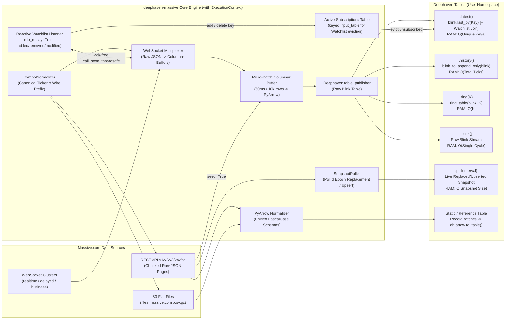

# Implementation Plan: `deephaven-massive`

## 1. Executive Summary & Goals

`deephaven-massive` is a Python library that bridges **Massive.com** (formerly Polygon.io) market, fundamental, macroeconomic, and alternative data feeds into **Deephaven** tables (`deephaven.table.Table`).

### Core Architectural Principles
1. **100% Catalog Coverage**: Complete support across all 6 market asset classes (**Stocks**, **Options**, **Futures**, **Indices**, **Forex**, **Crypto**), **Economy / Federal Reserve** datasets (including Overnight Funding Conditions / Short-Term Rates), **Fundamentals & Short Data** (including Short Interest and Short Volume), **SEC Filings**, **Technical Indicators**, **Partner / Alternative** datasets (Benzinga, ETF Global, TMX, Fable EU Consumer Spending), and **S3 Flat Files**.
2. **All 4 Delivery Mechanisms**:
   - **WebSocket Streaming**: Real-time and 15-minute delayed ticks/aggregates pushed into Deephaven via batched columnar `table_publisher` flushes.
   - **REST On-Demand & Polled Snapshots**: Direct arrow-backed conversion of paginated REST responses into static or periodically polled Deephaven tables.
   - **Hybrid REST Seeding + WebSocket Streaming**: Optional `seed=True` on `.latest()` and `seed_since=...` on `.history()` to bootstrap initial state from REST and seamlessly cut over to live WebSocket ticks without duplicates or gaps.
   - **S3 Flat Files (`files.massive.com`)**: High-throughput PyArrow CSV/Gzip streaming of bulk daily historical files, integrated both directly into `.historical(..., source="auto" | "flat_files")` and under `m.flat_files.*`.
3. **Explicit, Memory-Safe Deephaven Table Semantics**:
   - **`.latest(seed=False, by=None)`**: Keyed current snapshot built by applying `.last_by(key_cols)` **directly to the upstream blink table**—bounded to $O(N_{\text{keys}})$ RAM with zero historical tick accumulation.
   - **`.history(seed_since=None)`**: Complete append-only history since stream start via `blink_to_append_only(blink_table)` ($O(N_{\text{ticks}})$ RAM).
   - **`.ring(capacity)`**: Bounded FIFO sliding window of the last $K$ events via `ring_table(blink_table, capacity)` ($O(K)$ RAM).
   - **`.blink()`**: Raw single-cycle `table_publisher` blink table ($O(N_{\text{batch}})$ RAM) for zero-retention custom downstream aggregations (`agg_by`, `update_by`).
4. **Reactive Deephaven `Table`-Driven Subscriptions**:
   - Streamable feeds accept a static symbol (`"AAPL"`), a list (`["AAPL", "MSFT"]` or `["*"]`), **or a live Deephaven `Table`** (such as an interactive `input_table` watchlist or a live portfolio positions table).
   - Using `deephaven.table_listener.listen(..., do_replay=True)`, adding, modifying, or removing symbol rows in the Deephaven watchlist table automatically sends WebSocket `subscribe` / `unsubscribe` messages, and removing a symbol immediately evicts its row from `.latest()` snapshot tables.
5. **Unified Deephaven `PascalCase` Schemas & Canonical Symbols**:
   - All data sources (WebSocket, REST, and S3 Flat Files) normalize into identical `PascalCase` column names (`Symbol`, `Timestamp`, `Price`, `Size`, `BidPrice`, `AskPrice`, etc.), canonical symbol strings across transports, and native Deephaven types (`dht.Instant` UTC nanosecond timestamps, `dht.LocalDate` calendar dates, `dht.double` prices, `dht.int32_array` condition arrays).
6. **100% Test Coverage via `pytest` + `pytest-cov`**:
   - Strict enforcement of **100% line and branch coverage (`--cov-fail-under=100`)** across all package modules (`src/deephaven_massive`).

---

## 2. Adversarial Review Findings & Architectural Safeguards

> [!IMPORTANT]
> Two rounds of adversarial architectural review uncovered **14 critical edge cases and failure modes** across Deephaven's Update Graph threading model, blink table lifecycle semantics, Massive's cross-transport wire formats, and PyArrow's CSV parser. All 14 fixes below are built directly into the core architecture.

| # | Flaw Uncovered in Adversarial Review | Root Cause | Architectural Fix in Plan |
| :--- | :--- | :--- | :--- |
| **1** | **Deephaven `ExecutionContext` Crash & UG Lock Deadlock** | Background Python threads calling `dh.arrow.to_table()`, `publisher.add()`, or `input_table.add()` raise `DHError: No execution context`. Furthermore, `table_listener` callbacks run *inside* the Deephaven Update Graph (UG) lock—blocking there while waiting on the `asyncio` thread causes an AB-BA deadlock. | Capture `ctx = get_exec_ctx()` on the main thread when `MassiveSession` / `FeedBuilder` is created; wrap all background Deephaven operations in `with self._exec_ctx:`. Keep `table_listener` callbacks 100% lock-free by pushing `added` / `removed` / `modified` diffs via `loop.call_soon_threadsafe()`. |
| **2** | **Wildcard `["*"]` & `input_table` In-Place Edits Breaking `active_subs` Join** | (a) Joining `on=["Symbol"]` against `active_subs` drops 100% of rows when `tickers=["*"]` (`"AAPL" != "*"`). (b) Editing a cell in-place in a Deephaven `input_table` fires `update.modified()` / `update.modified_prev()`, not `added()`/`removed()`. (c) Omitting `do_replay=True` misses rows already in `watchlist` prior to listener attachment. | (a) Only attach the `active_subs` join when `tickers` is a reactive `Table` (for static lists or `["*"]`, `blink_table.last_by(key_cols)` is used directly with zero join overhead, and per-stream symbol filtering happens in the Python micro-batch router). (b) Handle `added()`, `removed()`, AND `modified()` / `modified_prev()` with `do_replay=True`. |
| **3** | **Seeding Timestamp Trap & Subscribe/Unsubscribe Race Condition** | Filtering `.latest()` by exchange `Timestamp >= SubscribedAt` drops valid REST-seeded snapshots whenever a stock's last trade occurred before `SubscribedAt`. Furthermore, if `SubscribedAt` is recorded *after* a seed batch or early WS tick is stamped with `ReceivedAt`, valid rows get dropped; or if an in-flight WS tick arrives *after* unsubscription, it pollutes `raw_latest`. | (a) Separate exchange `Timestamp` (used to deduplicate REST seed rows against buffered WS ticks) from internal monotonic `__ReceivedAt` (used for `__ReceivedAt >= SubscribedAt`). (b) **Strict Ordering**: On subscribe, record `sub_ts = now_ns()`, insert `(Symbol, sub_ts)` into `active_subs` *before* enabling `Symbol` in the per-feed filter, and guarantee all accepted rows have `__ReceivedAt >= sub_ts`. On unsubscribe, disable `Symbol` in the per-feed filter *first* (blocking in-flight WS ticks) and then delete from `active_subs`. Strip internal `__ReceivedAt` from user-facing tables. |
| **4** | **Cross-Transport Symbol Prefix Mismatch (`O:`, `I:`, `C:`, `X:`)** | Massive uses `"X:BTCUSD"` and `"C:EURUSD"` in REST/Flat Files, but `"BTC-USD"` (`XT.BTC-USD`) and `"EUR/USD"` (`C.EUR/USD`) in WebSockets. Without canonicalization, `.latest(seed=True)` creates duplicate rows per asset (`"X:BTCUSD"` and `"BTC-USD"`). | Implement `SymbolNormalizer` per domain that accepts any user input form (`"BTC-USD"`, `"X:BTCUSD"`, `"BTC/USD"`), emits the exact wire subscription string per transport (`REST`, `WS`, `S3`), and normalizes the `Symbol` column to a single canonical ticker format across all 3 transports. |
| **5** | **REST Pagination Dataclass Allocation & OOM** | Calling `list(RESTClient.list_trades(...))` allocates millions of Python `@dataclass` objects in RAM before PyArrow conversion. Also, `massive-com/client-python` lacks a wrapper for `/fed/v1/funding-conditions`. | Paginate using raw JSON pages (`raw=True` / direct path requests via `BaseClient._get`), converting each JSON page directly into a `pyarrow.RecordBatch` and discarding the JSON buffer immediately. Route `/fed/v1/funding-conditions` directly through the raw JSON paginator. |
| **6** | **Nested Objects in Snapshot Responses** | REST Snapshots (`stocks.snapshots`, `options.chain`) return nested dicts (`day`, `lastTrade`, `lastQuote`, `greeks`, `details`). Storing nested dicts in Deephaven creates unqueryable `PyObject` columns, and `seed=True` on `quotes` vs `trades` needs different slices of the snapshot. | Flatten all Snapshot schemas into primitive `PascalCase` columns (`Delta`, `Gamma`, `Theta`, `Vega`, `ImpliedVolatility`, `BidPrice`, `LastTradePrice`, etc.). When `seed=True` is used on `trades` or `quotes`, project the snapshot's `last_trade` or `last_quote` fields into the exact `Trades` or `Quotes` schema. |
| **7** | **PyArrow CSV Failure on List Columns in S3 Flat Files** | `pyarrow.csv.read_csv` does **not** support `pa.list_(pa.int32())` in `ConvertOptions`, so reading `conditions` / `indicators` from S3 `.csv.gz` files with the target schema crashes with `ArrowInvalid`. | Read `conditions` / `indicators` as `pa.string()` during `pyarrow.csv.open_csv`, apply `Symbol` predicate pushdown on each chunk first, and then parse the string representation into `pa.list_(pa.int32())` on the surviving rows. |
| **8** | **JVM Singleton & Async Timer Flakiness in `pytest`** | Deephaven's JVM can only be started once per process; starting/stopping per test crashes. Real wall-clock sleeps make coverage tests slow and flaky. | Use a `scope="session"` Deephaven server fixture on an ephemeral port (`port=0`) in `conftest.py`, and design `MicroBatchPublisher` and `SnapshotPoller` with deterministic `.flush_now()` / `.poll_once()` methods alongside background timers. |
| **9** | **Polled Snapshot (`.poll()`) Blink Table Vanishing Bug** | `table_publisher` creates a **blink table** whose rows exist for only a single Deephaven update cycle. If `.poll(interval=5.0)` returns the raw blink table, the option chain or snapshot flashes for ~1ms and is **empty (0 rows)** for the remaining 4.999s! Conversely, naive `.last_by(["Symbol"])` on `top_movers` never evicts stocks that dropped out of the top 20 on subsequent polls. | Support `.poll(interval=5.0, mode="replace" \| "upsert" \| "append")`:<br/>• `"replace"` (default for `snapshots`, `chain`, `top_movers`): stamps each poll batch with monotonic `__PollId`, applies `last_by(key_cols)`, and joins against `current_poll = blink.view(["__PollId"]).last_by()` with `.where("__PollId == CurrentPollId")`, so rows persist between polls and dropped rows are atomically evicted on the next poll.<br/>• `"upsert"` (default for `news`): `blink.last_by(key_cols)`.<br/>• `"append"`: `blink_to_append_only(blink)`. |
| **10** | **`massive.WebSocketClient` Dataclass Overhead, Missing Futures Venue Paths, & `FMV` Host Routing** | (a) `massive.WebSocketClient` parses every incoming JSON message into Python `@dataclass` instances on the event loop, bottlenecking high-rate `Q.*`/`T.*` streams. (b) Its `Market` enum lacks `/futures/{venue}` (`cme`, `cbot`, `nymex`, `comex`). (c) Fair Market Value (`FMV.*`) streams require `wss://business.massive.com` even when regular trades/quotes use `wss://socket.massive.com`. | Implement `ws_multiplexer.py` directly over `websockets` (with raw JSON batch decoding directly into columnar buffers, bypassing `@dataclass` instantiation). Automatically route `fmv()` streams to `business.massive.com` (or `delayed-business.massive.com`), and support `/futures/{venue}` endpoints natively. |
| **11** | **Mixed Timestamp Units (`s`, `ms`, `us`, `ns`, ISO-8601) Across Endpoints** | Massive returns Unix milliseconds (`~1.7e12`) on WS aggregates/equity trades, Unix nanoseconds (`~1.7e18`) on REST `sip_timestamp` and `trf_timestamp`, microseconds (`~1.7e15`) on certain futures fields, and ISO-8601 strings on news/filings. Assuming a single unit corrupts dates to `1970-01-01`. | Implement a magnitude-aware `to_utc_ns()` normalizer (`>=1e17` -> `ns`, `>=1e14` -> `us * 1e3`, `>=1e11` -> `ms * 1e6`, `<1e11` -> `s * 1e9`, plus ISO-8601 string parser) so all timestamps convert accurately to `pa.timestamp("ns", tz="UTC")` (`dht.Instant`). |
| **12** | **Orphaned Publishers on Repeated Notebook Cell Execution** | In the Deephaven Web IDE or Jupyter, users frequently re-run cells (`df = m.stocks.quotes(["AAPL"]).latest()`). Spawning a new `MicroBatchPublisher` and `table_publisher` on every call leaks duplicate background publishers for the exact same stream. | Deduplicate active `StreamSource` pipelines in `MassiveSession` by `(domain, channel, canonical_symbols_key, params)` for static subscriptions, and provide explicit `.stop()` on `FeedBuilder` / `m.stop_stream(...)` in addition to `m.close()`. |
| **13** | **Ambiguous `.historical(source="auto")` Routing Logic** | Calling `.historical(source="auto")` without a deterministic cost model could download multi-GB full-market S3 `.csv.gz` files for a 1-ticker bar query (which takes 150ms via REST), or fail when S3 credentials aren't configured or when `adjusted=True` bars are requested. | Define an explicit routing heuristic for `source="auto"`: route to `"flat_files"` *only* when (1) S3 credentials are configured, (2) the dataset/timespan exists in S3 (`trades`, `quotes`, `values`, or unadjusted `1m`/`1d` bars) for historical dates prior to today UTC, and (3) `tickers == ["*"]` or `len(tickers) >= 50`. Otherwise route to `"rest"`. |
| **14** | **Wide / Evolving Schemas in Fundamentals, SEC Filings & Partners** | While market data schemas (`Trades`, `Quotes`, `Bars`, `Snapshots`) are fixed, accounting endpoints (`balance_sheets`, `income_statements`) have 50+ line items that Massive periodically expands. | Use a **Hybrid Schema Strategy** for wide fundamental/reference endpoints: enforce a fixed core `pyarrow.Schema` (guaranteeing `0-row` empty tables always have valid typed columns) while dynamically promoting any additional JSON scalar/nested fields into `PascalCase` Arrow columns so zero accounting fields are ever silently dropped. |

---

## 3. System Architecture



### Key Engine Components

#### 3.1 Thread-Safe `ExecutionContext` & WebSocket Multiplexer
- **ExecutionContext Binding**: At `MassiveSession` creation time (or lazily on first table creation), the library captures `self._exec_ctx = get_exec_ctx()`. Every background thread interaction with Deephaven (`dh.arrow.to_table()`, `publisher.add()`, `active_subs.add()`, `active_subs.delete()`) executes inside `with self._exec_ctx:`.
- **Connection Sharing & Automatic Host Routing**: Massive enforces 1 WebSocket connection per `(asset_class, feed_tier)` per API key by default (and up to 1,000 option contracts per connection). `MassiveSession` maintains a singleton `WebSocketMultiplexer` per `(host, path)` running on a dedicated background `asyncio` event loop thread. Fair Market Value (`fmv`) channels automatically route to `wss://business.massive.com/{market}` (or `wss://delayed-business.massive.com/{market}` when `feed="delayed"`), and futures venue streams route to `/futures` or `/futures/{venue}`.
- **Zero-Dataclass Micro-Batched Columnar Publishing**: Incoming WebSocket JSON frames are decoded directly into per-feed columnar buffers (bypassing Python `@dataclass` instantiation) and flushed as a `pyarrow.Table` -> `deephaven.arrow.to_table()` into `publisher.add()` every **50ms** (`flush_interval_ms`) or **10,000 rows** (`max_batch_size`).
- **Stream Deduplication & Branching**: Active static streams are deduplicated by `(domain, channel, canonical_symbols_tuple, params)` so re-running a notebook cell reuses the existing `MicroBatchPublisher` and `table_publisher` rather than leaking duplicate background publishers. Multiple materializations (`.latest()`, `.history()`, `.ring()`, `.blink()`) branch off the same blink table.

#### 3.2 Reactive Watchlist Subscriptions & `.latest()` Eviction
1. **Static Symbol List or Wildcard (`tickers=["AAPL", "MSFT"]` or `["*"]`)**:
   - No `active_subs` join is needed. `.latest()` is simply `blink_table.drop_columns(["__ReceivedAt"]).last_by(key_cols)`. Memory is strictly $O(N_{\text{keys}})$.
2. **Reactive Deephaven `Table` (`tickers=watchlist_table`)**:
   - An internal keyed `active_subs = input_table({"Symbol": dht.string, "SubscribedAt": dht.Instant}, key_cols=["Symbol"])` tracks currently active symbols in `watchlist_table`.
   - `deephaven.table_listener.listen(watchlist_table, callback, do_replay=True)` captures initial rows (`do_replay=True`) as well as live updates:
     - `added = update.added()` -> symbols to subscribe.
     - `removed = update.removed()` -> symbols to unsubscribe.
     - `modified = update.modified()` and `modified_prev = update.modified_prev()` -> unsubscribes `modified_prev["Symbol"]` and subscribes `modified["Symbol"]`.
   - The listener callback immediately enqueues a lock-free task onto the background `asyncio` loop via `loop.call_soon_threadsafe()` (never blocking the Deephaven Update Graph lock).
   - **Strict Subscribe / Unsubscribe Ordering**:
     - *On Subscribe*: Record `sub_ts = now_ns()`, write `(Symbol, sub_ts)` to `active_subs` first, then enable `Symbol` in the publisher's filter (guaranteeing all subsequent seed rows and WS ticks for `Symbol` have `__ReceivedAt >= sub_ts`), and send WS `subscribe`.
     - *On Unsubscribe*: Disable `Symbol` in the publisher's filter *first* (preventing in-flight WS ticks from entering `blink_table`), delete `Symbol` from `active_subs`, and send WS `unsubscribe`.
   - The `.latest()` table is constructed as:
     ```python
     raw_latest = blink_table.last_by(key_cols)
     latest_table = (
         raw_latest.natural_join(active_subs, on=["Symbol"], joins=["SubscribedAt"])
         .where("!isNull(SubscribedAt) && __ReceivedAt >= SubscribedAt")
         .drop_columns(["SubscribedAt", "__ReceivedAt"])
     )
     ```
   - **Immediate Eviction & Zero Stale Re-Subscription**: Removing a symbol from `watchlist_table` deletes its key from `active_subs`, making `SubscribedAt` null and immediately evicting the row from `latest_table`. Re-adding the symbol later assigns a new `SubscribedAt`, filtering out any stale prior-session row in `raw_latest` (`__ReceivedAt < SubscribedAt`) while allowing fresh REST seeds and new WebSocket ticks (`__ReceivedAt >= SubscribedAt`) through.

#### 3.3 Hybrid Startup Seeding (`seed=True` on `.latest()`, `seed_since` on `.history()`) & Polled Snapshots (`.poll()`)
- **For `.latest(seed=True)`** *(default is `seed=False`)*:
  1. Subscribes the WebSocket stream first and pauses flushing to the publisher while buffering incoming live WebSocket ticks in memory with their exchange `Timestamp`.
  2. Queries Massive's corresponding REST Snapshot endpoint (`get_snapshot_all`, `list_universal_snapshots`, `list_snapshot_options_chain`) and projects the relevant sub-structure (`last_trade` for `trades`, `last_quote` for `quotes`, `day`/`min` for `bars`, or full snapshot for `snapshots`) into the unified `PascalCase` schema.
  3. Drops any seeded row whose exchange `Timestamp` is older than an already-buffered WebSocket tick for the same key, flushes the seed batch (with `__ReceivedAt = now_ns()`), and then flushes the buffered live WebSocket ticks and resumes normal 50ms micro-batching.
- **For `.history(seed_since=...)`**:
  1. Buffers incoming live WebSocket events while querying REST historical trades/quotes/bars from `seed_since` up to the earliest buffered WebSocket exchange `Timestamp`.
  2. Deduplicates at the cutover boundary using `(Symbol, Timestamp, TradeId / SequenceNumber)` before flushing to the append-only table.
- **For `.poll(interval=5.0, mode="replace" | "upsert" | "append")`**:
  1. `SnapshotPoller` fetches the REST endpoint every `interval` seconds and publishes each batch with a monotonically increasing `__PollId` column.
  2. In `mode="replace"` (default for `snapshots`, `chain`, `top_movers`), `raw_keyed = poll_blink.last_by(key_cols)` is joined with `current_epoch = poll_blink.view(["__PollId"]).last_by()` and filtered by `__PollId == CurrentPollId`, ensuring the table persists continuously between polls and atomically evicts any rows absent from the latest poll.
  3. In `mode="upsert"` (default for `news`), `poll_blink.drop_columns(["__PollId"]).last_by(key_cols)` retains and updates all keyed items across polls.
  4. In `mode="append"`, `blink_to_append_only(poll_blink.drop_columns(["__PollId"]))` records a full historical log of every polled snapshot.

---

## 4. Python API Specification

### 4.1 Session Initialization
```python
from deephaven_massive import MassiveSession

m = MassiveSession(
    api_key="...",                  # Defaults to MASSIVE_API_KEY / POLYGON_API_KEY env var
    feed="realtime",                # "realtime" | "delayed" | "business"
    s3_access_key_id="...",         # Optional: defaults to MASSIVE_S3_ACCESS_KEY_ID or api_key
    s3_secret_access_key="...",     # Optional: defaults to MASSIVE_S3_SECRET_ACCESS_KEY
    flush_interval_ms=50,           # Micro-batch flush interval for WebSocket streams
    max_batch_size=10_000,          # Max rows per micro-batch flush
    max_retries=3,                  # Automatic HTTP 429 / 5xx exponential backoff retries
)
```

### 4.2 Fluent Builder Pattern for Streamable & Multi-Mode Feeds
All real-time / time-series feeds return a `FeedBuilder` supporting terminal table materializers:

```python
# 1. Keyed Latest Snapshot (O(unique keys) RAM, default seed=False)
latest_quotes = m.stocks.quotes(["AAPL", "MSFT", "NVDA"]).latest()
seeded_quotes = m.stocks.quotes(["AAPL", "MSFT", "NVDA"]).latest(seed=True)
by_venue      = m.stocks.trades(["AAPL", "MSFT"]).latest(by=["Symbol", "Exchange"])

# 2. Complete Append-Only History (O(ticks) RAM)
trade_history = m.stocks.trades(["AAPL", "MSFT"]).history()
backfilled    = m.stocks.trades(["AAPL"]).history(seed_since="2025-03-14T09:30:00Z")

# 3. Sliding Ring Buffer (O(capacity) RAM)
recent_trades = m.stocks.trades(["*"]).ring(100_000)

# 4. Raw Blink Stream (O(single batch) RAM - rows live for 1 update cycle)
raw_blink     = m.stocks.trades(["*"]).blink()

# 5. Reactive Watchlist (Deephaven Table-driven subscription & eviction)
from deephaven import input_table, dtypes as dht
watchlist = input_table({"Symbol": dht.string}, key_cols=["Symbol"])
live_watch = m.stocks.quotes(watchlist).latest(seed=True)

# 6. Historical Range Query (REST or S3 Flat Files -> Static Deephaven Table)
hist_bars = m.stocks.bars("AAPL", multiplier=1, timespan="minute").historical(
    start="2025-01-01",
    end="2025-03-14",
    source="auto",  # "auto" | "rest" | "flat_files"
)

# 7. Polled REST Snapshots (for feeds with REST snapshots like Option Chains w/ Greeks)
opt_chain_static = m.options.chain("AAPL", expiration="2025-06-20").snapshot()
opt_chain_live   = m.options.chain("AAPL", expiration="2025-06-20").poll(interval=5.0)
```

### 4.3 Direct `Table` Return for Static / Reference / Fundamental REST Queries
Datasets that represent reference, fundamental, corporate action, macro, or partner queries return a `deephaven.table.Table` directly:

```python
# Short Data & Fundamentals
short_int   = m.stocks.short_interest(ticker="GME", settlement_date_gte="2024-01-01")
short_vol   = m.stocks.short_volume(ticker="GME", date_gte="2025-01-01")
bal_sheets  = m.stocks.balance_sheets(tickers="AAPL", timeframe="quarterly")
inc_stmts   = m.stocks.income_statements(tickers="AAPL", timeframe="quarterly")
cash_flows  = m.stocks.cash_flow_statements(tickers="AAPL", timeframe="quarterly")
ratios      = m.stocks.ratios(ticker="AAPL")
share_float = m.stocks.share_float(ticker="AAPL")

# Economy & Overnight Short-Term Funding Rates (/fed/v1/*)
funding     = m.economy.funding_conditions(date_gte="2025-01-01")  # SOFR, EFFR, OBFR, TGCR, IORB, repo, CP rates
yields      = m.economy.treasury_yields(date_gte="2025-01-01")
inflation   = m.economy.inflation(date_gte="2020-01-01")
infl_exp    = m.economy.inflation_expectations(date_gte="2020-01-01")
labor       = m.economy.labor_market(date_gte="2020-01-01")

# Corporate Actions, SEC Filings & Technical Indicators
dividends   = m.stocks.dividends(ticker="AAPL")
splits      = m.stocks.splits(ticker="AAPL")
ipos        = m.stocks.ipos(listing_date_gte="2024-01-01")
sec_10k     = m.stocks.sec_10k_sections(ticker="AAPL")
sec_13f     = m.stocks.sec_13f_holdings(cik="0001067983")
sec_form4   = m.stocks.sec_form4_transactions(ticker="AAPL")
rsi_table   = m.stocks.rsi("AAPL", timespan="day", window=14)
```

---

## 5. Complete Data Catalog & Method Mapping

Every endpoint in Massive's documentation (`https://massive.com/docs/llms.txt`) is mapped below across all 9 domain sub-clients.

### 5.1 `m.stocks` (U.S. Equities)

| Method | Return Type | Delivery Sources | Underlying Massive Channels / Endpoints | Default `.latest()` Key |
| :--- | :--- | :--- | :--- | :--- |
| `m.stocks.trades(tickers)` | `FeedBuilder` | WS (`T.*`), REST (`/v3/trades/{ticker}`, Snapshots), S3 (`us_stocks_sip/trades_v1`) | Real-time/delayed SIP trades, historical trades, snapshot `last_trade` | `["Symbol"]` |
| `m.stocks.quotes(tickers)` | `FeedBuilder` | WS (`Q.*`), REST (`/v3/quotes/{ticker}`, Snapshots), S3 (`us_stocks_sip/quotes_v1`) | Real-time/delayed NBBO quotes, historical quotes, snapshot `last_quote` | `["Symbol"]` |
| `m.stocks.bars(tickers, multiplier=1, timespan="minute")` | `FeedBuilder` | WS (`A.*` 1s, `AM.*` 1m), REST (`/v2/aggs/ticker/...`), S3 (`day_aggs_v1`, `minute_aggs_v1`) | Second/minute streaming bars + custom historical OHLCV bars | `["Symbol"]` |
| `m.stocks.luld(tickers)` | `FeedBuilder` | WS (`LULD.*`) | Limit Up - Limit Down price bands & indicators | `["Symbol"]` |
| `m.stocks.imbalances(tickers)` | `FeedBuilder` | WS (`NOI.*`) | Net Order Imbalance auction events | `["Symbol"]` |
| `m.stocks.fmv(tickers)` | `FeedBuilder` | WS (`FMV.*`) | Fair Market Value streaming pricing (`wss://business.massive.com`) | `["Symbol"]` |
| `m.stocks.snapshots(tickers=None)` | `FeedBuilder` | REST (`/v2/snapshot/locale/us/markets/stocks/tickers`, `/v3/snapshot`) | Full market or filtered ticker snapshots (`.snapshot()` or `.poll(interval)`) | `["Symbol"]` |
| `m.stocks.top_movers(direction="gainers")` | `FeedBuilder` | REST (`/v2/snapshot/locale/us/markets/stocks/{direction}`) | Top 20 gainers or losers (`.snapshot()` or `.poll(interval)`) | `["Symbol"]` |
| `m.stocks.daily_market_summary(date)` | `Table` | REST (`/v2/aggs/grouped/locale/us/market/stocks/{date}`) | Grouped daily OHLCV for all US stocks on a date | N/A (Static) |
| `m.stocks.daily_ticker_summary(ticker, date)` | `Table` | REST (`/v1/open-close/{ticker}/{date}`) | Daily open/close, pre-market, and after-hours prices | N/A (Static) |
| `m.stocks.previous_day_bar(ticker)` | `Table` | REST (`/v2/aggs/ticker/{ticker}/prev`) | Previous trading day OHLCV bar | N/A (Static) |
| `m.stocks.tickers(**filters)` | `Table` | REST (`/v3/reference/tickers`) | Directory of stock tickers | N/A (Static) |
| `m.stocks.ticker_details(ticker, date=None)` | `Table` | REST (`/v3/reference/tickers/{ticker}`) | Detailed company profile, market cap, SIC, branding | N/A (Static) |
| `m.stocks.ticker_events(ticker)` | `Table` | REST (`/vX/reference/tickers/{id}/events`) | Historical ticker symbol changes & rebranding timeline | N/A (Static) |
| `m.stocks.related_companies(ticker)` | `Table` | REST (`/v1/related-companies/{ticker}`) | Peer tickers identified from news & returns | N/A (Static) |
| `m.stocks.ticker_types()` | `Table` | REST (`/v3/reference/tickers/types`) | Supported equity/asset type codes | N/A (Static) |
| `m.stocks.short_interest(**filters)` | `Table` | REST (`/stocks/v1/short-interest`) | Bi-monthly FINRA short interest, avg daily volume, days to cover | N/A (Static) |
| `m.stocks.short_volume(**filters)` | `Table` | REST (`/stocks/v1/short-volume`) | Daily short volume, total volume, short volume ratio & venue breakdown | N/A (Static) |
| `m.stocks.share_float(**filters)` | `Table` | REST (`/stocks/vX/float`) | Free float share count and free float percentage | N/A (Static) |
| `m.stocks.balance_sheets(**filters)` | `Table` | REST (`/stocks/financials/v1/balance-sheets`) | Quarterly & annual balance sheet fundamentals | N/A (Static) |
| `m.stocks.income_statements(**filters)` | `Table` | REST (`/stocks/financials/v1/income-statements`) | Quarterly & annual income statement fundamentals | N/A (Static) |
| `m.stocks.cash_flow_statements(**filters)` | `Table` | REST (`/stocks/financials/v1/cash-flow-statements`) | Quarterly & annual cash flow fundamentals | N/A (Static) |
| `m.stocks.ratios(**filters)` | `Table` | REST (`/stocks/financials/v1/ratios`) | Valuation, profitability, liquidity, and leverage ratios | N/A (Static) |
| `m.stocks.dividends(**filters)` | `Table` | REST (`/stocks/v1/dividends` & `/v3/reference/dividends`) | Cash/stock dividend declarations, ex-dates, pay dates, yields | N/A (Static) |
| `m.stocks.splits(**filters)` | `Table` | REST (`/stocks/v1/splits` & `/v3/reference/splits`) | Forward and reverse stock split histories & adjustment factors | N/A (Static) |
| `m.stocks.ipos(**filters)` | `Table` | REST (`/vX/reference/ipos`) | Upcoming and historical IPO listings, offer prices, share counts | N/A (Static) |
| `m.stocks.sec_edgar_index(**filters)` | `Table` | REST (`/stocks/filings/vX/index`) | Master SEC EDGAR filings index | N/A (Static) |
| `m.stocks.sec_10k_sections(**filters)` | `Table` | REST (`/stocks/filings/10-K/v1/sections`) | Full text of standardized 10-K/10-Q sections | N/A (Static) |
| `m.stocks.sec_8k_text(**filters)` | `Table` | REST (`/stocks/filings/8-K/v1/text`) | 8-K current report disclosures and text | N/A (Static) |
| `m.stocks.sec_13f_holdings(**filters)` | `Table` | REST (`/stocks/filings/13F/v1/holdings`) | Institutional investment manager quarterly holdings | N/A (Static) |
| `m.stocks.sec_form3_ownership(**filters)` | `Table` | REST (`/stocks/filings/form-3/v1/ownership`) | Initial insider beneficial ownership filings | N/A (Static) |
| `m.stocks.sec_form4_transactions(**filters)` | `Table` | REST (`/stocks/filings/form-4/v1/transactions`) | Insider open-market purchases, sales, and option exercises | N/A (Static) |
| `m.stocks.sec_risk_factors(**filters)` | `Table` | REST (`/stocks/filings/v1/risk-factors` & `/stocks/taxonomies/v1/risk-factors`) | Categorized SEC filing risk factors & taxonomy | N/A (Static) |
| `m.stocks.sec_disclosures(**filters)` | `Table` | REST (`/stocks/filings/vX/disclosures` & `/stocks/taxonomies/vX/disclosures`) | Structured footnote disclosures & taxonomy | N/A (Static) |
| `m.stocks.sma / .ema / .macd / .rsi` | `Table` | REST (`/v1/indicators/{indicator}/{ticker}`) | Technical indicator time series | N/A (Static) |
| `m.stocks.news(**filters)` | `FeedBuilder` | REST (`/v2/reference/news`) | Ticker news with sentiment insights (`.snapshot()` or `.poll(interval)`) | `["ArticleId"]` |
| `m.stocks.exchanges / .conditions / .holidays / .market_status` | `Table` | REST (`/v3/reference/exchanges`, `/v3/reference/conditions`, `/v1/marketstatus/*`) | Market operations and reference metadata | N/A (Static) |

### 5.2 `m.options` (U.S. Options — OPRA)

| Method | Return Type | Delivery Sources | Underlying Massive Channels / Endpoints | Default `.latest()` Key |
| :--- | :--- | :--- | :--- | :--- |
| `m.options.trades(contracts)` | `FeedBuilder` | WS (`T.O:*`), REST (`/v3/trades/{optionsTicker}`), S3 (`us_options_opra/trades_v1`) | Real-time/delayed OPRA option trades, historical trades | `["Symbol"]` |
| `m.options.quotes(contracts)` | `FeedBuilder` | WS (`Q.O:*`), REST (`/v3/quotes/{optionsTicker}`), S3 (`us_options_opra/quotes_v1`) | OPRA BBO quotes (auto-enforces 1,000-contract WS cap or shards across connections) | `["Symbol"]` |
| `m.options.bars(contracts, multiplier=1, timespan="minute")` | `FeedBuilder` | WS (`A.O:*` 1s, `AM.O:*` 1m), REST (`/v2/aggs/ticker/...`), S3 (`day_aggs_v1`, `minute_aggs_v1`) | Streaming and historical OHLCV bars for option contracts | `["Symbol"]` |
| `m.options.fmv(contracts)` | `FeedBuilder` | WS (`FMV.O:*`) | Real-time Option Fair Market Value | `["Symbol"]` |
| `m.options.chain(underlying, **filters)` | `FeedBuilder` | REST (`/v3/snapshot/options/{underlyingAsset}`) | Full Option Chain with flattened **Greeks (`Delta`, `Gamma`, `Theta`, `Vega`), `ImpliedVolatility`, `OpenInterest`, `BreakEvenPrice`**, latest trade/quote (`.snapshot()` or `.poll(interval)`) | `["Symbol"]` |
| `m.options.contract_snapshot(underlying, contract)` | `Table` | REST (`/v3/snapshot/options/{underlyingAsset}/{optionContract}`) | Single option contract snapshot with Greeks, IV, OI | N/A (Static) |
| `m.options.contracts(**filters)` | `Table` | REST (`/v3/reference/options/contracts`) | All active and expired option contracts | N/A (Static) |
| `m.options.contract_details(contract)` | `Table` | REST (`/v3/reference/options/contracts/{options_ticker}`) | Contract specifications, strike, expiration, deliverables | N/A (Static) |
| `m.options.sma / .ema / .macd / .rsi` | `Table` | REST (`/v1/indicators/{indicator}/{optionsTicker}`) | Technical indicators on option contracts | N/A (Static) |

### 5.3 `m.futures` (CME, CBOT, NYMEX, COMEX)

| Method | Return Type | Delivery Sources | Underlying Massive Channels / Endpoints | Default `.latest()` Key |
| :--- | :--- | :--- | :--- | :--- |
| `m.futures.trades(contracts, venue=None)` | `FeedBuilder` | WS (`T.*` on `/futures` or `/futures/{venue}`), REST (`/futures/vX/trades`), S3 (`trades_v1`) | Tick-level futures trades | `["Symbol"]` |
| `m.futures.quotes(contracts, venue=None)` | `FeedBuilder` | WS (`Q.*`), REST (`/futures/vX/quotes`), S3 (`quotes_v1`) | Futures BBO quotes | `["Symbol"]` |
| `m.futures.bars(contracts, multiplier=1, timespan="minute")` | `FeedBuilder` | WS (`A.*` 1s, `AM.*` 1m), REST (`/futures/vX/aggs`), S3 (`minute_aggs_v1`, `session_aggs_v1`) | Futures streaming and historical bars (including full session bars via S3) | `["Symbol"]` |
| `m.futures.snapshots(contracts=None)` | `FeedBuilder` | REST (`/futures/vX/snapshot`) | Futures contract snapshots (`.snapshot()` or `.poll(interval)`) | `["Symbol"]` |
| `m.futures.contracts / .products / .schedules / .exchanges / .market_status` | `Table` | REST (`/futures/vX/contracts`, `/products`, `/schedules`, `/exchanges`, `/market-status`) | Futures reference & trading schedule tables | N/A (Static) |

### 5.4 `m.indices`, `m.forex`, and `m.crypto`

| Sub-Client | FeedBuilder Methods (`.latest()`, `.history()`, `.ring()`, `.blink()`, `.historical()`) | Direct `Table` REST Methods |
| :--- | :--- | :--- |
| **`m.indices`** | `values(tickers)` (`V.I:*`, S3 `values_v1`), `bars(tickers, ...)` (`A.I:*`, `AM.I:*`, REST aggs, S3 `day_aggs_v1`/`minute_aggs_v1`), `snapshots(tickers)` | `daily_ticker_summary`, `previous_day_bar`, `tickers`, `sma`, `ema`, `macd`, `rsi`, `holidays`, `market_status` |
| **`m.forex`** | `quotes(pairs)` (`C.*`, REST `/v3/quotes`, S3 `quotes_v1`), `bars(pairs, ...)` (`CAS.*` 1s, `CA.*` 1m, REST aggs, S3), `fmv(pairs)` (`FMV.*`), `snapshots(pairs)` | `convert_currency`, `last_quote`, `daily_market_summary`, `previous_day_bar`, `tickers`, `sma`, `ema`, `macd`, `rsi` |
| **`m.crypto`** | `trades(pairs)` (`XT.*`, REST `/v3/trades`, S3 `trades_v1`), `quotes(pairs)` (`XQ.*`), `bars(pairs, ...)` (`XAS.*` 1s, `XA.*` 1m, REST aggs, S3), `fmv(pairs)` (`FMV.*`), `snapshots(pairs)` | `last_trade`, `daily_market_summary`, `daily_ticker_summary`, `previous_day_bar`, `tickers`, `conditions`, `exchanges`, `sma`, `ema`, `macd`, `rsi` |

### 5.5 `m.economy` (Federal Reserve & Macro Data)

| Method | Massive REST Endpoint | Columns (`PascalCase`) |
| :--- | :--- | :--- |
| `m.economy.funding_conditions(**filters)` | `GET /fed/v1/funding-conditions` | `Date`, `Effr`, `FedFundsTargetLow`, `FedFundsTargetHigh`, `Iorb`, `Sofr`, `Sofr1stPercentile`, `Sofr25thPercentile`, `Sofr75thPercentile`, `Sofr99thPercentile`, `SofrVolume`, `Obfr`, `Obfr1stPercentile`, `Obfr25thPercentile`, `Obfr75thPercentile`, `Obfr99thPercentile`, `ObfrVolume`, `Tgcr`, `Tgcr1stPercentile`, `Tgcr25thPercentile`, `Tgcr75thPercentile`, `Tgcr99thPercentile`, `TgcrVolume`, `OvernightRepoVolume`, `OvernightReverseRepoVolume`, `CpRate90dFinancial`, `CpRate90dNonfinancial` |
| `m.economy.treasury_yields(**filters)` | `GET /fed/v1/treasury-yields` | `Date`, `Yield1Month`, `Yield3Month`, `Yield6Month`, `Yield1Year`, `Yield2Year`, `Yield3Year`, `Yield5Year`, `Yield7Year`, `Yield10Year`, `Yield20Year`, `Yield30Year` |
| `m.economy.inflation(**filters)` | `GET /fed/v1/inflation` | `Date`, `Cpi`, `CpiCore`, `CpiYearOverYear`, `Pce`, `PceCore`, `PceSpending` |
| `m.economy.inflation_expectations(**filters)` | `GET /fed/v1/inflation-expectations` | `Date`, `Market5Year`, `Market10Year`, `ForwardYears5To10`, `Model1Year`, `Model5Year`, `Model10Year`, `Model30Year` |
| `m.economy.labor_market(**filters)` | `GET /fed/v1/labor-market` | `Date`, `UnemploymentRate`, `LaborForceParticipationRate`, `AvgHourlyEarnings`, `JobOpenings` |

### 5.6 `m.partners` (Benzinga, ETF Global, TMX, Fable Alternative Data)
- **Benzinga**: `benzinga_ratings`, `benzinga_consensus_ratings`, `benzinga_analyst_insights`, `benzinga_analysts`, `benzinga_firms`, `benzinga_bulls_bears_say`, `benzinga_corporate_guidance`, `benzinga_earnings`, `benzinga_news` (supports `.snapshot()` and `.poll(interval)`).
- **ETF Global**: `etf_analytics`, `etf_constituents`, `etf_fund_flows`, `etf_profiles`, `etf_taxonomies`.
- **TMX / Wall Street Horizon**: `tmx_corporate_events`.
- **Fable Data (Alternative)**: `eu_merchant_aggregates`, `eu_merchant_hierarchy`.

### 5.7 `m.flat_files` (S3 Bulk Historical Loader)
- Connects to `https://files.massive.com` (`bucket="flatfiles"`) using `boto3` / `pyarrow` and streams `.csv.gz` partitions in chunks:
  1. Reads scalar columns natively via `pyarrow.csv.open_csv` while reading array columns (`conditions`, `indicators`) as `pa.string()`.
  2. Applies `Symbol` predicate pushdown (`pyarrow.compute.is_in`) on each chunk immediately so single-ticker queries against full-market daily files discard non-matching rows before accumulating in RAM.
  3. Parses string-encoded integer lists (`"[12, 37]"` / `"12,37"`) into `pa.list_(pa.int32())` on the filtered rows so the output schema matches WebSocket and REST tables identically.
  - Methods: `m.flat_files.load(dataset, date=..., start_date=..., end_date=..., symbols=None)` plus convenience methods (`stocks_trades`, `stocks_quotes`, `stocks_bars`, `options_trades`, `options_quotes`, `options_bars`, `futures_trades`, `futures_quotes`, `futures_bars`, `futures_session_bars`, `indices_values`, `indices_bars`, `forex_quotes`, `forex_bars`, `crypto_trades`, `crypto_bars`).

---

## 6. Unified Deephaven `PascalCase` Schemas & Canonical Symbols

### 6.1 Cross-Transport Symbol Canonicalization (`SymbolNormalizer`)
| Domain | Accepted User Inputs | Canonical `Symbol` Column in Deephaven | WebSocket Subscription Prefix | REST / S3 Ticker Parameter |
| :--- | :--- | :--- | :--- | :--- |
| **Stocks** | `"AAPL"` | `"AAPL"` | `T.AAPL`, `Q.AAPL`, `A.AAPL`, `AM.AAPL` | `"AAPL"` |
| **Options** | `"O:AAPL250620C00150000"` or `"AAPL250620C00150000"` | `"O:AAPL250620C00150000"` | `T.O:AAPL250620C00150000` | `"O:AAPL250620C00150000"` |
| **Futures** | `"ESZ5"` | `"ESZ5"` | `T.ESZ5`, `Q.ESZ5`, `A.ESZ5`, `AM.ESZ5` | `"ESZ5"` |
| **Indices** | `"I:SPX"` or `"SPX"` | `"I:SPX"` | `V.I:SPX`, `A.I:SPX`, `AM.I:SPX` | `"I:SPX"` |
| **Forex** | `"EUR/USD"`, `"EUR-USD"`, `"C:EURUSD"`, `"EURUSD"` | `"EUR/USD"` | `C.EUR/USD`, `CA.EUR/USD`, `CAS.EUR/USD` | `"C:EURUSD"` |
| **Crypto** | `"BTC-USD"`, `"BTC/USD"`, `"X:BTCUSD"`, `"BTCUSD"` | `"BTC-USD"` | `XT.BTC-USD`, `XQ.BTC-USD`, `XA.BTC-USD`, `XAS.BTC-USD` | `"X:BTCUSD"` |

### 6.2 Core Market Data Schemas

#### Trades (`Stocks`, `Options`, `Futures`, `Crypto`)
| Column Name | Deephaven Type (`dht`) | PyArrow Type | WebSocket Field | REST Field | Flat File Column |
| :--- | :--- | :--- | :--- | :--- | :--- |
| `Symbol` | `dht.string` | `pa.string()` | `sym` / `pair` (normalized) | `ticker` (normalized) | `ticker` (normalized) |
| `Timestamp` | `dht.Instant` | `pa.timestamp("ns", tz="UTC")` | `t` (ms/ns) | `sip_timestamp` / `participant_timestamp` | `sip_timestamp` / `timestamp` |
| `ParticipantTimestamp` | `dht.Instant` | `pa.timestamp("ns", tz="UTC")` | `y` (if present) | `participant_timestamp` | `participant_timestamp` |
| `TrfTimestamp` | `dht.Instant` | `pa.timestamp("ns", tz="UTC")` | `trft` | `trf_timestamp` | `trf_timestamp` |
| `Price` | `dht.double` | `pa.float64()` | `p` | `price` | `price` |
| `Size` | `dht.double` | `pa.float64()` | `s` | `size` | `size` |
| `Exchange` | `dht.int32` | `pa.int32()` | `x` | `exchange` | `exchange` |
| `TradeId` | `dht.string` | `pa.string()` | `i` | `id` | `id` |
| `Conditions` | `dht.int32_array` | `pa.list_(pa.int32())` | `c` | `conditions` | `conditions` (parsed) |
| `Correction` | `dht.int32` | `pa.int32()` | `e` | `correction` | `correction` |
| `SequenceNumber` | `dht.int64` | `pa.int64()` | `q` | `sequence_number` | `sequence_number` |
| `TrfId` | `dht.int32` | `pa.int32()` | `trfi` | `trf_id` | `trf_id` |
| `Tape` | `dht.int32` | `pa.int32()` | `z` | `tape` | `tape` |

#### Quotes (`Stocks`, `Options`, `Futures`, `Forex`, `Crypto`)
| Column Name | Deephaven Type (`dht`) | PyArrow Type | WebSocket Field | REST Field | Flat File Column |
| :--- | :--- | :--- | :--- | :--- | :--- |
| `Symbol` | `dht.string` | `pa.string()` | `sym` / `p` / `pair` (normalized) | `ticker` (normalized) | `ticker` (normalized) |
| `Timestamp` | `dht.Instant` | `pa.timestamp("ns", tz="UTC")` | `t` | `sip_timestamp` | `sip_timestamp` |
| `ParticipantTimestamp` | `dht.Instant` | `pa.timestamp("ns", tz="UTC")` | `y` | `participant_timestamp` | `participant_timestamp` |
| `BidPrice` | `dht.double` | `pa.float64()` | `bp` / `b` | `bid_price` | `bid_price` |
| `BidSize` | `dht.double` | `pa.float64()` | `bs` | `bid_size` | `bid_size` |
| `BidExchange` | `dht.int32` | `pa.int32()` | `bx` | `bid_exchange` | `bid_exchange` |
| `AskPrice` | `dht.double` | `pa.float64()` | `ap` / `a` | `ask_price` | `ask_price` |
| `AskSize` | `dht.double` | `pa.float64()` | `as` | `ask_size` | `ask_size` |
| `AskExchange` | `dht.int32` | `pa.int32()` | `ax` | `ask_exchange` | `ask_exchange` |
| `Conditions` | `dht.int32_array` | `pa.list_(pa.int32())` | `c` | `conditions` | `conditions` (parsed) |
| `Indicators` | `dht.int32_array` | `pa.list_(pa.int32())` | `i` | `indicators` | `indicators` (parsed) |
| `SequenceNumber` | `dht.int64` | `pa.int64()` | `q` | `sequence_number` | `sequence_number` |
| `Tape` | `dht.int32` | `pa.int32()` | `z` | `tape` | `tape` |

#### Bars / Aggregates (`Stocks`, `Options`, `Futures`, `Indices`, `Forex`, `Crypto`)
| Column Name | Deephaven Type (`dht`) | PyArrow Type | WebSocket Field (`A`, `AM`, `CA`, `XA`) | REST Field | Flat File Column |
| :--- | :--- | :--- | :--- | :--- | :--- |
| `Symbol` | `dht.string` | `pa.string()` | `sym` / `pair` (normalized) | `ticker` (normalized) | `ticker` (normalized) |
| `Timestamp` | `dht.Instant` | `pa.timestamp("ns", tz="UTC")` | `s` (bar start) | `t` | `window_start` |
| `EndTimestamp` | `dht.Instant` | `pa.timestamp("ns", tz="UTC")` | `e` (bar end) | computed (`t + span`) | computed |
| `Open` | `dht.double` | `pa.float64()` | `o` | `o` | `open` |
| `High` | `dht.double` | `pa.float64()` | `h` | `h` | `high` |
| `Low` | `dht.double` | `pa.float64()` | `l` | `l` | `low` |
| `Close` | `dht.double` | `pa.float64()` | `c` | `c` | `close` |
| `Volume` | `dht.double` | `pa.float64()` | `v` | `v` | `volume` |
| `Vwap` | `dht.double` | `pa.float64()` | `vw` | `vw` | `vwap` |
| `AccumulatedVolume` | `dht.double` | `pa.float64()` | `av` | `null` | `null` |
| `OfficialOpen` | `dht.double` | `pa.float64()` | `op` | `null` | `null` |
| `Transactions` | `dht.int64` | `pa.int64()` | `z` / `n` | `n` | `transactions` |
| `IsOtc` | `dht.bool_` | `pa.bool_()` | `otc` | `otc` | `otc` |

#### Flattened Option Chain Snapshot (`m.options.chain(...)`)
`Symbol`, `UnderlyingSymbol`, `UnderlyingPrice`, `ExpirationDate` (`dht.LocalDate`), `StrikePrice`, `ContractType`, `ExerciseStyle`, `SharesPerContract`, `BreakEvenPrice`, `ImpliedVolatility`, `OpenInterest`, `Delta`, `Gamma`, `Theta`, `Vega`, `BidPrice`, `BidSize`, `AskPrice`, `AskSize`, `Midpoint`, `QuoteTimestamp`, `LastTradePrice`, `LastTradeSize`, `LastTradeTimestamp`, `DayOpen`, `DayHigh`, `DayLow`, `DayClose`, `DayVolume`, `DayVwap`, `PrevDayClose`, `Change`, `ChangePercent`, `FairMarketValue`.

---

## 7. Package Directory Structure

```text
/Users/chip/dev/deephaven-massive/
├── pyproject.toml
├── README.md
├── LICENSE
├── src/
│   └── deephaven_massive/
│       ├── __init__.py              # Exports MassiveSession, FeedBuilder, schemas
│       ├── session.py               # MassiveSession entry point, ExecutionContext capture & lifecycle
│       ├── config.py                # Auth, feed URLs (realtime/delayed/business), S3 config, retry config
│       ├── engine/
│       │   ├── __init__.py
│       │   ├── symbols.py           # Cross-transport SymbolNormalizer (stocks, options, futures, indices, forex, crypto)
│       │   ├── builder.py           # Fluent FeedBuilder (.latest, .history, .ring, .blink, .historical, .snapshot, .poll)
│       │   ├── ws_multiplexer.py    # Async WebSocket connection pool, ref-counted subscriptions, auto-reconnect
│       │   ├── publisher.py         # Thread-safe ExecutionContext micro-batched PyArrow -> table_publisher pipeline
│       │   ├── watchlist.py         # Lock-free reactive Deephaven Table listener (do_replay=True, added/removed/modified)
│       │   ├── poller.py            # Periodic REST snapshot poller into table_publisher
│       │   └── arrow_bridge.py      # Zero-dataclass JSON/CSV -> PyArrow RecordBatch -> Deephaven Table bridge
│       ├── schemas/
│       │   ├── __init__.py
│       │   ├── market.py            # PascalCase PyArrow & Deephaven schemas for Trades, Quotes, Bars, LULD, NOI, FMV, Flattened Snapshots
│       │   ├── reference.py         # Schemas for Tickers, Fundamentals, Short Interest, Short Volume, Corporate Actions, SEC
│       │   ├── economy.py           # Schemas for Treasury Yields, Funding Conditions, Inflation, Labor Market
│       │   └── partners.py          # Schemas for Benzinga, ETF Global, TMX, EU Consumer Spending
│       └── domains/
│           ├── __init__.py
│           ├── base.py              # BaseDomainClient with chunked raw-JSON pagination, seeding, and Flat File routing
│           ├── stocks.py            # StocksClient (m.stocks.*)
│           ├── options.py           # OptionsClient (m.options.*)
│           ├── futures.py           # FuturesClient (m.futures.*)
│           ├── indices.py           # IndicesClient (m.indices.*)
│           ├── forex.py             # ForexClient (m.forex.*)
│           ├── crypto.py            # CryptoClient (m.crypto.*)
│           ├── economy.py           # EconomyClient (m.economy.*, including /fed/v1/funding-conditions)
│           ├── partners.py          # PartnersClient (m.partners.*)
│           └── flat_files.py        # FlatFilesClient (m.flat_files.*)
└── tests/
    ├── conftest.py                  # Session-scoped Deephaven Server (port=0) & ExecutionContext + mock WS/REST/S3 fixtures
    ├── test_config_and_session.py   # 100% coverage of MassiveConfig, env var resolution, MassiveSession lifecycle & context manager
    ├── test_symbols.py              # 100% coverage of SymbolNormalizer across all 6 asset classes and wire formats
    ├── test_schemas.py              # 100% coverage of all schema definitions, timestamp/date conversions, and flattened snapshots
    ├── test_arrow_bridge.py         # 100% coverage of empty tables, batch conversions, CSV list parsing, and Deephaven table creation
    ├── test_publisher_and_poller.py # 100% coverage of ExecutionContext wrapping, micro-batch triggers, and periodic REST polling
    ├── test_ws_multiplexer.py       # 100% coverage of WS multiplexing, ref-counting, 1000-contract option cap, and reconnect logic
    ├── test_reactive_watchlist.py   # 100% coverage of do_replay=True, added/removed/modified handling, and .latest() eviction
    ├── test_fluent_builder.py       # 100% coverage of .latest(), .history(), .ring(), .blink(), .snapshot(), .poll(), .historical()
    ├── test_seeding.py              # 100% coverage of seed=True snapshot cutover and seed_since history backfill deduplication
    ├── test_domains_market.py       # 100% coverage of Stocks, Options, Futures, Indices, Forex, Crypto domain methods
    ├── test_domains_reference.py    # 100% coverage of Short Interest, Short Volume, Fundamentals, Corporate Actions, SEC, Economy, Partners
    └── test_flat_files.py           # 100% coverage of S3 .csv.gz streaming, string-to-list parsing, and symbol predicate pushdown
```

---

## 8. Phased Implementation Roadmap

### Phase 1: Project Scaffolding, Symbol Normalizer & Unified Schema Layer
1. Configure `pyproject.toml` with dependencies (`massive>=1.0.0`, `deephaven-core`, `deephaven-server`, `pyarrow`, `boto3`) and test dependencies (`pytest`, `pytest-asyncio`, `pytest-cov`).
2. Implement `config.py`, `engine/symbols.py` (`SymbolNormalizer`), and `schemas/` (`market.py`, `reference.py`, `economy.py`, `partners.py`) with explicit `pyarrow.Schema` definitions, `dht` column definitions, and flattened snapshot normalizers.

### Phase 2: Core Streaming, Batching & Reactive Watchlist Engine
1. Implement `arrow_bridge.py`, `publisher.py` (with `ExecutionContext` wrapping and deterministic `.flush_now()` support), and `poller.py`.
2. Implement `ws_multiplexer.py` wrapping `massive.WebSocketClient` on a dedicated background `asyncio` event loop with reference-counted subscriptions across multiple downstream tables and automatic reconnection.
3. Implement `watchlist.py` using `deephaven.table_listener.listen(..., do_replay=True)` handling `added()`, `removed()`, and `modified()`/`modified_prev()` via lock-free `call_soon_threadsafe()`, updating `active_subs` for immediate `.latest()` eviction and `ReceivedAt >= SubscribedAt` session-epoch filtering.
4. Implement `builder.py` (`FeedBuilder`) providing `.latest(seed=False, by=None)`, `.history(seed_since=None)`, `.ring(capacity)`, `.blink()`, `.snapshot()`, `.poll(interval)`, and `.historical(start, end, source="auto")`.

### Phase 3: Domain Sub-Clients (`stocks`, `options`, `futures`, `indices`, `forex`, `crypto`, `economy`, `partners`, `flat_files`)
1. Implement `base.py` with chunked raw-JSON pagination (`RecordBatch` streaming without intermediate dataclass bloat).
2. Implement `stocks.py`, `options.py`, `futures.py`, `indices.py`, `forex.py`, and `crypto.py` with all streaming feeds, flattened snapshots, reference endpoints, corporate actions, fundamentals, `short_interest`, `short_volume`, SEC filings, and technical indicators.
3. Implement `economy.py` covering `treasury_yields`, `funding_conditions` (`GET /fed/v1/funding-conditions`), `inflation`, `inflation_expectations`, and `labor_market`.
4. Implement `partners.py` covering Benzinga, ETF Global, TMX, and Fable European Consumer Spending.
5. Implement `flat_files.py` for streaming S3 `.csv.gz` partitions via PyArrow with symbol predicate filtering and post-filter CSV list column parsing.

### Phase 4: Pytest Suite & 100% Coverage Verification
1. Implement the full `tests/` suite against a session-scoped embedded Deephaven server fixture (`Server(port=0)`) and deterministic mock Massive WebSocket, REST, and S3 transports.
2. Run `pytest` with `pytest-cov` and iterate until **100% line and branch coverage (`--cov-fail-under=100`)** is achieved with zero warnings or uncovered branches.

---

## 9. Verification Plan & 100% Coverage Target

### 9.1 `pyproject.toml` Coverage Enforcement
`pyproject.toml` will enforce 100% test coverage automatically on every `pytest` run:

```toml
[tool.pytest.ini_options]
testpaths = ["tests"]
asyncio_mode = "auto"
addopts = "--cov=deephaven_massive --cov-branch --cov-report=term-missing --cov-fail-under=100"

[tool.coverage.run]
source = ["src/deephaven_massive"]
branch = true

[tool.coverage.report]
fail_under = 100
show_missing = true
exclude_lines = [
    "pragma: no cover",
    "if TYPE_CHECKING:",
    "raise NotImplementedError",
]
```

### 9.2 Automated Test Execution Command
```bash
pytest --cov=deephaven_massive --cov-branch --cov-report=term-missing --cov-fail-under=100
```

### 9.3 Test Matrix for 100% Line & Branch Coverage
- **`test_config_and_session.py`**: Tests explicit args, `MASSIVE_API_KEY` / `POLYGON_API_KEY` fallback, missing key `ValueError`, feed URL resolution (`realtime`, `delayed`, `business`), lazy sub-client initialization, `ExecutionContext` capture, and `MassiveSession.close()` / context manager cleanup.
- **`test_symbols.py`**: Tests `SymbolNormalizer` across Stocks, Options (`O:`), Futures, Indices (`I:`), Forex (`EUR/USD` <-> `C:EURUSD`), and Crypto (`BTC-USD` <-> `X:BTCUSD`), including wildcard `"*"` handling.
- **`test_schemas.py`**: Parameterized tests for every schema in `market.py`, `reference.py`, `economy.py`, and `partners.py`, exercising WebSocket models, REST dicts, flattened Option Chain & Stock snapshots, and S3 CSV rows, including null/missing optional fields and millisecond vs. nanosecond timestamps.
- **`test_arrow_bridge.py`**: Tests empty result sets (verifying an empty Deephaven `Table` with exact column types is returned), multi-batch `RecordBatch` concatenation, and string-to-`int32_array` CSV list parsing.
- **`test_publisher_and_poller.py`**: Tests background thread `ExecutionContext` wrapping, micro-batch flushing triggered by both row count (`max_batch_size`) and timer (`flush_interval_ms`), per-feed symbol filtering, and periodic REST polling into `table_publisher`.
- **`test_ws_multiplexer.py`**: Tests connection pooling per `(asset_class, feed_tier)`, reference-counted symbol `subscribe`/`unsubscribe` across multiple consumers, OPRA 1,000-contract limit enforcement, and automatic WebSocket reconnect + resubscribe on disconnect.
- **`test_reactive_watchlist.py`**: End-to-end Deephaven tests passing a live `input_table({"Symbol": dht.string}, key_cols=["Symbol"])` (including pre-populated rows before listener attachment via `do_replay=True`, `watchlist.add(...)`, `watchlist.delete(...)`, and in-place row edits triggering `update.modified()`), verifying immediate `.latest()` row eviction and zero stale rows on re-subscribe.
- **`test_fluent_builder.py` & `test_seeding.py`**: Tests `.latest(seed=False | True, by=...)` (with both static lists, `"*"`, and reactive watchlists), `.history(seed_since=...)`, `.ring(capacity)`, `.blink()`, `.snapshot()`, `.poll(interval, mode="replace" | "upsert" | "append")`, and `.historical(source="auto" | "rest" | "flat_files")`, including after-hours REST snapshot seeding (`Timestamp < SubscribedAt <= __ReceivedAt`) and cutover deduplication when a WebSocket tick arrives before the REST seed completes.
- **`test_domains_market.py`, `test_domains_reference.py`, & `test_flat_files.py`**: Parameterized tests invoking every method across `stocks` (including `short_interest`, `short_volume`, fundamentals, SEC filings), `options` (`chain` with flattened Greeks/IV), `futures`, `indices`, `forex`, `crypto`, `economy` (including `funding_conditions`), `partners`, and `flat_files`.

---

## 10. Areas of Uncertainty & Risk Mitigations

| Area of Uncertainty | Why It Is a Concern | Built-In Mitigation & Design Trade-Off |
| :--- | :--- | :--- |
| **1. Massive Account Entitlements & Tier-Split WebSocket Hosts** | Massive splits access across subscription tiers (`realtime` vs `delayed` vs `business`) and add-on entitlements (OPRA Options, CME/CBOT/NYMEX/COMEX Futures, Benzinga, ETF Global, TMX, Fable, and `FMV.*` on `wss://business.massive.com`). A single user API key may have real-time stocks, delayed options, and no Benzinga entitlement. | • Allow per-domain feed override (e.g., `m.options.quotes(..., feed="delayed")` while session default is `feed="realtime"`).<br/>• Automatically route `fmv()` streams to `business.massive.com` / `delayed-business.massive.com`.<br/>• Raise an explicit `MassiveEntitlementError` (inheriting from `PermissionError`) when HTTP 403 or WebSocket auth/entitlement rejection occurs, identifying the exact endpoint/channel and required Massive entitlement. |
| **2. Wide & Evolving JSON Schemas in Fundamentals, SEC Filings & Partners** | While market data (`Trades`, `Quotes`, `Bars`, `Snapshots`) and macro (`Economy`) schemas are strictly fixed, financial statements (`balance_sheets`, `income_statements`, `cash_flow_statements`) and partner feeds contain 50+ nested/optional fields that Massive periodically expands. | Use a **Hybrid Schema Strategy** on wide fundamental/reference endpoints: define a core `pyarrow.Schema` (so `0-row` empty results always produce a valid typed Deephaven `Table`), while dynamically promoting any additional fields present in non-empty payloads into `PascalCase` columns. |
| **3. S3 Flat Files Full-Market Tick Volume & RAM** | A single daily `.csv.gz` file for `us_stocks_sip/quotes_v1` or `us_options_opra/quotes_v1` contains 100M–1B+ rows across all symbols. Loading multi-day tick files with `symbols=None` into an in-memory Deephaven table can exhaust host RAM. | • Stream `.csv.gz` in 16 MB chunks and apply `Symbol` and timestamp predicate pushdown *before* retaining batches in memory.<br/>• Enforce a configurable `max_rows: int \| None = None` safety parameter on `flat_files` and `.historical()`, and emit a warning when querying multi-day full-market (`symbols=None` / `["*"]`) tick-level flat files. |
| **4. Long-Running Unsubscribed Key Retention in `raw_latest`** | In reactive watchlists (`tickers=watchlist_table`) or `mode="replace"` polling, `raw_latest = blink_table.last_by(key_cols)` retains 1 row per unique historical key upstream even after the downstream join evicts unsubscribed keys from `latest_table`. For Stocks (~11k total symbols) this is <2 MB, but for OPRA Options (~1.5M contracts) heavy contract churn over weeks could accumulate tens of MBs. | For standard equity/forex/crypto/futures streams, `blink_table.last_by(key_cols)` is optimal. For high-churn reactive watchlists or `mode="replace"` pollers, `FeedBuilder.stop()` or recreating the stream releases the underlying `table_publisher` and `last_by` state completely. |
| **5. Standalone Script vs. Deephaven IDE `ExecutionContext` Initialization** | Inside the Deephaven Web IDE, the JVM server and default `ExecutionContext` are already running. In a standalone Python process (or `pytest`), calling `table_publisher` or `dh.arrow.to_table` before starting `deephaven_server.Server` raises `DHError`. | `MassiveSession` detects whether a Deephaven `Server` / `ExecutionContext` is active; if not, it either auto-starts an embedded `Server(port=0)` when `auto_start_server=True` or raises a clear initialization message guiding the user. |

