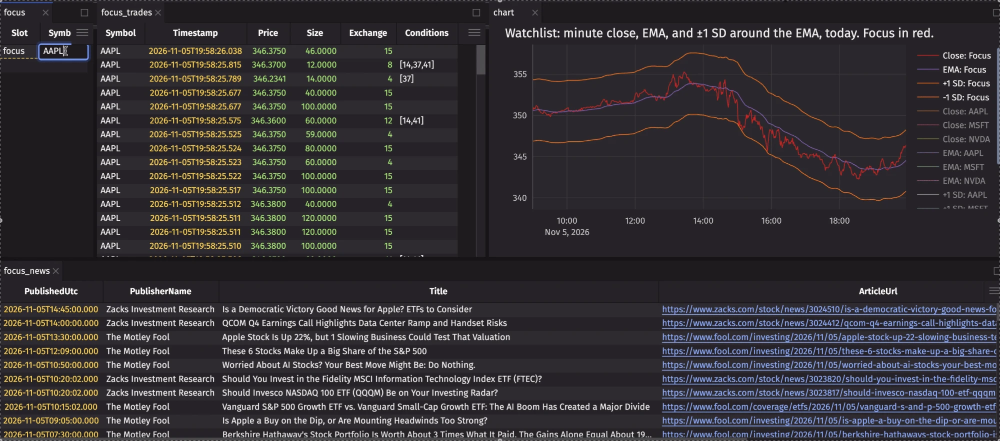

# deephaven-massive



[](https://github.com/chipkent/deephaven-massive/actions/workflows/ci.yml)

Market data from [Massive](https://massive.com) as live and historical
[Deephaven](https://deephaven.io) tables, for traders and quants who work in Python.

- **Research faster.** A year of bars, or every listed US stock on one day, is one line.
- **Go live without a rewrite.** The query that reads history also opens the live table.
- **Build live boards, not infrastructure.** Your stocks' live change since the previous close
  is [about ten lines](#change-since-close).
- **Spend your time trading, not coding.** Live tables that follow your watchlist are already
  built.

This charts a year of Apple's daily closes on Massive's free Stocks Basic plan:

```python
import deephaven.plot.express as dx
import deephaven_massive as dm

m = dm.MassiveSession()
apple = m.stocks.bars("AAPL", dm.Timespan.DAY).history("2025-11-03", "2026-10-30")
chart = dx.line(apple, x="Date", y="Close")
```

Paste it into the Deephaven IDE's console to see the chart. You never download or manage a data
file.

[Install the library](#install), then start the [tutorial](#tutorial) with a week of Apple's
prices.

<a id="install"></a>

## Install

You install Deephaven's server and the library into one Python environment, then start the
server from it.

<a id="prerequisites"></a>

### Prerequisites

You need:

| What | Check it with | Get it from |
|---|---|---|
| Python 3.11 or later | `python3 --version` | [python.org](https://www.python.org/downloads/) |
| Java 17 or later, with `JAVA_HOME` set | `java -version` and `echo $JAVA_HOME` | Deephaven's [pip install guide](https://deephaven.io/core/docs/getting-started/pip-install/) |
| Git and the GitHub CLI | `git --version` and `gh --version` | [git-scm.com](https://git-scm.com) and [cli.github.com](https://cli.github.com) |
| A Massive account | Sign in at [massive.com](https://massive.com) | [Massive's plans](https://massive.com/pricing) |

<a id="sign-in-to-github"></a>

### Sign in to GitHub

The library installs from its GitHub repository. Sign in with the GitHub CLI, and let git use
the same sign-in:

```bash
gh auth login
gh auth setup-git
```

<a id="install-the-library"></a>

### Install the library

Create a virtual environment and install Deephaven's server, its chart and dashboard plugins,
and the library's newest release. Use pip or uv.

With pip:

```bash
python3 -m venv ~/dh-massive
source ~/dh-massive/bin/activate
TAG=$(gh release list --repo chipkent/deephaven-massive --limit 1 --json tagName --jq '.[0].tagName')
pip install deephaven-server deephaven-plugin-ui deephaven-plugin-plotly-express \
  "deephaven-massive @ git+https://github.com/chipkent/deephaven-massive.git@$TAG"
```

With [uv](https://docs.astral.sh/uv/getting-started/installation/):

```bash
uv venv --python ">=3.11" ~/dh-massive
source ~/dh-massive/bin/activate
TAG=$(gh release list --repo chipkent/deephaven-massive --limit 1 --json tagName --jq '.[0].tagName')
uv pip install deephaven-server deephaven-plugin-ui deephaven-plugin-plotly-express \
  "deephaven-massive @ git+https://github.com/chipkent/deephaven-massive.git@$TAG"
```

<a id="set-your-api-keys"></a>

### Set your API keys

Open your shell's startup file in a text editor: `~/.zshrc` on macOS, `~/.bashrc` on Linux.
Paste the lines below at its end. The first is required; leave out the two S3 lines if your plan
doesn't include flat files, which [Environment variables](#environment-variables) explains. Copy
each key from Massive's [keys page](https://massive.com/dashboard/keys) over its placeholder,
and save the file:

```bash
export MASSIVE_API_KEY="your-api-key"
export MASSIVE_S3_ACCESS_KEY_ID="your-s3-access-key-id"
export MASSIVE_S3_SECRET_ACCESS_KEY="your-s3-secret-access-key"
```

Every terminal you open from now on has the keys.

<a id="start-the-server"></a>

### Start the server

Open a new terminal, activate the environment, and start Deephaven's server with 4 GB of memory:

```bash
source ~/dh-massive/bin/activate
deephaven server --jvm-args "-Xmx4g"
```

The server prints a line that starts with `Deephaven is running at` and opens the Deephaven IDE
in your browser. Keep the terminal open while you work, and press Control-C there to stop the
server.

Next, run the tutorial's [first example](#read-daily-bars). If a step fails,
[Troubleshooting](docs/troubleshooting.md#setup-messages) lists common setup problems and their
fixes.

<a id="tutorial"></a>

## Tutorial

Paste each example into the **Console** panel of the Deephaven IDE and run it. The table gives
each example's plan, and Examples 8 to 12 read the settings file that Example 7 saves.

| # | Example | Plan |
|---|---|---|
| 1 | [Queries: read a week of Apple's daily bars](#read-daily-bars) | Stocks Basic |
| 2 | [Symbol lists: rank every listed US stock by one day's dollar volume](#whole-market-day) | Stocks Basic |
| 3 | [Date ranges: compare three stocks' price returns over a year](#compare-stocks) | Stocks Basic |
| 4 | [Charts: plot a stock's daily closes for a year](#chart-closes) | Stocks Basic |
| 5 | [Live tables: poll for the latest news headlines](#follow-the-news) | Stocks Basic |
| 6 | [Loading data for new symbols without restarting: add and remove stocks from a live table of previous closes](#drive-with-a-watchlist) | Stocks Basic |
| 7 | [Plans and settings: load your settings from a file and read a delayed market snapshot](#what-your-plan-allows) | Stocks Starter or higher |
| 8 | [Streaming: stream minute bars for the stocks on your list](#stream-minute-bars) | Stocks Starter or higher |
| 9 | [Live calculations: track each stock's change since the previous close](#change-since-close) | Stocks Starter or higher |
| 10 | [Table types: keep the latest bar, the last 30 minutes, or the whole stream since you started](#table-shapes) | Stocks Starter or higher |
| 11 | [Backfill: start with today's minute bars, then continue live](#backfill-then-live) | Stocks Starter or higher |
| 12 | [Dashboards: show a live chart and table together with deephaven.ui](#dashboard) | Stocks Starter or higher |
| 13 | [Problems: see what went wrong in your tables](#see-problems) | Stocks Basic |
| 14 | [Stopping live tables: release one table or close the session](#stop-live-tables) | Stocks Basic |

<a id="read-daily-bars"></a>

### Queries: read a week of Apple's daily bars

Read Apple's daily bars for the last week of October 2026, with Stocks Basic:

```python
import deephaven_massive as dm

m = dm.MassiveSession()
apple = m.stocks.bars("AAPL", dm.Timespan.DAY).history("2026-10-26", "2026-10-30")
```

`apple` fills in with five rows, one per trading day, with columns such as `Date`, `Open`,
`High`, `Low`, `Close`, and `Volume`.

`m` is the session, your connection to Massive. Every dataset works the same way through it.
`m.stocks.bars(...)` is a query, which names the data and reads nothing. `history()` and the
query's other methods read the data and return a Deephaven table, so Deephaven's
[table operations](https://deephaven.io/core/docs/conceptual/table-operations-overview/) work on
it. The
[dataset index](docs/datasets/README.md) lists each dataset's arguments and columns.

Next, one query for every listed stock at once.

<a id="whole-market-day"></a>

### Symbol lists: rank every listed US stock by one day's dollar volume

Find the stocks that traded the most dollars on October 30, 2026, with Stocks Basic. Read that
day's bar for every listed US stock, then rank them in Deephaven:

```python
import deephaven_massive as dm

m = dm.MassiveSession()
day = m.stocks.bars(dm.ALL, dm.Timespan.DAY).history("2026-10-30", "2026-10-30")
busiest = (
    day.update_view("DollarVolume = Vwap * Volume")
    .sort_descending("DollarVolume")
    .head(20)
)
```

`day` has a row for every listed US stock that traded that day. Over-the-counter (OTC) stocks
are left out.

A dataset's `symbols` argument names what to read: `dm.ALL` for every symbol, one symbol as
text, or several as a list, each spelled as Massive does. Daily bars take `dm.ALL`, and each
dataset's page says whether it takes it. The ranking is ordinary Deephaven table operations.

Next, a list of three stocks over a longer range.

<a id="compare-stocks"></a>

### Date ranges: compare three stocks' price returns over a year

Compare the price returns of Apple, Microsoft, and Nvidia over a year from their daily bars,
with Stocks Basic:

```python
import deephaven_massive as dm
from deephaven import agg

m = dm.MassiveSession()
year = m.stocks.bars(["AAPL", "MSFT", "NVDA"], dm.Timespan.DAY).history(
    "2025-11-03", "2026-10-30"
)
returns = year.agg_by(
    [agg.sorted_first("Date", "Start = Close"), agg.sorted_last("Date", "End = Close")],
    by="Symbol",
).update_view("ReturnPct = 100 * (End / Start - 1)")
```

`returns` has one row per stock, with its close on the first and last day and its percent
return.

`history()` returns `year` at once and downloads its rows in the background, so the console
stays free. `year` and `returns` start empty, and Deephaven updates both when the rows arrive. To
wait for the rows instead, pass `wait=True`.

Dates are `yyyy-MM-dd` text in every table, so they sort by day and join across tables. A range
includes both of its dates, and for stocks a date is the trading day in New York.

Next, the same kind of table as a chart.

<a id="chart-closes"></a>

### Charts: plot a stock's daily closes for a year

Draw Nvidia's daily closes for a year on Stocks Basic, charted with
[Deephaven Express](https://deephaven.io/core/plotly/docs/):

```python
import deephaven.plot.express as dx
import deephaven_massive as dm

m = dm.MassiveSession()
nvda = m.stocks.bars("NVDA", dm.Timespan.DAY).history("2025-11-03", "2026-10-30")
closes = dx.line(nvda, x="Date", y="Close")
```

`closes` is a line chart of Nvidia's close on each trading day of the year. Deephaven Express
charts any Deephaven table, so every table in this tutorial can be a chart, live ones included.

Next, a table that keeps changing.

<a id="follow-the-news"></a>

### Live tables: poll for the latest news headlines

Follow the news on Apple, Nvidia, and Tesla with Stocks Basic. Ask Massive for each stock's
newest headlines every five minutes:

```python
import deephaven_massive as dm

m = dm.MassiveSession()
headlines = m.reference.news(["AAPL", "NVDA", "TSLA"], limit=10).poll(300)
latest = headlines.view(["PublishedUtc", "Symbol", "Title"]).sort_descending("PublishedUtc")
```

`latest` starts with up to ten articles per stock, newest first. A new article arrives at the
first poll after Massive lists it.

`poll()` returns a live table. At each poll it asks Massive again, and a news table adds only
the articles it hasn't seen. `latest` updates with it.

The poll keeps running until you close its session with `m.close()`. The
[last example](#stop-live-tables) shows the other ways to stop live tables.

Next, a live table whose stocks you change while it runs.

<a id="drive-with-a-watchlist"></a>

### Loading data for new symbols without restarting: add and remove stocks from a live table of previous closes

Keep a live table of previous closes that follows your list of stocks through the day, with
Stocks Basic:

```python
import deephaven_massive as dm
from deephaven import input_table, new_table

m = dm.MassiveSession()
stocks = new_table({"Symbol": ["AAPL", "MSFT", "AMZN", "GOOGL"]})
watchlist = input_table(init_table=stocks, key_cols="Symbol")
closes = m.stocks.previous_day_bar(watchlist).poll(60)
```

`closes` has a row for each stock with its previous trading day's bar. Each poll sends one
request per stock, so four stocks polled every 60 seconds send four requests a minute. Massive
allows five a minute on the plan this example uses.

`watchlist` is a Deephaven [input table](https://deephaven.io/core/docs/how-to-guides/input-tables/),
which you edit by hand in its panel or in code. By hand, type a symbol into a new row of the
`watchlist` panel, press **Enter**, and click **Commit**. In code, run this in the same console
to add Nvidia and remove Microsoft:

```python continues
watchlist.add(new_table({"Symbol": ["NVDA"]}))
watchlist.delete(new_table({"Symbol": ["MSFT"]}))
```

At the next poll, Nvidia's row arrives and Microsoft's leaves, and the table keeps running.

Wherever a dataset takes symbols, it also takes a table with a `Symbol` column, and it follows a
live one as it changes.

<a id="convert-symbols"></a>

To read a list from Yahoo Finance, convert it first. Yahoo spells some tickers differently:
Yahoo's `BRK-B` is Massive's `BRK.B`, and Yahoo's `BAC-PL` is Massive's `BACpL`. Tell the
converter whose tickers they are with `convention=`. This reads the previous closes of a table
of Yahoo tickers, with Stocks Basic:

```python
import deephaven_massive as dm
from deephaven import new_table

m = dm.MassiveSession()
yahoo = new_table({"Symbol": ["AAPL", "BRK-B", "BAC-PL", "^GSPC"]})
stocks = dm.canonicalize_symbols(
    yahoo.update("Yahoo = Symbol"), dm.AssetClass.STOCKS, convention=dm.SymbolConvention.YAHOO
)
yahoo_closes = m.stocks.previous_day_bar(stocks).fetch()
```

`yahoo_closes` has one row each for `AAPL`, `BRK.B`, and `BACpL`, with the previous trading
day's bar. `stocks` keeps all four rows. `Symbol` holds Massive's ticker, and `Yahoo` holds
the text you started with.

`^GSPC` isn't a stock ticker, so its `Symbol` is null and every dataset skips the row.
`stocks.where("isNull(Symbol)")` lists such rows. To fail instead of nulling a row, pass
`on_error=dm.OnError.RAISE`.

One call converts one asset class. For a list that mixes stocks with indices, currencies, or
crypto, convert each class's rows in a call of its own. Pick the convention by where the
tickers came from, not where the stock trades: `NASDAQ` reads Nasdaq Trader's symbol files, so
it converts `BRK-B` to the preferred `BRKpB`.

Next, settings for the paid plans.

<a id="what-your-plan-allows"></a>

### Plans and settings: load your settings from a file and read a delayed market snapshot

Read a snapshot of three stocks with Stocks Starter or higher. First, save your plan's setting in
a settings file. Starter and Developer are 15 minutes late, so their file accepts delayed data.
Advanced and Business are real-time. In a new terminal, run the commands for your plan.

Starter or Developer:

```bash
mkdir -p ~/massive
echo "delayed_subscriptions: [stocks]" > ~/massive/settings.yaml
```

Advanced or Business:

```bash
mkdir -p ~/massive
echo "delayed_subscriptions: []" > ~/massive/settings.yaml
```

Then load the file and read the snapshot:

```python
import deephaven_massive as dm

config = dm.MassiveConfig.from_file("~/massive/settings.yaml")
m = dm.MassiveSession(config)
snapshot = m.stocks.snapshots(["AAPL", "MSFT", "NVDA"]).fetch()
```

`snapshot` has one row per stock, with columns such as `DayClose`, `PrevDayClose`, and
`TodaysChangePerc`. On Starter or Developer without the setting, the `snapshot` table fails with
an error that names the setting to change.

To check whether your data is real-time or delayed, run `m.connections()` in the next example's
session. Its `Recency` is `DELAYED` with the Starter file and `REALTIME` with the Advanced one.
[The problems example](#see-problems) shows the call.

Settings belong to `dm.MassiveConfig`, and a file keeps them in one place for every console and
script. Your keys stay in the environment, never in the file. [Configuration](#configuration)
covers the environment variables and the settings a new user needs, and the
[settings page](docs/configuration.md) lists every setting a file can hold.

Next, a live table that streams instead of polling.

<a id="stream-minute-bars"></a>

### Streaming: stream minute bars for the stocks on your list

Watch the latest minute bar of each stock on your list as it arrives, with Stocks Starter or
higher:

```python
import deephaven_massive as dm
from deephaven import input_table, new_table

m = dm.MassiveSession(dm.MassiveConfig.from_file("~/massive/settings.yaml"))
stocks = new_table({"Symbol": ["AAPL", "MSFT", "NVDA"]})
watchlist = input_table(init_table=stocks, key_cols="Symbol")
latest = m.stocks.bars(watchlist, dm.Timespan.MINUTE).last_by()
```

`latest` gets a row for each stock with its first minute bar, and the row changes as each minute
ends.

`last_by()` reads Massive's stream instead of polling, and like the poll in Example 6, the
stream follows the watchlist.

Massive sends a minute bar only for a minute with trades. Stocks trade in pre-market, regular,
and after-hours sessions, so a table you start overnight stays empty until pre-market trading.
Crypto trades around the clock, and on Currencies Starter or higher,
`m.crypto.bars("X:BTCUSD", dm.Timespan.MINUTE).last_by()` streams at any hour.

The example runs as written. A type checker rejects its `last_by()`, because `bars()` declares two
classes and only `StreamHistoryQuery` has stream methods. You get that class for 1-second and
1-minute bars at `multiplier=1`, which Massive streams. In type-checked code, check the class
first:

```python continues
from deephaven_massive.queries import StreamHistoryQuery

minute = m.stocks.bars(watchlist, dm.Timespan.MINUTE)
assert isinstance(minute, StreamHistoryQuery)  # 1-minute bars stream
latest = minute.last_by()
```

Next, a calculation on the live bars.

<a id="change-since-close"></a>

### Live calculations: track each stock's change since the previous close

Find how far each stock has moved today, with Stocks Starter or higher. Join the live minute
bars to the previous closes, and compute the change:

```python
import deephaven_massive as dm

m = dm.MassiveSession(dm.MassiveConfig.from_file("~/massive/settings.yaml"))
symbols = ["AAPL", "MSFT", "NVDA"]
closes = m.stocks.previous_day_bar(symbols).fetch()
latest = m.stocks.bars(symbols, dm.Timespan.MINUTE).last_by()
changes = (
    closes.view(["Symbol", "PrevClose = Close"])
    .natural_join(latest, on="Symbol", joins="Close")
    .update_view("ChangePct = 100 * (Close / PrevClose - 1)")
)
```

`changes` has a row for each stock with a previous close. Its `Close` and `ChangePct` fill in
with the stock's first minute bar and change with every bar after it.

Deephaven recomputes `changes` whenever `latest` changes. Every table you build on a live table
stays live, and the code is the same as for static tables.

Next, other ways to keep a stream's rows.

<a id="table-shapes"></a>

### Table types: keep the latest bar, the last 30 minutes, or the whole stream since you started

Stream SPY's minute bars into three tables that keep different rows, with Stocks Starter or
higher:

```python
import deephaven_massive as dm

m = dm.MassiveSession(dm.MassiveConfig.from_file("~/massive/settings.yaml"))
bars = m.stocks.bars("SPY", dm.Timespan.MINUTE)
newest = bars.last_by()
last_30 = bars.ring(30)
since_start = bars.append_only()
```

| Table | Method | Keeps |
|---|---|---|
| `newest` | `last_by()` | One row per symbol: its newest bar |
| `last_30` | `ring(30)` | The newest 30 bars: for a stock that trades every minute, the last 30 minutes |
| `since_start` | `append_only()` | Every bar since you ran the code |

All three share one stream from Massive, so pick the method by the rows you need to keep.

`since_start` begins when you run the code. Next, fill in the bars before that.

<a id="backfill-then-live"></a>

### Backfill: start with today's minute bars, then continue live

Start with every minute bar SPY has had today, then add each new one as it ends, with Stocks
Starter or higher:

```python
import deephaven_massive as dm
from deephaven import merge
from deephaven.time import dh_today, to_j_time_zone

m = dm.MassiveSession(dm.MassiveConfig.from_file("~/massive/settings.yaml"))
bars = m.stocks.bars("SPY", dm.Timespan.MINUTE)
live = bars.append_only()
past = bars.history(dh_today(to_j_time_zone("America/New_York")))
spy = merge([past, live]).last_by(["Symbol", "TimestampStart"])
```

`spy` holds SPY's minute bars for the day so far, and it grows as each minute ends. On a day the
market is closed, it stays empty.

To backfill a live table, merge its `history()` with it and keep one row per bar with `last_by`.
Put the live table last, so its bar wins where both have one. `history()` with only a start date
reads through now.

Next, a live chart and a live table on one screen.

<a id="dashboard"></a>

### Dashboards: show a live chart and table together with deephaven.ui

Put a live chart and a live table side by side with
[deephaven.ui](https://deephaven.io/core/ui/docs/), on Stocks Starter or higher. The table is
Example 9's change table:

```python
import deephaven.plot.express as dx
import deephaven_massive as dm
from deephaven import ui

m = dm.MassiveSession(dm.MassiveConfig.from_file("~/massive/settings.yaml"))
symbols = ["AAPL", "MSFT", "NVDA"]
closes = m.stocks.previous_day_bar(symbols).fetch()
bars = m.stocks.bars(symbols, dm.Timespan.MINUTE)
changes = (
    closes.view(["Symbol", "PrevClose = Close"])
    .natural_join(bars.last_by(), on="Symbol", joins="Close")
    .update_view("ChangePct = 100 * (Close / PrevClose - 1)")
)
chart = dx.line(bars.append_only(), x="TimestampEnd", y="Close", by="Symbol")
dashboard = ui.dashboard(ui.row(ui.panel(chart, title="Closes"), ui.panel(changes, title="Change")))
```

`dashboard` opens with two panels side by side: a line per stock that grows each minute, and
the change table.

A dashboard arranges panels in rows and columns, and each panel holds any table or chart.
Deephaven's guide to
[creating dashboards](https://deephaven.io/core/ui/docs/creating-layouts/creating-dashboards/)
shows more layouts.

Next, where to see what went wrong in your tables.

<a id="see-problems"></a>

### Problems: see what went wrong in your tables

Find out why a table has fewer rows than you asked for, on Stocks Basic. This asks for the
details of Apple and of `ZZZZ`, a ticker Massive doesn't list:

```python
import deephaven_massive as dm

m = dm.MassiveSession()
problems = m.problems()  # each problem in your tables: Cause says why, Detail what happened
details = m.reference.ticker_details(["AAPL", "ZZZZ"]).fetch()
```

`details` holds Apple's row. Massive answers the ticker-details request for `ZZZZ` with HTTP 404,
so `problems` gets a row whose `Cause` is `unavailable_symbols` and `Symbol` is `ZZZZ`. Its
`Detail` names the HTTP 404 and the endpoint the library called. Most other datasets answer an
unlisted ticker with no rows and no error, so `problems` gets no row for it.

Other problems, such as rows the library left out or a connection outage, add rows the same way.
Troubleshooting's [problems section](docs/troubleshooting.md#problems) says what each one means
and what to do about it.

Four more live tables show what the session is doing:

```python continues
streams = m.streams()  # each live table and background read: its State, and Error if it failed
# each streaming connection: its Host, State, and Recency, REALTIME or DELAYED
connections = m.connections().view(["Transport", "AssetClass", "Host", "State", "Recency"])
rate_limits = m.rate_limits()  # each subscription's rate-limit State: READY, PACED, or PAUSED
symbol_reads = m.symbol_reads()  # each watchlist symbol read: its State, and Error if it failed
```

Here `streams` has one row, for the ticker-details read, whose `State` ends `DONE`.
`symbol_reads` stays empty, because this example reads no watchlist. `connections` stays empty
too, because a `fetch()` doesn't stream. Once a table streams, `connections` gets a row for each
connection.

Troubleshooting's [diagnostics section](docs/troubleshooting.md#diagnostics) says when to check
each table. For a table's columns, run `help()` on its method, such as
`help(m.connections)`.

Next, how to stop live tables when you're done with them.

<a id="stop-live-tables"></a>

### Stopping live tables: release one table or close the session

Stop the live tables you no longer need, on Stocks Basic. This example starts two polls of its
own:

```python
import deephaven_massive as dm

m = dm.MassiveSession()
closes = m.stocks.previous_day_bar(["AAPL", "MSFT"]).poll(60)
headlines = m.reference.news(["AAPL", "NVDA"], limit=5).poll(300)
```

To stop one table, release it:

```python continues
m.release(closes)
```

`closes` stops once you close its panel, if no other table uses it. The session and
`headlines` keep running.

When you're done with them all, keep a copy of the rows you want and close the session:

```python continues
kept = headlines.snapshot()
m.close()
```

Closing stops every live table of the session: `headlines` stops updating, shows an error
saying the session was closed, and keeps its rows. `kept` is a static copy that you can filter
and join like any table. A closed session reads nothing more. To read more data, open a new
one with `m = dm.MassiveSession()`, or rerun any example, since each opens its own.

<a id="configuration"></a>

## Configuration

The library reads your keys and a few options from environment variables, and every other
setting from `dm.MassiveConfig`.

<a id="environment-variables"></a>

### Environment variables

Set these in your shell's startup file, as Install does for the keys. After you set one, stop
the server and start it from a new terminal, as [Start the server](#start-the-server) does.

| Variable | What you get | Default |
|---|---|---|
| `MASSIVE_API_KEY` | Access to Massive. Every session needs it, unless your code passes the key. | Unset |
| `MASSIVE_S3_ACCESS_KEY_ID`, `MASSIVE_S3_SECRET_ACCESS_KEY` | `history()` from Massive's flat files, on plans that include them. Index values have no other history source, and trades, quotes, and as-traded minute and daily bars use the files for the whole market or for 50 or more symbols. Set both or neither. | Unset |
| `DEEPHAVEN_MASSIVE_CONFIG_FILE` | Your settings file, read by `dm.MassiveConfig.from_file()` called with no path | Unset |
| `DEEPHAVEN_MASSIVE_LOG` | The library's log at the level you name: `DEBUG`, `INFO`, `WARNING`, `ERROR`, or `CRITICAL` | Warnings and errors only, in the server's terminal |
| `DEEPHAVEN_MASSIVE_LOG_FILE` | The log in this file instead of the terminal. Set alone, it logs at `DEBUG`. | Unset |
| `HTTPS_PROXY`, `NO_PROXY` | A proxy for every connection to Massive, and the hosts that skip it | Your system's proxy on macOS; none on Linux |
| `SSL_CERT_FILE`, `SSL_CERT_DIR` | The certificate authorities to trust, such as your company's own. Flat-file reads use only `SSL_CERT_FILE`. | The `certifi` bundle |

[Turn on the debug log](docs/troubleshooting.md#the-log) explains each log level and how to
record what the library does, and [Report a bug](docs/troubleshooting.md#report-a-bug) says how
to attach the log to an issue.

<a id="massive-config"></a>

### MassiveConfig

`dm.MassiveConfig` holds a session's settings. Pass it as `dm.MassiveSession(config)`, or leave
it out for the defaults. Massive sells Stocks, Options, and its other subscriptions separately,
each on its own plan. Two settings match a session to your plans:

| Setting | Set it when | What changes |
|---|---|---|
| `delayed_subscriptions` | A subscription's plan gets Massive's delayed feed | Live tables and snapshots accept the delayed data. |
| `rest_requests_per_minute` | Massive limits a subscription's REST requests per minute | Its requests keep to your limit from the first one, with no pause to learn it. |

This session is for an account whose stocks plan streams delayed data, and whose other
subscriptions Massive limits to five requests a minute:

```python
import deephaven_massive as dm

config = dm.MassiveConfig(
    delayed_subscriptions={dm.Subscription.STOCKS},
    rest_requests_per_minute={
        dm.Subscription.OPTIONS: 5,
        dm.Subscription.INDICES: 5,
        dm.Subscription.CURRENCIES: 5,
        dm.Subscription.FUTURES: 5,
    },
)
m = dm.MassiveSession(config)
```

Leave a limited subscription out, and the session learns its limit from Massive's first
rate-limit error, after a pause. `m.rate_limits()` then shows the learned limit in
`RequestsPerMinute`. Copy that number into the setting to skip the pause next time.

`dm.MassiveConfig.from_file()` reads the same settings from a YAML file, as
[Example 7](#what-your-plan-allows) shows. The [settings page](docs/configuration.md) lists every
setting, its values, and its default, with an example settings file.

<a id="bad-symbols-and-rows"></a>

### Bad symbols and rows

By default, one bad symbol or row never stops a table. The library skips it, reads the rest, and
logs a warning. `m.problems()` lists each one, as [Example 13](#see-problems) shows.

Each kind of problem is a cause. For example, `noncanonical_symbols` is a watchlist row that
isn't Massive's exact ticker. A `dm.ErrorPolicy` gives each cause one of three settings:

- `dm.OnError.RAISE` fails the call or live table that met the problem.
- `dm.OnError.LOG` skips the symbol or row and logs a warning.
- `dm.OnError.IGNORE` skips it with no warning.

One cause raises by default: `refused_venues`. A futures `history()` that only flat files can
serve raises when Massive refuses an exchange you name in `venues`.

This session raises on every cause except a malformed flat-file line. It skips and logs that
line. Its call for daily bars logs every problem and keeps going:

```python
import deephaven_massive as dm

strict = dm.ErrorPolicy(dm.OnError.RAISE, malformed_rows=dm.OnError.LOG)
m = dm.MassiveSession(dm.MassiveConfig(on_error=strict))
lenient = dm.ErrorPolicy(dm.OnError.LOG)
week = m.stocks.bars(["AAPL", "MSFT"], dm.Timespan.DAY, on_error=lenient).history(
    "2026-10-26", "2026-10-30"
)
```

`dm.ErrorPolicy`'s first argument sets every cause. Each cause you name overrides it. A call's
`on_error=` changes only that call. A cause the call leaves unset follows the session's policy,
then the defaults. A call without `on_error=` uses the session's policy.

In a settings file, `on_error` maps each cause to `raise`, `log`, or `ignore`. This file sets
the same policy as `strict`:

```yaml
on_error:
  noncanonical_symbols: raise
  unreadable_symbols: raise
  unavailable_symbols: raise
  unreadable_keys: raise
  unconvertible_values: raise
  malformed_rows: log
  unlisted_contracts: raise
  unscheduled_products: raise
  refused_venues: raise
```

[Bad symbols and rows](docs/configuration.md#on-error) on the settings page describes each cause
and what `raise` does to each kind of read.

<a id="next-steps"></a>

## Next steps

- Call `help()` on any object for its full documentation, such as `help(m.stocks.bars)`.
- The [dataset index](docs/datasets/README.md) has a page for each of the 112 datasets, with its
  arguments, its columns, and the plans that include it. `dm.datasets()` lists them in the
  console.
- [Troubleshooting](docs/troubleshooting.md) covers the problems whose message doesn't say how
  to fix them, and how to report a bug.

<a id="contributing"></a>

## Contributing

[CONTRIBUTING.md](https://github.com/chipkent/deephaven-massive/blob/main/CONTRIBUTING.md) explains how to set up a development checkout, run the
checks, and propose a change.
