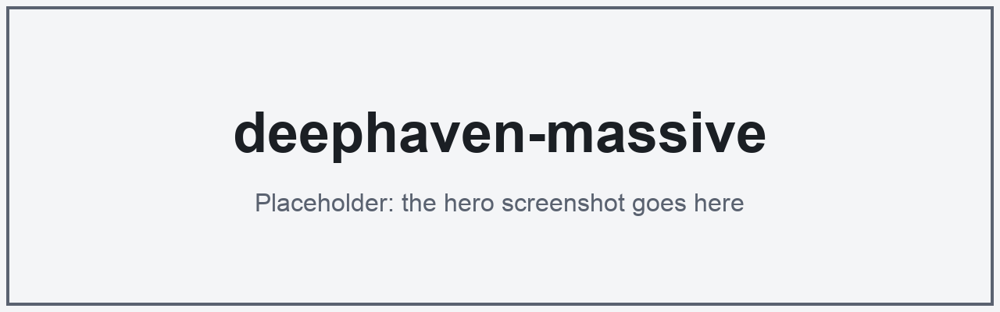

# deephaven-massive

<!-- The owner supplies the hero image in both variants, at docs/images/hero-light.png and docs/images/hero-dark.png. -->
<picture>
  <source media="(prefers-color-scheme: dark)" srcset="docs/images/hero-dark.png">
  
</picture>


Read years of market history and watch the market live, from one Python query.

Testing a trading idea often means two programs, one for the past and one for the live feed,
each with its own columns. With deephaven-massive, one query does both jobs. A query names the
data you want from [Massive](https://massive.com) (formerly Polygon.io), such as Apple's minute
bars. Call `history()` on it for a date range in the past, or `last_by()` for a live table that
keeps each stock's newest row. A live table updates as data arrives, and both tables have the
same columns. You get the same pair of tables from every dataset Massive offers both as history
and as a stream, such as trades and quotes.

You work with the tables in [Deephaven](https://deephaven.io). Deephaven is a free real-time
query engine that represents both static and streaming data as tables. It runs on your own
computer, and you type Python into its console in your browser. A filtered view or a chart built
on a live table updates with it.

Once you've installed the library, this example runs as pasted in the Deephaven console. As
pasted, it needs Massive's Stocks Advanced or Business plan. Other Stocks plans stream late or
not at all, so on the free plan, start with [Example 1](#whole-market-day) instead. The query `bars` names the minute bars
of Apple and Microsoft. `history()` reads one week of them, and `last_by()` makes a live table:

```python
import deephaven_massive as dm

m = dm.MassiveSession()

bars = m.stocks.bars(["AAPL", "MSFT"], dm.Timespan.MINUTE)
week = bars.history("2026-10-26", "2026-10-30")
latest = bars.last_by()
```

`week` is a static table of every minute bar the two stocks had that week. `latest` has one row
per stock, and each row is replaced as the next minute ends. A stock's row appears with its
first minute bar after you run the code. Bars arrive in pre-market and after-hours trading, too.

Stock bars are one of the library's 112 datasets. They cover stocks, options, CME Group futures,
indices, forex, and crypto, and beyond prices they hold company financials, SEC filings, news,
and economic data such as Treasury yields. The [dataset index](docs/datasets/README.md) links a
page for each, with its columns and the plans that include it.

Live tables follow your watchlist, and the free plan is enough to start:

- A live table can follow a watchlist. Pass a table of symbols where a list would go, and the
  live table adds each symbol you add to the watchlist and drops each one you delete.
- On Massive's free Stocks Basic plan, you can read two years of daily and minute stock bars,
  plus news and economic data.
- Live tables stream in real time on Advanced and Business plans, and on Currencies Starter.
  Other Starter and Developer plans stream 15 minutes late, or 10 minutes for futures. To read
  a delayed stream, list its subscription, such as Stocks, in the `delayed_subscriptions` setting.

To begin, [install the library](#install), then work through [ten examples](#learn-by-example).

<a id="install"></a>

## Install

Setup takes about 15 minutes. You'll install Deephaven's server and the library into one Python
environment, give the server your API key, and make a first table in your browser.

<a id="check-what-you-need"></a>

### Check what you need

The server runs on macOS, Linux, and Windows 10 or 11 through WSL 2, on a computer with at least
8 GB of memory. Deephaven's [pip install guide](https://deephaven.io/core/docs/getting-started/pip-install/)
covers each operating system, Java, and `JAVA_HOME` in detail. Get these four ready before you
start:

| What | Why | Check | Get it |
|---|---|---|---|
| Python 3.11 or later | Runs the library and Deephaven's Python API | `python3 --version` | [python.org](https://www.python.org/downloads/) or your package manager |
| Java 17 or later, with `JAVA_HOME` set | Deephaven's engine runs on Java, and its server finds Java through `JAVA_HOME` | `java -version` and `echo $JAVA_HOME` | Deephaven's [pip install guide](https://deephaven.io/core/docs/getting-started/pip-install/) |
| Git and the GitHub CLI | The library installs from its GitHub repository until it's on PyPI | `git --version` and `gh --version` | [git-scm.com](https://git-scm.com) and [cli.github.com](https://cli.github.com) |
| A Massive account | Massive gives you the API key every example uses | Sign in at [massive.com](https://massive.com) and open the API Keys page | Sign up at [massive.com](https://massive.com). The free Stocks Basic plan is enough to start. |

### 1. Sign in to GitHub

The install command reads the library from GitHub, so git needs your GitHub sign-in. Sign in
with the GitHub CLI, then let git use the same sign-in:

```bash
gh auth login
gh auth setup-git
```

To check, run `gh auth status`. It prints a line that says you're logged in to github.com.

### 2. Create a Python environment

Install the server and the library into one Python environment, because the server imports the
library from the environment it runs in. A virtual environment also keeps them apart from your
other Python projects. Create one and activate it:

```bash
python3 -m venv ~/dh-massive
source ~/dh-massive/bin/activate
```

Your prompt now starts with `(dh-massive)`. If you use uv, create the environment with uv
instead:

```bash
uv venv --python ">=3.11" ~/dh-massive
source ~/dh-massive/bin/activate
```

If you already run Deephaven's server from an environment of your own, activate that one and
skip to the next step.

### 3. Install Deephaven and the library

Look up the newest release of the library, then install it with Deephaven's server:

```bash
REPO=chipkent/deephaven-massive
TAG=$(gh release list --repo $REPO --limit 1 --json tagName --jq '.[0].tagName')
pip install deephaven-server \
  "deephaven-massive @ git+https://github.com/$REPO.git@$TAG"
```

If you use uv, install with `uv pip` instead:

```bash
REPO=chipkent/deephaven-massive
TAG=$(gh release list --repo $REPO --limit 1 --json tagName --jq '.[0].tagName')
uv pip install deephaven-server \
  "deephaven-massive @ git+https://github.com/$REPO.git@$TAG"
```

To check the install, run `pip show deephaven-massive`, or `uv pip show deephaven-massive` if you
used uv. It prints the version you installed.

### 4. Set your API key

The library reads your API key from the `MASSIVE_API_KEY` environment variable. The server sees
only the variables set in its terminal before it starts, so set the key in the terminal you'll
start the server from. Copy the key from the API Keys page of Massive's dashboard, then run this
line with your key in place of `your-api-key`:

```bash
export MASSIVE_API_KEY="your-api-key"
```

A key kept in the environment never lands in a script or notebook you save or share. To set it
in every new terminal, add the same line to `~/.zshrc` on macOS or `~/.bashrc` on Linux.

<a id="start-the-server"></a>

### 5. Start the Deephaven server

Start the server in the same terminal, with 4 GB of memory:

```bash
deephaven server --jvm-args "-Xmx4g"
```

The `-Xmx4g` argument sets that memory, enough for a day of minute bars of every US stock. After
about a minute, the terminal prints a line that starts with `Deephaven is running at`, followed
by the server's address. Your browser opens the Deephaven IDE at that address, already signed
in. Keep this terminal open, because closing it stops the server. To stop the server yourself,
press Control-C there.

### 6. Make your first table

Your first table holds a week of Apple's daily bars, and it works on every Stocks plan, the free
Stocks Basic plan included. `dm.MassiveSession()` opens a session. A session is your
connection to Massive, and it reads your key from `MASSIVE_API_KEY`. The next line reads the
bars. Python runs inside the server, in the IDE's **Console** panel. Click in that panel, paste
the code, and press Enter:

```python
import deephaven_massive as dm

m = dm.MassiveSession()
apple = m.stocks.bars("AAPL", dm.Timespan.DAY).history(
    "2026-10-26", "2026-10-30"
)
```

The `apple` table opens in a new panel, with five rows, one for each trading day. Its columns
include `Date`, `Open`, `High`, `Low`, `Close`, and `Volume`.

<a id="fix-a-step"></a>

### Fix a step that fails

Most setup problems come from a terminal that's missing a variable or a sign-in, and each of
these has a one-line fix. [Setup and keys](docs/troubleshooting.md#setup-messages) in
Troubleshooting gives the cause of each:

| You see | What to do |
|---|---|
| `Repository not found`, or a password prompt, during the install | Run `gh auth login` and `gh auth setup-git`, then install again |
| The server stops at startup with an error about Java | Set up Java as Deephaven's [pip install guide](https://deephaven.io/core/docs/getting-started/pip-install/) shows, then start the server again |
| `AuthenticationError: no Massive API key: ...` | Stop the server, set `MASSIVE_API_KEY` in its terminal, and start it again |
| `RuntimeError: The Deephaven Server has not been initialized` | Paste the code into the **Console** panel of the Deephaven IDE |

<a id="configuration"></a>

## Configuration

To start, you need only `MASSIVE_API_KEY`, and you set it in [Install](#install). The rest are
optional. Environment variables hold your keys and the settings for the whole server, and
settings in code change how one session behaves.

<a id="environment-variables"></a>

### Environment variables

Set these in the terminal that starts the server, before you start it. A running server doesn't
see a change, so restart it after you set one:

| Variable | Default | What it does |
|---|---|---|
| `MASSIVE_API_KEY` | None; required | Your Massive API key. Creating a session without it raises `dm.AuthenticationError`. |
| `MASSIVE_S3_ACCESS_KEY_ID` | Unset | The access key for Massive's flat files: compressed files of a whole market's trades, quotes, or bars, one file a day. Massive shows it beside your API key on paid plans. |
| `MASSIVE_S3_SECRET_ACCESS_KEY` | Unset | The secret key that goes with the access key. Set both keys or neither. |
| `DEEPHAVEN_MASSIVE_CONFIG_FILE` | Unset | The path of a settings file, which `dm.MassiveConfig.from_file()` reads when you call it with no path. |
| `DEEPHAVEN_MASSIVE_LOG` | Unset, so only warnings and errors appear, in the server's terminal and the IDE's **Log** panel | Turns on the library's log at a level: `DEBUG`, `INFO`, `WARNING`, `ERROR`, or `CRITICAL`. |
| `DEEPHAVEN_MASSIVE_LOG_FILE` | Unset, so the log goes to the server's terminal and the IDE's **Log** panel | A file to append the log to. Set alone, it turns the log on at `DEBUG`. |
| `HTTPS_PROXY`, `NO_PROXY` | Your proxy settings on macOS; none on Linux and WSL | The proxy for every connection to Massive, and the hosts that skip it. |
| `SSL_CERT_FILE`, `SSL_CERT_DIR` | The `certifi` certificate bundle | The certificate authorities to trust instead, such as your company's own. |
| `JAVA_HOME` | None | The Java installation the server runs on. Deephaven's server reads it, and Deephaven's [pip install guide](https://deephaven.io/core/docs/getting-started/pip-install/) says how to set it. |

The log variables take effect only when the server starts. To turn the log on in a console
that's already running, call `dm.enable_debug_logging()` instead.

If your plan includes flat files, set the two S3 keys. A `history()` of 50 or more symbols, or
of `dm.ALL`, then downloads one file a day instead of sending a request for each symbol. Flat
files hold bars as they traded, before any split adjustment, so the library reads bars from them
only when you pass `adjusted=False`. [Adjust prices for splits](#split-adjustment) explains the
difference.

<a id="settings-in-code"></a>

### Settings in code

Most sessions need no settings in code. Massive sells its data by market, and you subscribe to
each market you need: Stocks, Options, Indices, Currencies (forex and crypto), or Futures. Each
subscription is on a plan, such as the free Basic plan or Starter, and Massive's
[pricing page](https://massive.com/pricing) lists what each plan includes. Two settings fit a
session to your plans:

| Setting | Set it when | What changes | Example |
|---|---|---|---|
| `rest_basic_subscriptions` | A subscription is on a free Basic plan, which allows five requests a minute, and you read more than five symbols or pages at a time | The session sends at most five requests a minute for that subscription, from the first request on. Without the setting, it slows down only after Massive refuses a request. | `{dm.Subscription.STOCKS}` |
| `delayed_subscriptions` | Your Starter or Developer plan streams a subscription late: 15 minutes, or 10 for futures | Live tables read Massive's delayed feed. Without the setting, opening a live table or fetching current data, such as a snapshot, raises `dm.EntitlementError`, and its message names the line to add. | `{dm.Subscription.STOCKS}` |

Pass the settings to `dm.MassiveConfig`, and pass that to `dm.MassiveSession`. This session is
for an account with Stocks on the Basic plan and Options on the Starter plan:

```python
import deephaven_massive as dm

config = dm.MassiveConfig(
    rest_basic_subscriptions={dm.Subscription.STOCKS},
    delayed_subscriptions={dm.Subscription.OPTIONS},
)
m = dm.MassiveSession(config)
```

`help(dm.MassiveConfig)` in the console lists every other setting and its default. To use the
same settings in every console and script, keep them in a YAML file and read it with
`dm.MassiveConfig.from_file()`. `help(dm.MassiveConfig.from_file)` shows an example file.

<a id="learn-by-example"></a>

## Learn the library in ten examples

Each example runs as pasted into a fresh console. To run one, paste it into the **Console**
panel of the Deephaven IDE and press Enter. Examples 1 to 6 run on every Stocks plan, and
Examples 1 to 5 need no settings. Examples 7 to 10 each name the paid plan they need.

Stocks Basic allows five requests a minute, so on that plan an example's tables can take up to
a minute to appear. When Massive refuses a request for coming too fast, the session waits and
sends it again. [Example 6](#what-your-plan-allows) shows the setting that spaces your requests
to fit the limit.

<a id="whole-market-day"></a>

### 1. Rank every US stock by one day's trading

One read returns the daily bar of every US-listed stock for October 30, 2026.

The code reads that day's bar for every stock, then ranks the stocks by dollars traded and by
their gain from open to close:

```python
import deephaven_massive as dm

m = dm.MassiveSession()

day = m.stocks.bars(dm.ALL, dm.Timespan.DAY).history(
    "2026-10-30", "2026-10-30"
)

busiest = (
    day.update_view("DollarVolume = Vwap * Volume")
    .sort_descending("DollarVolume")
    .head(20)
)
risers = (
    day.where("Volume >= 1000000")
    .update_view("ChangePct = 100 * (Close - Open) / Open")
    .sort_descending("ChangePct")
    .head(20)
)
```

Three tables open. `day` has one row per stock, and its columns include `Symbol`, `Date`,
`Open`, `High`, `Low`, `Close`, `Volume`, and `Vwap`. `Vwap` is the volume-weighted average
price, so `Vwap * Volume` is the dollars traded. `busiest` holds the 20 stocks with the most dollars traded, largest first. `risers` holds the 20
stocks that rose most from open to close, among those that traded at least a million shares.
The [stock bars page](docs/datasets/stocks.bars.md) lists every column. To rank another day,
change both dates. Stocks Basic serves any trading day in the past two years.

`m.stocks.bars(dm.ALL, dm.Timespan.DAY)` is the query, and `dm.ALL` stands for every symbol. On
its own, the query reads nothing. `history()` is the verb. It reads the bars from Massive and
returns a Deephaven table.

`update_view`, `where`, `sort_descending`, and `head` are Deephaven's own
[table operations](https://deephaven.io/core/docs/conceptual/table-operations-overview/), and
they work on every table the library returns.

<a id="compare-stocks"></a>

### 2. Compare a few stocks over a year

A three-row scorecard compares Apple, Microsoft, and Nvidia over a year, with each stock's first
and last close, its high and low, and its return. A year of daily bars is well inside Stocks Basic's two years of history.

`agg_by` reduces each stock's year of daily bars to one row:

```python
import deephaven_massive as dm
from deephaven import agg

m = dm.MassiveSession()

year = m.stocks.bars(["AAPL", "MSFT", "NVDA"], dm.Timespan.DAY).history(
    "2025-11-03", "2026-10-30"
)
scorecard = year.agg_by(
    [
        agg.sorted_first("Date", "Start = Close"),
        agg.sorted_last("Date", "End = Close"),
        agg.max_("High"),
        agg.min_("Low"),
    ],
    by="Symbol",
).update_view("ReturnPct = 100 * (End / Start - 1)")
```

`year` has one row per stock for each trading day in the range. `scorecard` has three rows, one
per stock, with `Start`, `End`, `High`, `Low`, and `ReturnPct`.

The first argument, `symbols`, takes one symbol as text, several as a list, or `dm.ALL` for
every symbol. Spell each symbol exactly as Massive does, with its capitals and its prefix. If
you pass a misspelled symbol, such as `aapl`, the call raises `ValueError` before it sends a
request. Each asset class has its own form:

| Asset class | Example | Form |
|---|---|---|
| Stocks | `AAPL`, `BRK.B` | The ticker, with a dot before a share class |
| Options | `O:SPY271217C00700000` | `O:` and the contract's OCC code |
| Indices | `I:SPX` | `I:` and the index ticker |
| Forex | `C:EURUSD` | `C:` and the two currencies |
| Crypto | `X:BTCUSD` | `X:` and the coin and its currency |
| Futures | `ESZ6` | The product code, month code, and the year's last digit |

A range includes both of its dates, so this read runs from November 3, 2025, through October 30,
2026. For stocks, options, and indices, a date means the trading day in New
York. For futures, it means the trading day that ends on that date, and for forex and crypto,
the UTC day. The [arguments of stock bars](docs/datasets/stocks.bars.md#arguments) give the full
rules for symbols and ranges.

Date arguments take `yyyy-MM-dd` text, and every `Date` column holds the same text. That text
sorts by day, so `sorted_first("Date", ...)` finds the year's first close.

<a id="how-it-works"></a>

### 3. Find a dataset and the verbs it has

Before you read any data, you can ask the library which dataset holds it, what a company's
ticker is, and what each column means. `dm.datasets()` and `columns()` answer without a request
to Massive, and the ticker search sends one.

Search the catalog for dividends, look up Coca-Cola's ticker, and describe the dividend columns:

```python
import deephaven_massive as dm

m = dm.MassiveSession()

catalog = dm.datasets()
about_dividends = catalog.where("Summary.toLowerCase().contains(`dividend`)")
coke = m.reference.tickers(search="Coca-Cola").fetch()
dividend_columns = m.stocks.dividends("KO").columns()
```

`catalog` has one row per dataset, and its columns include `Dataset`, `Call`, `Summary`,
`Verbs`, and `Documentation`, a link to the dataset's page. `about_dividends` keeps the datasets
whose summary mentions dividends, `stocks.dividends` among them. `coke` lists the active tickers
whose symbol or name matches, Coca-Cola's own `KO` among them. Its columns include `Symbol`,
`Name`, and `PrimaryExchange`. `dividend_columns` has one row for each column of the dividends
dataset. Its columns are `Name`, `Type`, `Description`, and `SuppliedBy`, which says whether
Massive's REST API, flat files, or live stream fills the column.

`day`, `year`, and `coke` all came from one pattern:
`m.<namespace>.<dataset>(<arguments>).<verb>()`. A namespace, such as `m.stocks` or
`m.reference`, groups the datasets of one market or one kind of data. Calling a dataset makes a
query, and a verb, such as `history()` or `fetch()`, reads the data and returns a table. If you
call a verb the dataset doesn't have, Python raises `AttributeError` and lists the verbs it does
have.

Each dataset has some of these verbs, and the `Verbs` column of `catalog` lists which:

| Verb | What it returns | Taught in |
|---|---|---|
| `fetch()` | A static table, read once | This example |
| `history(start, end)` | A static table of every row in a date range | [Example 1](#whole-market-day) |
| `poll(interval)` | A live table that repeats the read every `interval` seconds | [Example 5](#follow-the-news) |
| `last_by()`, `ring(capacity)`, `append_only()`, `blink()` | A live table fed by Massive's stream, each keeping a different set of rows | [Example 7](#table-shapes) |

<a id="price-dividends"></a>

### 4. Price each dividend against the stock

One table prices each dividend KO, PEP, and JNJ paid over the past year against the stock's
close on its ex-dividend date.

`fetch()` reads the dividends whose ex-dividend date falls between `start` and `end`, and
`history()` reads the daily closes over the same dates. `natural_join` then matches each
dividend to the bar of the same symbol and date:

```python
import deephaven_massive as dm

m = dm.MassiveSession()

payers = ["KO", "PEP", "JNJ"]
start, end = "2025-11-03", "2026-10-30"
dividends = m.stocks.dividends(payers, start=start, end=end).fetch()
closes = m.stocks.bars(payers, dm.Timespan.DAY).history(start, end)

yields = dividends.natural_join(
    closes,
    on=["Symbol", "ExDividendDate = Date"],
    joins="CloseOnExDate = Close",
).update_view(
    "AnnualYieldPct = 100 * SplitAdjustedCashAmount * Frequency / CloseOnExDate"
)
```

`yields` has one row per dividend. It keeps every column of the dividend, such as
`SplitAdjustedCashAmount`, the dividend per share. It adds two more: `CloseOnExDate`, the
stock's close that day, and `AnnualYieldPct`, the yield a year of such payments implies. The
dividend is split-adjusted, as the closes are, so a later split doesn't skew the yield.
`Frequency` is the number of payments a year. A one-time special dividend has a `Frequency` of
0, so its `AnnualYieldPct` is 0 too.

Every date column in every table is `yyyy-MM-dd` text, so a dividend's `ExDividendDate` joins
straight onto a bar's `Date`, with no conversion.

<a id="follow-the-news"></a>

### 5. Follow the news as it breaks

A live table of Apple, Nvidia, and Tesla headlines picks up each new article within five
minutes of Massive listing it. On Stocks Basic, Massive updates news hourly, so an article can
arrive up to an hour after it's published.

`poll(300)` repeats the request for each stock's ten newest articles every 300 seconds:

```python
import deephaven_massive as dm

m = dm.MassiveSession()

headlines = m.reference.news(
    ["AAPL", "NVDA", "TSLA"],
    sort="published_utc",
    order=dm.Order.DESC,
    limit=10,
).poll(300)
newest_first = headlines.view(
    ["PublishedUtc", "Symbol", "Title", "PublisherName"]
).sort_descending("PublishedUtc")
```

`newest_first` starts with up to ten articles for each stock, newest at the top. Articles
already in the table stay as new ones arrive.

`headlines` is your first live table, one that keeps changing after you create it. For news,
each poll adds only the articles not already in the table, and `newest_first` updates with it
because it's built on `headlines`. Each dataset's page says how its polls combine, in the
`poll()` row of its table, such as the one for [news](docs/datasets/reference.news.md).

Until you release it, `headlines` keeps polling while anything refers to it, such as its
variable, a table built on it like `newest_first`, or an open panel. `m.release(headlines)`
stops the poll unless a table built on it or an open panel still uses it. Here `newest_first`
still uses it. The poll stops once you close both tables' panels, `del newest_first`, and Python
reclaims the table, which can take a few minutes.

To stop every live table of the session at once, call `m.close()`. Each table stops updating
and shows an error that says the session was closed. It keeps its rows, though, and
`newest_first.snapshot()` gives you a static copy to keep working with. A closed session refuses
new calls, so create a new `dm.MassiveSession()` to read more.

<a id="what-your-plan-allows"></a>

### 6. Learn what your plan allows

You ask for data your plan doesn't include and catch the error it raises. You also learn where
to check a plan's history and delay before you ask. Massive refuses such a request, and the
library raises `dm.EntitlementError` with Massive's reason. The code asks for Apple's daily bars
from January 2004. Only Stocks Advanced and Business reach that far, so any other Stocks plan
prints the refusal.

Stocks Basic allows five requests a minute. With `rest_basic_subscriptions`, the session spaces
its Stocks requests to fit, instead of pausing each time Massive refuses one. Examples 1 to 5
run without it, more slowly. On a paid Stocks plan, leave it out. The `try` block asks for the
bars and catches the refusal:

```python
import deephaven_massive as dm

config = dm.MassiveConfig(rest_basic_subscriptions={dm.Subscription.STOCKS})
m = dm.MassiveSession(config)

try:
    old = m.stocks.bars("AAPL", dm.Timespan.DAY).history(
        "2004-01-05", "2004-01-30"
    )
except dm.EntitlementError as error:
    print(error)
```

On Stocks Basic, Starter, or Developer, the console prints a message that names the refused
data and gives Massive's reason. On Stocks Advanced or Business, `old` holds the bars.

To see what a plan includes before you ask, open the dataset's page. Its plan table gives each
plan's history and delay, such as the one for
[stock bars](docs/datasets/stocks.bars.md#plan-access). Massive's
[pricing page](https://massive.com/pricing) covers every plan, futures and currencies included.

<a id="table-shapes"></a>

### 7. Watch trades arrive, four ways

Four live tables keep different parts of one stream of Bitcoin and Ether trades, and a fifth
keeps a running summary. Crypto trades around the clock, so you can run this at any
hour. It needs a Currencies Starter plan or higher, which streams crypto in real time.

Each verb on the `crypto` query makes a different kind of live table, and all four read one
stream from Massive:

```python
import deephaven_massive as dm
from deephaven import agg

m = dm.MassiveSession()

crypto = m.crypto.trades(["X:BTCUSD", "X:ETHUSD"])
last = crypto.last_by()
recent = crypto.ring(50)
tape = crypto.append_only()
ticks = crypto.blink()

since_start = ticks.agg_by(
    [
        agg.count_("Trades"),
        agg.sum_("Volume = Size"),
        agg.weighted_avg("Size", "Vwap = Price"),
    ],
    by="Symbol",
)
```

Each trade's columns include `Symbol`, `Timestamp`, `Price`, `Size`, and `Exchange`. All five
tables change about once a second, because Deephaven applies new rows in batches called update
cycles. The tables differ in which trades they keep:

| Table | Verb | Keeps |
|---|---|---|
| `last` | `last_by()` | One row per pair, holding its latest trade |
| `recent` | `ring(50)` | The latest 50 trades |
| `tape` | `append_only()` | Every trade since you ran the code, so it keeps growing |
| `ticks` | `blink()` | Only the trades of the latest update cycle |
| `since_start` | An aggregation of `ticks` | One row per pair, with its trade count, volume, and VWAP since you ran the code |

A table from `blink()`, called a blink table, keeps each trade for only one update cycle. An
aggregation of it, such as `since_start`, still counts every trade that passes through. For a
board, use `last_by()`, and for a chart of recent trades, use `ring()`.

If the connection to Massive drops, the library reconnects by itself, and the tables carry on.
Trades sent while it was down are missing, so `tape` has a gap and `since_start` undercounts.
`m.streams()` is a table with one row for each stream and poll of the session. The stream's row
shows the outage in `Error` while it lasts, and the missing span in `Gaps` afterwards. If the
connection stays down for five minutes, the tables stop with an error that names the
`max_outage` setting, and you call the verbs again for new tables.

<a id="seed-a-live-board"></a>
<a id="live-board"></a>

### 8. Build a live board against the previous close

A board of five stocks has a row for each from the start. Each row shows the previous
trading day's close, the latest minute's close, and the change between them.

It needs a Stocks Starter plan or higher. Starter and Developer stream 15 minutes late. To
accept that delayed feed, list Stocks in `delayed_subscriptions`, the setting that names the
markets your plan delays. Without it, the `latest` line raises `dm.EntitlementError` on those
plans, and the message names the line to add. A refusal that comes after the table opens stops
the table instead, and its row in `m.streams()` shows Massive's reason in `Error`. On Advanced
or Business, which stream in real time, leave the setting out.

`natural_join` adds each stock's newest minute bar to its row of `previous`, the previous
trading day's bars:

```python
import deephaven_massive as dm

config = dm.MassiveConfig(delayed_subscriptions={dm.Subscription.STOCKS})
m = dm.MassiveSession(config)

symbols = ["AAPL", "MSFT", "NVDA", "AMZN", "GOOGL"]
previous = m.stocks.previous_day_bar(symbols).fetch()
latest = m.stocks.bars(symbols, dm.Timespan.MINUTE).last_by()

board = (
    previous.view(["Symbol", "PrevClose = Close"])
    .natural_join(latest, on="Symbol", joins=["TimestampEnd", "Close"])
    .update_view("ChangePct = 100 * (Close / PrevClose - 1)")
)
```

`board` has one row per stock as soon as you run the code, because `previous` has a row for
each. A stock's `TimestampEnd`, `Close`, and `ChangePct` stay empty until its first minute bar
arrives. From then on, they change as each minute ends, in pre-market and after-hours trading as
well as regular hours. Run it during the trading day. A board left running overnight still
compares against the close it read when you created it. On Starter and Developer, each bar
arrives 15 minutes after its minute ends.

`board` changes only when `latest` gets a new bar. `fetch()` reads `previous` once, and a live
table joins a static one the same way two static tables do.

<a id="drive-with-a-watchlist"></a>

### 9. Follow a watchlist with live bars

This board keeps the latest minute bar of each stock on your watchlist, and you can change the
stocks while it runs. The plan and the setting are those of
[Example 8](#live-board): Stocks Starter or higher, with `delayed_subscriptions` on Starter and
Developer.

The watchlist is a Deephaven
[input table](https://deephaven.io/core/docs/how-to-guides/input-tables/), a table you can edit
in code or by hand, keyed by its `Symbol` column. The code makes the watchlist, streams its
minute bars, then adds NVDA and deletes MSFT:

```python
import deephaven_massive as dm
from deephaven import dtypes as dht
from deephaven import input_table, new_table
from deephaven.column import string_col

config = dm.MassiveConfig(delayed_subscriptions={dm.Subscription.STOCKS})
m = dm.MassiveSession(config)

watchlist = input_table({"Symbol": dht.string}, key_cols="Symbol")
watchlist.add(new_table([string_col("Symbol", ["AAPL", "MSFT"])]))
board = m.stocks.bars(watchlist, dm.Timespan.MINUTE).last_by()

watchlist.add(new_table([string_col("Symbol", ["NVDA"])]))
watchlist.delete(new_table([string_col("Symbol", ["MSFT"])]))
```

`watchlist` holds AAPL and NVDA. `board` gets a row for each of them as its first minute bar
arrives. MSFT never gets a row, because you deleted it before its first bar. A symbol you
delete later loses its row at once, and its stream stops.

Wherever a dataset takes `symbols`, it also takes a table with a `Symbol` column, and it follows
a live one as it changes. Each verb reacts to an edit of the watchlist in its own way:

| Verb | When you add a symbol | When you delete one |
|---|---|---|
| `last_by()`, `ring(n)`, `append_only()`, `blink()` | Subscribes to its stream | Unsubscribes, and the symbol's `last_by()` row leaves |
| `poll(interval)` | Reads it at the next poll | Stops reading it. Its rows leave at the next poll, except in news, filings, and IPO tables. |
| `fetch()`, `history()` | Reads it over the same range | Its rows leave the table |

Any live table with a `Symbol` column can stand in for the watchlist, such as
`m.stocks.movers(dm.Direction.GAINERS).poll(60)`, the day's top gainers, read again every
minute.

To add a symbol to `watchlist` by hand in the Deephaven IDE:

1. Open the `watchlist` panel.
2. Type the symbol in the empty row at the bottom.
3. Press Enter.
4. Click **Commit**. The row joins the watchlist only when you commit it.

<a id="backfill-then-live"></a>

### 10. Start with today's history, then continue live

One table holds every minute bar SPY has had today, read from history, and adds each new minute
as it ends. Like [Example 8](#live-board), it needs Stocks Starter or
higher, and `delayed_subscriptions` on Starter and Developer.

The code opens SPY's live stream of minute bars, reads today's history, and merges the two:

```python
import deephaven_massive as dm
from deephaven import merge
from deephaven.time import dh_today, to_j_time_zone

config = dm.MassiveConfig(delayed_subscriptions={dm.Subscription.STOCKS})
m = dm.MassiveSession(config)

today = dh_today(to_j_time_zone("America/New_York"))
bars = m.stocks.bars("SPY", dm.Timespan.MINUTE)
live = bars.append_only()
past = bars.history(today)
spy = merge([past, live]).last_by(["Symbol", "TimestampStart"])
```

`spy` has one row per minute of SPY's day, oldest first. Each minute that ends while the table is
open adds a row at the bottom. `dh_today` gives New York's date as `yyyy-MM-dd` text, and
`history()` with no end date reads through now. On a day the market is closed, `spy` stays
empty.

The code opens the stream before it reads history, so no minute falls between the two. Where
both have the same minute, `last_by` keeps the live bar.

For a long read, such as a year of minute bars, pass `wait=False`, as in
`bars.history("2025-11-03", wait=False)`. `history()` then returns at once and fills its table
in the background. Without it, every live table on the server waits until the read ends,
because the read runs inside your console command. Today's bars of one stock take seconds, so
this example doesn't need it.

History is split-adjusted as of the moment you read it, and live bars are as traded. If the
table runs across a split, the live bars from the split's date on arrive in the new shares. The
history stays in the old ones, so prices jump at the split. Build the table again after a
split, as [adjust prices for splits](#split-adjustment) explains.

<a id="recipes"></a>

## Recipes

The recipes here stream the options near the money, read a watchlist's history, and adjust
prices for splits. To screen the whole market, start from [Example 1](#whole-market-day). For a
live board, start from [Example 8](#live-board) or [Example 9](#drive-with-a-watchlist), and for
history that continues live, from [Example 10](#backfill-then-live).

<a id="option-chain"></a>

### Stream the options near the money

This recipe streams the latest quotes of SPY's options within 2% of SPY's price, and the set of
contracts moves as the price does. Streaming option quotes needs Options Advanced, or Options Business
with Massive's Expansion add-on. Both stream in real time, so you don't need to add options to
`delayed_subscriptions`.

The code re-reads SPY's chain for the next seven days of expirations every five minutes, keeps
the contracts near the money, and streams their quotes:

```python
import deephaven_massive as dm
from datetime import date, timedelta
from deephaven.time import dh_today, to_j_time_zone

m = dm.MassiveSession()

today = date.fromisoformat(dh_today(to_j_time_zone("America/New_York")))
week_out = today + timedelta(days=7)
spy_chain = m.options.chain(
    "SPY",
    filters={
        "expiration_date_gte": today.isoformat(),
        "expiration_date_lte": week_out.isoformat(),
    },
).poll(300)
near = spy_chain.where(
    "abs(DetailsStrikePrice / UnderlyingAssetPrice - 1) <= 0.02"
)
near_quotes = m.options.quotes(near).last_by()
```

`spy_chain` has one row for each SPY contract that expires in the next seven days. The days are
counted from the day you run the code, so run it again each day to move the window. Its columns
include each contract's strike, implied volatility, greeks, and open interest. Massive leaves
the greek columns null for some contracts, such as those deep in the money. `near_quotes` has
the latest quote of each contract within 2% of SPY's price, and it fills as quotes arrive while
options trade.

If `UnderlyingAssetPrice` is empty in `spy_chain`, `near_quotes` stays empty, because the filter
compares each strike with that column. Massive fills it according to your Stocks plan, and its
documentation doesn't say which plans include it. On a plan that leaves it empty, put SPY's
price in the filter yourself, such as `abs(DetailsStrikePrice / 685.0 - 1) <= 0.02`. The set of
contracts then stays fixed around that price.

`m.options.quotes(near)` takes a live table of contracts as its symbols, and the stream follows
`near`. Each five-minute read of the chain updates `near`. The stream then subscribes to the
contracts that came within 2% and drops the ones that drifted out.

Massive allows 1,000 option contracts on one connection, and the library counts a contract's
quotes and its trades separately against that cap. Contracts past the cap wait until others
leave, so keep the filter narrow enough that `near` stays under 1,000 rows.

<a id="history-of-a-watchlist"></a>

### Read the history of a watchlist

You can read the daily bars of every symbol on a watchlist three ways. They differ in what
happens when you edit the watchlist:

| Way | When you edit the watchlist | Cost |
|---|---|---|
| Pass the watchlist itself | Each symbol you add is read over the same range, and the rows of each one you delete leave the table | One read per symbol you add |
| Pass `watchlist.snapshot()` | Nothing changes, because the table holds the symbols on the list when you called it | One read |
| Read every symbol, then filter by the watchlist | Rows appear and leave at once, with no new read | One read of the whole market |

All three run on any Stocks plan. The code sets `rest_basic_subscriptions`, as
[Example 6](#what-your-plan-allows) does, so the session keeps to Stocks Basic's five requests a
minute.
It sends nine requests, two each for `followed` and `fixed` and one for each of the week's five
days in `market`, so they finish in about a minute. On a paid plan, leave that setting out.
The code builds a watchlist, then reads its daily bars each way:

```python
import deephaven_massive as dm
from deephaven import dtypes as dht
from deephaven import input_table, new_table
from deephaven.column import string_col
from deephaven.experimental.data_index import data_index

config = dm.MassiveConfig(rest_basic_subscriptions={dm.Subscription.STOCKS})
m = dm.MassiveSession(config)

watchlist = input_table({"Symbol": dht.string}, key_cols="Symbol")
watchlist.add(new_table([string_col("Symbol", ["AAPL", "MSFT"])]))

start, end = "2026-10-26", "2026-10-30"
followed = m.stocks.bars(watchlist, dm.Timespan.DAY).history(start, end)
fixed = m.stocks.bars(watchlist.snapshot(), dm.Timespan.DAY).history(start, end)

market = m.stocks.bars(dm.ALL, dm.Timespan.DAY).history(start, end)
data_index(market, ["Symbol"])
mine = market.where_in(watchlist, "Symbol")
```

`followed`, `fixed`, and `mine` each start with the week's daily bars of AAPL and MSFT. To add
NVDA, run `watchlist.add(new_table([string_col("Symbol", ["NVDA"])]))`. `mine` shows NVDA's bars
at once, `followed` shows them when its read finishes, and `fixed` doesn't change.

The `data_index` line keeps `mine` quick to update. Without it, Deephaven searches every row of
`market` each time you edit the watchlist. With it, Deephaven goes straight to the changed
symbol's rows.

`m.symbol_reads()` shows where each symbol's read in `followed` stands, and the
[symbol-reads table](docs/troubleshooting.md#symbol-reads) explains each state. To read a failed
symbol again, such as NVDA, run two lines in the same console:

1. Delete it: `watchlist.delete(new_table([string_col("Symbol", ["NVDA"])]))`
2. Add it back: `watchlist.add(new_table([string_col("Symbol", ["NVDA"])]))`

Reading every symbol works when the whole market fits in the server's memory, the 4 GB that
[Install's step 5](#start-the-server) gives it. `market.size` shows how many rows a read holds.
A year of daily bars of every stock fits in 4 GB, and so does one day of minute bars. A year of
minute bars doesn't fit, and neither does a day of every stock's trades or quotes.

Minute bars of every symbol come only from flat files, so pass `adjusted=False` to read them.
Flat files need a Stocks Starter plan or higher and your [S3 keys](#environment-variables).

<a id="split-adjustment"></a>

### Adjust prices for splits

This recipe states a stock's prices in today's shares on both sides of a split, first as Massive
adjusts them and then with your own code. When a company splits its stock 15 for 1, each share becomes 15 shares
worth a fifteenth of the price. A chart of the prices as traded falls 93% overnight. A
split-adjusted price restates each earlier price in today's shares, so the series runs on
without a break. The `history()` of stock and option bars returns split-adjusted prices by
default. Live bars are always as traded, and so is any read with `adjusted=False`.

O'Reilly Automotive (ORLY) split 15 for 1 on June 10, 2025. The code reads ORLY's daily bars
around the split, adjusted and as traded, then adjusts the as-traded bars itself with Massive's
splits. It runs on any Stocks plan, Stocks Basic included, and sends three requests:

```python
import deephaven_massive as dm

m = dm.MassiveSession()

start, end = "2025-06-03", "2025-06-13"
adjusted = m.stocks.bars("ORLY", dm.Timespan.DAY).history(start, end)
traded = m.stocks.bars("ORLY", dm.Timespan.DAY, adjusted=False).history(
    start, end
)
splits = m.stocks.splits("ORLY").fetch()

by_hand = traded.raj(
    splits,
    on=["Symbol", "Date<ExecutionDate"],
    joins="Factor = HistoricalAdjustmentFactor",
).update(
    [
        "Factor = isNull(Factor) ? 1.0 : Factor",
        "AdjustedClose = Close * Factor",
        "AdjustedVolume = Volume / Factor",
    ]
)
```

`adjusted` and `traded` each have one row per trading day from June 3 to June 13. Before June
10, `traded` shows ORLY's closes as they traded, near $1,350, and `adjusted` shows them in
today's shares, near $90. From June 10 on, the two match. `by_hand` is `traded` with three new
columns, `Factor`, `AdjustedClose`, and `AdjustedVolume`, and its `AdjustedClose` matches the
`Close` of `adjusted`.

Massive adjusts a price from a given day by multiplying it by the `HistoricalAdjustmentFactor`
of the first split after that day. `raj`, Deephaven's
[reverse as-of join](https://deephaven.io/core/docs/reference/table-operations/join/raj/), finds
that split for each bar, and a bar with no later split keeps a factor of 1. Multiply `Open`,
`High`, `Low`, and `Vwap` by `Factor` the same way to adjust them too. Adjust daily bars before
you aggregate them into weeks or months, because a longer bar has no `Date` for the join to
match.

`by_hand` and `adjusted` can differ around a stock dividend. The splits dataset lists stock
dividends as well as splits, with an `AdjustmentType` of `stock_dividend`, and the code applies
every row. Massive doesn't say whether its own adjusted bars apply stock dividends. Before you
drop a row by its `AdjustmentType`, check its `SplitFrom` and `SplitTo`, because a company can
carry out a split as a stock dividend. O'Reilly paid this one as a dividend of 14 new shares
for each share held.

A table that merges adjusted history with live bars, as [Example 10](#backfill-then-live) does,
shows a jump if it runs across a split. From the split's date on, live bars arrive in the new
shares, while the history you read earlier stays in the old ones. Read the history again after
the split to put both on the same shares.

<a id="troubleshooting"></a>

## Fix common errors

Most errors after setup come from what your plan includes or from how a call is written. A plan
refusal raises `dm.EntitlementError`, and a mistake in a call raises `ValueError` before any
request goes out. These six are the ones new users meet first, and each links to its full entry
in Troubleshooting:

| You see | What to do |
|---|---|
| `EntitlementError` with `... would be delayed (Massive reports ...)` | Add the setting the message shows, as in [settings in code](#settings-in-code). See [plan limits and refusals](docs/troubleshooting.md#plan-messages). |
| `HTTP 403` from `fetch()`, `poll()`, or `history()` | Use the dataset the message names, if it names one. See [plan limits and refusals](docs/troubleshooting.md#plan-messages). |
| `Your plan doesn't include this data timeframe` | Start the range inside your plan's history. See [plan limits and refusals](docs/troubleshooting.md#plan-messages). |
| `ValueError` naming a symbol | Spell it as Massive does, as in [Example 2](#compare-stocks). See [calls the library refuses](docs/troubleshooting.md#refused-calls). |
| A live table stays empty | Run `m.streams()`, which shows each live table's state and error. See [live tables](docs/troubleshooting.md#live-table-messages). |
| A read is slow on a Basic plan | Run `m.rate_limits()` to see the pace. See [plan limits and refusals](docs/troubleshooting.md#plan-messages). |

[Troubleshooting](docs/troubleshooting.md) has many more messages and symptoms. It also explains
the diagnostics tables and the debug log, and says how to report a bug.

<a id="where-next"></a>

## Where to go next

Every object in the library documents itself in the console. Run `help()` on one, such as
`help(m.stocks.bars)` or `help(dm.MassiveConfig)`, to read its full documentation. Three pages
cover what `help()` doesn't:

| Page | Go here when you want to |
|---|---|
| [Troubleshooting](docs/troubleshooting.md) | Find an error message, read the diagnostics tables, or report a bug |
| [Dataset index](docs/datasets/README.md) | Find a dataset's arguments, columns, and Massive's plan table for it |
| [Deephaven's crash course](https://deephaven.io/core/docs/getting-started/crash-course/overview/) | Learn Deephaven's filters, joins, aggregations, and plots |

<a id="status"></a>

## Status

The library is in release-candidate testing and isn't on PyPI yet. If you're testing a release
candidate, the [tester guide](docs/tester-guide.md) walks you through every step and says what to
report.

<a id="contributing"></a>

## Contributing

[CONTRIBUTING.md](CONTRIBUTING.md) explains how to set up a development checkout, run the
checks, and propose a change. The library is licensed under the
[Apache License 2.0](LICENSE).
