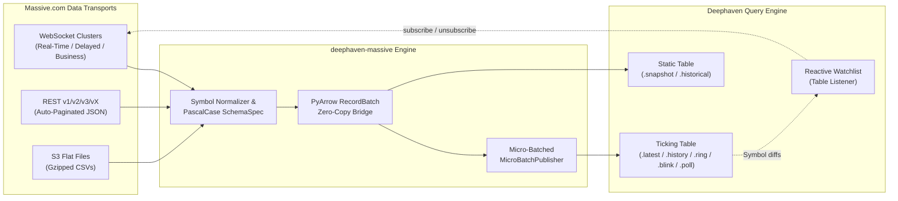

# deephaven-massive

**Unified Real-Time, Snapshot, and Historical Market Data for Deephaven Community Core**

`deephaven-massive` connects [Massive.com](https://massive.com) (formerly Polygon.io) directly to [Deephaven Community Core](https://deephaven.io), transforming WebSocket tick streams, paginated REST APIs, and multi-gigabyte S3 flat files into strongly typed, live-updating Deephaven tables.

Instead of writing bespoke WebSocket reconnect loops, thread-safe buffer queues, REST pagination cursors, and S3 CSV parsers, you express market data pipelines using a single declarative grammar:

```python
from deephaven_massive import MassiveSession

m = MassiveSession()

# Live per-symbol state table of equity trades, pre-seeded via REST snapshot
latest_trades = m.stocks.trades(["AAPL", "NVDA", "MSFT"]).latest()

# Append-only tick history table, pre-seeded with trades since market open
trade_history = m.stocks.trades(["AAPL", "NVDA", "MSFT"]).history(seed_since="09:30:00")

# Dynamically stream quotes for whatever tickers are in today's top gainers table
gainers = m.stocks.gainers().poll(interval_s=30.0)
gainer_quotes = m.stocks.quotes(gainers).latest()
```

---

## Table of Contents

1. [Why `deephaven-massive`?](#1-why-deephaven-massive)
2. [Core Architecture & Mental Model](#2-core-architecture--mental-model)
3. [Installation & Configuration](#3-installation--configuration)
4. [5-Minute Quickstart](#4-5-minute-quickstart)
5. [Delivery Modes in Depth](#5-delivery-modes-in-depth)
6. [Reactive Watchlists: Table-Driven Subscriptions](#6-reactive-watchlists-table-driven-subscriptions)
7. [Canonical Symbols & Option Contract Helpers](#7-canonical-symbols--option-contract-helpers)
8. [Complete Domain Reference](#8-complete-domain-reference)
   - [8.1 Equities (`m.stocks`)](#81-equities-mstocks)
   - [8.2 Options (`m.options`)](#82-options-moptions)
   - [8.3 Futures (`m.futures`)](#83-futures-mfutures)
   - [8.4 Indices (`m.indices`)](#84-indices-mindices)
   - [8.5 Forex (`m.forex`)](#85-forex-mforex)
   - [8.6 Crypto (`m.crypto`)](#86-crypto-mcrypto)
   - [8.7 Macroeconomics (`m.economy`)](#87-macroeconomics-meconomy)
   - [8.8 Partner Datasets (`m.partners`)](#88-partner-datasets-mpartners)
   - [8.9 Bulk S3 Flat Files (`m.flat_files`)](#89-bulk-s3-flat-files-mflat_files)
9. [Observability, Performance & Production Operations](#9-observability-performance--production-operations)

---

## 1. Why `deephaven-massive`?

Building a quantitative research or real-time trading system typically requires gluing together three incompatible data transports:

1. **WebSockets** for low-latency live ticks (`T.*`, `Q.*`, `A.*`, `AM.*`), which arrive as compact JSON arrays with terse single-letter keys (`ev`, `sym`, `p`, `s`, `t`).
2. **REST APIs** for point-in-time snapshots, reference data, fundamentals, and technical indicators, which arrive as nested JSON objects with `snake_case` field names and `next_url` pagination cursors.
3. **S3 Flat Files** (`files.massive.com`) for multi-day or full-market historical backfills, which arrive as gzipped CSVs with their own header conventions.

Without a unified integration layer, your downstream analytics code fractures: a query written against historical S3 CSVs breaks when pointed at a live WebSocket table because column names, timestamp precisions, and symbol prefixes (`O:`, `I:`, `C:`, `X:`) differ across transports.

`deephaven-massive` eliminates this impedance mismatch:

- **One Schema Across Every Transport**: Whether a trade row originates from a live WebSocket frame, a REST endpoint, or a gzipped S3 flat file, it lands in Deephaven with the exact same **PascalCase column names** (`Symbol`, `Timestamp`, `Price`, `Size`, `Exchange`, `Conditions`) and **PyArrow data types** (`pa.timestamp("ns", tz="UTC")`, `pa.float64()`, `pa.int64()`).
- **Zero-Boilerplate Streaming**: Background asyncio WebSocket multiplexers, exponential backoff reconnects, subscription replay, and micro-batched `table_publisher` (`MicroBatchPublisher`) flushes happen automatically off the Deephaven query graph thread.
- **Cold-Start Seeding (`seed=True` / `seed_since`)**: Pre-populate live streaming tables with the latest REST snapshot or historical ticks before opening the WebSocket feed—so dashboards and joins have valid state even before the next tick arrives or when markets are closed.
- **Reactive Table Watchlists**: Pass any live Deephaven `Table` containing a `Symbol` column directly into a feed method. As upstream queries add or remove symbols in real time, `deephaven-massive` automatically sends `subscribe` and `unsubscribe` diffs over the WebSocket.

---

## 2. Core Architecture & Mental Model

Every data request in `deephaven-massive` follows a fluent three-part grammar:

```text
m.<domain>.<dataset>(symbols_or_filters).<delivery_mode>()
```



### Key Architectural Guarantees

1. **Non-Blocking Ingestion**: All network I/O, JSON parsing, and gzip decompression run on isolated background daemon threads. Rows are converted into vectorized PyArrow batches via `rows_to_record_batch` / `record_batches_to_arrow_table` and handed to Deephaven via `arrow_to_deephaven_table`, keeping the Deephaven Update Graph lock-free.
2. **Two-Phase Seed & Cutover Deduplication**: When combining a REST seed with a live WebSocket stream (`.latest(seed=True)` or `.history(seed=True)`), [`MicroBatchPublisher`](src/deephaven_massive/engine/publisher.py) buffers incoming live WebSocket frames while the REST snapshot is in flight and deduplicates across the cutover boundary by `(Symbol, TradeId)` and `(key_cols, Timestamp, SequenceNumber)`.
3. **Bounded Memory Footprint**: Multi-page REST queries and multi-gigabyte S3 flat files are streamed, filtered per chunk via PyArrow compute expressions, and concatenated into a single table without unbounded intermediate Python object graphs.

---

## 3. Installation & Configuration

### Installation

Install `deephaven-massive` using `uv` or `pip`:

```bash
# Recommended: install with uv
uv pip install deephaven-massive

# Or with standard pip
pip install deephaven-massive
```

### Environment Variables

`MassiveSession()` configures itself automatically from environment variables via `MassiveConfig.from_args()`:

| Environment Variable | Default | Description |
| :--- | :--- | :--- |
| `MASSIVE_API_KEY` | *(Required)* | Your Massive.com API key (falls back to `POLYGON_API_KEY` for backward compatibility). |
| `MASSIVE_S3_ACCESS_KEY_ID` | `None` | Optional S3 Access Key ID (enables S3 flat-file routing for `.historical()` and `m.flat_files`). |
| `MASSIVE_S3_SECRET_ACCESS_KEY` | `None` | Optional S3 Secret Access Key. |

```bash
export MASSIVE_API_KEY="your-massive-api-key"
export MASSIVE_S3_ACCESS_KEY_ID="your-s3-access-key"
export MASSIVE_S3_SECRET_ACCESS_KEY="your-s3-secret-key"
```

### Explicit Programmatic Configuration

You can pass configuration arguments directly to `MassiveSession(...)` or construct an immutable [`MassiveConfig`](src/deephaven_massive/config.py):

```python
from deephaven_massive import MassiveConfig, MassiveSession

# Option A: Keyword arguments directly on MassiveSession
m = MassiveSession(
    api_key="your-api-key",
    feed="realtime",
    flush_interval_ms=50,
    max_batch_size=10_000,
)

# Option B: Inspect or validate resolved settings via MassiveConfig.from_args()
config = MassiveConfig.from_args(
    api_key="your-api-key",
    feed="realtime",
    flush_interval_ms=50,
    flat_file_ticker_threshold=50,
    auto_start_server=True,
)
assert config.has_s3_credentials is False
```

| `MassiveConfig` Field | Default | Description |
| :--- | :--- | :--- |
| `api_key` | `MASSIVE_API_KEY` | Massive API key used for REST `Bearer` auth and WebSocket `auth` frames. |
| `feed` | `"realtime"` | Default WebSocket feed tier (`"realtime"`, `"delayed"`, `"business"`, `"delayed_business"`, `"nasdaq"`, `"polyfeed"`, `"polyfeed_plus"`, `"starter"`, `"launchpad"`, or custom hostname). |
| `rest_base_url` | `"https://api.massive.com"` | Base URL for Massive REST API endpoints. |
| `s3_access_key_id` | `MASSIVE_S3_ACCESS_KEY_ID` | S3 access key ID for Flat Files (`files.massive.com`). |
| `s3_secret_access_key` | `MASSIVE_S3_SECRET_ACCESS_KEY` | S3 secret access key for Flat Files. |
| `s3_endpoint_url` | `"https://files.massive.com"` | S3-compatible endpoint URL. |
| `s3_bucket` | `"flatfiles"` | S3 bucket name hosting gzipped CSV flat files. |
| `flush_interval_ms` | `50` | Micro-batch flush interval in milliseconds for live streaming publishers. |
| `max_batch_size` | `10_000` | Maximum buffered events per micro-batch flush. |
| `max_retries` | `3` | Maximum retry attempts for transient REST and S3 errors (`429` / `5xx`). |
| `flat_file_ticker_threshold` | `50` | Minimum symbol count at which `.historical(source="auto")` switches from parallel REST to S3 Flat Files. |
| `auto_start_server` | `True` | Automatically start an embedded Deephaven `Server` if the JVM is not yet running. |

---

## 4. 5-Minute Quickstart

### Step 1: Stream Live Equity Trades & Quotes with Cold-Start Seeding

Calling `.latest()` creates a live-updating `last_by` state table (1 row per `Symbol`) pre-seeded with the latest REST snapshot (`seed=True` by default). Calling `.history(seed=True)` creates an append-only tick log pre-seeded with the latest snapshot before seamlessly transitioning to live WebSocket ticks:

```python
from deephaven_massive import MassiveSession

m = MassiveSession()

watchlist = ["AAPL", "MSFT", "NVDA", "SPY", "QQQ"]

# Append-only live trade & quote streams, pre-seeded via REST so tables are never empty
trades = m.stocks.trades(watchlist).history(seed=True)
quotes = m.stocks.quotes(watchlist).history(seed=True)
```

### Step 2: Real-Time As-Of Join (`aj`) Between Trades and Quotes

Because `trades` and `quotes` share canonical `Symbol` and `Timestamp` (`Instant`) columns, you can immediately compute real-time execution quality and effective spread in Deephaven:

```python
# Attach the prevailing NBBO bid/ask to every incoming trade tick
trades_with_nbbo = trades.aj(
    table=quotes,
    on=["Symbol", "Timestamp"],
    joins=["BidPrice", "BidSize", "AskPrice", "AskSize"],
).update_view([
    "MidPrice = (BidPrice + AskPrice) / 2.0",
    "SpreadBps = (AskPrice - BidPrice) / MidPrice * 10000.0",
    "SignedSlippage = Price - MidPrice",
])
```

### Step 3: Enrich Live Streams with Reference & Fundamental Data

Fetch a static or periodically polled reference table and join it onto your streaming ticks:

```python
# Fetch valuation ratios and join P/E and EnterpriseValue onto live latest quotes
ratios = m.stocks.ratios(tickers=watchlist).snapshot()
latest_quotes = m.stocks.quotes(watchlist).latest()

enriched_quotes = latest_quotes.natural_join(
    table=ratios.last_by(["Symbol"]),
    on=["Symbol"],
    joins=["EnterpriseValue", "PriceToEarnings", "ReturnOnEquity", "DebtToEquity"],
)
```

---

## 5. Delivery Modes in Depth

Every domain dataset method (except `m.flat_files.*`, which returns a `Table` directly) returns a [`FeedBuilder`](src/deephaven_massive/engine/builder.py) supporting up to seven terminal delivery modes:

| Method | Return Type | Transport | When to Use |
| :--- | :--- | :--- | :--- |
| `.latest(key_cols=None, *, by=None, seed=True)` | Live Ticking `Table` (`last_by`) | REST Seed + WebSocket | Maintain the current state per symbol (1 row per key), pre-seeded via REST by default (`seed=True`). |
| `.history(seed_since=None, *, seed=False)` | Live Ticking `Table` (Append-Only) | WebSocket (+ optional REST Seed) | Retain every incoming tick in an in-memory append-only table (`blink_to_append_only`), optionally seeded via `seed=True` or `seed_since="09:30:00"`. |
| `.ring(capacity=100_000, *, seed=False)` | Live Ticking `Table` (`ring_table`) | WebSocket (+ optional REST Seed) | Retain a bounded sliding window of the most recent `capacity` ticks in memory. |
| `.blink()` | Live Ticking `Table` (Blink) | WebSocket | Raw stateless single-cycle Deephaven blink table containing only the current update cycle's events. |
| `.snapshot()` | Static `Table` | REST | One-shot point-in-time snapshots, reference directories, corporate actions, fundamentals, or technical indicators. |
| `.poll(interval_s=60.0, *, mode="replace", key_cols=None)` | Live Ticking `Table` | REST (Background Timer) | Turn any REST endpoint (top gainers, option chains, Treasury yields, news) into a live-updating Deephaven table refreshed every `interval_s` seconds (`mode` in `"replace"`, `"upsert"`, or `"append"`). |
| `.historical(start=None, end=None, *, limit=None, source="auto")` | Static `Table` | REST or S3 Flat Files | Historical time-series backfills. Automatically selects parallel REST for narrow symbol queries and S3 Flat Files for wildcard `"*"` or large multi-symbol scans. |

### Smart Historical Routing (`source="auto"`)

When you call `.historical(start, end, source="auto")` on a dataset backed by both REST and S3 Flat Files (such as `trades`, `quotes`, `bars`, or `values`), `FeedBuilder` inspects your query:

- **Routes to S3 Flat Files** if S3 credentials (`MASSIVE_S3_ACCESS_KEY_ID` and `MASSIVE_S3_SECRET_ACCESS_KEY`) are configured *and* you request either wildcard `"*"` *or* at least `config.flat_file_ticker_threshold` symbols (default `50`). Decompressed CSV chunks are filtered in C++ via PyArrow compute expressions so irrelevant symbols are discarded immediately.
- **Routes to Parallel REST** for targeted symbol queries (`< 50` symbols), or when S3 credentials are not configured.

```python
# Targeted symbol query -> automatically routes to paginated REST
aapl_recent = m.stocks.bars("AAPL", multiplier=1, timespan="minute").historical(
    start="2026-01-05", end="2026-01-06"
)

# Full-market minute bars across 5 trading days -> automatically streams from S3 Flat Files
full_market = m.stocks.bars("*", multiplier=1, timespan="minute").historical(
    start="2026-01-05", end="2026-01-09"
)

# Force a specific transport explicitly ("rest", "s3", or "flat_files")
forced_rest = m.stocks.trades("AAPL").historical(
    start="2026-01-05", end="2026-01-06", source="rest"
)
```

---

## 6. Reactive Watchlists: Table-Driven Subscriptions

One of Deephaven's superpowers is that tables update reactively as data flows through the query graph. `deephaven-massive` extends this reactivity all the way to your network socket.

Anywhere a streaming method accepts `symbols` (or `contracts` / `pairs`), you can pass:

1. A single symbol string: `"AAPL"`
2. An iterable of symbol strings: `["AAPL", "MSFT", "NVDA"]`
3. `"*"` for full-market wildcard subscriptions
4. **A live Deephaven `Table`** containing a `Symbol` column (or custom `symbol_col`)

When you pass a Deephaven `Table`, [`ReactiveWatchlistController`](src/deephaven_massive/engine/watchlist.py) attaches a Deephaven table listener (`listen`) to the `Symbol` column:

- When rows are **added** to the upstream table, `deephaven-massive` sends a `subscribe` command for the newly added symbols.
- When rows are **removed** from the upstream table, `deephaven-massive` decrements their reference count and sends an `unsubscribe` command once the count reaches zero.

### Example: Dynamically Streaming Option Contracts Near the Money

```python
# 1. Poll the NVDA option chain every 60 seconds
chain = m.options.chain_snapshot("NVDA").poll(interval_s=60.0)

# 2. Filter for liquid near-the-money calls using standard Deephaven table operations
active_calls = chain.where([
    "ContractType = `call`",
    "Delta >= 0.35 && Delta <= 0.65",
    "OpenInterest >= 500",
])

# 3. Pass the filtered Deephaven table directly as the watchlist!
# As NVDA's spot price moves and new strikes enter the 0.35-0.65 delta band,
# the WebSocket automatically subscribes to the new contracts and unsubscribes from old ones.
live_option_quotes = m.options.quotes(active_calls).latest()
```

---

## 7. Canonical Symbols & Option Contract Helpers

Massive's raw APIs use different symbol conventions across asset classes and transports (`O:` for options, `I:` for indices, `C:` for forex REST vs. `EUR/USD` for forex WebSocket, `X:` for crypto REST vs. `BTC-USD` for crypto WebSocket).

`deephaven-massive` normalizes these transparently through [`SymbolNormalizer`](src/deephaven_massive/engine/symbols.py):

- **Input**: You can pass user-friendly symbols (`"SPX"`, `"EUR/USD"`, `"BTC-USD"`, `"AAPL250117C00150000"`) or raw prefixed symbols (`"I:SPX"`, `"C:EURUSD"`, `"X:BTCUSD"`, `"O:AAPL250117C00150000"`).
- **Output**: Every Deephaven table emitted by `deephaven-massive` normalizes the `Symbol` column to a single canonical representation across WebSocket, REST, and S3 Flat Files so joins across transports always match.

| Domain | Accepted Input Formats | Canonical `Symbol` in Deephaven Table | REST Ticker | WebSocket Topic (`<channel>.<ticker>`) |
| :--- | :--- | :--- | :--- | :--- |
| **Stocks** | `"AAPL"`, `"aapl"`, `"BRK.B"` | `"AAPL"`, `"BRK.B"` | `"AAPL"`, `"BRK.B"` | `"T.AAPL"`, `"Q.BRK.B"` |
| **Options** | `"AAPL250117C00150000"`, `"O:AAPL250117C00150000"` | `"O:AAPL250117C00150000"` | `"O:AAPL250117C00150000"` | `"T.O:AAPL250117C00150000"` |
| **Indices** | `"SPX"`, `"I:SPX"`, `"VIX"` | `"I:SPX"`, `"I:VIX"` | `"I:SPX"`, `"I:VIX"` | `"V.I:SPX"`, `"AM.I:VIX"` |
| **Forex** | `"EUR/USD"`, `"EUR-USD"`, `"C:EURUSD"` | `"EUR/USD"` | `"C:EURUSD"` | `"C.EUR/USD"`, `"CA.EUR/USD"` |
| **Crypto** | `"BTC-USD"`, `"BTC/USD"`, `"X:BTCUSD"` | `"BTC-USD"` | `"X:BTCUSD"` | `"XT.BTC-USD"`, `"XQ.BTC-USD"` |
| **Futures** | `"ESZ5"`, `"NQH6"` | `"ESZ5"`, `"NQH6"` | `"ESZ5"`, `"NQH6"` | `"T.ESZ5"`, `"Q.NQH6"` |

### Normalizing OCC Option Symbols

Use [`SymbolNormalizer`](src/deephaven_massive/engine/symbols.py) (or pass unprefixed OCC contract strings directly to `m.options.*`) to normalize OCC option contract tickers into canonical `"O:..."` format:

```python
from deephaven_massive.engine.symbols import SymbolNormalizer

contract = SymbolNormalizer("options").canonical("AAPL260116C00200000")
# -> "O:AAPL260116C00200000"

quotes = m.options.quotes(contract).latest()
```

---

## 8. Complete Domain Reference

`MassiveSession` exposes nine specialized domain clients:

| Attribute | Client Class | Coverage |
| :--- | :--- | :--- |
| `m.stocks` | [`StocksClient`](src/deephaven_massive/domains/stocks.py) | US equities trades, NBBO quotes, bars, LULD, imbalances, FMV, snapshots, technicals, fundamentals, SEC filings, corporate actions, and market status. |
| `m.options` | [`OptionsClient`](src/deephaven_massive/domains/options.py) | OPRA options trades, quotes, bars, FMV, Greeks/IV chain snapshots, technicals, and contract reference data. |
| `m.futures` | [`FuturesClient`](src/deephaven_massive/domains/futures.py) | CME, CBOT, NYMEX, and COMEX futures trades, quotes, bars, snapshots, contracts, products, and trading schedules. |
| `m.indices` | [`IndicesClient`](src/deephaven_massive/domains/indices.py) | Real-time index values (`V.I:*`), minute/second aggregates, snapshots, technicals, and reference data. |
| `m.forex` | [`ForexClient`](src/deephaven_massive/domains/forex.py) | Global OTC FX spot quotes, aggregates, FMV, snapshots, top movers, technicals, and real-time currency conversion. |
| `m.crypto` | [`CryptoClient`](src/deephaven_massive/domains/crypto.py) | 24/7 digital asset trades, BBO quotes, bars, FMV, snapshots, top movers, and technical indicators. |
| `m.economy` | [`EconomyClient`](src/deephaven_massive/domains/economy.py) | US Treasury yield curves, CPI/PCE inflation, inflation expectations, labor market indicators, and Fed/SOFR funding conditions. |
| `m.partners` | [`PartnersClient`](src/deephaven_massive/domains/partners.py) | Benzinga (ratings, earnings, guidance, consensus, news, transcripts, insights), ETF Global, TMX corporate events, and Fable Data. |
| `m.flat_files` | [`FlatFilesClient`](src/deephaven_massive/domains/flat_files.py) | Direct bulk ingestion of historical gzipped CSV files from `files.massive.com` with symbol predicate pushdown. |

---

### 8.1 Equities (`m.stocks`)

#### Market Data, Snapshots & Technical Indicators

| Method | Supported Delivery Modes | Description |
| :--- | :--- | :--- |
| `m.stocks.trades(symbols="*", *, feed=None)` | `.latest()`, `.history()`, `.ring()`, `.blink()`, `.snapshot()`, `.poll()`, `.historical()` | Tick-by-tick equity trade executions (`T.*`, `us_stocks_sip/trades_v1`). |
| `m.stocks.quotes(symbols="*", *, feed=None)` | `.latest()`, `.history()`, `.ring()`, `.blink()`, `.snapshot()`, `.poll()`, `.historical()` | Tick-by-tick NBBO top-of-book quotes (`Q.*`, `us_stocks_sip/quotes_v1`). |
| `m.stocks.bars(symbols="*", *, multiplier=1, timespan="minute", adjusted=True)` | `.latest()`, `.history()`, `.ring()`, `.blink()`, `.snapshot()`, `.poll()`, `.historical()` | OHLCV aggregate bars (`"second"`, `"minute"`, `"hour"`, `"day"`, `"week"`, `"month"`, `"quarter"`, `"year"`). |
| `m.stocks.luld(symbols="*", *, feed=None)` | `.latest()`, `.history()`, `.ring()`, `.blink()` | Real-time Limit Up-Limit Down (`LULD.*`) price bands and pause indicators. |
| `m.stocks.imbalances(symbols="*", *, feed=None)` | `.latest()`, `.history()`, `.ring()`, `.blink()` | Real-time Net Order Imbalances (`NOI.*`) auction stream. |
| `m.stocks.fmv(symbols="*", *, feed=None)` | `.latest()`, `.history()`, `.ring()`, `.blink()` | Real-time algorithmic Fair Market Value (`FMV.*`) stream on `business.massive.com`. |
| `m.stocks.snapshots(symbols=None, *, include_otc=False)` | `.snapshot()`, `.poll()` | Full-market or multi-ticker snapshot (day bar, prev day bar, last trade, last quote). |
| `m.stocks.top_movers(direction="gainers", *, include_otc=False)` | `.snapshot()`, `.poll()` | Top 20 intraday percentage `"gainers"` or `"losers"` (aliases: `gainers()`, `losers()`). |
| `m.stocks.previous_close(symbol, *, adjusted=True)` | `.snapshot()`, `.poll()` | Previous trading session's OHLCV bar (alias: `previous_day_bar()`). |
| `m.stocks.daily_open_close(symbol, date, *, adjusted=True)` | `.snapshot()`, `.poll()` | Official open, close, pre-market, and after-hours prices (alias: `daily_ticker_summary()`). |
| `m.stocks.daily_market_summary(date, *, adjusted=True, include_otc=False)` | `.snapshot()`, `.poll()` | Full-market daily OHLCV bars for all US equities on `date`. |
| `m.stocks.sma(symbol, *, window=50, timespan="day", ...)` | `.snapshot()`, `.poll()`, `.historical()` | Simple Moving Average (`INDICATOR_SCHEMA`). |
| `m.stocks.ema(symbol, *, window=50, timespan="day", ...)` | `.snapshot()`, `.poll()`, `.historical()` | Exponential Moving Average (`INDICATOR_SCHEMA`). |
| `m.stocks.macd(symbol, *, short_window=12, long_window=26, signal_window=9, ...)` | `.snapshot()`, `.poll()`, `.historical()` | Moving Average Convergence/Divergence (`INDICATOR_SCHEMA`). |
| `m.stocks.rsi(symbol, *, window=14, timespan="day", ...)` | `.snapshot()`, `.poll()`, `.historical()` | Relative Strength Index (`INDICATOR_SCHEMA`). |

#### Fundamentals, Short Volume, SEC Filings & Reference

| Method | Description |
| :--- | :--- |
| `m.stocks.short_interest(symbol=None, *, tickers=None, **filters)` | Bi-weekly FINRA short interest, average daily volume, and days-to-cover. |
| `m.stocks.short_volume(symbol=None, *, tickers=None, **filters)` | Daily off-exchange and exchange short sale volume and short ratio. |
| `m.stocks.float(symbol=None, *, tickers=None, **filters)` | Public share float and free-float percentage (alias: `share_float()`). |
| `m.stocks.balance_sheets(symbol=None, *, tickers=None, timeframe=None, **filters)` | Standardized quarterly and annual balance sheets (`/stocks/financials/v1/balance-sheets`). |
| `m.stocks.income_statements(symbol=None, *, tickers=None, timeframe=None, **filters)` | Standardized quarterly and annual income statements (`/stocks/financials/v1/income-statements`). |
| `m.stocks.cash_flow_statements(symbol=None, *, tickers=None, timeframe=None, **filters)` | Standardized quarterly and annual cash flow statements (`/stocks/financials/v1/cash-flow-statements`). |
| `m.stocks.financials(symbol=None, *, timeframe=None, **filters)` | Combined financial statements (`/vX/reference/financials`; alias: `financials_vx()`). |
| `m.stocks.ratios(symbol=None, *, tickers=None, **filters)` | Valuation, profitability, liquidity, and leverage ratios (P/E, P/B, EV/EBITDA, ROE). |
| `m.stocks.dividends(symbol=None, ...)` / `m.stocks.splits(symbol=None, ...)` / `m.stocks.ipos(...)` | Cash/stock dividends, forward/reverse splits, and historical/upcoming IPOs. |
| `m.stocks.tickers(...)` / `m.stocks.ticker_details(symbol, ...)` / `m.stocks.ticker_types(...)` | Reference ticker directory, detailed company profiles, and asset class codes. |
| `m.stocks.ticker_events(symbol, ...)` / `m.stocks.related_companies(symbol)` | Corporate symbol-change history and peer ticker relationships. |
| `m.stocks.sec_filings(symbol=None, ...)` | SEC EDGAR filings index (`10-K`, `10-Q`, `8-K`, etc.; alias: `sec_edgar_index()`). |
| `m.stocks.sec_10k_sections(...)` / `m.stocks.sec_8k_text(...)` | Parsed 10-K narrative sections and 8-K item disclosures. |
| `m.stocks.sec_risk_factors(...)` / `m.stocks.sec_disclosures(...)` | Categorized SEC risk factor and structured taxonomy disclosures. |
| `m.stocks.sec_13f_holdings(...)` / `m.stocks.sec_form3_ownership(...)` / `m.stocks.sec_insider_transactions(...)` | Institutional Form 13F holdings, Form 3 initial ownership, and Form 4 insider transactions (alias: `sec_form4_transactions()`). |
| `m.stocks.news(symbol=None, ...)` | Real-time financial news articles with sentiment and entity insights. |
| `m.stocks.market_status()` / `m.stocks.market_holidays()` | Real-time exchange open/closed status and upcoming holiday schedules (alias: `holidays()`). |
| `m.stocks.exchanges(...)` / `m.stocks.conditions(...)` | Exchange directory and SIP trade/quote condition code dictionaries. |

---

### 8.2 Options (`m.options`)

```python
# Snapshot or poll the full option chain with Greeks, IV, and Break-Even Price
nvda_chain = m.options.chain_snapshot(
    "NVDA",
    expiration_date_gte="2026-01-01",
    contract_type="call",
).snapshot()

# Stream live NBBO quotes and trades for a specific OCC option contract
contract = "O:NVDA260116C00150000"
opt_quotes = m.options.quotes([contract]).latest()
opt_trades = m.options.trades([contract]).history(seed=True)
```

| Method | Supported Delivery Modes | Description |
| :--- | :--- | :--- |
| `m.options.chain_snapshot(underlying, ...)` | `.snapshot()`, `.poll()` | Full option chain snapshot with `ImpliedVolatility`, `Delta`, `Gamma`, `Theta`, `Vega`, `OpenInterest`, and `BreakEvenPrice` (alias: `chain()`). |
| `m.options.contract_snapshot(underlying, contract)` | `.snapshot()`, `.poll()` | Point-in-time snapshot for a single OCC option contract. |
| `m.options.quotes(contracts="*", *, feed=None)` | `.latest()`, `.history()`, `.ring()`, `.blink()`, `.snapshot()`, `.poll()`, `.historical()` | OPRA option quotes (`Q.O:*`, `us_options_opra/quotes_v1`). |
| `m.options.trades(contracts="*", *, feed=None)` | `.latest()`, `.history()`, `.ring()`, `.blink()`, `.snapshot()`, `.poll()`, `.historical()` | OPRA option trade executions (`T.O:*`, `us_options_opra/trades_v1`). |
| `m.options.bars(contracts="*", *, multiplier=1, timespan="minute", adjusted=True)` | `.latest()`, `.history()`, `.ring()`, `.blink()`, `.snapshot()`, `.poll()`, `.historical()` | OHLCV aggregate bars for option contracts. |
| `m.options.fmv(contracts="*", *, feed=None)` | `.latest()`, `.history()`, `.ring()`, `.blink()` | Real-time Fair Market Value (`FMV.O:*`) for option contracts on `business.massive.com`. |
| `m.options.contracts(underlying=None, *, contract_type=None, expiration_date=None, strike_price=None, expired=False, **filters)` | `.snapshot()`, `.poll()`, `.historical()` | Active and expired option contracts reference directory. |
| `m.options.contract_details(contract)` | `.snapshot()`, `.poll()` | Reference metadata for a single OCC option contract. |
| `m.options.previous_close(contract)` / `daily_open_close(contract, date)` | `.snapshot()`, `.poll()` | Previous day OHLCV (`previous_day_bar()`) and daily open/close summary (`daily_ticker_summary()`). |
| `m.options.sma(...)` / `ema(...)` / `macd(...)` / `rsi(...)` | `.snapshot()`, `.poll()`, `.historical()` | Technical indicators computed on option contract prices. |
| `m.options.exchanges()` / `m.options.conditions(...)` | `.snapshot()`, `.poll()` | OPRA options exchange and condition code reference tables. |

---

### 8.3 Futures (`m.futures`)

```python
# Stream live E-mini S&P 500 and Nasdaq-100 futures trades & quotes on CME
fut_trades = m.futures.trades(["ESZ5", "NQZ5"], venue="cme").latest()
fut_quotes = m.futures.quotes(["ESZ5", "NQZ5"], venue="cme").latest()

# Query active CME/CBOT futures contracts and trading schedules
contracts = m.futures.contracts(product_code="ES").snapshot()
schedules = m.futures.schedules(product_code="ES").snapshot()
```

| Method | Supported Delivery Modes | Description |
| :--- | :--- | :--- |
| `m.futures.trades(contracts="*", *, venue="cme", feed=None)` | `.latest()`, `.history()`, `.ring()`, `.blink()`, `.snapshot()`, `.poll()`, `.historical()` | Real-time and historical futures trade executions across `"cme"`, `"cbot"`, `"nymex"`, and `"comex"` (`us_futures/trades_v1`). |
| `m.futures.quotes(contracts="*", *, venue="cme", feed=None)` | `.latest()`, `.history()`, `.ring()`, `.blink()`, `.snapshot()`, `.poll()`, `.historical()` | Top-of-book futures bid/ask quotes (`us_futures/quotes_v1`). |
| `m.futures.bars(contracts="*", *, multiplier=1, timespan="minute", venue="cme")` | `.latest()`, `.history()`, `.ring()`, `.blink()`, `.snapshot()`, `.poll()`, `.historical()` | OHLCV and settlement price bars (`"second"`, `"minute"`, `"hour"`, `"day"`, `"session"`). |
| `m.futures.snapshots(contracts=None)` | `.snapshot()`, `.poll()` | Multi-contract futures market snapshot (`LastTradePrice`, `BidPrice`, `AskPrice`, `SessionVolume`, `SettlementPrice`, `OpenInterest`). |
| `m.futures.contracts(product_code=None, *, active=True, **filters)` | `.snapshot()`, `.poll()` | Active and historical futures contract specifications (`TickSize`, `TradingVenue`, `FirstTradeDate`, `LastTradeDate`). |
| `m.futures.products(*, venue=None, **filters)` | `.snapshot()`, `.poll()` | Futures product catalog (`ProductCode`, `Name`, `AssetClass`, `TradingVenue`, `SettlementMethod`). |
| `m.futures.schedules(product_code=None, **filters)` | `.snapshot()`, `.poll()` | Exchange trading session schedules (`SessionEndDate`, `Event`, `Timestamp`). |
| `m.futures.exchanges()` / `m.futures.market_status()` | `.snapshot()`, `.poll()` | Futures exchanges directory and real-time venue status. |

---

### 8.4 Indices (`m.indices`)

```python
# Stream real-time index levels (S&P 500, Nasdaq-100, Russell 2000, VIX)
idx_values = m.indices.values(["SPX", "NDX", "RUT", "VIX"]).latest()

# Historical 1-minute index bars
spx_bars = m.indices.bars("SPX", multiplier=1, timespan="minute").historical(
    start="2026-01-01", end="2026-01-15"
)
```

| Method | Supported Delivery Modes | Description |
| :--- | :--- | :--- |
| `m.indices.values(symbols="*", *, feed=None)` | `.latest()`, `.history()`, `.ring()`, `.blink()`, `.snapshot()`, `.poll()`, `.historical()` | Real-time streaming and historical index levels (`V.I:*`, `us_indices/values_v1`). |
| `m.indices.bars(symbols="*", *, multiplier=1, timespan="minute")` | `.latest()`, `.history()`, `.ring()`, `.blink()`, `.snapshot()`, `.poll()`, `.historical()` | OHLC aggregate bars for market indices (`A.I:*`, `AM.I:*`, `us_indices/minute_aggs_v1`, `us_indices/day_aggs_v1`). |
| `m.indices.snapshots(symbols=None)` | `.snapshot()`, `.poll()` | Point-in-time index values and daily OHLC snapshots. |
| `m.indices.previous_close(symbol)` / `daily_open_close(symbol, date)` | `.snapshot()`, `.poll()` | Previous day close (`previous_day_bar()`) and daily open/close summary (`daily_ticker_summary()`). |
| `m.indices.sma(...)` / `ema(...)` / `macd(...)` / `rsi(...)` | `.snapshot()`, `.poll()`, `.historical()` | Technical indicators computed on index levels. |
| `m.indices.tickers(...)` / `market_holidays()` / `market_status()` | `.snapshot()`, `.poll()` | Index reference directory, holiday calendar (`holidays()`), and market status. |

---

### 8.5 Forex (`m.forex`)

```python
# Stream live spot FX quotes with cold-start REST seeding
fx_quotes = m.forex.quotes(["EUR/USD", "USD/JPY", "GBP/USD"]).latest()

# Convert currency amounts at live spot rates
conversion = m.forex.convert_currency("EUR", "USD", amount=1_000_000).snapshot()
```

| Method | Supported Delivery Modes | Description |
| :--- | :--- | :--- |
| `m.forex.quotes(pairs="*", *, feed=None)` | `.latest()`, `.history()`, `.ring()`, `.blink()`, `.snapshot()`, `.poll()`, `.historical()` | Real-time institutional FX spot bid/ask quotes (`C.*`, `global_forex/quotes_v1`). |
| `m.forex.bars(pairs="*", *, multiplier=1, timespan="minute", adjusted=True)` | `.latest()`, `.history()`, `.ring()`, `.blink()`, `.snapshot()`, `.poll()`, `.historical()` | OHLCV aggregate bars for currency pairs (`CAS.*`, `CA.*`, `global_forex/minute_aggs_v1`, `global_forex/day_aggs_v1`). |
| `m.forex.fmv(pairs="*", *, feed=None)` | `.latest()`, `.history()`, `.ring()`, `.blink()` | Real-time Fair Market Value (`FMV.*`) for FX pairs on `business.massive.com`. |
| `m.forex.snapshots(pairs=None)` | `.snapshot()`, `.poll()` | Full-market or multi-pair FX snapshot. |
| `m.forex.top_movers(direction="gainers")` | `.snapshot()`, `.poll()` | Top 20 intraday FX percentage `"gainers"` or `"losers"`. |
| `m.forex.last_quote(pair)` | `.snapshot()`, `.poll()` | Latest spot BBO quote for a single currency pair (`/v1/last_quote/currencies/{from}/{to}`). |
| `m.forex.convert_currency(from_currency, to_currency, *, amount=100.0, precision=2)` | `.snapshot()`, `.poll()` | Real-time spot currency conversion calculation (alias: `convert()`). |
| `m.forex.daily_market_summary(date)` / `previous_close(pair)` / `daily_open_close(pair, date)` | `.snapshot()`, `.poll()` | Full-market daily FX bars, previous close (`previous_day_bar()`), and daily summary (`daily_ticker_summary()`). |
| `m.forex.sma(...)` / `ema(...)` / `macd(...)` / `rsi(...)` | `.snapshot()`, `.poll()`, `.historical()` | Technical indicators for currency pairs. |
| `m.forex.tickers(...)` / `exchanges()` / `market_holidays()` / `market_status()` | `.snapshot()`, `.poll()` | FX reference pairs, institutional quoting venues, holidays, and market status. |

---

### 8.6 Crypto (`m.crypto`)

```python
# Stream 24/7 digital asset trades and BBO quotes with cold-start REST seeding
btc_trades = m.crypto.trades(["BTC-USD", "ETH-USD", "SOL-USD"]).latest()
btc_quotes = m.crypto.quotes(["BTC-USD", "ETH-USD", "SOL-USD"]).latest()
```

| Method | Supported Delivery Modes | Description |
| :--- | :--- | :--- |
| `m.crypto.trades(pairs="*", *, feed=None)` | `.latest()`, `.history()`, `.ring()`, `.blink()`, `.snapshot()`, `.poll()`, `.historical()` | Real-time and historical digital asset trade executions (`XT.*`, `global_crypto/trades_v1`). |
| `m.crypto.quotes(pairs="*", *, feed=None)` | `.latest()`, `.history()`, `.ring()`, `.blink()` | Best bid and offer (BBO) crypto quotes (`XQ.*`). |
| `m.crypto.bars(pairs="*", *, multiplier=1, timespan="minute", adjusted=True)` | `.latest()`, `.history()`, `.ring()`, `.blink()`, `.snapshot()`, `.poll()`, `.historical()` | OHLCV aggregate bars for digital currency pairs (`XAS.*`, `XA.*`, `global_crypto/minute_aggs_v1`, `global_crypto/day_aggs_v1`). |
| `m.crypto.fmv(pairs="*", *, feed=None)` | `.latest()`, `.history()`, `.ring()`, `.blink()` | Real-time Fair Market Value (`FMV.*`) for digital assets on `business.massive.com`. |
| `m.crypto.snapshots(pairs=None)` / `m.crypto.last_trade(pair)` | `.snapshot()`, `.poll()` | Multi-pair market snapshots and single-pair latest trade execution. |
| `m.crypto.top_movers(direction="gainers")` | `.snapshot()`, `.poll()` | Top 20 24-hour crypto percentage `"gainers"` or `"losers"`. |
| `m.crypto.daily_market_summary(date)` / `previous_close(pair)` / `daily_open_close(pair, date)` | `.snapshot()`, `.poll()` | Daily OHLCV summaries across digital asset markets. |
| `m.crypto.sma(...)` / `ema(...)` / `macd(...)` / `rsi(...)` | `.snapshot()`, `.poll()`, `.historical()` | Technical indicators for digital assets. |
| `m.crypto.tickers(...)` / `exchanges()` / `conditions(...)` / `market_holidays()` / `market_status()` | `.snapshot()`, `.poll()` | Crypto reference pairs, exchanges, condition codes, holidays, and market status. |

---

### 8.7 Macroeconomics (`m.economy`)

```python
# Fetch the historical US Treasury yield curve (1M through 30Y maturities)
yields = m.economy.treasury_yields().historical(start="2020-01-01", end="2026-01-15")

# Snapshot CPI/PCE inflation, inflation expectations, labor market, and Fed funding rates
inflation = m.economy.inflation().snapshot()
expectations = m.economy.inflation_expectations().snapshot()
labor = m.economy.labor_market().snapshot()
funding = m.economy.funding_conditions().snapshot()
```

| Method | Supported Delivery Modes | Description |
| :--- | :--- | :--- |
| `m.economy.treasury_yields(date=None, **filters)` | `.snapshot()`, `.poll()`, `.historical()` | Daily constant-maturity US Treasury yield curve (`Yield1Month` through `Yield30Year`). |
| `m.economy.inflation(date=None, **filters)` | `.snapshot()`, `.poll()`, `.historical()` | Headline and Core CPI and PCE inflation metrics (`Cpi`, `CpiCore`, `CpiYearOverYear`, `Pce`, `PceCore`). |
| `m.economy.inflation_expectations(date=None, **filters)` | `.snapshot()`, `.poll()`, `.historical()` | Market-based TIPS breakevens (`Market5Year`, `Market10Year`, `ForwardYears5To10`) and Cleveland Fed models. |
| `m.economy.labor_market(date=None, **filters)` | `.snapshot()`, `.poll()`, `.historical()` | Labor market indicators (`UnemploymentRate`, `LaborForceParticipationRate`, `AvgHourlyEarnings`, `JobOpenings`). |
| `m.economy.funding_conditions(date=None, **filters)` (`fed_funds_rate`) | `.snapshot()`, `.poll()`, `.historical()` | Short-term money market and Federal Reserve rates (`Effr`, `FedFundsTargetLow`, `FedFundsTargetHigh`, `Iorb`, `Sofr`, `OvernightReverseRepoVolume`). |

---

### 8.8 Partner Datasets (`m.partners`)

`m.partners` exposes structured vendor sub-clients (`m.partners.benzinga`, `m.partners.etf_global`, `m.partners.tmx`, `m.partners.fable`) as well as flat convenience delegates (`m.partners.benzinga_ratings`, `m.partners.etf_fund_flows`, `m.partners.tmx_corporate_events`, etc.):

```python
# Poll Benzinga analyst upgrades, downgrades, and price-target revisions
ratings = m.partners.benzinga.ratings(tickers=["AAPL", "NVDA"]).poll(interval_s=60.0)

# Fetch upcoming earnings dates, EPS/Revenue surprises, and corporate guidance
earnings = m.partners.benzinga.earnings(tickers=["AAPL", "NVDA"]).snapshot()
guidance = m.partners.benzinga.guidance(tickers=["AAPL", "NVDA"]).snapshot()

# Query ETF Global constituent weights and daily fund flows
spy_constituents = m.partners.etf_global.constituents("SPY").snapshot()
spy_flows = m.partners.etf_global.fund_flows("SPY").historical(start="2025-01-01", end="2026-01-01")
```

| Sub-Client / Convenience Method | Description |
| :--- | :--- |
| `m.partners.benzinga.ratings(...)` (`m.partners.benzinga_ratings`) | Analyst upgrades, downgrades, initiations, and price-target changes. |
| `m.partners.benzinga.earnings(...)` (`m.partners.benzinga_earnings`) | Historical and upcoming quarterly earnings releases (`EpsActual`, `EpsEstimate`, `EpsSurprisePercent`, `RevenueActual`). |
| `m.partners.benzinga.guidance(...)` (`m.partners.benzinga_guidance`) | Corporate management EPS and revenue guidance ranges (`EpsGuidanceMin`, `EpsGuidanceMax`). |
| `m.partners.benzinga.consensus_ratings(...)` (`m.partners.benzinga_consensus_ratings`) | Aggregated consensus rating scores and price target distributions. |
| `m.partners.benzinga.analysts(analyst_id=None, **filters)` / `firms(firm_id=None, **filters)` | Directory of individual Wall Street analysts and sell-side research firms. |
| `m.partners.benzinga.news(...)` (`m.partners.benzinga_news`) | Real-time Benzinga financial news feed with channels and tags. |
| `m.partners.benzinga.bulls_say_bears_say(...)` (`m.partners.benzinga_bulls_bears`) | Curated bull-case and bear-case investment thesis summaries. |
| `m.partners.benzinga.analyst_insights(...)` / `transcripts(...)` | Narrative analyst research commentary and earnings call transcripts. |
| `m.partners.etf_global.constituents(...)` / `fund_flows(...)` / `analytics(...)` / `profiles(...)` / `taxonomies(...)` | ETF Global holdings weights, daily creation/redemption flows, risk/reward scores, fund profiles, and classification taxonomies. |
| `m.partners.tmx.corporate_events(...)` (`m.partners.tmx_corporate_events`) | TMX Wall Street Horizon corporate events calendar (conferences, shareholder meetings, splits). |
| `m.partners.fable.eu_merchant_aggregates(...)` / `eu_merchant_hierarchy(...)` (`m.partners.fable_*`) | Fable Data European consumer transaction aggregates and merchant-to-corporate parent hierarchy. |

---

### 8.9 Bulk S3 Flat Files (`m.flat_files`)

When backfilling days or months of full-market data, `m.flat_files` downloads and decompresses daily `.csv.gz` archives directly from `https://files.massive.com` across a thread pool, pushing symbol filters down into PyArrow compute expressions per chunk:

```python
# Load a 5-day window of US equity trades for semiconductor tickers directly from S3
semi_trades = m.flat_files.load(
    "us_stocks_sip/trades_v1",
    start="2026-01-05",
    end="2026-01-09",
    symbols=["NVDA", "AMD", "AVGO", "TSM", "INTC"],
)

# Or use domain-specific convenience helpers on m.flat_files
minute_bars = m.flat_files.stocks_bars(
    timespan="minute",
    start="2026-01-05",
    end="2026-01-09",
    symbols=["AAPL", "MSFT"],
)
```

| Dataset Identifier (`dataset`) | Convenience Helper | Schema |
| :--- | :--- | :--- |
| `"us_stocks_sip/trades_v1"` | `m.flat_files.stocks_trades(...)` | `TRADES_SCHEMA` |
| `"us_stocks_sip/quotes_v1"` | `m.flat_files.stocks_quotes(...)` | `QUOTES_SCHEMA` |
| `"us_stocks_sip/minute_aggs_v1"` / `"day_aggs_v1"` | `m.flat_files.stocks_bars(timespan=...)` | `BARS_SCHEMA` |
| `"us_options_opra/trades_v1"` | `m.flat_files.options_trades(...)` | `TRADES_SCHEMA` |
| `"us_options_opra/quotes_v1"` | `m.flat_files.options_quotes(...)` | `QUOTES_SCHEMA` |
| `"us_options_opra/minute_aggs_v1"` / `"day_aggs_v1"` | `m.flat_files.options_bars(timespan=...)` | `BARS_SCHEMA` |
| `"us_indices/values_v1"` | `m.flat_files.indices_values(...)` | `INDEX_VALUES_SCHEMA` |
| `"us_indices/minute_aggs_v1"` / `"day_aggs_v1"` | `m.flat_files.indices_bars(timespan=...)` | `BARS_SCHEMA` |
| `"global_forex/quotes_v1"` | `m.flat_files.forex_quotes(...)` | `QUOTES_SCHEMA` |
| `"global_forex/minute_aggs_v1"` / `"day_aggs_v1"` | `m.flat_files.forex_bars(timespan=...)` | `BARS_SCHEMA` |
| `"global_crypto/trades_v1"` | `m.flat_files.crypto_trades(...)` | `TRADES_SCHEMA` |
| `"global_crypto/minute_aggs_v1"` / `"day_aggs_v1"` | `m.flat_files.crypto_bars(timespan=...)` | `BARS_SCHEMA` |
| `"us_futures/trades_v1"` | `m.flat_files.futures_trades(...)` | `TRADES_SCHEMA` |
| `"us_futures/quotes_v1"` | `m.flat_files.futures_quotes(...)` | `QUOTES_SCHEMA` |
| `"us_futures/minute_aggs_v1"` / `"day_aggs_v1"` | `m.flat_files.futures_bars(timespan=...)` | `BARS_SCHEMA` |
| `"us_futures/session_aggs_v1"` | `m.flat_files.futures_session_bars(...)` | `BARS_SCHEMA` |

---

## 9. Observability, Performance & Production Operations

### WebSocket Connection Status (`m.status()`) & Feed Throughput (`m.stats()`)

Call `m.status()` to inspect every active WebSocket multiplexer managed by the session, and `m.stats()` to inspect row throughput across all active streaming and polling `FeedBuilder` instances:

```python
ws_status = m.status()
feed_stats = m.stats()
```

#### `m.status()` Columns

| Column | Type | Description |
| :--- | :--- | :--- |
| `WsUrl` | `string` | WebSocket cluster endpoint URL (e.g., `"wss://socket.massive.com/stocks"`). |
| `Authenticated` | `bool` | `True` once the Massive `auth_success` handshake completes. |
| `Connecting` | `bool` | `True` while a background connection or reconnection attempt is in progress. |
| `ActiveTopicCount` | `int64` | Number of currently subscribed `<channel>.<ticker>` topics on the socket. |
| `ActiveTopics` | `string` | Comma-separated preview of active topic subscriptions. |
| `LastError` | `string` | Most recent connection or protocol error message, if any. |

#### `m.stats()` Columns

| Column | Type | Description |
| :--- | :--- | :--- |
| `FeedName` | `string` | Logical feed identifier (e.g., `"stocks.trades"`, `"options.quotes"`). |
| `Mode` | `string` | Active execution mode (`"stream"`, `"watchlist"`, or `"poll"`). |
| `WsChannel` | `string` | WebSocket channel prefix (`"T"`, `"Q"`, `"AM"`, etc.) or `None` for REST pollers. |
| `Symbols` | `string` | Comma-separated list of active canonical symbols. |
| `RowsPublished` | `int64` | Cumulative rows flushed to Deephaven by the feed's `MicroBatchPublisher`. |

### Graceful Lifecycle & Resource Cleanup

`MassiveSession` manages background WebSocket threads, HTTP connection pools, S3 clients, and periodic timers. You can stop individual streams with `m.stop_stream(builder)` or tear down the entire session with `m.close()` / a `with` block:

```python
with MassiveSession() as m:
    bars = m.stocks.bars("AAPL", multiplier=1, timespan="day").historical(
        start="2025-01-01", end="2026-01-01"
    )
```

---

## Development & Testing

```bash
# Run the full test suite with 100% statement and branch coverage enforcement
uv run pytest --cov=deephaven_massive --cov-branch --cov-report=term-missing
```

## License

Apache License 2.0
