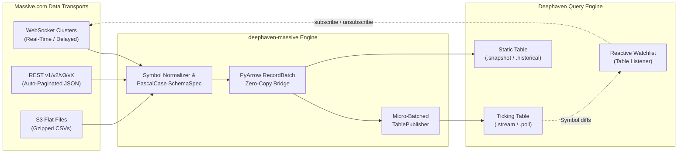

# deephaven-massive

**Unified Real-Time, Snapshot, and Historical Market Data for Deephaven Community Core**

`deephaven-massive` connects [Massive.com](https://massive.com) (formerly Polygon.io) directly to [Deephaven Community Core](https://deephaven.io), transforming WebSocket tick streams, paginated REST APIs, and multi-gigabyte S3 flat files into strongly typed, live-updating Deephaven tables.

Instead of writing bespoke WebSocket reconnect loops, thread-safe buffer queues, REST pagination cursors, and S3 CSV parsers, you express market data pipelines using a single declarative grammar:

```python
from deephaven_massive import MassiveSession

m = MassiveSession.from_env()

# Stream live equity trades, pre-populated with the latest REST snapshot
trades = m.stocks.trades(["AAPL", "NVDA", "MSFT"]).with_seed().stream()

# Dynamically stream quotes for whatever tickers are in today's top gainers table
gainers = m.stocks.gainers().poll(interval=30.0)
gainer_quotes = m.stocks.quotes(gainers).stream()
```

---

## Table of Contents

1. [Why `deephaven-massive`?](#1-why-deephaven-massive)
2. [Core Architecture & Mental Model](#2-core-architecture--mental-model)
3. [Installation & Configuration](#3-installation--configuration)
4. [5-Minute Quickstart](#4-5-minute-quickstart)
5. [Delivery Modes in Depth](#5-delivery-modes-in-depth)
6. [Reactive Watchlists: Table-Driven Subscriptions](#6-reactive-watchlists-table-driven-subscriptions)
7. [Canonical Symbols & Option Contract Helpers](#7-canonical-symbols--option-contract-helpers)
8. [Complete Domain Reference](#8-complete-domain-reference)
   - [8.1 Equities (`m.stocks`)](#81-equities-mstocks)
   - [8.2 Options (`m.options`)](#82-options-moptions)
   - [8.3 Futures (`m.futures`)](#83-futures-mfutures)
   - [8.4 Indices (`m.indices`)](#84-indices-mindices)
   - [8.5 Forex (`m.forex`)](#85-forex-mforex)
   - [8.6 Crypto (`m.crypto`)](#86-crypto-mcrypto)
   - [8.7 Macroeconomics (`m.economy`)](#87-macroeconomics-meconomy)
   - [8.8 Partner Datasets (`m.partners`)](#88-partner-datasets-mpartners)
   - [8.9 Bulk S3 Flat Files (`m.flat_files`)](#89-bulk-s3-flat-files-mflat_files)
9. [Observability, Performance & Production Operations](#9-observability-performance--production-operations)

---

## 1. Why `deephaven-massive`?

Building a quantitative research or real-time trading system typically requires gluing together three incompatible data transports:

1. **WebSockets** for low-latency live ticks (`T.*`, `Q.*`, `A.*`), which arrive as compact JSON arrays with terse single-letter keys (`ev`, `sym`, `p`, `s`, `t`).
2. **REST APIs** for point-in-time snapshots, reference data, fundamentals, and technical indicators, which arrive as nested JSON objects with `snake_case` field names and `next_url` pagination cursors.
3. **S3 Flat Files** (`files.massive.com`) for multi-day or full-market historical backfills, which arrive as gzipped CSVs with their own header conventions.

Without a unified integration layer, your downstream analytics code fractures: a query written against historical S3 CSVs breaks when pointed at a live WebSocket table because column names, timestamp precisions, and symbol prefixes (`O:`, `I:`, `C:`, `X:`) differ across transports.

`deephaven-massive` eliminates this impedance mismatch:

- **One Schema Across Every Transport**: Whether a trade row originates from a live WebSocket frame, a REST endpoint, or a gzipped S3 flat file, it lands in Deephaven with the exact same **PascalCase column names** (`Symbol`, `Timestamp`, `Price`, `Size`, `Exchange`, `Conditions`) and **PyArrow data types** (`pa.timestamp("ns", tz="UTC")`, `pa.float64()`, `pa.int64()`).
- **Zero-Boilerplate Streaming**: Background asyncio multiplexers, exponential backoff reconnects, subscription replay, and micro-batched `DynamicTableWriter` flushes happen automatically off the Deephaven query graph thread.
- **Cold-Start Seeding (`.with_seed()`)**: Pre-populate live streaming tables with the latest REST snapshot before opening the WebSocket feed—so dashboards and joins have valid state even before the next tick arrives or when markets are closed.
- **Reactive Table Watchlists**: Pass any live Deephaven `Table` containing a `Symbol` column directly into a feed method. As upstream queries add or remove symbols in real time, `deephaven-massive` automatically sends `subscribe` and `unsubscribe` diffs over the WebSocket.

---

## 2. Core Architecture & Mental Model

Every data request in `deephaven-massive` follows a fluent three-part grammar:

```text
m.<domain>.<dataset>(symbols_or_filters).<delivery_mode>()
```



### Key Architectural Guarantees

1. **Non-Blocking Ingestion**: All network I/O, JSON parsing, and gzip decompression run on isolated background daemon threads. Rows are converted into vectorised PyArrow tables and handed to Deephaven via `pa_table_to_dh`, keeping the Deephaven Update Graph lock-free.
2. **Nanosecond High-Water Mark Deduplication**: When combining a REST seed with a live WebSocket stream (`.with_seed().stream()`), `TablePublisher` tracks the maximum `Timestamp` (`int64` nanoseconds since epoch) observed per `(Symbol, EventType)` during seeding and drops any overlapping historical WebSocket events.
3. **Bounded Memory Footprint**: Multi-million-row REST queries and multi-gigabyte S3 flat files are streamed and concatenated in configurable chunks (`rest_chunk_size=50_000`, `s3_chunk_bytes=64MB`), preventing peak heap spikes.

---

## 3. Installation & Configuration

### Installation

Install `deephaven-massive` alongside Deephaven Community Core using `uv` or `pip`:

```bash
# Recommended: install with Deephaven server & PyArrow runtime
uv pip install "deephaven-massive[deephaven]"

# Or with standard pip
pip install "deephaven-massive[deephaven]"
```

### Environment Variables

`MassiveSession.from_env()` configures itself automatically from environment variables:

| Environment Variable | Default | Description |
| :--- | :--- | :--- |
| `MASSIVE_API_KEY` | *(Required)* | Your Massive.com API key (falls back to `POLYGON_API_KEY` for backward compatibility). |
| `MASSIVE_FEED` | `"delayed"` | Default WebSocket cluster: `"realtime"` (`wss://socket.massive.com`) or `"delayed"` (`wss://delayed.massive.com`). |
| `MASSIVE_REST_BASE_URL` | `"https://api.massive.com"` | Base URL for REST API calls. |
| `MASSIVE_S3_ENDPOINT` | `"https://files.massive.com"` | S3-compatible endpoint for historical flat files. |
| `MASSIVE_S3_BUCKET` | `"flatfiles"` | S3 bucket hosting historical flat files. |
| `MASSIVE_S3_ACCESS_KEY_ID` | `None` | Optional S3 Access Key ID (enables S3 flat-file routing for `.historical()`). |
| `MASSIVE_S3_SECRET_ACCESS_KEY` | `None` | Optional S3 Secret Access Key. |
| `MASSIVE_MAX_CONCURRENT_REQUESTS` | `32` | Maximum concurrent REST requests across worker threads. |
| `MASSIVE_FLUSH_INTERVAL_MS` | `100` | Micro-batch flush interval in milliseconds for live streaming tables. |

```bash
export MASSIVE_API_KEY="your-massive-api-key"
export MASSIVE_FEED="realtime"
export MASSIVE_S3_ACCESS_KEY_ID="your-s3-access-key"
export MASSIVE_S3_SECRET_ACCESS_KEY="your-s3-secret-key"
```

### Explicit Programmatic Configuration

You can also pass parameters directly to `MassiveSession` or construct an immutable `MassiveConfig`:

```python
from deephaven_massive import MassiveConfig, MassiveSession

# Option A: Keyword overrides on MassiveSession
m = MassiveSession(api_key="your-api-key", feed="realtime")

# Option B: Explicit MassiveConfig dataclass
config = MassiveConfig.from_env(
    feed="realtime",
    flush_interval_ms=50,
    max_concurrent_requests=64,
)
m = MassiveSession(config=config)
```

---

## 4. 5-Minute Quickstart

### Step 1: Stream Live Equity Trades & Quotes with Cold-Start Seeding

By chaining `.with_seed().stream()`, your table immediately populates with the latest trade/quote from the REST Snapshot API and then seamlessly transitions to live WebSocket ticks:

```python
from deephaven_massive import MassiveSession

m = MassiveSession.from_env()

watchlist = ["AAPL", "MSFT", "NVDA", "SPY", "QQQ"]

# Live trades and NBBO quotes, pre-seeded so the table is never empty
trades = m.stocks.trades(watchlist).with_seed().stream()
quotes = m.stocks.quotes(watchlist).with_seed().stream()
```

### Step 2: Real-Time As-Of Join (`aj`) Between Trades and Quotes

Because `trades` and `quotes` share canonical `Symbol` and `Timestamp` (`Instant`) columns, you can immediately compute real-time execution quality and effective spread in Deephaven:

```python
# Attach the prevailing NBBO bid/ask to every incoming trade tick
trades_with_nbbo = trades.aj(
    table=quotes,
    on=["Symbol", "Timestamp"],
    joins=["BidPrice", "BidSize", "AskPrice", "AskSize"],
).update_view([
    "MidPrice = (BidPrice + AskPrice) / 2.0",
    "SpreadBps = (AskPrice - BidPrice) / MidPrice * 10000.0",
    "SignedSlippage = Price - MidPrice",
])
```

### Step 3: Enrich Live Streams with Reference & Fundamental Data

Fetch a static or periodically polled reference table and join it onto your streaming ticks:

```python
# Poll valuation ratios every 5 minutes and join P/E and MarketCap onto live quotes
ratios = m.stocks.ratios(tickers=watchlist).snapshot()

enriched_quotes = quotes.last_by(["Symbol"]).natural_join(
    table=ratios.last_by(["Symbol"]),
    on=["Symbol"],
    joins=["MarketCap", "PriceToEarnings", "ReturnOnEquity", "DebtToEquity"],
)
```

---

## 5. Delivery Modes in Depth

Every dataset method returns a [`FeedBuilder`](file:///Users/chip/dev/deephaven-massive/src/deephaven_massive/engine/builder.py) supporting up to five terminal delivery modes:

| Method | Return Type | Transport | When to Use |
| :--- | :--- | :--- | :--- |
| `.stream(feed=None)` | Live Ticking `Table` | WebSocket | Low-latency real-time or 15-min delayed streaming ticks, quotes, bars, L2 book, and FMV. |
| `.with_seed().stream()` | Live Ticking `Table` | REST + WebSocket | Pre-populate a live stream with the latest REST snapshot so downstream joins have immediate state, then deduplicate live ticks by nanosecond high-water mark. |
| `.snapshot()` | Static `Table` | REST | Point-in-time snapshots, reference directories, corporate actions, fundamentals, or technical indicators. |
| `.historical(start, end, source="auto")` | Static `Table` | REST or S3 | Historical time-series backfills. Automatically selects REST for narrow symbol-specific queries and S3 Flat Files for multi-day or full-market scans. |
| `.poll(interval=60.0)` | Live Ticking `Table` | REST (Background Timer) | Turn any REST endpoint (top gainers, option chains, Treasury yields, news) into a live-updating Deephaven table refreshed every `interval` seconds. |

### Smart Historical Routing (`source="auto"`)

When you call `.historical(start, end, source="auto")` on a dataset that exists in both REST and S3 Flat Files (such as trades, quotes, or bars), `FeedBuilder` inspects your query:

- **Routes to S3 Flat Files** if S3 credentials are configured *and* you request all symbols (`symbols=None` or `"*"`) *or* a date range spanning **5 or more days**. Furthermore, symbol and timestamp predicates are pushed down into `pyarrow.csv.open_csv` during streaming decompression so irrelevant symbols are discarded before allocation.
- **Routes to REST** for targeted symbol queries over short date windows, or when S3 credentials are not configured.

```python
# Short 2-day window for 1 symbol -> automatically routes to REST
aapl_recent = m.stocks.bars("AAPL", multiplier=1, timespan="minute").historical(
    "2026-01-05", "2026-01-06"
)

# Full-market minute bars across 5 trading days -> automatically streams from S3 Flat Files
full_market = m.stocks.bars("*", multiplier=1, timespan="minute").historical(
    "2026-01-05", "2026-01-09"
)

# Force a specific transport explicitly if desired
forced_rest = m.stocks.trades("AAPL").historical("2026-01-05", "2026-01-06", source="rest")
```

---

## 6. Reactive Watchlists: Table-Driven Subscriptions

One of Deephaven's superpowers is that tables update reactively as data flows through the query graph. `deephaven-massive` extends this reactivity all the way to your network socket.

Anywhere a method accepts `symbols`, you can pass:

1. A single symbol string: `"AAPL"`
2. An iterable of symbol strings: `["AAPL", "MSFT", "NVDA"]`
3. `"*"` for full-market wildcard subscriptions
4. **A live Deephaven `Table`** containing a `Symbol` column

When you pass a Deephaven `Table`, [`WatchlistSubscriber`](file:///Users/chip/dev/deephaven-massive/src/deephaven_massive/engine/watchlist.py) attaches a table listener to the `Symbol` column:

- When rows are **added** to the upstream table, `deephaven-massive` sends a `subscribe` command for the newly added symbols.
- When rows are **removed** from the upstream table, `deephaven-massive` decrements their reference count and sends an `unsubscribe` command once the count reaches zero.

### Example: Dynamically Streaming Option Contracts Near the Money

```python
# 1. Poll the NVDA option chain every 60 seconds
chain = m.options.chain_snapshot("NVDA").poll(interval=60.0)

# 2. Filter for liquid near-the-money calls using standard Deephaven table operations
active_calls = chain.where([
    "ContractType = `call`",
    "Delta >= 0.35 && Delta <= 0.65",
    "OpenInterest >= 500",
])

# 3. Pass the filtered Deephaven table directly as the watchlist!
# As NVDA's spot price moves and new strikes enter the 0.35-0.65 delta band,
# the WebSocket automatically subscribes to the new contracts and unsubscribes from old ones.
live_option_quotes = m.options.quotes(active_calls).stream()
```

---

## 7. Canonical Symbols & Option Contract Helpers

Massive's raw APIs prefix non-equity symbols with asset-class namespace indicators (`O:` for options, `I:` for indices, `C:` for forex, `X:` for crypto).

`deephaven-massive` handles these prefixes transparently through [`SymbolNormalizer`](file:///Users/chip/dev/deephaven-massive/src/deephaven_massive/engine/symbols.py):

- **Input**: You can pass clean canonical symbols (`"SPX"`, `"EUR/USD"`, `"BTC-USD"`, `"AAPL260116C00200000"`) or raw prefixed symbols (`"I:SPX"`, `"C:EURUSD"`, `"X:BTC-USD"`, `"O:AAPL260116C00200000"`).
- **Output**: Every Deephaven table emitted by `deephaven-massive` strips wire prefixes and normalizes separators so the `Symbol` column always contains the clean canonical symbol (`"SPX"`, `"EUR/USD"`, `"BTC-USD"`, `"AAPL260116C00200000"`).

| Domain | Accepted Input Formats | Canonical `Symbol` in Deephaven Table | Wire Symbol Sent to Massive |
| :--- | :--- | :--- | :--- |
| **Stocks** | `"AAPL"`, `"aapl"`, `"BRK.B"` | `"AAPL"`, `"BRK.B"` | `"AAPL"`, `"BRK.B"` |
| **Options** | `"AAPL260116C00200000"`, `"O:AAPL260116C00200000"` | `"AAPL260116C00200000"` | `"O:AAPL260116C00200000"` |
| **Indices** | `"SPX"`, `"I:SPX"`, `"VIX"` | `"SPX"`, `"VIX"` | `"I:SPX"`, `"I:VIX"` |
| **Forex** | `"EUR/USD"`, `"EUR-USD"`, `"EURUSD"`, `"C:EURUSD"` | `"EUR/USD"` | `"C:EURUSD"` (REST) / `"EUR/USD"` (WS) |
| **Crypto** | `"BTC-USD"`, `"BTC/USD"`, `"X:BTCUSD"` | `"BTC-USD"` | `"X:BTCUSD"` (REST) / `"BTC-USD"` (WS) |
| **Futures** | `"ESZ5"`, `"NQH6"` | `"ESZ5"`, `"NQH6"` | `"ESZ5"`, `"NQH6"` |

### Formatting OCC Option Symbols

Use `MassiveSession.option_symbol()` to construct canonical 21-character OCC option contract tickers without manual zero-padding:

```python
from deephaven_massive import MassiveSession

contract = MassiveSession.option_symbol("AAPL", "2026-01-16", "C", 200.0)
# -> "AAPL260116C00200000"

quotes = m.options.quotes(contract).with_seed().stream()
```

---

## 8. Complete Domain Reference

`MassiveSession` exposes nine specialized domain clients as properties:

| Property | Client Class | Coverage |
| :--- | :--- | :--- |
| `m.stocks` | [`StocksClient`](file:///Users/chip/dev/deephaven-massive/src/deephaven_massive/domains/stocks.py) | US equities trades, NBBO quotes, bars, snapshots, technicals, fundamentals, SEC filings, corporate actions, and market status. |
| `m.options` | [`OptionsClient`](file:///Users/chip/dev/deephaven-massive/src/deephaven_massive/domains/options.py) | OPRA options trades, quotes, bars, Greeks/IV chain snapshots, and contract reference data. |
| `m.futures` | [`FuturesClient`](file:///Users/chip/dev/deephaven-massive/src/deephaven_massive/domains/futures.py) | CME, CBOT, NYMEX, and COMEX futures trades, quotes, bars, snapshots, contracts, and product schedules. |
| `m.indices` | [`IndicesClient`](file:///Users/chip/dev/deephaven-massive/src/deephaven_massive/domains/indices.py) | Real-time index values (`V.*`), minute/second aggregates, and snapshots for S&P, Nasdaq, Dow, Russell, and VIX. |
| `m.forex` | [`ForexClient`](file:///Users/chip/dev/deephaven-massive/src/deephaven_massive/domains/forex.py) | Global OTC FX spot quotes, aggregates, snapshots, and real-time currency conversion. |
| `m.crypto` | [`CryptoClient`](file:///Users/chip/dev/deephaven-massive/src/deephaven_massive/domains/crypto.py) | 24/7 digital asset trades, BBO quotes, Level 2 order book depth, bars, and snapshots. |
| `m.economy` | [`EconomyClient`](file:///Users/chip/dev/deephaven-massive/src/deephaven_massive/domains/economy.py) | US Treasury yield curves, CPI/PCE inflation, inflation expectations, and Federal Reserve / FOMC policy metrics. |
| `m.partners` | [`PartnersClient`](file:///Users/chip/dev/deephaven-massive/src/deephaven_massive/domains/partners.py) | Benzinga analyst ratings, earnings, guidance, consensus, news, and TMX corporate events. |
| `m.flat_files` | [`FlatFilesClient`](file:///Users/chip/dev/deephaven-massive/src/deephaven_massive/domains/flat_files.py) | Direct bulk ingestion of historical gzipped CSV files from `files.massive.com` with predicate pushdown. |

---

### 8.1 Equities (`m.stocks`)

#### Market Data, Snapshots & Technical Indicators

| Method | Supported Delivery Modes | Description |
| :--- | :--- | :--- |
| `m.stocks.trades(symbols)` | `.stream()`, `.with_seed()`, `.historical()` | Tick-by-tick equity trade executions (`T.*`). |
| `m.stocks.quotes(symbols)` | `.stream()`, `.with_seed()`, `.historical()` | Tick-by-tick NBBO top-of-book quotes (`Q.*`). |
| `m.stocks.bars(symbols, multiplier=1, timespan="minute")` | `.stream()`, `.historical()`, `.poll()` | OHLCV aggregate bars (`"second"`, `"minute"`, `"hour"`, `"day"`, `"week"`, `"month"`). |
| `m.stocks.luld(symbols)` | `.stream()` | Real-time Limit Up-Limit Down (LULD) price bands and pause indicators. |
| `m.stocks.fmv(symbols)` | `.stream()` | Real-time algorithmic Fair Market Value (`FMV.*`) estimates. |
| `m.stocks.snapshot(symbols=None)` | `.snapshot()`, `.poll()` | Full-market or multi-ticker snapshot (day bar, prev day bar, last trade, last quote). |
| `m.stocks.gainers(include_otc=False)` | `.snapshot()`, `.poll()` | Top 20 intraday percentage gainers. |
| `m.stocks.losers(include_otc=False)` | `.snapshot()`, `.poll()` | Top 20 intraday percentage losers. |
| `m.stocks.previous_close(symbol)` | `.snapshot()`, `.poll()` | Previous trading session's OHLCV bar. |
| `m.stocks.daily_open_close(symbol, date)` | `.snapshot()` | Official open, close, pre-market, and after-hours prices for a specific date. |
| `m.stocks.grouped_daily(date)` | `.snapshot()`, `.historical()` | Full-market daily OHLCV bars for all US equities on a given date. |
| `m.stocks.sma(symbol, window=50)` | `.snapshot()`, `.historical()`, `.poll()` | Simple Moving Average (`SMA_SCHEMA`). |
| `m.stocks.ema(symbol, window=50)` | `.snapshot()`, `.historical()`, `.poll()` | Exponential Moving Average (`EMA_SCHEMA`). |
| `m.stocks.macd(symbol, short_window=12, long_window=26, signal_window=9)` | `.snapshot()`, `.historical()`, `.poll()` | Moving Average Convergence/Divergence (`Value`, `Signal`, `Histogram`). |
| `m.stocks.rsi(symbol, window=14)` | `.snapshot()`, `.historical()`, `.poll()` | Relative Strength Index (`RSI_SCHEMA`). |

#### Fundamentals, Short Volume, SEC Filings & Reference

| Method | Description |
| :--- | :--- |
| `m.stocks.short_interest(symbol, tickers=...)` | Bi-weekly FINRA short interest, average daily volume, and days-to-cover. |
| `m.stocks.short_volume(symbol, tickers=...)` | Daily off-exchange and exchange short sale volume and short ratio. |
| `m.stocks.float(symbol, tickers=...)` | Public share float and free-float percentage (alias: `share_float`). |
| `m.stocks.balance_sheets(symbol, timeframe=...)` | Quarterly and annual standardized balance sheets. |
| `m.stocks.income_statements(symbol, timeframe=...)` | Quarterly and annual standardized income statements. |
| `m.stocks.cash_flow_statements(symbol, timeframe=...)` | Quarterly and annual standardized cash flow statements. |
| `m.stocks.financials(symbol, timeframe=...)` | Combined financial statements (`/vX/reference/financials`). |
| `m.stocks.ratios(symbol, tickers=...)` | Valuation, profitability, liquidity, and leverage ratios (P/E, P/B, EV/EBITDA, ROE). |
| `m.stocks.dividends(symbol)` / `m.stocks.splits(symbol)` / `m.stocks.ipos()` | Cash/stock dividends, forward/reverse splits, and historical/upcoming IPOs. |
| `m.stocks.tickers(...)` / `m.stocks.ticker_details(symbol)` | Reference ticker directory and detailed company profiles (SIC, market cap, address). |
| `m.stocks.ticker_events(symbol)` / `m.stocks.related_companies(symbol)` | Corporate symbol-change history and peer ticker relationships. |
| `m.stocks.sec_filings(symbol, form_type=...)` | SEC EDGAR filings index (`10-K`, `10-Q`, `8-K`, etc.). |
| `m.stocks.sec_10k_sections(...)` / `m.stocks.sec_8k_text(...)` | Parsed 10-K narrative sections and 8-K item disclosures. |
| `m.stocks.sec_risk_factors(...)` / `m.stocks.sec_disclosures(...)` | Categorized SEC risk factor and structured taxonomy disclosures. |
| `m.stocks.sec_13f_holdings(...)` / `m.stocks.sec_insider_transactions(...)` | Institutional Form 13F holdings and Form 3/4/5 insider transactions. |
| `m.stocks.news(symbol)` | Real-time financial news articles with sentiment and entity insights. |
| `m.stocks.market_status()` / `m.stocks.market_holidays()` | Real-time exchange open/closed status and upcoming holiday schedules. |
| `m.stocks.exchanges()` / `m.stocks.conditions()` | Exchange directory and SIP trade/quote condition code dictionaries. |

---

### 8.2 Options (`m.options`)

```python
# Snapshot or poll the full option chain with Greeks, IV, and Break-Even Price
nvda_chain = m.options.chain_snapshot(
    "NVDA",
    expiration_date_gte="2026-01-01",
    contract_type="call",
).snapshot()

# Stream live NBBO quotes and trades for specific OCC option contracts
contract = m.option_symbol("NVDA", "2026-01-16", "C", 150.0)
opt_quotes = m.options.quotes([contract]).with_seed().stream()
opt_trades = m.options.trades([contract]).with_seed().stream()
```

| Method | Supported Delivery Modes | Description |
| :--- | :--- | :--- |
| `m.options.chain_snapshot(underlying_asset, ...)` | `.snapshot()`, `.poll()` | Full option chain snapshot with `ImpliedVolatility`, `Delta`, `Gamma`, `Theta`, `Vega`, `OpenInterest`, and `BreakEvenPrice`. |
| `m.options.contract_snapshot(underlying_asset, option_contract)` | `.snapshot()`, `.poll()` | Point-in-time snapshot for a single OCC option contract. |
| `m.options.quotes(symbols)` | `.stream()`, `.with_seed()`, `.historical()` | OPRA option quotes (`Q.O:*`). |
| `m.options.trades(symbols)` | `.stream()`, `.with_seed()`, `.historical()` | OPRA option trade executions (`T.O:*`). |
| `m.options.bars(symbols, multiplier=1, timespan="minute")` | `.stream()`, `.historical()`, `.poll()` | OHLCV aggregate bars for option contracts. |
| `m.options.fmv(symbols)` | `.stream()` | Real-time Fair Market Value (`FMV.O:*`) for option contracts. |
| `m.options.contracts(underlying_ticker=..., ...)` | `.snapshot()`, `.historical()`, `.poll()` | Active and expired option contracts reference directory. |
| `m.options.contract_overview(options_ticker)` | `.snapshot()`, `.poll()` | Reference metadata for a single OCC option contract. |
| `m.options.previous_close(symbol)` / `daily_open_close(symbol, date)` | `.snapshot()` | Previous day OHLCV and daily open/close summary. |
| `m.options.sma(...)` / `ema(...)` / `macd(...)` / `rsi(...)` | `.snapshot()`, `.historical()`, `.poll()` | Technical indicators computed on option contract prices. |

---

### 8.3 Futures (`m.futures`)

```python
# Stream live E-mini S&P 500 and Nasdaq-100 futures trades & quotes
fut_trades = m.futures.trades(["ESZ5", "NQZ5"]).stream()
fut_quotes = m.futures.quotes(["ESZ5", "NQZ5"]).stream()

# Query active CME/CBOT futures contracts and trading schedules
contracts = m.futures.contracts(product_code="ES").snapshot()
schedules = m.futures.schedules(product_code="ES").snapshot()
```

| Method | Supported Delivery Modes | Description |
| :--- | :--- | :--- |
| `m.futures.trades(symbols)` | `.stream()`, `.historical()` | Real-time and historical futures trade executions across CME, CBOT, NYMEX, and COMEX. |
| `m.futures.quotes(symbols)` | `.stream()`, `.historical()` | Top-of-book futures bid/ask quotes. |
| `m.futures.bars(symbols, multiplier=1, timespan="minute")` | `.stream()`, `.historical()`, `.poll()` | OHLCV and settlement price bars for futures contracts. |
| `m.futures.snapshot(symbols=None)` | `.snapshot()`, `.poll()` | Multi-contract futures market snapshot (`Change`, `ChangePercent`, `OpenInterest`, `SettlementPrice`). |
| `m.futures.contracts(product_code=..., ...)` | `.snapshot()`, `.historical()`, `.poll()` | Active and historical futures contract specifications (`TickSize`, `MinTickValue`, `LastTradeDate`). |
| `m.futures.contract_overview(ticker)` | `.snapshot()`, `.poll()` | Detailed contract specifications for a single futures symbol. |
| `m.futures.products(...)` / `m.futures.product_schedules(product_code)` | `.snapshot()`, `.poll()` | Futures product directory and exchange trading session schedules. |
| `m.futures.schedules(...)` / `m.futures.market_Status()` | `.snapshot()`, `.poll()` | Futures session schedules and real-time venue status. |

---

### 8.4 Indices (`m.indices`)

```python
# Stream real-time index levels (S&P 500, Nasdaq-100, Russell 2000, VIX)
idx_values = m.indices.values(["SPX", "NDX", "RUT", "VIX"]).with_seed().stream()

# Historical 1-minute index bars
spx_bars = m.indices.bars("SPX", multiplier=1, timespan="minute").historical(
    "2026-01-01", "2026-01-15"
)
```

| Method | Supported Delivery Modes | Description |
| :--- | :--- | :--- |
| `m.indices.values(symbols)` | `.stream()`, `.with_seed()` | Real-time streaming index levels (`V.I:*`). |
| `m.indices.bars(symbols, multiplier=1, timespan="minute")` | `.stream()`, `.historical()`, `.poll()` | OHLC aggregate bars for market indices (`A.I:*`, `AM.I:*`). |
| `m.indices.snapshot(symbols=None)` | `.snapshot()`, `.poll()` | Point-in-time index values and daily OHLC snapshots. |
| `m.indices.previous_close(symbol)` / `daily_open_close(symbol, date)` | `.snapshot()` | Previous day close and daily open/close summary for an index. |
| `m.indices.sma(...)` / `ema(...)` / `macd(...)` / `rsi(...)` | `.snapshot()`, `.historical()`, `.poll()` | Technical indicators computed on index levels. |

---

### 8.5 Forex (`m.forex`)

```python
# Stream live spot FX quotes with cold-start REST seeding
fx_quotes = m.forex.quotes(["EUR/USD", "USD/JPY", "GBP/USD"]).with_seed().stream()

# Convert currency amounts at live spot rates
conversion = m.forex.currency_conversion("EUR", "USD", amount=1_000_000).snapshot()
```

| Method | Supported Delivery Modes | Description |
| :--- | :--- | :--- |
| `m.forex.quotes(symbols)` | `.stream()`, `.with_seed()`, `.historical()` | Real-time institutional FX spot bid/ask quotes (`C.*`). |
| `m.forex.bars(symbols, multiplier=1, timespan="minute")` | `.stream()`, `.historical()`, `.poll()` | OHLCV aggregate bars for currency pairs (`CAS.*`, `CA.*`). |
| `m.forex.fmv(symbols)` | `.stream()` | Real-time Fair Market Value (`FMV.C:*`) for FX pairs. |
| `m.forex.snapshot(symbols=None)` | `.snapshot()`, `.poll()` | Full-market or multi-pair FX snapshot. |
| `m.forex.gainers()` / `m.forex.losers()` | `.snapshot()`, `.poll()` | Top 20 intraday FX percentage gainers and losers. |
| `m.forex.currency_conversion(from_currency, to_currency, amount=100.0)` | `.snapshot()`, `.poll()` | Real-time spot currency conversion calculation. |
| `m.forex.grouped_daily(date)` / `previous_close(symbol)` | `.snapshot()` | Full-market daily FX bars and single-pair previous close. |
| `m.forex.sma(...)` / `ema(...)` / `macd(...)` / `rsi(...)` | `.snapshot()`, `.historical()`, `.poll()` | Technical indicators for currency pairs. |

---

### 8.6 Crypto (`m.crypto`)

```python
# Stream 24/7 digital asset trades, BBO quotes, and Level 2 order book updates
btc_trades = m.crypto.trades(["BTC-USD", "ETH-USD", "SOL-USD"]).with_seed().stream()
btc_l2 = m.crypto.level2(["BTC-USD"]).stream()
```

| Method | Supported Delivery Modes | Description |
| :--- | :--- | :--- |
| `m.crypto.trades(symbols)` | `.stream()`, `.with_seed()`, `.historical()` | Real-time and historical digital asset trade executions (`XT.*`). |
| `m.crypto.quotes(symbols)` | `.stream()`, `.with_seed()`, `.historical()` | Best bid and offer (BBO) crypto quotes (`XQ.*`). |
| `m.crypto.level2(symbols)` | `.stream()` | Real-time Level 2 order book price-level changes (`XL2.*`). |
| `m.crypto.bars(symbols, multiplier=1, timespan="minute")` | `.stream()`, `.historical()`, `.poll()` | OHLCV aggregate bars for digital currency pairs (`XAS.*`, `XA.*`). |
| `m.crypto.fmv(symbols)` | `.stream()` | Real-time Fair Market Value (`FMV.X:*`) for digital assets. |
| `m.crypto.snapshot(symbols=None)` / `book_snapshot(symbol)` | `.snapshot()`, `.poll()` | Multi-pair market snapshots and single-pair L2 order book snapshots. |
| `m.crypto.gainers()` / `m.crypto.losers()` | `.snapshot()`, `.poll()` | Top 20 24-hour crypto percentage gainers and losers. |
| `m.crypto.grouped_daily(date)` / `previous_close(symbol)` / `daily_open_close(...)` | `.snapshot()` | Daily OHLCV summaries across digital asset markets. |
| `m.crypto.sma(...)` / `ema(...)` / `macd(...)` / `rsi(...)` | `.snapshot()`, `.historical()`, `.poll()` | Technical indicators for digital assets. |

---

### 8.7 Macroeconomics (`m.economy`)

```python
# Fetch the historical US Treasury yield curve (1M through 30Y maturities)
yields = m.economy.treasury_yields().historical("2020-01-01", "2026-01-15")

# Poll CPI/PCE inflation and market-implied inflation expectations
inflation = m.economy.inflation().snapshot()
expectations = m.economy.inflation_expectations().snapshot()
```

| Method | Supported Delivery Modes | Description |
| :--- | :--- | :--- |
| `m.economy.treasury_yields(**filters)` | `.snapshot()`, `.historical()`, `.poll()` | Daily constant-maturity US Treasury yield curve (`Yield1Month` through `Yield30Year`). |
| `m.economy.inflation(**filters)` | `.snapshot()`, `.historical()`, `.poll()` | Headline and Core CPI and PCE inflation metrics (`CPI`, `CPICore`, `CPIYearOverYear`, `PCE`, `PCECore`). |
| `m.economy.inflation_expectations(**filters)` | `.snapshot()`, `.historical()`, `.poll()` | TIPS breakeven rates, Cleveland Fed models, and consumer survey inflation expectations. |
| `m.economy.labor_market(**filters)` | `.snapshot()`, `.historical()`, `.poll()` | Unemployment rate, nonfarm payrolls, labor force participation, and job openings. |
| `m.economy.fed_funds_rate(**filters)` / `sofr(**filters)` | `.snapshot()`, `.historical()`, `.poll()` | Effective Federal Funds Rate, target bounds, and Secured Overnight Financing Rate (SOFR). |
| `m.economy.fomc_calendar(**filters)` | `.snapshot()`, `.historical()`, `.poll()` | Federal Open Market Committee meeting dates, rate decisions, and statement links. |

---

### 8.8 Partner Datasets (`m.partners`)

```python
# Stream or poll Benzinga analyst upgrades, downgrades, and price-target revisions
ratings = m.partners.benzinga_ratings(tickers=["AAPL", "NVDA"]).poll(interval=60.0)

# Fetch upcoming earnings dates, EPS/Revenue surprises, and corporate guidance
earnings = m.partners.benzinga_earnings(tickers=["AAPL", "NVDA"]).snapshot()
guidance = m.partners.benzinga_guidance(tickers=["AAPL", "NVDA"]).snapshot()
```

| Method | Description |
| :--- | :--- |
| `m.partners.benzinga_ratings(symbol, tickers=..., action=...)` | Analyst upgrades, downgrades, initiations, and price-target changes. |
| `m.partners.benzinga_earnings(symbol, tickers=...)` | Historical and upcoming quarterly earnings releases (`EPSActual`, `EPSEstimate`, `EPSSurprisePercent`, `RevenueActual`). |
| `m.partners.benzinga_guidance(symbol, tickers=...)` | Corporate management EPS and revenue guidance ranges (`MinGuidanceEPS`, `MaxGuidanceEPS`). |
| `m.partners.benzinga_consensus(symbol, tickers=...)` | Aggregated consensus rating scores and price target distributions. |
| `m.partners.benzinga_analysts()` / `benzinga_firms()` | Directory of individual Wall Street analysts and sell-side research firms. |
| `m.partners.benzinga_news(symbol, tickers=...)` | Real-time Benzinga financial news feed with channels and tags. |
| `m.partners.benzinga_bulls_bears_say(symbol, tickers=...)` | Curated bull-case and bear-case investment thesis summaries. |
| `m.partners.tmx_corporate_events(symbol, tickers=...)` | TMX Wall Street Horizon corporate events calendar (conferences, shareholder meetings, splits). |

---

### 8.9 Bulk S3 Flat Files (`m.flat_files`)

When backfilling days or months of full-market data, `m.flat_files` streams and decompresses `.csv.gz` archives directly from `https://files.massive.com` in 64 MB chunks, pushing symbol and timestamp filters down into the C++ PyArrow CSV reader:

```python
# Load a full day of US equity trades for semiconductor tickers directly from S3
semi_trades = m.flat_files.load(
    "us_stocks_sip",
    "trades_v1",
    start="2026-01-05",
    end="2026-01-09",
    symbols=["NVDA", "AMD", "AVGO", "TSM", "INTC"],
)

# List available S3 keys under a prefix
keys = m.flat_files.list_files("us_stocks_sip", "minute_aggs_v1", prefix="2026/01")
```

| Namespace (`asset_class`) | Available Datasets (`dataset`) |
| :--- | :--- |
| `"us_stocks_sip"` | `"trades_v1"`, `"quotes_v1"`, `"minute_aggs_v1"`, `"day_aggs_v1"` |
| `"us_options_opra"` | `"trades_v1"`, `"quotes_v1"`, `"minute_aggs_v1"`, `"day_aggs_v1"` |
| `"us_indices"` | `"values_v1"`, `"minute_aggs_v1"`, `"day_aggs_v1"` |
| `"global_forex"` | `"quotes_v1"`, `"minute_aggs_v1"`, `"day_aggs_v1"` |
| `"global_crypto"` | `"trades_v1"`, `"quotes_v1"`, `"minute_aggs_v1"`, `"day_aggs_v1"` |
| `"us_futures_cme"` | `"trades_v1"`, `"quotes_v1"`, `"minute_aggs_v1"`, `"day_aggs_v1"` |

---

## 9. Observability, Performance & Production Operations

### Live Health & Telemetry Table (`m.status()`)

Call `m.status()` in any Deephaven session to open a live-updating telemetry table tracking every active WebSocket multiplexer, REST poller, and table publisher:

```python
status_table = m.status()
```

| Column | Type | Description |
| :--- | :--- | :--- |
| `Component` | `string` | Subsystem identifier (e.g., `"ws:stocks:realtime"`, `"poller:stocks_gainers"`). |
| `Domain` | `string` | Asset domain (`"stocks"`, `"options"`, `"crypto"`, etc.). |
| `State` | `string` | Current operational state (`"STREAMING"`, `"POLLING"`, `"RECONNECTING"`, `"STOPPED"`). |
| `ActiveSymbols` | `int64` | Number of currently subscribed tickers on the stream. |
| `RowsEmitted` | `int64` | Cumulative rows flushed to Deephaven `DynamicTableWriter`s. |
| `DroppedRows` | `int64` | Rows dropped due to queue overflow (when `drop_oldest_on_full=True`). |
| `Reconnects` | `int64` | Count of automatic WebSocket reconnections. |
| `LastEventTs` | `Instant` | UTC timestamp of the most recent event or poll cycle. |
| `LastError` | `string` | Most recent exception message, if any. |

### Graceful Lifecycle & Resource Cleanup

`MassiveSession` manages background WebSocket threads, HTTP connection pools, S3 clients, and periodic timers. Use it as a context manager for bounded jobs, or call `m.close()` when tearing down an interactive session:

```python
with MassiveSession.from_env() as m:
    bars = m.stocks.bars("AAPL", 1, "day").historical("2025-01-01", "2026-01-01")
```

---

## Development & Testing

```bash
# Run the full test suite with 100% statement and branch coverage enforcement
uv run pytest --cov=deephaven_massive --cov-branch --cov-report=term-missing
```

## License

Apache License 2.0
