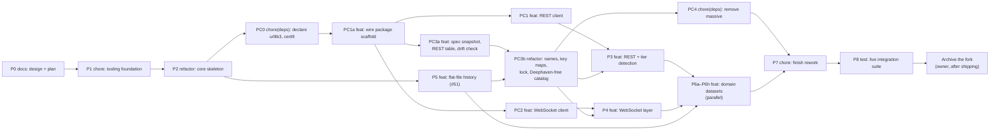

# deephaven-massive rework — execution plan

**Status:** approved plan; P0–P2 merged, P5 in review (#51), PC0–PC4 next. **Companion:** [`DESIGN.md`](DESIGN.md) is the
specification; this file is the schedule. When they disagree, `DESIGN.md` wins and this file
gets a `docs:` fix.

## Purpose and lifetime of this file

This file turns the approved rework into work packages that a fresh-context agent can execute
with nothing but `DESIGN.md`, this file, `AGENTS.md`, and the code. It is **temporary by
design**: P7 moves the durable parts (standards, invariants, workflow) into `README.md` and
`AGENTS.md`, then deletes `plans/rework/`. Nothing in this file is a long-term reference, so do
not link to it from docstrings or from `README.md`.

Citations of the form "Appendix B" through "Appendix I" refer to
[`RESEARCH.md`](RESEARCH.md), the reference material gathered during planning: the data
catalog, endpoint status, tooling research, and the bug lists for the current code.
Appendix H (the SDK evaluation) predates the decision to drop the SDK; its notes on SDK
behaviour are history, and the SDK defects it records are now requirements of the library's own
clients (DESIGN § 19).

## How progress is tracked

- One GitHub issue per work package, all children of one parent tracking issue. Each issue
  carries the package's live checklist; the checklists below are the *initial* copy.
- Each package links its issue; the parent tracking issue is #37. Live progress is tracked in
  the issues' checklists, not by ticking boxes in this file.
- A package is **done** when its PR is merged by the owner and the issue is closed with a link to
  the merged PR. Agents never merge and never close issues on their own authority.
- Packages are referred to by ID (`P3`, `PC1`) in commit bodies and PR descriptions
  (`Refs #<issue>`), never by title, so renames do not break traceability.

## Table of contents

1. [Dependency graph](#dependency-graph)
2. [Global rules for every package](#global-rules-for-every-package)
3. [Parallelism guide](#parallelism-guide)
4. [Legacy code transition](#legacy-code-transition)
5. [Package template](#package-template)
6. Library packages
   - [P0 docs: rework design and plan](#p0)
   - [P1 chore: tooling foundation](#p1)
   - [P2 refactor: core skeleton](#p2)
   - [PC0–PC4 own clients and the spec snapshot](#pc)
   - [P3 feat: REST transport and tier detection](#p3)
   - [P4 feat: WebSocket layer](#p4)
   - [P5 feat: flat-file history](#p5)
   - [P6a–P6h feat: domain datasets](#p6)
   - [P7 chore: finish rework](#p7)
   - [P8 test: live integration suite](#p8)
7. [Upstream SDK issues (optional)](#upstream)
8. [Final step: archive the fork](#archive-fork)
9. [End-to-end verification](#end-to-end-verification)
10. [Decisions recorded during planning](#decisions-recorded-during-planning)

---

## Dependency graph



P0, P1, and P2 are merged; P5 is in review (#51). PC0 lands first, then the PC1a scaffold.
PC1, PC2, and PC3a own
disjoint files and run in parallel with each other and with P5. PC3b follows PC3a and P5: it
moves the flat-file key maps #51 owns today into the wire package, so #51 is never broken.
PC4 removes `massive` once PC3b has removed its last import; P3 and P4 do not wait for it.

Critical path: `PC0 → PC1a → PC3a → PC3b → P4 → P6 → P7`, with PC1 and PC2 alongside PC3a.
Keep PC1a minimal so PC3a can start at once.

---

## Global rules for every package

These rules apply to every package in both repositories. Package sections only add to them.

1. **Branching.** One PR per package on a branch named `<type>/<topic>` off `main`. Never
   commit directly on `main`. Never force-push a branch another agent may have checked out.
2. **Conventional commits.** Commit subjects and PR titles follow Conventional Commits v1.0.0
   (`feat:`, `fix:`, `docs:`, `test:`, `refactor:`, `ci:`, `chore:`), with the PR title given in
   each package below. Commit bodies end with the attribution lines the harness supplies.
3. **Check gate.** `./scripts/check.sh` (full tier) must be green before every push, and every
   CI job must be green on the PR, including the free-threaded `3.14t` job (`PYTHON_GIL=0`),
   which is a required check. 3.14t is the only free-threaded target: pyarrow, numpy, and pandas
   no longer publish cp313t wheels. Until P1 lands, the gate is the legacy
   `scripts/pre-commit.sh`; from P1 on, hooks enforce it automatically.
4. **Fresh-context implementers.** Each package is executed by a subagent whose only inputs are
   `DESIGN.md`, this file, `AGENTS.md`, and the code. If a package cannot be completed from those
   inputs, the fix is to improve those files (a `docs:` PR), not to pass tribal knowledge along.
5. **No merging.** Agents never run `gh pr merge`, `git merge` into `main`, or `git push` to
   `main`. Only the owner merges, always via PR.
6. **Owner approvals.** The following are outward-facing and require explicit owner approval
   each time: opening a PR or issue in this repository, filing an issue on
   `massive-com/client-python` ([Upstream SDK issues](#upstream); pull requests there are never
   opened), and any change to branch protection. Agents prepare the text and stop at the gate.
7. **Test layout** ([DESIGN § 4.2 Test layout](DESIGN.md#42-test-layout)). `tests/` mirrors
   `src/deephaven_massive/`: the module `<path>/<name>.py` is tested by
   `tests/<path>/test_<name>.py`, where `<name>` has its leading underscore removed and `<path>`
   is copied as is. So `_config.py` is tested by `tests/test_config.py`, `_domains/stocks.py` by
   `tests/_domains/test_stocks.py`, and `_catalog.py` by `tests/test_catalog.py` (which also
   holds the coverage assertions). A package `__init__.py` is mirrored by
   `tests/<path>/test_init.py`; `tests/test_init.py` holds the public-surface tests
   (`dm.__all__`, `__version__`). Live tests end in `_integration.py`. The approved exceptions
   to the mirror rule are exactly `tests/conftest.py`, `tests/test_layout.py`,
   `tests/test_catalog.py` (for its coverage assertions), `tests/test_readme.py` (the
   DESIGN § 21 examples; it mirrors `README.md`), and the `tests/_fakes/` package
   (DESIGN § 4.2; see [Decisions recorded during planning](#decisions-recorded-during-planning)).
   `tests/_fakes/` is imported only by `tests/conftest.py`, whose thin fixtures hand the fakes
   to test modules; a test module imports it directly only when no fixture can provide what it
   needs, with a comment saying why. `tests/test_layout.py` enforces the rule; a new exception
   needs owner approval and a change to DESIGN § 4.2.
8. **Linter-ignore policy.** The global `ignore` list, every `per-file-ignores` entry, and every
   inline `# noqa` or `# type: ignore[...]` needs a reason comment. Adding a *new* rule to any
   ignore list, or a new `noqa` category, requires owner approval recorded in the PR. Fix the
   code first.
9. **Coverage.** 100% statement and branch coverage over `src/deephaven_massive`. `pragma: no
   cover` is allowed only with a written reason on the same line and owner approval in the PR;
   `exclude_also` holds exactly the approved patterns from `pyproject.toml`. Never write dead
   defensive branches to satisfy the gate; delete the branch instead.
10. **Deephaven invariants.** `AGENTS.md` lists them (execution context on every library thread,
    no blocking inside listeners, the registry lock is a leaf lock, no refreshing tables outside
    an explicit liveness scope). A package that touches `src/deephaven_massive/_*.py` restates
    the invariants it relies on in its PR description.
11. **No live testing as design input** ([DESIGN § 22](DESIGN.md#22-decisions), item 19). Unit tests use fake REST/WS/S3 servers and
    fixtures shaped from the OpenAPI spec's examples and the documentation samples. Live tests
    are P8 only.
12. **Docstrings and docs sync.** Every module, class, and function, public or private, has a
    Google-style docstring that meets `AGENTS.md`'s documentation standard (purpose, arguments,
    returns, raises, side effects, threading, and an example where it helps). Minimal docstrings
    are a defect. `D` and `DOC201/501/502` check form; review checks substance. A change to a public signature, default, or
    table semantics updates `DESIGN.md` (owner decision required) and, after P7, `README.md`.
13. **One package, one concern.** If a package needs a change to a file another package owns,
    land that change first in a small separate PR (`refactor:` or `chore:`), rebase, and continue.
14. **Answer every review comment.** Reply to each review thread on a package's PR, from people
    or bots: name the commit that addresses it and summarize the fix, or explain why no change
    is made. No thread is left unanswered, and none is resolved without a reply.

---

## Parallelism guide

### Which packages can run concurrently

| Wave | Packages | Notes |
|---|---|---|
| 0–2 | P0, P1, P2 | Merged. |
| 3 | PC0, then PC1a, then PC1, PC2, PC3a; P5 | PC0 (declarations) and PC1a (the scaffold every client imports) are small and land first. P5 is in review (#51). |
| 4 | PC3b | After PC3a and P5. |
| 5 | PC4, P3, P4 | Disjoint files. |
| 6 | P6a–P6h | Eight domain packages, disjoint files by construction. |
| 7 | P7 | Serial: deletes legacy code, rewrites docs, adds the catalog coverage assertions. |
| 8 | P8 | After P7; needs a key; owner runs it. |
| — | Archive the fork | Owner step after shipping. |

### How file conflicts are avoided

The module names are fixed by [DESIGN § 4.1 Source modules](DESIGN.md#41-source-modules). The
skeleton created in P2 is designed so that later packages own disjoint files:

- **Client and transport packages own distinct modules.** The Massive wire package
  `src/deephaven_massive/_massive/` is split by owner: PC1a owns the package root
  (`__init__.py`, `errors.py`, `net.py`), the value types `_massive/spec/types.py`, and the
  import-boundary test in `tests/test_layout.py`; PC1 owns `_massive/rest/`; PC2 owns
  `_massive/ws/`; PC3a owns the rest of `_massive/spec/` (snapshot, allow-list, exclusions,
  units, generator, drift, generated table), `scripts/refresh_massive_spec.py`, and
  `.github/workflows/spec-drift.yml`; PC3b owns `_massive/names/` (lexicons, key maps, lock code,
  and the empty locks) and `_datasets/`, and is the package that reworks `_schema.py`,
  `_catalog.py`, and `_timeunits.py`. PC2, PC3a, and PC3b each add one block of exports to
  `_massive/__init__.py`. P3 owns `_rest.py`, `_hosts.py`, and `_poll.py`. P4 owns `_ws.py`, `_stream.py`,
  and `_watchlist.py`. P5 owns `_flatfiles.py`. Each owns its mirrored test file(s) and a
  fixture directory `tests/data/<module>/`. The fake servers follow the clients: P1 created the
  empty `tests/_fakes/__init__.py`, PC1 owns `tests/_fakes/rest.py`, PC2 `tests/_fakes/ws.py`,
  and P5 `tests/_fakes/s3.py`. Each also adds its own thin fixture to `tests/conftest.py` as a
  separate, self-contained block (one fixture function and its import), so the three edits are
  disjoint hunks. `_session.py` exposes
  one factory hook per transport that P2 stubs (`NotImplementedError`) and each transport
  package fills; the hooks are separate functions, so three PRs can edit `_session.py` without
  overlapping hunks. If overlap is unavoidable, P3 lands first, then P5, then P4.
- **Domain packages own one domain each.** P6x edits only `_datasets/<domain>.py` (the
  declarations), `_domains/<domain>.py` (the namespace class), their tests
  `tests/_datasets/test_<domain>.py` and `tests/_domains/test_<domain>.py`, its lock file
  `_massive/names/locks/<domain>.json` (through the refresh), and `tests/data/<domain>/`. P6h owns
  the `partners` modules, which hold the four vendor classes. P6g owns the `reference`,
  `indicators`, and `economy` modules of `_datasets/` and `_domains/`, and is the one
  domain package that also edits `_session.py`: it fills `MassiveSession.snapshots()`, because
  DESIGN places the unified snapshot on the session rather than in a namespace. The dataset's
  record, `reference.snapshots`, is declared in `_datasets/reference.py` like every other
  record (DESIGN § 8.11), so `_catalog.datasets()` finds it without a `_catalog.py` edit.
- **No shared registry file is edited by domain packages** (P6g's `_session.py` edit above
  excepted).
  Every cross-cutting table is composed from per-domain declarations rather than written
  centrally:
  - Each `_domains/<domain>.py` exports `DATASETS: tuple[DatasetSpec, ...]`. A `DatasetSpec`
    (defined in P2's `_catalog.py`, reworked by PC3b, declared in `_datasets/<domain>.py`)
    carries the dataset name, query kind, REST role
    path template(s), WebSocket channel(s), flat-file prefix(es), schema overrides, timestamp
    units per transport and field, the `start`/`end` wire parameter pair, default `PollMode`,
    and the page size.
  - `_catalog.py` aggregates `DATASETS` from a **fixed module list written in P2** (every domain
    module exists from P2 as a stub exporting `DATASETS = ()`), so P6 packages never touch
    `_timeunits.py` or `_schema.py`.
  - The namespace classes (`_Stocks`, `_Options`, …) live in their domain modules; `_session.py`
    instantiates them from P2 on, so P6 packages never touch `__init__.py`.
  - Exclusions live only in `EXCLUSIONS` of `_massive/spec/allowlist.py` (PC3a, finalized in P7).
- **The `_massive` package changes only in PC1a–PC3b, P7, and dedicated spec refresh PRs**, never
  inside a transport or domain PR, except for the domain lock files below. Its generated table,
  snapshot, exclusions, unit table, lexicons, and key maps are complete for every path, channel,
  and prefix DESIGN § 8 uses when PC3b merges. A domain package runs
  `scripts/refresh_massive_spec.py` offline with the snapshot unchanged, which leaves
  `_massive/spec/restspec.json` as it is and only appends its datasets' entries to its own lock file,
  `_massive/names/locks/<domain>.json`, the one generated file a domain package owns. PC3b delivers the
  lexicons for every allow-listed path, so a domain refresh never needs a lexicon edit; if one
  does, land it first in a separate PR.
- **`pyproject.toml` dependency changes** happen only in P1, PC0, PC4, P7, and `chore(deps):`
  PRs. (PC3a's wheel exclusion is packaging configuration, not a dependency.)
  `uv.lock` is not committed.
  Feature PRs do not add dependencies; if one is needed, open a `chore(deps):` PR first.
- **Fixture data is per package.** Never add a shared fixture file; put payloads in
  `tests/data/<owner>/` and load them through the `load_fixture` fixture from `conftest.py`.

---

## Legacy code transition

The current implementation (`src/deephaven_massive/engine/`, `domains/`, `schemas/`, and the
legacy `config.py`, `session.py`, `__init__.py`) stays in the tree until P7 as a reference for
implementers (the appendices cite its line numbers), but it is **not** part of the new gate.

- **P1** adds temporary exclusions, each tagged with the grep-able marker `LEGACY-EXCLUSION`:
  - `[tool.ruff] extend-exclude`, `[tool.mypy] exclude`, and `[tool.coverage.run] omit` for
    `src/deephaven_massive/{engine,domains,schemas}/**` and the three legacy top-level files;
  - legacy tests move unchanged to `tests/legacy/` and are excluded from collection
    (`collect_ignore_glob` in `tests/conftest.py`) and from ruff/mypy;
  - `tests/test_layout.py` skips the same paths via one `LEGACY_PATHS` constant.
- **P2** rewrites `__init__.py`, replaces the legacy `config.py` and `session.py` with
  `_config.py` and `_session.py`, and removes those three files from every exclusion list. From
  P2 on, the legacy set is exactly the three subpackages.
- **P6x** packages may read legacy normalizers for field provenance but must not import them.
- **P7** deletes the three subpackages, `tests/legacy/`, and every `LEGACY-EXCLUSION` line.
  `grep -rn LEGACY-EXCLUSION .` must return nothing after P7.

---

## Package template

Every package below has the same sections, in this order: header (PR title, branch, issue),
goal, DESIGN sections, dependencies and parallelism, files, tasks, acceptance criteria,
verification, pitfalls, out of scope, approval gates. "DESIGN §" references use the section
numbers and titles of `DESIGN.md` and link to its headings; the "DESIGN sections implemented"
line of each package is the authoritative list, and prose elsewhere may cite a section by number
alone.

---

<a id="p0"></a>
## P0 — `docs: rework design and plan`

| | |
|---|---|
| **Branch** | `docs/rework-design-plan` |
| **Issue** | Parent tracking issue #37 (P0 itself merged in #11) |

**Goal.** Commit the approved specification and this execution plan so every later package has
a stable source of truth, and open the tracking issues that hold the live checklists.

**DESIGN sections implemented.** All of `DESIGN.md` is the deliverable (Appendix A v3 with the
"Required v3 edits" applied, rewritten in O'Reilly style), including
[§ 1 Purpose and scope](DESIGN.md#1-purpose-and-scope) and
[§ 22 Decisions](DESIGN.md#22-decisions), which no code package implements; no code.

**Depends on.** Nothing. **Parallel with.** F0.

**Files.**
- Create: `plans/rework/DESIGN.md`, `plans/rework/PLAN.md` (this file).
- Modify: none. Delete: none.

**Tasks.**
- [ ] Write `plans/rework/DESIGN.md` from Appendix A plus every "Required v3 edit" (lifecycle
      once-only flag; stream lifetime bound to `on_shutdown_callback`; `HeldResults` column;
      explicit-verdict rule narrowed; stream key `(dataset, channel, symbol key)`; lock order
      sentence; `last_by` keeps every symbol ever seen; `venue` on futures factories and six query
      classes; `/v3/snapshot/options/{u}/{o}` "covered by"; Python `>=3.11`; enums only with the
      runtime `TypeError`; base Business TICK host rule with WARNING; diagnostics scope; fork list
      minus #9/#10 plus the handshake `max_connections` item (F2.6); owner answers to §20).
- [ ] Write this file.
- [ ] Draft the parent tracking issue and one issue per package (P0–P8, F0–F7) using
      each package's goal, checklist, and acceptance criteria. **Stop for owner approval before
      creating any issue.**
- [ ] After approval: create the issues, replace every `Issue: TBD` in this file, commit.
- [ ] Open the PR (title above) with the owner's approval. PR body links the parent issue.

**Acceptance criteria.**
- [ ] `DESIGN.md` contains every required edit; a reviewer can tick each of the 13 edit items.
- [ ] Every package in this file has all template sections filled.
- [ ] Every `Issue: TBD` is replaced (or the PR description says issue creation was deferred by
      the owner).
- [ ] The legacy gate (`./scripts/pre-commit.sh`) still passes; no code changed.

**Verification.**
```bash
./scripts/pre-commit.sh                       # legacy gate; must be unchanged and green
git diff --stat main -- . ':!plans/'          # must be empty: P0 touches only plans/
grep -n "Issue: TBD" plans/rework/PLAN.md     # empty after issues are created
```

**Pitfalls.** Appendix G §6 lists statements in the current `README.md`/`AGENTS.md` that are
false (not strict mypy, wrong test counts, "Zero-Copy", "lock-free"); do not copy prose from
them into `DESIGN.md`.

**Out of scope.** Any code or tooling change; `AGENTS.md`/`README.md` edits (P1 and P7).

**Approval gates.** Creating issues; opening the PR. Merge by owner only.

---

<a id="p1"></a>
## P1 — `chore: tooling foundation`

| | |
|---|---|
| **Branch** | `chore/tooling-foundation` |
| **Issue** | #12 |

**Status.** Merged (#42). Its fork source (`[tool.uv.sources]`, the `massive` dependency, and
the installed-commit steps in `check.sh` and CI) is removed by PC4; the text below records what
P1 did.

**Goal.** Replace the permissive, four-way-duplicated gate with one strict, agent-friendly
toolchain: ruff `ALL` on the latest release, strict mypy, pytest 9 native config, a single `scripts/check.sh`
entry point, git and Claude Code hooks, a CI matrix that includes free-threaded CPython, and a
no committed lockfile: every sync resolves the newest versions, including the latest SDK fork. Legacy code is excluded from the gate until P7.

**DESIGN sections implemented.** [§ 20 Quality gates](DESIGN.md#20-quality-gates) (the whole
section); [§ 4.2 Test layout](DESIGN.md#42-test-layout) (`tests/conftest.py` and
`tests/test_layout.py`); [§ 11 Enums and types](DESIGN.md#11-enums-and-types) (the `>=3.11`
floor and the CI matrix); [§ 18.4 Free-threaded specifics](DESIGN.md#184-free-threaded-specifics)
(free-threaded CI is gating); the `[tool.uv.sources]` branch source of the former § 19 (the
SDK fork, since replaced by [§ 19 Wire clients and the spec snapshot](DESIGN.md#19-wire-clients-and-the-spec-snapshot)). The exact configuration is [§ 20.1 Tooling configuration](DESIGN.md#201-tooling-configuration).

**Depends on.** P0 (merged), F0 (the `deephaven-fixes` branch must exist to be tracked).
**Parallel with.** F1–F7.

**Files.**
- Create: `scripts/check.sh`, `.claude/settings.json`, `.claude/hooks/post-edit-ruff.sh`,
  `.claude/hooks/stop-check.sh`, `.claude/hooks/pre-bash-uv-only.sh`, `tests/test_layout.py`,
  `tests/test_init.py`, `tests/_fakes/__init__.py` (empty; P3, P4, and P5 each add one module),
  `tests/legacy/` (moved files). `uv.lock` stays git-ignored.
- Modify: `pyproject.toml` (rewrite), `.pre-commit-config.yaml` (rewrite), `.gitignore` (trim to
  ~20 lines), `.github/workflows/ci.yml` (rewrite), `.github/workflows/conventional-pr-check.yml`
  (runner `ubuntu-latest`), `.github/dependabot.yml` (GitHub Actions and pre-commit
  updates only), `AGENTS.md` (rewrite), `tests/conftest.py` (rewrite), `src/deephaven_massive/__init__.py`
  (minimal: `__version__` from `importlib.metadata` only).
- Delete: `scripts/pre-commit.sh`, `scripts/install-hooks.sh`, `tests/__init__.py`.
- Move: `tests/test_*.py` (eight legacy files) → `tests/legacy/`.

**Tasks.**
- [ ] **`pyproject.toml`** per Appendix D §5 with these overrides from the settled decisions
      (decisions override the appendix where they differ):
  - `requires-python = ">=3.11"`, `target-version = "py311"`, mypy `python_version = "3.11"`,
    classifiers 3.11–3.14; PEP 639 `license = "Apache-2.0"`, `license-files = ["LICENSE"]`;
    `authors = [{name = "Chip Kent", email = "chipkent@illumon.com"}]`; `[project.urls]` to
    `github.com/chipkent/deephaven-massive`; `Typing :: Typed`.
  - `dependencies`: `massive>=2.9.0`, `deephaven-core>=42.0`, `pyarrow>=14`, `boto3>=1.28`,
    `websockets>=14`. `[tool.uv.sources] massive = { git = "https://github.com/chipkent/massive-client-python", branch = "deephaven-fixes" }` (always the latest commit).
    `orjson` as an optional extra (`[project.optional-dependencies] orjson = ["orjson>=3.9"]`).
  - `[dependency-groups] dev`: `ruff>=…` (floor only; every sync installs the latest), `mypy`, `types-boto3[s3]`, `pytest>=9`,
    `pytest-cov`, `pytest-timeout`, `pyright`, `pre-commit`, `deephaven-server>=42.0`. No
    `pytest-asyncio` ([DESIGN § 20.1](DESIGN.md#201-tooling-configuration)).
  - Ruff: `select = ["ALL", "DOC201", "DOC501", "DOC502"]`, `preview = true`,
    `explicit-preview-rules = true`, global ignores exactly: `COM812`,
    `COM819`, `W191`, `E111`, `E114`, `E117`, `D206`, `D300`, `Q000`–`Q003`, `TRY003`, `EM101`,
    `EM102`, `PLR0913`, `FBT003`, `CPY001`, each with a reason comment. **Keep enforced**: `E501`
    at 100, `ANN401`, `TC*`, `SLF001` in src, `C901` (`max-complexity = 12`), `PLR091x`,
    `PLR0917` with `max-positional-args = 3`. Tests-only ignores: `S101`, `PLR2004`, `INP001`,
    `SLF001`, `ARG001`, `ARG002`, `ARG005`, `FBT001`, `FBT002`, `D100`–`D107`. Google
    convention; `docstring-code-format = true`. **Do not** add Appendix D's `banned-module-level-imports`
    for `deephaven` ([DESIGN § 20.1](DESIGN.md#201-tooling-configuration): module-level imports; the JVM starts in `pytest_configure`).
  - Mypy: `strict`, `warn_unreachable`, `warn_unused_configs`, the eight `enable_error_code`
    entries from [DESIGN § 20.1](DESIGN.md#201-tooling-configuration). Overrides: `ignore_missing_imports` for `pyarrow.*` only;
    the fork's `massive` ships `py.typed` (F4).
  - Pytest 9 `[tool.pytest]`: `minversion = "9.0"`, `strict = true`, `filterwarnings = ["error"]`,
    `addopts = ["-ra", "--import-mode=importlib"]`, `timeout = "60"`,
    `faulthandler_timeout = "120"` (both strings: pytest and pytest-timeout declare these
    options as strings and reject TOML numbers), `faulthandler_exit_on_timeout = true`,
    `testpaths = ["tests"]`.
    No coverage flags in `addopts`.
  - Coverage: `source = ["deephaven_massive"]`, `branch = true`, `fail_under = 100`,
    `show_missing`, `exclude_also = ["if TYPE_CHECKING:", "@(typing\\.)?overload"]` only.
  - Pyright `[tool.pyright]` standard mode over `src` (non-gating).
  - `LEGACY-EXCLUSION` entries (see [Legacy code transition](#legacy-code-transition)).
- [ ] Keep `uv.lock` git-ignored. Trim `.gitignore` to the ~20 lines in Appendix G finding 13.
- [ ] **`scripts/check.sh [fast|full] [--no-fix]`**: fast = `ruff check --fix` + `ruff format` +
      `mypy src tests`; full = fast + `pytest --cov --cov-report=term-missing:skip-covered`;
      `--no-fix` = `ruff check` + `ruff format --check` (CI and hooks). `CI=true` adds
      `--output-format github`. Exit non-zero on first failure; print each step's name.
- [ ] **`.pre-commit-config.yaml`**: local hooks calling `uv run` for the fast tier at
      `pre-commit`; the full tier at `pre-push`; `pre-commit-hooks` `no-commit-to-branch`
      (`main`), `check-yaml`, `end-of-file-fixer`, `trailing-whitespace`. Pin `rev`s.
- [ ] **`.claude/settings.json`** hooks: `PostToolUse` on `Edit|Write` of `*.py` → ruff fix +
      format on that file, remaining diagnostics to stderr with exit 2; `Stop` → `check.sh fast
      --no-fix` (respect `stop_hook_active`); `PreToolUse` on `Bash` → block bare
      `python|pytest|ruff|mypy|pip` not prefixed by `uv run`. Scripts live in `.claude/hooks/`.
- [ ] **CI** (`ci.yml`): jobs `lint` (`check.sh fast --no-fix` with
      GitHub output format, plus `pyright src` with `continue-on-error: true`), `test` matrix
      `["3.11", "3.12", "3.13", "3.14", "3.14t"]` with JDK 17, `uv sync` (a fresh resolve),
      `PYTHON_GIL=0` on `3.14t` (the only free-threaded target: pyarrow, numpy, and pandas no
      longer publish cp313t wheels), `pytest --cov --cov-report=xml`; `build` (`uv build`
      then `uv run --isolated --with dist/*.whl python -c "import deephaven_massive"`). Pin
      action SHAs as today.
- [ ] **`tests/conftest.py`** rewrite: start the embedded `deephaven_server.Server` in
      `pytest_configure` (before collection), `-DPeriodicUpdateGraph.defaultRefreshIntervalMillis=25`,
      keep the documented `_final_jvm_exit`/`os._exit` shutdown workaround in an isolated,
      commented block; fixtures (not importable helpers): `dh_exec_ctx`, `dh_to_pylist`,
      `load_fixture(owner, name)`, `make_csv_gz`; `collect_ignore_glob = ["legacy/*"]`.
      Port: an implementer's technical choice, not an owner decision. Try
      `deephaven_server.Server(port=0)` (an ephemeral port lets two test runs share a machine);
      if the server does not support it, use the fixed port `10099` with a comment saying why.
      Make `tests/_fakes/` importable from `conftest.py` under `--import-mode=importlib` (for
      example `pythonpath = ["tests"]` in `[tool.pytest]`, with a reason comment, so the
      fixtures can `from _fakes.ws import …`).
- [ ] **`tests/test_layout.py`**: walk `src/deephaven_massive/**/*.py`, assert the mirrored test
      file exists per DESIGN § 4.2 (leading underscore stripped from the module name; the
      directory path copied as is; `__init__.py` ↔ `test_init.py`), assert no test file
      lacks a source module unless it is one of the approved exceptions (`tests/conftest.py`,
      `tests/test_layout.py`, `tests/test_catalog.py`, `tests/test_readme.py`), ignore the
      `tests/_fakes/` package entirely, skip `LEGACY_PATHS`.
- [ ] **`tests/test_init.py`** + minimal `__init__.py`: `__version__` equals
      `importlib.metadata.version("deephaven-massive")`.
- [ ] Move the eight legacy test files to `tests/legacy/`; delete `tests/__init__.py`.
- [ ] Delete `scripts/pre-commit.sh` and `scripts/install-hooks.sh`. (`IMPLEMENTATION_PLAN.md`
      was already deleted in P0; DESIGN.md supersedes it.)
- [ ] **`AGENTS.md`** rewrite (≤ 150 lines): commands (`uv sync --upgrade`, `./scripts/check.sh`,
      `uv run pre-commit install --hook-type pre-commit --hook-type pre-push`); the hard rules
      (merges via PR, only the owner merges, answer every review comment, branch naming,
      conventional commits, test layout,
      linter-ignore policy, coverage pragma policy, free-threaded CI is gating, no live testing
      in unit tests); the Deephaven invariants from DESIGN § 18 and § 6.1 rewritten as rules;
      JVM test gotchas; a "where to look" table pointing at `DESIGN.md` until P7. Drop every
      count and every claim a tool now enforces.
- [ ] PR description documents the manual owner step: GitHub ruleset on `main` requiring a PR,
      the required status checks `test (3.11)` … `test (3.14)` and `test (3.14t)`, no direct
      pushes.

**Acceptance criteria.**
- [ ] `./scripts/check.sh` (full) is green locally on 3.11; CI is green on all five Python jobs.
- [ ] `uv sync` succeeds from a clean checkout.
- [ ] `uv run pre-commit run --all-files` passes; `pre-push` stage runs the full tier.
- [ ] Claude Code hooks fire: editing a `.py` file with a lint error surfaces it (exit 2); a
      bare `pytest` command is blocked.
- [ ] `tests/test_layout.py` and `tests/test_init.py` pass; coverage of the measured set is 100%.
- [ ] `grep -rn LEGACY-EXCLUSION` lists every temporary exclusion and nothing else is excluded.
- [ ] `AGENTS.md` contains the merges-via-PR rule, the layout rule, and the ignore policy.

**Verification.**
```bash
uv sync --upgrade
./scripts/check.sh                       # full tier
./scripts/check.sh fast --no-fix
uv run pre-commit run --all-files
uv run pre-commit run --hook-stage pre-push --all-files
uv run pytest tests/test_layout.py tests/test_init.py -q
uv build && uv run --isolated --with dist/*.whl python -c "import deephaven_massive"
grep -rn LEGACY-EXCLUSION pyproject.toml tests/conftest.py tests/test_layout.py
```

**Pitfalls (Appendix G).** Unused
`massive` dependency (G#2); blanket `ignore_missing_imports` discarding real types for
`deephaven`/`websockets` (G#3); `pytest-asyncio` with zero async tests (G#4); four gate
definitions (G#6); tests importing helpers from `conftest.py` plus `pythonpath=["."]` (G#7);
`exclude_lines` re-adding `pragma: no cover` (G#8); duplicated version (G#9); placeholder author
and deprecated license form (G#10); dev deps as a PyPI extra (G#11); `websockets>=11` with the
legacy `connect` (G#12); 220-line `.gitignore` (G#13); `conftest.py` importing the private
`_ensure_deephaven_server` and hard-coding port 10099 (G P2). Appendix D's draft config has
`py310`, `pytest-asyncio`, a `TC003` ignore, an `ANN401` ignore, `PLR0917` ignored, and a
`deephaven` module-level import ban; the settled decisions override all six.

**Out of scope.** Any change to legacy code behaviour; new library modules (P2); README rewrite
(P7); removing the legacy exclusions (P7).

**Approval gates.** Opening the PR; the ruleset on `main` (owner); any addition to the ignore
lists beyond those enumerated above.

---

<a id="p2"></a>
## P2 — `refactor: core skeleton`

| | |
|---|---|
| **Branch** | `refactor/core-skeleton` |
| **Issue** | #13 |

**Status.** Merged (#46). Its SDK-derived parts (`_schema.model_schema` and the model
flattening, the SDK fields of `DatasetSpec`, the empty `SDK_PARAMS` block, and the tests that
import `massive`) are removed by PC3b; the text below records what P2 did.

**Goal.** Create the new package layout with the public surface fixed (exports, config, session
shell, query classes, enums, types, errors), the cross-cutting engines that transports and domains
build on (schema registry, time units, symbols, dates, liveness, diagnostics, dataset catalog),
and stub domain modules so P3–P6 can proceed in parallel without touching shared files. No
network code.

**DESIGN sections implemented.** [§ 2 Principles and terms](DESIGN.md#2-principles-and-terms);
[§ 3 Exports](DESIGN.md#3-exports); [§ 4 Package layout](DESIGN.md#4-package-layout) (every
P2 module of § 4.1 exists after P2, the domain modules as stubs; the transport modules
`_rest.py`, `_hosts.py`, `_poll.py`, `_ws.py`, `_stream.py`, `_watchlist.py`, and
`_flatfiles.py` are created by P3, P4, and P5);
[§ 5 `MassiveConfig`](DESIGN.md#5-massiveconfig);
[§ 6 `MassiveSession` and lifecycle](DESIGN.md#6-massivesession-and-lifecycle) including
[§ 6.1 How a live table is kept alive and released](DESIGN.md#61-how-a-live-table-is-kept-alive-and-released);
[§ 7 Query classes and verbs](DESIGN.md#7-query-classes-and-verbs) (class shapes,
[§ 7.2 synchronous `ValueError`s](DESIGN.md#72-synchronous-valueerrors-for-parameter-values),
and [§ 7.3 the runtime enum check](DESIGN.md#73-runtime-enum-check); transport-dependent verb
bodies raise `NotImplementedError` until their transport lands);
[§ 10 Symbols and `ALL`](DESIGN.md#10-symbols-and-all);
[§ 11 Enums and types](DESIGN.md#11-enums-and-types);
[§ 12 Timestamp units and day boundaries](DESIGN.md#12-timestamp-units-and-day-boundaries);
[§ 17 Diagnostics](DESIGN.md#17-diagnostics) (table definitions and the session-owned scope);
[§ 18 Concurrency model](DESIGN.md#18-concurrency-model) (registry lock, reaper thread, lock
order).

**Depends on.** P1. **Parallel with.** F1–F7.

**Files.** Module names are those of DESIGN § 4.1; every module below `deephaven_massive/`
other than `__init__.py` is private, and the public surface is `__init__.py` alone. The six
query classes and the type aliases are importable from `deephaven_massive._query` and
`deephaven_massive._types` for annotations only; there is no public `query` module.
- Create under `src/deephaven_massive/`:
  - `__init__.py` (rewrite): exactly the names of DESIGN § 3, `__all__`, and `__version__`.
  - `_config.py`: frozen `MassiveConfig`; `MassiveConfig()` reads the environment; validation
    (`reconnect_backoff` positive and `max_reconnect_backoff >= reconnect_backoff`, else
    `ValueError`; `ws_hosts` hostname-only).
  - `_session.py`: `MassiveSession`, namespaces, the `snapshots()` shell (P6g fills it),
    `connections()`, `streams()`, `release()`, `close()`, context manager, `registry_lock`,
    reaper thread, the captured `ExecutionContext` with fail-fast,
    second-session WARNING, per-transport factory hooks (stubs).
  - `_query.py`: the six query classes and their verbs.
  - `_errors.py`: `MassiveError`, `AuthenticationError`, `EntitlementError`.
  - `_enums.py`: the fourteen exported `StrEnum`s plus the internal `Recency` and
    `ChannelFamily`; the `_require_enum(value, EnumType, name)` check raising the decision-23
    `TypeError`.
  - `_types.py`: `Symbols`, `ALL`/`_All`, `DateLike`, `FilterValue`, and the `bars` overload
    aliases (`StreamSpan`, `DaySpan`, `FuturesSpan`).
  - `_schema.py`: schema registry, SDK-model flattening to PascalCase, dtype coercion, the
    override-table types, the four hand-written tick schemas with per-transport key maps.
  - `_timeunits.py`: `(dataset, transport, field) → unit` lookup composed from `DatasetSpec`s;
    refuses unregistered fields; the `[1990, 2100]` defensive check; the FMV `>= 10**17` rule.
  - `_symbols.py`: normalization across WS/REST/S3 forms for every class; `Underlying` parsing.
  - `_dates.py`: `DateLike` parsing (tz required), class day zones, half-open `[start, end)`,
    futures session rules, `flat_file_publish_cutoff` logic (pure function).
  - `_liveness.py`: result and stream scopes, `ResultRecord`, weakref → reaper queue, once-only
    `released` flag.
  - `_diagnostics.py`: `connections`/`streams` `input_table` definitions and update helpers
    (library threads only).
  - `_catalog.py`: `DatasetSpec`, the aggregation over the fixed domain module list, and an
    empty, clearly delimited `SDK_PARAMS` block that P3 generates.
  - `_domains/__init__.py` (empty), `_domains/base.py` (the shared dataset factory), and
    stubs `_domains/{stocks,options,futures,indices,forex,crypto,reference,indicators,economy,partners}.py`,
    each with its namespace class(es) and `DATASETS: tuple[DatasetSpec, ...] = ()`.
    `partners.py` holds the four vendor classes.
- Create the mirrored test for every module above under `tests/` (`tests/test_config.py`,
  `tests/test_session.py`, `tests/test_query.py`, …, `tests/_domains/test_base.py`,
  `tests/_domains/test_stocks.py`, …), update `tests/test_init.py`, and add
  `tests/_domains/test_init.py` (the mirror of `_domains/__init__.py`).
- Modify: `pyproject.toml` (remove the three top-level files from `LEGACY-EXCLUSION` lists),
  `tests/test_layout.py` (`LEGACY_PATHS` shrinks to the three subpackages).
- Delete: the legacy `config.py` and `session.py` (replaced by `_config.py` and
  `_session.py`); the legacy subpackages remain until P7.

**Tasks.**
- [ ] Implement `_enums.py`, `_types.py`, `_errors.py`; test: every exported enum is a `StrEnum`
      whose values are Massive wire strings; the `_require_enum` message names the member.
- [ ] Implement `_config.py`; tests cover env resolution order (`MASSIVE_API_KEY` then
      `POLYGON_API_KEY`), missing key → `AuthenticationError`, every validation rule, defaults
      live in exactly one place (assert no second default table exists).
- [ ] Implement `_symbols.py` and `_dates.py` as pure functions with parametrized tests from
      DESIGN § 10 and § 12 (every input form listed there; naive datetimes rejected; futures
      session widening).
- [ ] Implement `_schema.py`: flatten an SDK `@modelclass` instance (nested models → `Parent.Child`
      → `ParentChild` PascalCase), the explicit override table type, one dtype per union column,
      `int[]` for condition lists, `LocalDate`/`Instant` mapping. Tests use real SDK models
      (`massive.rest.models`).
- [ ] Implement `_timeunits.py` + the `[1990, 2100]` guard; test the FMV rule at the boundary.
- [ ] Implement `_catalog.py` (`DatasetSpec`, aggregation, `SDK_PARAMS` loader interface that P3
      fills, `extra_params`); test that the fixed module list equals the set of modules under
      `_domains/`.
- [ ] Implement `_liveness.py` and the reaper in `_session.py` exactly per DESIGN § 6.1:
      scope per result, `manage`, weakref callback enqueues only, reaper wraps each job in
      try/except with ERROR log, once-only flag flipped under `registry_lock`, `release()`
      verifies the weakref resolves to the same object. Tests run inside the embedded JVM with
      a `table_publisher` blink table and assert `on_shutdown_callback` fires after the last
      result is released, and does not fire while a derived table is alive.
      Also assert that two `blink()` calls on one query return distinct wrappers with distinct
      records, and that deleting one releases only its own record.
- [ ] Implement `_diagnostics.py` in a session-owned `LivenessScope` released in `close()`.
- [ ] Implement `_query.py` verbs' synchronous validation (`ALL` rules, exhausted generator,
      `ring(capacity)` bounds, `last_by` keys, `poll` interval) and the `ValueError` when called
      on the UG thread; transport-dependent bodies call session hooks that raise
      `NotImplementedError` (covered by tests asserting that exact behaviour until P3–P5 replace
      them).
- [ ] Implement `_session.py` namespaces, `close()` semantics (publishers not failed, WARNING
      once, streams `CLOSED`), `__enter__/__exit__`, fail-fast without an `ExecutionContext`.
- [ ] Add the enum-only signature test in `tests/test_enums.py` (DESIGN § 11): walk every
      public callable reachable from `deephaven_massive` and the session namespaces; assert no
      parameter annotation contains a `Literal` of `str` ([DESIGN § 11](DESIGN.md#11-enums-and-types)), and that every enum
      mirroring an SDK enum has the same value set. The `dm.__all__` test lives in
      `tests/test_init.py`.
- [ ] Remove the three top-level files from the `LEGACY-EXCLUSION` lists.

**Acceptance criteria.**
- [ ] `import deephaven_massive as dm; dm.__all__` equals the DESIGN § 3 list (test).
- [ ] `MassiveSession()` outside a Deephaven worker raises a clear error naming the requirement.
- [ ] Liveness tests prove: release via `m.release`, via GC, and via `close()`; double release is
      a no-op with no second shutdown callback.
- [ ] No `Literal[str]` in any public signature; every enum parameter rejects `str` with the
      documented `TypeError`.
- [ ] `./scripts/check.sh` green; CI green on all five test jobs including `3.14t`.

**Verification.**
```bash
./scripts/check.sh
uv run pytest tests/test_init.py tests/test_config.py tests/test_session.py tests/test_query.py \
  tests/test_enums.py tests/test_types.py tests/test_errors.py tests/test_liveness.py \
  tests/test_schema.py tests/test_timeunits.py tests/test_symbols.py tests/test_dates.py \
  tests/test_catalog.py tests/test_diagnostics.py tests/_domains -q
uv run mypy src tests
PYTHON_GIL=0 uv run --python 3.14t pytest tests/test_liveness.py tests/test_session.py -q
```

**Pitfalls (Appendix E).** Unbounded `_post_attach_sigs` (E C1) — no per-row Python sets in any
engine path; streams never shut down (E C3) — every publisher is created with
`on_shutdown_callback` inside a scope; zero logging and swallowed exceptions (E H2) — every
module has `logger = logging.getLogger(__name__)` and no `contextlib.suppress(Exception)`; test
hooks in the public constructor (E H6) — `MassiveSession(config)` only; `_is_deephaven_table`
duck-typing matched `pyarrow.Table` (E H7) — use `isinstance(obj, deephaven.table.Table)`;
defensive clamps `max(0, n-1)` (E H8) — raise on double release; triplicated config defaults
(E M); `exec_ctx: ... | None` deferred failures (E M) — mandatory, fail fast; `to_utc_ns`
magnitude sniffing (F M6) — units are declared per `(dataset, transport, field)`.

**Out of scope.** Any REST, WebSocket, or S3 I/O (P3–P5); dataset definitions (P6); the `bars`
overloads (P6, per domain); deleting legacy code (P7).

**Approval gates.** Opening the PR. Any deviation from DESIGN § 3 or from the module names of
DESIGN § 4.1 needs an owner decision first.

---
<a id="pc"></a>
## PC0–PC4: own clients and the spec snapshot

The owner decided on 2026-10-26 to drop Massive's Python SDK and the fork
([DESIGN § 22](DESIGN.md#22-decisions), decisions 1, 2, and 22 to 30). These packages build what
replaces it, ahead of P3 and P4, split by content. Everything that talks to Massive or describes
its wire format goes in one private package, the wire package `deephaven_massive._massive`
(DESIGN § 19), with subpackages `rest/` (PC1), `ws/` (PC2), `spec/` (PC3a), and `names/` (PC3b).

| Package | Content | Depends on |
|---|---|---|
| PC0 `chore(deps)` | Declare `urllib3` and `certifi`; raise the `websockets` floor | P2 |
| PC1a `feat` | The scaffold: package root and interface skeleton, `WireError` family, `net.py`, the spec value types, the boundary test | PC0 |
| PC1 `feat` | The REST client, public `MassiveError.status`/`request_id` | PC1a |
| PC2 `feat` | The WebSocket client, frame decoding, the 15 s `reconnect_backoff` floor | PC1a |
| PC3a `feat` | The snapshot, allow-list, exclusions, unit table, REST-table generator, drift check, drift workflow | PC1a |
| PC3b `feat` | Lexicons, key maps, the name lock, the catalog and schema rework, the Deephaven-free catalog | PC3a, P5 (#51) |
| PC4 `chore(deps)` | Remove `massive` and its fork source; ban the import | PC3b |

PC1a holds everything the clients and the generator import from each other, so PC1, PC2, and
PC3a then run in parallel with no imports between them. PC1a creates `_massive/__init__.py`;
PC1, PC2, PC3a, and PC3b each add their own block of exports to it, so a later merge rebases
that one file.

---

<a id="pc0"></a>
### PC0: `chore(deps): declare urllib3 and certifi; raise the websockets floor`

| | |
|---|---|
| **Branch** | `chore/deps-wire-clients` |
| **Issue** | TBD (owner approval to create) |

**Goal.** Declare the libraries the clients import, before any client code lands, so nothing
relies on a dependency that only `massive` brings in.

**DESIGN sections implemented.** [§ 20.1 Tooling configuration](DESIGN.md#201-tooling-configuration)
(the runtime dependencies).

**Depends on.** P2. **Parallel with.** P5. Lands first.

**Files.** Modify `pyproject.toml` only: add floors for `urllib3` and `certifi`; raise the
`websockets` floor to the first release whose `websockets.asyncio.client.connect` reads proxies
from the environment. `massive` stays until PC4.

**Tasks.**
- [ ] The three declarations, each floor checked against the clients' use.

**Acceptance criteria.**
- [ ] A clean `uv sync --upgrade` resolves; `./scripts/check.sh` green; CI green.

**Verification.**
```bash
rm -rf .venv && uv sync --upgrade
./scripts/check.sh
```

**Pitfalls.** Declarations only; nothing else rides along.

**Out of scope.** Removing `massive` (PC4).

**Approval gates.** Opening the PR.

---

<a id="pc1a"></a>
### PC1a: `feat: wire package scaffold`

| | |
|---|---|
| **Branch** | `feat/wire-package-scaffold` |
| **Issue** | TBD (owner approval to create) |

**Goal.** Create the wire package's skeleton and the pieces every later wire package imports, so
PC1, PC2, and PC3a can run in parallel without importing each other. Types and skeletons with
their tests only; no client, no generator.

**DESIGN sections implemented.** The package, its interface skeleton, and its boundary
([§ 19 Wire clients and the spec snapshot](DESIGN.md#19-wire-clients-and-the-spec-snapshot));
the value types of [§ 19.3](DESIGN.md#193-the-spec-snapshot-the-generator-and-the-name-lock).

**Depends on.** PC0. **Parallel with.** P5.

**Files.**
- Create: `src/deephaven_massive/_massive/__init__.py` (defines `__all__`; this package's block),
  `_massive/errors.py`, `_massive/net.py`, `_massive/rest/__init__.py`, `_massive/ws/__init__.py`,
  `_massive/names/__init__.py` (empty subpackage markers), `_massive/spec/__init__.py` (re-exports
  the types), `_massive/spec/types.py`; their mirrors under `tests/_massive/`.
- Modify: `tests/test_layout.py` (the import-boundary test).
- Delete: none.

**Tasks.**
- [ ] `errors.py`: `WireError` (status, host, path, `request_id`, message) and its subclasses
      `WireAuthError`, `WireEntitlementError`, `WireRateLimitError`, `WireHandshakeError`.
- [ ] `net.py`: the CA bundle (`SSL_CERT_FILE`/`SSL_CERT_DIR`, else `certifi`), proxy selection
      from the environment, the User-Agent, and the JSON codec (`orjson` when installed, logged
      once at INFO).
- [ ] `spec/types.py`, a runtime-safe module of frozen value types: `RestPath`, `Param`, `Field`,
      `ParamKind`, `WireType`, `WireUnit`, and `DatasetWire`. It imports nothing but the
      standard library; `spec/__init__.py` re-exports them, and the generator imports them from
      here, so the generator is never needed at run time.
- [ ] `_massive/__init__.py`: re-exports this package's block (the `WireError` family and the
      value types) and defines `__all__`.
- [ ] The import-boundary test in `tests/test_layout.py`, reading every module with `ast` and
      resolving relative imports, with every rule of DESIGN § 19: allowed imports inside
      `_massive/`; outside it, no `urllib3`, `websockets`, or `certifi`, no `_massive`
      submodule by `import`, relative import, `importlib.import_module`, or `__import__`,
      attribute reads on the package only for names in `_massive.__all__`, and no snapshot file
      names; the `tests/_fakes/` and script exceptions; and the run-time check that no
      generator or drift module is in `sys.modules` after importing the library. Negative tests
      on synthetic source trees.

**Acceptance criteria.**
- [ ] The boundary test passes, and its negative tests prove every rule.
- [ ] `./scripts/check.sh` green; CI green on all five test jobs.

**Verification.**
```bash
./scripts/check.sh
uv run pytest tests/_massive tests/test_layout.py -q
```

**Pitfalls.** Keep it minimal: anything beyond types, the codec and network plumbing, and the
boundary belongs to PC1, PC2, or PC3a.

**Out of scope.** The clients, the generator, the names.

**Approval gates.** Opening the PR.

---

<a id="pc1"></a>
### PC1: `feat: REST client`

| | |
|---|---|
| **Branch** | `feat/rest-client` |
| **Issue** | TBD (owner approval to create) |

**Goal.** A REST client that speaks Massive's documented REST protocol exactly, shared safely
by every thread of a session, with a protocol-faithful fake server. Give the public
`MassiveError` its `status` and `request_id`.

**DESIGN sections implemented.** [§ 3 Exports](DESIGN.md#3-exports) (`MassiveError.status` and
`request_id`); the package, its interface, and its boundary
([§ 19 Wire clients and the spec snapshot](DESIGN.md#19-wire-clients-and-the-spec-snapshot));
[§ 19.1 The REST client](DESIGN.md#191-the-rest-client);
[§ 13.4 REST](DESIGN.md#134-rest) (the error semantics);
[§ 18.2 Shared state and ownership](DESIGN.md#182-shared-state-and-ownership) and
[§ 18.4 Free-threaded specifics](DESIGN.md#184-free-threaded-specifics) (the shared client).

**Depends on.** PC1a. **Parallel with.** PC2, PC3a, P5.

**Files.**
- Create: `src/deephaven_massive/_massive/rest/client.py`, `rest/query.py`,
  `rest/response.py`, `rest/extract.py`; their mirrors under `tests/_massive/rest/`;
  `tests/_fakes/rest.py` (a real HTTP server on `127.0.0.1`, a `ThreadingHTTPServer`, speaking
  Massive's envelope); `tests/data/_massive/rest/`.
- Modify: `_massive/__init__.py` and `_massive/rest/__init__.py` (PC1's block: `RestClient`,
  `Page`, `extract`), `tests/conftest.py` (one thin `fake_rest` fixture),
  `src/deephaven_massive/_errors.py` and `tests/test_errors.py` (`MassiveError.status` and
  `request_id`; `from_wire`).
- Delete: none.

**Tasks.**
- [ ] `_errors.py`: `MassiveError` gains read-only `status` and `request_id` (both `None` by
      default, keyword-only); `from_wire` maps each `WireError` subclass to the public
      exception with the same message, `status`, and `request_id`. A test per subclass.
- [ ] `RestClient(api_key, *, base_url, max_concurrency)` with
      `get(rest_path, path_params, query_params) -> Page`,
      `pages(rest_path, path_params, query_params, *, limit=None) -> Iterator[Page]`, and
      `close()`. It reads the template, result key, and parameter kinds from the `RestPath` it
      is handed (the PC1a value type) and imports no generated data; tests build `RestPath`
      values by hand, so PC1 does not depend on PC3a. Every bullet of DESIGN § 19.1 is implemented and has a named
      test: bearer authentication and no key in any URL (the fake rejects an `apiKey`
      parameter); proxy selection from `HTTPS_PROXY` and `NO_PROXY`; the CA bundle from
      `SSL_CERT_FILE`/`SSL_CERT_DIR` or `certifi`; query encoding by `ParamKind` (enum, `bool`,
      `date`, exact `datetime` nanoseconds, `.any_of` lists, `None` omitted, naive `datetime`
      rejected); `next_url` paging with the foreign-host refusal and the total-row `limit`; at
      most 3 retries (4 attempts) with the waits of § 19.1 (5xx and connection errors 0.5, 1,
      2 s with jitter; 429 by `Retry-After` in both forms, else 15, 30, 60 s; a `Retry-After`
      above 60 s failing at once); a TLS certificate failure never retried; a reset
      mid-pagination retrying that page only; the error mapping; strict decoding (invalid JSON
      and non-UTF-8 bodies raise on the first and on a later page; result keys; a single object
      wrapped; a bare list with `status=""`; a missing result key with `OK` or `DELAYED` is
      empty); `User-Agent`; DEBUG logging with the key and header never logged.
- [ ] `extract(rows, fields)`: one list per wire path, including nested objects and missing
      keys (null).
- [ ] Sleeping goes through an injectable clock, so retry tests never call `time.sleep()`.
- [ ] `tests/_fakes/rest.py`: scripted routes (status, headers, body, a dropped connection, a
      delay), recorded requests (path, query, headers), and paging by `next_url`.
- [ ] Free-threaded stress: 16 threads page through one client concurrently against the fake
      (including a 429 with `Retry-After` and a mid-pagination reset), on `3.14t` with
      `PYTHON_GIL=0`.

**Acceptance criteria.**
- [ ] `urllib3` is imported only in `_massive/rest/` and `_massive/net.py`; the boundary test
      passes.
- [ ] Every rule of DESIGN § 19.1 has a named test; `caplog` proves the key never appears in a log
      record at any level.
- [ ] `./scripts/check.sh` green; CI green on all five test jobs, including the stress test on
      `3.14t`.

**Verification.**
```bash
./scripts/check.sh
uv run pytest tests/_massive tests/test_layout.py tests/test_errors.py -q
PYTHON_GIL=0 uv run --python 3.14t pytest tests/_massive/rest -q
```

**Pitfalls.** The SDK defects this client must not reproduce: a `datetime` converted through a
float (97% of microsecond values off); invalid JSON or a missing `results` key returned as an
empty list; an error without its HTTP status; urllib3's `MaxRetryError` leaking out; a 0, 0.2,
0.4 s backoff on 5xx. urllib3's `PoolManager` does not read `HTTPS_PROXY`; build a
`ProxyManager` yourself. Construct the pool with `retries=False`, or urllib3 retries a second
time underneath the client. The rate-limit WARNING is not the client's: P3 owns it.

**Out of scope.** Datasets, Arrow, and Deephaven (P3); host resolution (P3); the scaffold
(PC1a); `ws/`, `spec/`, and `names/` (PC2, PC3a, PC3b).

**Approval gates.** Opening the PR. The public `MassiveError` attributes are approved
(DESIGN § 22, decision 27).

---

<a id="pc2"></a>
### PC2: `feat: WebSocket client`

| | |
|---|---|
| **Branch** | `feat/websocket-client` |
| **Issue** | TBD (owner approval to create) |

**Goal.** A WebSocket client for one `wss://host/path` that speaks Massive's documented
WebSocket protocol, decodes every frame into typed events, and is confined to its own loop
thread, with a protocol-faithful fake server. It knows nothing of datasets or Deephaven; P4
builds the connection layer on it.

**DESIGN sections implemented.** [§ 19.2 The WebSocket client](DESIGN.md#192-the-websocket-client);
the client's side of [§ 13.3 Connection and subscription protocol](DESIGN.md#133-connection-and-subscription-protocol)
(the four callbacks, sends, `reconnect()`, `close()`); [§ 13.1 Invariants](DESIGN.md#131-invariants)
item 4 (backoff); [§ 5 `MassiveConfig`](DESIGN.md#5-massiveconfig) (`reconnect_backoff` at least
15 s, `max_reconnect_backoff`).

**Depends on.** PC1a (`errors.py`, `net.py`). **Parallel with.** PC1, PC3a, P5.

**Files.**
- Create: `src/deephaven_massive/_massive/ws/client.py`, `ws/protocol.py`,
  `ws/backoff.py`; their mirrors under `tests/_massive/ws/`; `tests/_fakes/ws.py` (a fake Massive
  server on `websockets.asyncio.server`); `tests/data/_massive/ws/` (frame fixtures: `connected`,
  `auth_success`, `auth_failed`, `max_connections`, acknowledgements, refusals, data frames per
  cluster, including forex `EUR/USD` with a quoted `x`).
- Modify: `_massive/__init__.py` and `_massive/ws/__init__.py` (PC2's block: `WsClient`,
  `WsState`, `Status`, `StatusKind`),
  `tests/conftest.py` (one thin `fake_ws_server` fixture), `src/deephaven_massive/_config.py` and
  `tests/test_config.py` (`reconnect_backoff` below 15 s raises `ValueError`; the docstring
  describes the client's single backoff, not websockets' own schedule).
- Delete: none.

**Tasks.**
- [ ] `WsClient(url, api_key, *, key_maps, on_open, on_status, on_data, on_state,
      reconnect_backoff, max_reconnect_backoff)` with `start()`, loop-thread
      `subscribe(generation, topics)`, `unsubscribe(generation, topics)`, and `reconnect()`, and
      thread-safe `close()` and `join(timeout)`. `key_maps` maps each channel to its key map;
      tests pass hand-written maps and P4 passes `_massive.ws_key_map` (PC3b), so PC2 does not
      depend on PC3b. Every bullet of DESIGN § 19.2 is implemented and has a named test.
- [ ] Handshake under `asyncio.timeout(10)` with `open_timeout=None`: `connected`, auth, reply;
      `auth_success` opens a generation; `auth_failed` is fatal (`WireAuthError`);
      `max_connections` reports `WAITING_SLOT`, waits for the server's close, and backs off.
- [ ] `protocol.py` decodes each frame once with `net.py`'s codec into `on_status` (`ACK` with
      parsed topics or none, `REFUSED` with the named topic or none, `MAX_CONNECTIONS`, `OTHER`;
      `realtime_verdict`) and `on_data` (rows keyed by column through the key map, symbols in
      REST form, forex `x` as an integer, unknown keys counted and logged once).
- [ ] One `connect()` per attempt (never websockets' reconnecting `async for` iterator, whose
      own schedule would bypass the backoff), `max_size=None`, the CA rule of § 19.1, and the
      `User-Agent`.
- [ ] Reconnect after every close or failure not requested and not fatal, a clean server close
      included; the backoff doubles from `reconnect_backoff` to `max_reconnect_backoff` with
      clamped upward jitter; it resets only after 60 s of stable uptime. Failure classification
      per § 19.2: 429 at the upgrade retryable (waiting at least its `Retry-After`), a TLS
      certificate failure fatal, everything else by `websockets.client.process_exception`.
- [ ] One sender coroutine sends queued frames in order and at once, chunked at 1,000 topics;
      frames of a stale generation are dropped.
- [ ] `close()` from any thread cancels the task through `call_soon_threadsafe`, interrupting a
      backoff wait at once, and closes an open socket with code 1000.
- [ ] Time goes through an injectable clock and sleep, so backoff tests never wait in real time
      and never need a `reconnect_backoff` below 15 s.
- [ ] `tests/_fakes/ws.py`: scripted handshakes (accept, reject, `max_connections` in the reply
      or later, silent after the upgrade, silent after auth, HTTP 404, 429, and 503 at the
      upgrade), per-topic acknowledgements and refusals, server-initiated clean and abnormal
      closes, and a record of every frame received.
- [ ] Free-threaded stress: `close()` from 16 threads while the client runs, and 16 clients at
      once against the fake, on `3.14t` with `PYTHON_GIL=0`.

**Acceptance criteria.**
- [ ] `websockets` is imported only in `_massive/ws/` and `tests/_fakes/ws.py`; the boundary test
      passes.
- [ ] A clean server close (1000) reconnects; `A.*` and `AM.X` are sent and kept independently;
      a change made while disconnected is never sent to the old socket.
- [ ] `close()` returns at once, and the thread ends within a second, while the client sits in a
      120 s backoff wait.
- [ ] The auth frame and the key never appear in a log record (`caplog`).
- [ ] `./scripts/check.sh` green; CI green on all five test jobs.

**Verification.**
```bash
./scripts/check.sh
uv run pytest tests/_massive/ws tests/test_layout.py tests/test_config.py -q
PYTHON_GIL=0 uv run --python 3.14t pytest tests/_massive/ws -q
```

**Pitfalls.** The SDK defects this client must not reproduce: a clean server close that ends
the client; a wildcard subscribe that drops topics sharing its prefix; changes made while down
that are lost or resurrected; instant reconnects (Massive needs at least 10–30 s to free the
slot); subscriptions sent only after a 1 s receive timeout; a lifetime reconnect count; no
thread-safe close; `max_connections` only logged; a server silent after the upgrade that hangs
`connect()` forever. `orjson.dumps` returns bytes, which would send binary frames; encode
outgoing frames with the standard library. `process_exception` is public in
`websockets.client`, not in `websockets.asyncio.client`, which only re-imports it.

**Out of scope.** Topics, reference counts, acknowledgement bookkeeping, watchdogs, routing
(P4); the real key maps (PC3b).

**Approval gates.** Opening the PR.

---

<a id="pc3a"></a>
### PC3a: `feat: spec snapshot, REST table, and drift check`

| | |
|---|---|
| **Branch** | `feat/spec-snapshot` |
| **Issue** | TBD (owner approval to create) |

**Goal.** Make Massive's OpenAPI spec the single source of REST parameters, fields, and types,
generated as data; put the hand-verified wire tables (allow-list, exclusions, units) in the wire
package; and give the owner a live drift check and its weekly workflow.

**DESIGN sections implemented.**
[§ 19.3 The spec snapshot, the generator, and the name lock](DESIGN.md#193-the-spec-snapshot-the-generator-and-the-name-lock)
(sources, hand-maintained spec data, the refresh command, the generator);
[§ 8.12 Excluded endpoints](DESIGN.md#812-excluded-endpoints) (the allow-list and `EXCLUSIONS`);
[§ 12 Timestamp units and day boundaries](DESIGN.md#12-timestamp-units-and-day-boundaries) (the
unit table and the tag cross-check); [§ 20 Quality gates](DESIGN.md#20-quality-gates) (the spec
gates, the drift workflow, the wheel exclusion).

**Depends on.** PC1a (the value types). **Parallel with.** PC1, PC2, P5.

**Files.**
- Create:
  - `src/deephaven_massive/_massive/spec/`: `allowlist.py`, `units.py`,
    `drift.py`, `generate.py`, `restspec.json` (generated), and the data directory
    `snapshot/` (`openapi.json`, `websocket.json`, `llms.txt`, the flat-file documentation
    pages, `manifest.json`);
  - their mirrors under `tests/_massive/spec/`;
  - `scripts/refresh_massive_spec.py` (a thin entry point),
    `.github/workflows/spec-drift.yml`.
- Modify: `_massive/__init__.py` and `_massive/spec/__init__.py` (PC3a's block: `rest_path`,
  `rest_paths`, `wire_unit`, `unused_allowlisted`, the cross-check readers; the value types
  are PC1a's),
  `pyproject.toml` (the wheel exclusion of `_massive/spec/snapshot`; not a dependency change).
- Delete: none.

**Tasks.**
- [ ] Fetch the sources once with `scripts/refresh_massive_spec.py --fetch` and commit them under
      `_massive/spec/snapshot/` with `manifest.json`.
- [ ] `allowlist.py`: the allow-list (every REST path of DESIGN § 8), the seven non-`results`
      result keys, the type overrides (rejecting overrides that name a missing path), and
      `EXCLUSIONS`, the single list of DESIGN § 8.12 for REST paths, WebSocket channels, and
      flat-file prefixes, each `(kind, item, reason)`.
- [ ] `units.py`: the hand-verified unit of every timestamp-like wire field § 8 uses (REST paths,
      WebSocket channels, flat-file prefixes), with the UNVERIFIED entries and the FMV
      magnitude rule marked, and the reviewed tag-conflict list (the 20 indicator
      `IMicroseconds` tags first). Test: every tagged field agrees or is listed.
- [ ] `generate.py`: spec flattening (`allOf`, nested objects), the failure on an allow-listed
      path that is missing, ignored, draft, or deprecated, the wire-type mapping, parameter
      extraction, canonical `restspec.json`, and `main(argv, wires, s3_prefixes)` with the
      modes `--check`, `--fetch`, plain regeneration, and `--verify`. It imports `DatasetWire`
      and the other value types from `spec/types.py` (PC1a), never the reverse; in PC3a the
      script passes no records,
      and lock appending comes in PC3b.
- [ ] `spec/__init__.py`: load `restspec.json` once into frozen dataclasses; the cross-check
      readers, which raise `WireError` when the snapshot is absent (an installed wheel).
- [ ] `drift.py`: the semantic comparison of a live fetch with the snapshot (canonical JSON,
      normalized text): REST paths new, removed, or deprecated; fields and parameters added,
      removed, or retyped; WebSocket channels and keys; flat-file pages added and CSV headers
      changed; and, against the allow-list and `EXCLUSIONS`, unaccounted REST endpoints,
      channels, flat-file pages, and unknown S3 prefixes. Tests on synthetic before-and-after
      snapshots for every kind. `tests/_massive/spec/test_allowlist.py`: the pinned snapshot has
      no unaccounted items (allow-listed paths only in PC3a; PC3b adds channels and prefixes).
- [ ] `scripts/refresh_massive_spec.py`: call `main(sys.argv[1:], wires, s3_prefixes)`, where
      `s3_prefixes` is listed with one `boto3` call when the S3 credentials are set; nothing
      else. (PC3b passes `_catalog.dataset_wires()` as `wires`.)
- [ ] `.github/workflows/spec-drift.yml`, exactly per DESIGN § 20: weekly `schedule` and
      `workflow_dispatch`; run `--check`; with drift, open or update the single standing
      "Massive API drift" issue (found by title and the `spec-drift` label; reopened if closed;
      never a duplicate), listing unaccounted items, field, type, and column changes, and
      deprecations, each with its action; with no drift, do nothing; `permissions: issues:
      write` only; never pushes or opens a pull request; not a required check.
- [ ] `pyproject.toml`: `[tool.hatch.build.targets.wheel] exclude =
      ["src/deephaven_massive/_massive/spec/snapshot"]`; the CI build job asserts the wheel
      holds `restspec.json` and no `snapshot/` file.

**Acceptance criteria.**
- [ ] `uv run python scripts/refresh_massive_spec.py --verify` exits 0 offline.
- [ ] Negative tests: an override naming a missing path fails; a deprecated allow-listed path
      fails the refresh, naming it; each drift kind is reported.
- [ ] `./scripts/check.sh` green; CI green on all five test jobs.

**Verification.**
```bash
./scripts/check.sh
uv run python scripts/refresh_massive_spec.py --verify
uv run python scripts/refresh_massive_spec.py --check      # live; prints the drift report
uv run pytest tests/_massive/spec tests/test_layout.py -q
```

**Pitfalls.** `https://api.massive.com/specs/rest.json` is a stale 33-path subset; pin
`/openapi`. Keep descriptions out of `restspec.json` so a description edit produces no generated
diff. The spec's `x-polygon-go-type` unit tags are wrong on indicators; they are a cross-check,
never a source. The drift workflow can run only after it reaches `main`; the owner triggers its
first run by hand.

**Out of scope.** Names, key maps, and the lock (PC3b); declaring datasets (P6).

**Approval gates.** Opening the PR. The allow-list, `EXCLUSIONS`, the unit table, and the
override table are reviewed by the owner in the PR. `--fetch` and `--check` read public Massive
URLs (read-only; note it in the PR).

---

<a id="pc3b"></a>
### PC3b: `refactor: names, key maps, lock, and the Deephaven-free catalog`

| | |
|---|---|
| **Branch** | `refactor/wire-names` |
| **Issue** | TBD (owner approval to create) |

**Goal.** Make the committed name lock the single source of column names, move every key map and
the unit lookup into the wire package, and rework the merged P2 catalog and schema: role paths,
lazy schemas, and a catalog that imports without Deephaven. Remove every SDK-derived part of P2.

**DESIGN sections implemented.**
[§ 19.3 The spec snapshot, the generator, and the name lock](DESIGN.md#193-the-spec-snapshot-the-generator-and-the-name-lock)
(the naming rule, the lock, `ALIASES`, `BREAKING_RENAMES`, the completeness and compatibility
tests); [§ 3 Exports](DESIGN.md#3-exports) and [§ 4.1 Source modules](DESIGN.md#41-source-modules)
(the lazy `__init__.py`, `_datasets/`, the role paths, the Deephaven-free layer);
[§ 9 Filters](DESIGN.md#9-filters); [§ 11 Enums and types](DESIGN.md#11-enums-and-types);
[§ 12 Timestamp units and day boundaries](DESIGN.md#12-timestamp-units-and-day-boundaries)
(conversion reads `_massive.wire_unit`).

**Depends on.** PC3a, and P5 (#51) merged: the flat-file key maps that #51 owns today move into
the wire package here, after #51 lands, so #51 is never broken. **Parallel with.** PC1, PC2.

**Files.**
- Create:
  - `src/deephaven_massive/_massive/names/`: `__init__.py`, `lexicon.py`, `wskeys.py`,
    `flatkeys.py`, `lock.py`, and the data directory `locks/` (one `<domain>.json` per domain,
    each `{}`);
  - `src/deephaven_massive/_datasets/__init__.py` and `_datasets/<domain>.py` (one per domain,
    `DATASETS = ()`);
  - their mirrors under `tests/_massive/names/` and `tests/_datasets/`.
- Modify: `_massive/__init__.py` (PC3b's block: `column_names`, `ws_key_map`,
  `flatfile_key_map`), `_massive/spec/generate.py` (lock appending) and `drift.py`
  (channels and flat-file prefixes join the allow-list that unaccounted items are counted
  against, with `EXCLUSIONS`; `DatasetWire`s play no part in it), `scripts/refresh_massive_spec.py`
  (pass `_catalog.dataset_wires()`), `src/deephaven_massive/__init__.py` (lazy exports),
  `_catalog.py`, `_schema.py`, `_timeunits.py`, `_enums.py` (`QueryKind`), `_query.py` and
  `_sources.py` (role paths), `_flatfiles.py` (key maps from `_massive.flatfile_key_map`),
  `_domains/*.py` (records come from `_datasets`), and their tests (`tests/test_catalog.py`,
  `tests/test_schema.py`, `tests/test_timeunits.py`, `tests/test_enums.py`,
  `tests/test_query.py`, `tests/test_sources.py`, `tests/test_flatfiles.py`), and
  `.github/workflows/ci.yml` (check out the full history with tags for the compatibility test).
- Delete: none.

**Tasks.**
- [ ] `lexicon.py`: the record families with their object-shape assignments, **complete
      lexicons for every allow-listed path**, the identity entries for short readable keys, and
      the WebSocket-only names. Domain packages never edit it.
- [ ] `wskeys.py`: the key map, with each key's `WireType`, of **every channel DESIGN § 8 uses**,
      one per (cluster path, channel), with the dropped keys and their reasons, moved out of
      `_schema.py`'s tick schemas and extended to the crypto, futures, LULD, NOI, FMV, and
      index channels; complete against `websocket.json`.
- [ ] `flatkeys.py`: the flat-file key maps, with types, of every prefix § 8 uses, each mapped to
      its documentation page, moved out of `_schema.py` and `_flatfiles.py`; checked against the
      documented headers.
- [ ] `lock.py`: canonical loading, appending, and comparing; `ALIASES` (an alias exempt from the
      collision gate only when the old key is absent from the snapshot) and `BREAKING_RENAMES`
      (names and types), both empty; the compatibility test against the lock at the last
      release tag in `tests/_massive/names/test_lock.py`, failing on a changed name or type,
      with the shallow-clone and no-tag rules of DESIGN § 19.3 (the comparison is a pure
      function tested directly; its git read is tested against a temporary repository made with
      `git init`).
- [ ] `generate.py`: the naming rule and its gate (short unknown key; PascalCase collision) with
      the description-match suggestion, and lock appending from `DatasetWire` records, applying
      `ALIASES` and `BREAKING_RENAMES`. `drift.py` and the accounted-for test: channels
      (`wskeys.py`) and flat-file prefixes (`flatkeys.py`) join the allow-list.
- [ ] `unused_allowlisted(wires, namespace=None)` in the wire package, tested on synthetic
      `DatasetWire` declarations (none used, some used, one namespace filtered). With every
      domain at `DATASETS = ()` it returns everything, and that is expected: it gates nothing
      in PC3b.
- [ ] The Deephaven-free catalog (DESIGN § 4.1): `deephaven_massive/__init__.py` resolves its
      public names through a module `__getattr__`, with the eager imports under
      `TYPE_CHECKING`; `DatasetSpec.query_class` becomes `query_kind: QueryKind`; the
      declarations move to `_datasets/<domain>.py`; `_catalog.py`, `_datasets/`, `_enums.py`,
      `_errors.py`, `_dates.py`, `_config.py`, and `_massive/` import no Deephaven module. A test
      in `tests/test_catalog.py` runs `_catalog.dataset_wires()` in a subprocess with no server
      and asserts `deephaven` is not in `sys.modules`.
- [ ] `_catalog.py`: drop `rest_model`, `rest_columns`, `fetch_method`, `history_method`,
      `grouped_daily_method`, `rest_paths`, `SymbolParam.PAIR`, `extra_params`,
      `SCHEMA_FROM_MODEL`, `SDK_PARAMS`, `sdk_params`, `time_units`, `unverified_time_units`,
      and its own `ParamKind` (now `_massive.ParamKind`); add the role paths `fetch_path`,
      `history_path`, `grouped_daily_path`, `extra_paths`, the primary time key, and the fan-out
      key; `has_rest_history` and `has_grouped_daily` on the role paths; `time_axis` names wire
      parameters (`timestamp.gte`, `timestamp.lt`); `__post_init__` validates the declaration
      only, including every declared wire name against its `RestPath`; `dataset_wires()`;
      filter validation per DESIGN § 9.
- [ ] `_schema.py`: delete `model_schema`, `ModelSchema`, `flatten`, `_flatten_into`,
      `_model_fields`, `_unwrap_optional`, the hint mapping of `_column_type`, `_jsonable`, and
      the tick schemas' key maps; keep `Schema`, `Column`, `ColumnType`, `ColumnOverride` (now
      keyed by wire path), and `KeyMap`; add the `WireType` → `ColumnType` mapping and
      `dataset_schema(spec)` (lazy, cached, from the lock); make `Schema.to_arrow` columnar;
      apply the owner's names: `AggregateVwap` becomes `DayVwap`, `AverageSize` becomes
      `AverageTradeSize`, and `BARS` gains `AccumulatedDollarVolume` (`dav`). No release has
      shipped, so these renames need no `BREAKING_RENAMES` entry.
- [ ] `_timeunits.py`: units from `_massive.wire_unit`; it keeps conversion, the FMV rule, and
      the guard.
- [ ] `_query.py` and `_sources.py`: read the role paths and `has_rest_history` /
      `has_grouped_daily`; every `_massive` use goes through the interface.
- [ ] `tests/test_catalog.py`, through the interface only: the completeness checks across the
      boundary of DESIGN § 19.3 for the datasets that are declared. The "used by a declared
      dataset" check is not asserted here yet: each P6 package asserts it for its namespace, and
      P7 makes it strict for the whole catalog.
- [ ] `tests/test_enums.py`: compare the public enums with the parameter enums of the generated
      table instead of the SDK's enums. `tests/test_schema.py`: replace the SDK-model tests; no
      test imports `massive`.
- [ ] `ci.yml`: `fetch-depth: 0` on the checkout of the test jobs.

**Acceptance criteria.**
- [ ] `git grep -nE "^(from|import) massive" -- src tests ':!tests/legacy'` is empty.
- [ ] The boundary test and the Deephaven-free subprocess test pass.
- [ ] Negative tests: an unknown short key fails the refresh and prints its suggestion; a
      PascalCase collision fails; a changed lock name or type without a `BREAKING_RENAMES`
      entry fails the compatibility test; a documented endpoint neither allow-listed nor
      excluded fails `tests/_massive/spec/test_allowlist.py` as unaccounted.
- [ ] `uv run python scripts/refresh_massive_spec.py --verify` exits 0, with no JVM.
- [ ] `./scripts/check.sh` green; CI green on all five test jobs.

**Verification.**
```bash
./scripts/check.sh
uv run python scripts/refresh_massive_spec.py --verify
uv run pytest tests/_massive tests/_datasets tests/test_layout.py tests/test_catalog.py tests/test_schema.py tests/test_enums.py -q
```

**Pitfalls.** Descriptions churn about twenty times as often as keys: never derive a name from
one. The same short key means different things by record family (`c` is close or conditions,
`z` is tape or average trade size), so a flat key table cannot work. Import must never require a
dataset's lock entries, or a new dataset could never get them.

**Out of scope.** Declaring datasets (P6); the REST transport (P3); the catalog's final
coverage assertions (P7).

**Approval gates.** Opening the PR. The lexicons, the family assignments, and the key maps are
reviewed by the owner in the PR.

---

<a id="pc4"></a>
### PC4: `chore(deps): remove massive and its fork source`

| | |
|---|---|
| **Branch** | `chore/deps-remove-massive` |
| **Issue** | TBD (owner approval to create) |

**Goal.** Remove the `massive` dependency and its fork source, and ban the import.

**DESIGN sections implemented.** [§ 20.1 Tooling configuration](DESIGN.md#201-tooling-configuration)
(packaging, the banned import, the entry point).

**Depends on.** PC3b (no code imports `massive`). **Parallel with.** P3, P4.

**Files.**
- Modify: `pyproject.toml` (remove `massive>=2.9.0`, the `[tool.uv.sources]` table, and its
  comment block; add `"massive".msg` to `[tool.ruff.lint.flake8-tidy-imports.banned-api]`),
  `scripts/check.sh` (remove the installed-`massive`-commit step and its offline message),
  `.github/workflows/ci.yml` (remove the step that prints the `massive` commit and the build
  job's fork override), `AGENTS.md` (drop the sentence about the old dependency being
  installed until PC4).
- Create, delete: none.

**Tasks.**
- [ ] The edits above; the `check.sh` and CI edits are needed because both read `massive`'s
      install record.
- [ ] Confirm that a clean `uv sync --upgrade` resolves from PyPI alone.

**Acceptance criteria.**
- [ ] `git grep -n "massive-client-python\|deephaven-fixes\|tool.uv.sources" -- ':!plans'` is
      empty.
- [ ] `uv run python -c "import massive"` fails after a clean sync, and ruff rejects an
      `import massive`.
- [ ] `./scripts/check.sh` green; CI green on all five test jobs and the build job.

**Verification.**
```bash
rm -rf .venv && uv sync --upgrade
./scripts/check.sh
uv build && uv run --isolated --with dist/*.whl python -c "import deephaven_massive"
```

**Pitfalls.** A `chore(deps):` PR changes declarations; the ban, `check.sh`, CI, and the AGENTS
sentence are here because they belong to the removal, and nothing else rides along.

**Out of scope.** Any library code.

**Approval gates.** Opening the PR.

---

<a id="p3"></a>
## P3 — `feat: REST transport and tier detection`

| | |
|---|---|
| **Branch** | `feat/rest-transport` |
| **Issue** | #14 |

**Goal.** Put every REST dataset on the library's own REST client (PC1) and the generated spec
table (PC3a, PC3b): requests built from a `DatasetSpec`, pages decoded straight into bounded columnar
Arrow batches, 403/429 handling, host resolution from REST evidence, and the `poll()` verb with
all three modes including reactive symbol tables. After P3, `Query.fetch()`, `Query.poll()`,
`HistoryQuery.history(source=REST)`, and the `fetch()` of the latest-queries work for any
`DatasetSpec` that declares REST paths.

**DESIGN sections implemented.** [§ 7 Query classes and verbs](DESIGN.md#7-query-classes-and-verbs)
(`fetch`, `poll`, REST `history`); [§ 9 Filters](DESIGN.md#9-filters) (`start`/`end` on the wire);
[§ 13.1 Invariants](DESIGN.md#131-invariants) and [§ 13.2 Host decision](DESIGN.md#132-host-decision);
[§ 13.4 REST](DESIGN.md#134-rest); the transport paragraph of
[§ 19.1 The REST client](DESIGN.md#191-the-rest-client);
[§ 14 Publishers, fan-out, and failure semantics](DESIGN.md#14-publishers-fan-out-and-failure-semantics)
(the `poll()` publisher and `input_table` rules); [§ 17 Diagnostics](DESIGN.md#17-diagnostics)
(REST rows in `connections()`, `RequestsPerCycle`);
[§ 18 Concurrency model](DESIGN.md#18-concurrency-model) (poller thread,
`ThreadPoolExecutor(max_concurrency)`).

**Depends on.** PC1, PC3b. **Parallel with.** P4, PC4 (disjoint files; P3 lands first if
`_session.py` hunks overlap).

**Files.**
- Create: `src/deephaven_massive/_rest.py` (request building, columnar decoding into Arrow
  batches, error handling, the rate-limit WARNING once), `_hosts.py` (host resolution and the
  `HostDecision` cache, per session, kept by the REST transport under its own lock), `_poll.py`
  (REPLACE/UPSERT/APPEND pollers, reactive symbol snapshot per cycle, fan-out executor),
  `tests/test_rest.py`, `tests/test_hosts.py`, `tests/test_poll.py`, `tests/data/_rest/`,
  `tests/data/_hosts/` (snapshot fixtures per class and tier).
- Modify: `_session.py` (fill the REST factory hook; the session's `RestClient` and its closer;
  `connections()` REST rows), `_query.py` (REST-backed verb bodies replace
  `NotImplementedError`), `_domains/base.py` (REST dataset factory helper used by P6).
- Delete: none.

**Tasks.**
- [ ] `_rest.py`: one `RestClient` per session (PC1), built from `MassiveConfig`
      (`rest_base_url`, `api_key`, `max_concurrency`) on first use and closed by `m.close()`
      through a closer that holds the core weakly. Every request goes through it.
- [ ] Build each request from the `DatasetSpec`: the role path for the verb (`fetch_path`,
      `history_path`, `grouped_daily_path`, or an `extra_paths` entry) as its `RestPath`
      (`_massive.rest_path`), its path segments, the symbol parameter (`SymbolParam`), the
      `start`/`end` wire pair, the validated `filters` (mapped to wire names by `_catalog.py`),
      the typed `Request.adjusted` sent as the `adjusted` query parameter (`true` or `false`)
      wherever the `RestPath` lists it, and the page size; `limit` stays the total-row cap of
      `RestClient.pages`. Tests cover `adjusted` both ways and a path whose result key is not
      `results` (`/v1/last/crypto/{from}/{to}`, key `last`).
- [ ] Decode each page straight to columns with `_massive.extract(page.rows, fields)`, timestamp
      units converted (`_timeunits.py`), one Arrow batch per page. Never hold more than one page
      of rows; build no row objects; walk no wire path outside `_massive`.
- [ ] Error handling per DESIGN § 13.4: every `WireError` becomes the public exception through
      `_errors.from_wire` (with `status` and `request_id`); the 429 WARNING about Basic-plan
      limits is logged once per session by `_rest.py`, behind a `threading.Event`; in fan-out, a
      404 for one symbol drops that symbol with one WARNING per symbol; in `poll()`,
      `EntitlementError` and `AuthenticationError` fail the table through `publish_failure`, and
      any other error logs at ERROR, sets the stream's `Error`, keeps the previous rows, and the
      next cycle runs.
- [ ] `_hosts.py`: `resolve(asset_class, family) -> HostDecision` exactly per DESIGN § 13.2:
      FMV fixed; `ws_hosts` pin; forex/crypto without a REST call; one evidence call per class
      through `RestClient.get` (raw rows); ordered timeframe fields excluding
      `underlying_asset`; DELAYED wins; the no-timeframe branches incl. the base-Business
      WARNING and futures `UNKNOWN`; HTTP 403 → `EntitlementError`; transport error → nothing
      cached. Synchronous on the calling thread; the REST transport caches each decision per
      session under its own leaf lock, released before the REST call.
- [ ] `_poll.py`: one thread per `poll()` table; `REPLACE` and `UPSERT` on a keyed
      `input_table` with static Arrow key tables for deletes (incl. empty cycles); `APPEND` on a
      `table_publisher`; reactive symbols read with `Table.snapshot()` on the poller thread, never
      in a listener; fan-out under `max_concurrency`; `RequestsPerCycle` in `streams()`; the
      release path stops the poller (uses P2's `_liveness`); 403 inside a cycle →
      `publish_failure(EntitlementError)`.
- [ ] `fetch()` on `StreamHistoryLatestQuery` (one request per symbol via the "last" endpoints;
      `ALL` → `ValueError` naming `snapshots()`); `fetch()` on `HistoryLatestQuery` (`/prev`).
- [ ] REST `history()` paging with no `limit` on `history_path`; `grouped_daily_path` for `ALL`
      + DAY. `HistoryQuery.history()` chooses the source (`_sources.choose_source`, P5) and
      calls this transport when the choice is REST.
- [ ] Tests against the `fake_rest` fixture (PC1), with fixtures in `tests/data/_rest/` shaped
      from the spec's response examples and the documentation samples (never invented keys):
      exact path and query for each code path, `next_url` paging with the page-size cap, 403,
      429, bad JSON, and all three poll modes under the embedded JVM.
- [ ] Free-threaded test: 16 threads calling `fetch()` on one session concurrently.

**Acceptance criteria.**
- [ ] `_rest.py`, `_hosts.py`, and `_poll.py` import only `deephaven_massive._massive` (the boundary
      test passes) and make every request through the session's `RestClient`; `_massive` errors
      reach users through `_errors.from_wire`.
- [ ] Every host-decision branch in DESIGN § 13.2 has a fixture test naming it.
- [ ] `poll(mode=REPLACE)` evicts keys absent from the latest cycle, including on an empty cycle.
- [ ] A session that used this transport and was dropped without `close()` is collected when
      unreferenced (`gc.collect()`), the `garbage-collected without close()` WARNING is logged,
      and the transport's closer ran (model: `test_a_session_collected_unclosed_runs_its_closers`;
      the closer and anything the transport keeps must hold the core weakly, DESIGN § 6).
- [ ] `./scripts/check.sh` green; CI green on all five test jobs.

**Verification.**
```bash
./scripts/check.sh
uv run pytest tests/test_rest.py tests/test_hosts.py tests/test_poll.py tests/test_catalog.py -q
uv run python scripts/refresh_massive_spec.py --verify   # generated table and locks are current
PYTHON_GIL=0 uv run --python 3.14t pytest tests/test_rest.py tests/test_poll.py -q
```

**Pitfalls (Appendices E, F, H).** A second HTTP path beside `RestClient` (the legacy session's
`_request_json` had its own retry loop); `limit` used as page size (F H1:
`/v3/reference/tickers` max 1000 → HTTP 400); envelope sniffing (`"converted" not in payload …`,
F H4) — use the generated result key; ms epoch ints forwarded to `timestamp.gte`, which expects
ns (F M6); `datetime.isoformat()` placed in the aggs path (F M6); option seeding with N
per-contract snapshot calls (F M7) — use `/v3/snapshot?ticker.any_of=` 250 per request; network
I/O in a poller `__init__` (E M); `__PollId` written but never read (E M); a second `poll()` on
the same query silently stopping the first (E M); "absence ⇒ delayed" applied to futures (v3 §19
M2).

**Out of scope.** The REST client itself (PC1); the generator (PC3a); WebSocket (P4); S3 (P5);
any `DatasetSpec` beyond the two or three used as test fixtures (P6); `HistorySource.AUTO`
arbitration (P5, which owns `_flatfiles.py`; P3's `history()` handles only `source=REST`); the
catalog coverage assertions (P7).

**Approval gates.** Opening the PR.

**Follow-ups from the P2 review (PR #46).** `poll()` must handle a verb that races `close()`,
as `SessionCore._claim` does for streams: a `poll()` that passed the verb guard just before
`close()` ran must not start a poller the session will never stop. Register the poller's
cleanup through `SessionCore.on_close`, which runs it at once on a closed session, or recheck
the closed flag under `registry_lock` before starting it.

---

<a id="p4"></a>
## P4 — `feat: WebSocket layer`

| | |
|---|---|
| **Branch** | `feat/websocket-layer` |
| **Issue** | #15 |

**Goal.** Implement live streams on the library's own WebSocket client (PC2): one connection per
URL, a reconcile loop with one in-flight step, acknowledgement parsing and watchdogs, the
explicit-verdict re-resolve, per-stream publishers with shared-batch fan-out, the options cap
with deferral, reactive watchlists, and the live diagnostics. After P4, every `StreamQuery` verb
works for any `DatasetSpec` that declares a channel.

**DESIGN sections implemented.**
[§ 13.3 Connection and subscription protocol](DESIGN.md#133-connection-and-subscription-protocol)
(the library's side; the client's side is PC2);
[§ 14 Publishers, fan-out, and failure semantics](DESIGN.md#14-publishers-fan-out-and-failure-semantics);
[§ 15 Options contract cap](DESIGN.md#15-options-contract-cap);
[§ 17 Diagnostics](DESIGN.md#17-diagnostics) (connection and stream rows, `HeldResults`,
`Deferred`, `State`); [§ 18 Concurrency model](DESIGN.md#18-concurrency-model) (WS client
thread, flush thread, loop-confined state, lock order);
[§ 6.1 How a live table is kept alive and released](DESIGN.md#61-how-a-live-table-is-kept-alive-and-released)
(stream scope; `on_shutdown_callback` → ref-count decrement).

**Depends on.** PC2, PC3b (the key maps and the renamed `BARS` columns). **Parallel with.** P3,
PC4.

**Files.**
- Create: `src/deephaven_massive/_ws.py` (connection registry keyed by URL, single-flight
  creation, one `WsClient` per connection, the callbacks, reconcile loop, wildcard coverage, ack
  parser, watchdogs, verdict rule, the options contract cap, idle close after 30 s grace),
  `_stream.py` (per-stream publisher, blink table, and stream scope created by
  `StreamTransport.open_stream`; the session's registry from P2 already deduplicates streams
  by key and owns each stream's record, so `_stream.py` keeps no second registry), per-channel
  `SimpleQueue`s, flush thread, one Arrow→Java conversion
  per channel per flush, `where_in` fan-out with cached filter tables, cap deferral),
  `_watchlist.py` (`listen(..., do_replay=True)` on the symbol table; diffs dispatched off the
  UG thread; `last_by().where_in(symbol_table, "Symbol")`), `tests/test_ws.py`,
  `tests/test_stream.py`, `tests/test_watchlist.py`, `tests/data/_ws/` (status-frame fixtures
  per cluster: `success subscribed to: …`, `error not authorized`, `max_connections` after
  authentication, comma-list acks).
- Modify: `tests/_fakes/ws.py` only if a scenario needs a new script (PC2 owns the module),
  `_session.py` (fill the WS factory hook; `connections()`/`streams()` live rows), `_query.py`
  (stream verb bodies), `_domains/base.py` (stream dataset factory helper).
- Delete: none.

**Tasks.**
- [ ] `_ws.py`: one `WsClient` (PC2) per `wss://host/path`, created on the first stream for that
      URL with `MassiveConfig`'s `reconnect_backoff` and `max_reconnect_backoff` and the key
      maps of its channels (`_massive.ws_key_map`), started on its daemon thread. Wire `on_open`,
      `on_status`, `on_data`, and `on_state` per DESIGN § 13.3; every
      connection-state writer runs on the client's loop thread, and the flush thread never
      touches the client.
- [ ] Generations: `on_open` cancels the old generation's watchdogs, clears S and A, shows
      `CONNECTED`, and reconciles, which re-sends the whole wire set W. Watchdogs are bound to
      their generation; one that fires for a stale generation, or for a topic that left S or W,
      is cancelled without escalating.
- [ ] `_ws.py` parses no frame text: `on_status` delivers typed `Status` events and
      `on_data` delivers rows keyed by column, which go to the per-channel queues.
- [ ] Reconcile loop per DESIGN § 13.3: D from reference counts minus deferred contracts; W
      with the make-before-break wildcard transitions (adding: the wildcard first, covered
      explicit topics unsubscribed only once it is acknowledged; removing: explicit topics first,
      the wildcard unsubscribed once each is resolved; covered topics count toward the cap only
      on the wire); one in-flight step; `client.subscribe` for additions, then
      `client.unsubscribe` for removals (≤ 1,000 topics per frame, chunked by the client);
      per-topic watchdog `ack_timeout` → one single-topic re-send → `NO_ACK` + ERROR +
      `client.reconnect()`; `Status(REFUSED, topic)` fails exactly that topic's streams; an
      unattributed refusal applies to the in-flight step; explicit-verdict re-resolve
      (`realtime_verdict`) only when `Recency=UNKNOWN`, every topic of the step was refused, and
      the host is not pinned, at most once per (class, family).
- [ ] `auth_failed` and fatal handshake errors (reported by the client as `FAILED`) fail every
      stream on the connection through `publish_failure` (`AuthenticationError`, or a
      `MassiveError` naming the HTTP status and host); `max_connections`, in the auth reply or
      as a later status, shows `WAITING_SLOT`, streams alive; `RECONNECTING` with
      `NextReconnectAt` from the client.
- [ ] `_stream.py`: `open_stream(spec, request, channel, *, stream_id)` creates
      `table_publisher(name=f"massive.{dataset}#{stream_id}",
      col_defs=<schema>, on_shutdown_callback=…)` created in the stream's `LivenessScope` under
      the captured `ExecutionContext`; shutdown callback does only registry update under
      `registry_lock` and `loop.call_soon_threadsafe`; flush thread: drain → one Arrow batch →
      `to_table` once → per stream `add(batch)` or `add(batch.where_in(filter_table, "Symbol"))`;
      `on_flush_callback` unused; schema mismatch → `publish_failure` + ERROR.
- [ ] Options cap: count topics per `/options` connection; static over-cap → `ValueError`
      at verb time; reactive input → sorted subscribe up to the cap, the rest `Deferred`,
      `State=RUNNING`, WARNING on each transition, promote on freed capacity.
- [ ] `_watchlist.py`: listener computes adds/removes only; dispatches to a session worker;
      subscribe order: insert, enable, subscribe; unsubscribe order: disable, unsubscribe,
      delete; symbol table held strongly by the stream in its scope.
- [ ] Library threads never take the UG lock while holding `registry_lock`; verbs on the UG
      thread raise `ValueError` (P2 helper).
- [ ] Idle connection close in the connection loop (30 s grace), not the reaper.
- [ ] Tests against the `fake_ws_server` fixture (PC2); deterministic drives (`flush_now()`
      style test seams on private objects, allowed under tests-only `SLF001`); every line of the
      DESIGN § 13.3 protocol block has a test, among them: acknowledgements in a generation's
      first frame are kept; a reconnect re-sends the whole wire set; a resend after an
      acknowledgement timeout is for that topic alone and advances to `NO_ACK`; a topic
      released while its watchdog runs is never re-sent; adding and removing a wildcard over
      explicit topics sends the expected frames; a `max_connections` status after
      authentication shows `WAITING_SLOT` once the socket closes; a server silent after
      authentication reaches `NO_ACK` within 2 × `ack_timeout`. The fan-out benchmark
      (non-gating, `-m benchmark`, deselected by default) records rows/second for 1, 10, 100
      streams; free-threaded stress: 16 threads × concurrent subscribe/unsubscribe/release
      against the fake server, run on `3.14t`.

**Acceptance criteria.**
- [ ] A refused topic fails only its streams; other streams on the same connection keep
      ticking (test).
- [ ] `_ws.py`, `_stream.py`, and `_watchlist.py` import only `deephaven_massive._massive` (the
      boundary test passes); `_massive` errors reach users through `_errors.from_wire`.
- [ ] A session that used this transport and was dropped without `close()` is collected when
      unreferenced (`gc.collect()`), the `garbage-collected without close()` WARNING is logged,
      and the transport's closer ran (model: `test_a_session_collected_unclosed_runs_its_closers`;
      the closer and anything the transport keeps must hold the core weakly, DESIGN § 6).
- [ ] Releasing the last result of a stream unsubscribes its topics; a derived table keeps the
      stream alive (test under the embedded JVM).
- [ ] Deferred option contracts subscribe automatically when capacity frees (test).
- [ ] `m.close()` returns promptly while a connection sits in a backoff wait: it calls
      `WsClient.close()`, which interrupts the wait, and joins the daemon thread with a bounded
      timeout (test with a long `reconnect_backoff` against the fake server).
- [ ] No Python per-row work per stream in the flush path (benchmark shows per-stream cost
      independent of row count in Python; recorded in the PR).
- [ ] `./scripts/check.sh` green; CI green on all five test jobs including the stress tests.

**Verification.**
```bash
./scripts/check.sh
uv run pytest tests/test_ws.py tests/test_stream.py tests/test_watchlist.py -q
PYTHON_GIL=0 uv run --python 3.14t pytest tests/test_ws.py tests/test_stream.py tests/test_watchlist.py -q
uv run pytest -m benchmark tests/test_stream.py -q    # non-gating
```

**Pitfalls (Appendices E, H).** `_post_attach_sigs` growth (E C1); seed cutover losing rows (E
C2; gone: `last_by` never seeds); streams never shut down (E C3); all decode/JVM work on the
asyncio thread (E H1); swallowed exceptions and unobserved `create_task` results (E H2); seed
failure leaving a half-started stream (E H3); idle connections never closed (E H4); unlocked
`_stream_registry` (E H5); `_emit_action` under a lock with a user hook (E M); tearing down the
whole URL on an entitlement error (DESIGN § 14); prefix matching between topics (`A.*` must
never touch `AM.X`) — topics are exact strings, and the only wildcard rule is the same-channel
coverage of DESIGN § 13.3; `custom_json=orjson`-style encoding of outgoing frames (`dumps`
returns bytes, H §3) — decode only.

**Out of scope.** The WebSocket client itself (PC2); REST (P3); S3 (P5); channel definitions for
datasets (P6; P4 uses `T`/`Q` fixtures only); live tests (P8).

**Approval gates.** Opening the PR.

**Follow-ups from the P2 review (PR #46).** The transport review of P2 (B1–B9) left these notes
for the implementer:

- Tighten `StreamTransport.open_stream`'s `channel` parameter from `str | None` to `str`: every
  WebSocket dataset has a channel, and `None` only means "no channel" for REST datasets.
- If `open_stream` raises after creating its stream scope or taking topic references, it must
  release both itself before the exception propagates; the session never sees a handle for it.
- The blink table's shutdown callback must catch the `RuntimeError` that
  `loop.call_soon_threadsafe` raises once the connection's loop is closed, and only log it: the
  callback can run long after the connection ended.
- The flush builds Arrow columns directly from the WebSocket key maps. (P2's
  `Schema.to_arrow` built per-row dictionaries, too slow for the flush path; PC3b makes it
  columnar, so the flush may use it if it fits.)
- Forex and crypto frames carry `sym` in the wire spelling (`EUR/USD`, `BTC-USD`). Canonicalise
  it before the `where_in` fan-out, so it matches `canonical_view`'s `C:EURUSD` and `X:BTCUSD`.
- The forex `C` channel sends `x` (the exchange id) as a quoted string; coerce it to `int`.
- `blink()` on a stream that failed during its open returns the failed table, but
  `append_only()`, `ring()` and `last_by()` raise Deephaven's `DHError` ("Can not listen to
  failed table") while shaping it (DESIGN § 6.1). Wrap that error in a `MassiveError` that
  names the stream's failure.

**Key maps for the other asset classes.** The owner decided (PR #46) that the shared tick
schemas are the union across asset classes: P2 added the nullable columns `ReceivedTimestamp`
(crypto `r`, ms), `SessionEndDate`, `Channel`, and `ReportSequence` to `TRADES` and `QUOTES`,
a single `Exchange` and `BidTimestamp`/`AskTimestamp` to `QUOTES`, and `DollarVolume`,
`SessionEndDate`, and `SettlementPrice` to `BARS`; PC3b adds `AccumulatedDollarVolume` (`dav`) to
`BARS` and renames its WebSocket-only columns to `DayVwap` (`a`) and `AverageTradeSize` (`z`).
PC3b's `_massive/names/wskeys.py` maps the crypto `XT`/`XQ` keys (`x`, `r`) and the futures
WebSocket keys (`dv` to `DollarVolume`, `dav` to `AccumulatedDollarVolume`) onto them; this
package reads them through `_massive.ws_key_map` and declares the units of the new timestamp fields
in the dataset specs.

---

<a id="p5"></a>
## P5 — `feat: flat-file history`

| | |
|---|---|
| **Branch** | `feat/flat-file-history` |
| **Issue** | #16 |

**Goal.** Stream `.csv.gz` flat files from `files.massive.com` into static tables with pure-Arrow
per-batch transforms, symbol pushdown, per-venue futures prefixes, partition-date rules, the
publish-cutoff rule, and the `HistorySource.AUTO` arbitration that decides between S3 and REST.

**DESIGN sections implemented.** [§ 16 `HistorySource.AUTO`](DESIGN.md#16-historysourceauto);
[§ 12 Timestamp units and day boundaries](DESIGN.md#12-timestamp-units-and-day-boundaries)
(flat-file partition dates, futures session keys with the fail-loud check);
[§ 7 Query classes and verbs](DESIGN.md#7-query-classes-and-verbs) (`history(source=…)`); the
flat-file columns of [§ 8 Namespace tree](DESIGN.md#8-namespace-tree) (as `DatasetSpec`
fields); [§ 5 `MassiveConfig`](DESIGN.md#5-massiveconfig) (`s3_*`,
`flat_file_symbol_threshold`, `flat_file_publish_cutoff`).

**Depends on.** P2. **Parallel with.** PC0, PC1a, PC1, PC2, PC3a. The move to own clients leaves P5
(open PR #51) unaffected: `HistoryQuery.history()` chooses the source (`_sources.choose_source`)
and calls one transport, and the REST transport it calls is P3's, on the library's REST client.
PC3b lands after P5 and then moves the flat-file key maps P5 owns into the wire package
(`_massive.flatfile_key_map`), redefines `has_rest_history` and `has_grouped_daily` on the role
paths, and keeps `_sources.py`; where P5's DESIGN text for `_flatfiles.py`, `_sources.py`, and
§ 16 differs from this PR's, P5's text wins.

**Files.**
- Create: `src/deephaven_massive/_flatfiles.py`, `tests/test_flatfiles.py`,
  `tests/_fakes/s3.py` (the fake S3 opener), `tests/data/_flatfiles/` (CSV fixtures with the
  **documented** headers per prefix, e.g. `us_stocks_sip/trades_v1`:
  `conditions,correction,exchange,id,participant_timestamp,price,sequence_number,sip_timestamp,size,tape,ticker,trf_id,trf_timestamp`).
- Modify: `tests/conftest.py` (one thin `fake_s3` fixture that builds the `tests/_fakes/s3.py`
  opener), `_session.py` (S3 factory hook). `HistoryQuery.history()` makes the source choice
  (`_sources.choose_source`) and calls one transport; `_flatfiles.py` does S3 I/O only.
- Delete: none.

**Tasks.**
- [ ] `boto3` client from config (`s3_endpoint_url`, `s3_bucket`, credentials); typed via
      `types-boto3[s3]`. Missing credentials → S3 "not possible" in AUTO; explicit
      `source=FLAT_FILES` → `ValueError` listing the violated constraint.
- [ ] Read each key with `pyarrow.csv.open_csv` in 16 MB chunks; per batch: rename headers to
      the dataset's PascalCase columns, `pc.cast` to the registered dtypes, timestamp units from
      `_timeunits.py` (ns for ticks and `window_start`), `Symbol` pushdown with `pc.is_in` on each
      batch, list columns (`Conditions`, `Indicators`) parsed with Arrow compute on surviving
      rows only, half-open `[start, end)` filter on `Timestamp`. Hand batches to Deephaven
      incrementally (one `to_table` per batch, then `merge`), never accumulate the whole range.
- [ ] Partition selection per class day zone; missing non-trading dates skipped silently,
      missing weekday WARNING, missing last requested date →
      `MassiveError("… not yet published; flat files land ~11:00 ET next day")`; the publish
      cutoff from config.
- [ ] Futures: `us_futures_{venue}` prefixes, `venue=None` reads all four, 403 on any prefix →
      `EntitlementError` naming the venue and the `venue=` parameter; the session-date
      assumption is verified on the first file (date column vs key) and fails loudly.
- [ ] `choose_source()` implementing the AUTO predicate verbatim from DESIGN § 16; each `history()`
      logs `source=S3 files=<n> skipped=<dates>` or `source=REST requests=<n>`.
- [ ] Tests: fake S3 (`tests/_fakes/s3.py`, through the `fake_s3` fixture) via a `botocore`
      stubber or an injected opener on the private client;
      gzip and plain streams; pushdown keeps only matching symbols; a 3-day range with one
      missing weekday; the cutoff rule at 11:29 and 11:31 ET; futures venue fan-out and 403;
      every AUTO branch (none/one/both possible, threshold at 49/50/`ALL`).

**Acceptance criteria.**
- [ ] `grep -n "to_pylist\|to_pydict" src/deephaven_massive/_flatfiles.py` is empty.
- [ ] Peak memory is bounded by one chunk (test monitors `pa.total_allocated_bytes()` across a
      multi-chunk fixture).
- [ ] Every branch of DESIGN § 16 is covered by a named test; `./scripts/check.sh` green; CI
      green.
- [ ] A session that used this transport and was dropped without `close()` is collected when
      unreferenced (`gc.collect()`), the `garbage-collected without close()` WARNING is logged,
      and the transport's closer ran (model: `test_a_session_collected_unclosed_runs_its_closers`;
      the closer and anything the transport keeps must hold the core weakly, DESIGN § 6).

**Verification.**
```bash
./scripts/check.sh
uv run pytest tests/test_flatfiles.py tests/test_query.py -q
```

**Pitfalls (Appendix F).** `to_pylist()` per chunk and accumulating every batch (F C2);
`us_futures/` umbrella prefix and futures `day_aggs_v1` never existed (F, Appendix C);
`load()` positional overloading and seven aliases (F H5); AUTO disabled whenever
`adjusted=True` (F M4) — AUTO requires `adjusted=False` only for datasets that *have* the
parameter, and `indices.bars` has none; `ignore_missing = len(dates) > 1` dropping days silently
(F LOW); fixture headers that are not Massive's real columns (F LOW).

**Out of scope.** Dataset prefixes beyond the fixtures (P6 declares them); REST history (P3);
live S3 tests (P8).

**Approval gates.** Opening the PR.

---

<a id="p6"></a>
## P6a–P6h — `feat: <namespace> datasets`

All eight packages share this section. Each implements its namespace's rows of
[DESIGN § 8 Namespace tree](DESIGN.md#8-namespace-tree) on top of P3–P5, owns disjoint files
(see [Parallelism guide](#parallelism-guide)), and follows the same tasks and acceptance
criteria. Per-package specifics follow the shared text.

**Shared goal.** Declare every dataset of the namespace as a `DatasetSpec` in the namespace's
module, implement the namespace class's factory methods with exact DESIGN signatures (enums
only; `bars` overloads where applicable), and prove each dataset with realistic fixtures: exact
path and params, normalized column values, and timestamp units.

**DESIGN sections implemented.** The namespace's subsection of
[§ 8 Namespace tree](DESIGN.md#8-namespace-tree) (§ 8.1 to § 8.11, named per package below);
[§ 7.1 `bars()` overloads](DESIGN.md#71-bars-overloads) where the namespace has `bars`;
[§ 9 Filters](DESIGN.md#9-filters) (the dataset's `start`/`end` axis pair and `filters` keys);
[§ 12 Timestamp units and day boundaries](DESIGN.md#12-timestamp-units-and-day-boundaries)
(the namespace's rows); [§ 10 Symbols and `ALL`](DESIGN.md#10-symbols-and-all) (the
namespace's input forms); [§ 11 Enums and types](DESIGN.md#11-enums-and-types) (the
namespace's parameters).

**Depends on.** P3, P4, P5 (and through them PC0–PC3b). **Parallel with.** every other P6
package. Every REST path, including `/fed/v1/funding-conditions` (P6g) and
`/v1/open-close/crypto/{from}/{to}/{date}` (P6f), is an ordinary allow-listed path of the
generated table.

**Shared files.** Replace the P2 stubs `src/deephaven_massive/_datasets/<domain>.py` (the
`DatasetSpec` declarations, importable without Deephaven) and `_domains/<domain>.py` (the
namespace class), append the
domain's entries to its name lock `src/deephaven_massive/_massive/names/locks/<domain>.json` (by running
`scripts/refresh_massive_spec.py` offline; never by hand), and create or extend
`tests/_domains/test_<domain>.py` and `tests/data/<domain>/*.json` (plus `*.csv` for flat-file
datasets). Nothing else, with the single exception noted for P6g. If a shared module
needs a change, land it first in a separate `refactor:` PR.

**Shared tasks (per dataset).**
- [ ] `DatasetSpec` in `_datasets/<domain>.py` with: name (`"<ns>.<dataset>"`), query kind,
      the REST role paths (`fetch_path`, `history_path`, `grouped_daily_path`, `extra_paths`)
      from the allow-list, WS channel(s) and family, flat-file prefix(es), its primary time key
      and fan-out key where the naming rule needs them, schema overrides (spec types that do not
      match the data, dtype narrowing), the `start`/`end` wire parameter pair, default
      `PollMode`, page size. Key maps and timestamp units come from the wire package
      (`_massive.ws_key_map`, `flatfile_key_map`, `wire_unit`) and are never edited here.
- [ ] Run `uv run python scripts/refresh_massive_spec.py` (offline). With the snapshot unchanged
      it leaves `_massive/spec/restspec.json` as it is and appends the domain's datasets to
      `_massive/names/locks/<domain>.json`; review every new column name in the lock diff. If the gate stops
      on an unknown short key or a collision, the lexicon in `_massive/names/lexicon.py` needs a line: land it
      first in a separate PR (DESIGN § 19.3).
- [ ] Factory method on the namespace class with the exact DESIGN § 8 signature and a Google
      docstring stating the transports, the `limit` total-row semantics, and `ALL` behaviour.
- [ ] Fixture shaped from the spec's response example and the docs sample (not invented keys);
      test asserts the exact request path and params, the normalized PascalCase column values
      for every column the fixture supplies, the `Instant` of each timestamp column, and
      `Symbol`/`Underlying` per DESIGN § 10.
- [ ] Synchronous `ValueError`s listed in DESIGN § 7.2 for the dataset (`ALL` where
      disallowed, `Timespan.DAY` on futures, `SESSION` outside futures, `history(source=REST)` on
      `indices.values`, …).
- [ ] For streamed datasets: a fake-server test that one data frame lands in `blink()` with the
      dataset schema; for flat-file datasets: a one-batch CSV fixture round trip.
- [ ] Docstring examples: once the namespace's datasets exist, give the query classes in
      `_query.py`, `MassiveSession` in `_session.py`, the enums in `_enums.py`, and
      `EntitlementError` in `_errors.py` real examples that use them again (P2 removed or
      reduced every example that used a dataset, because AGENTS.md requires examples that run
      against the documented API).

**Shared acceptance criteria.**
- [ ] Every row of the namespace's table in DESIGN § 8 has a `DatasetSpec` and a test module
      section named after it.
- [ ] `tests/test_timeunits.py` (P2) passes with the new specs: every timestamp-like field of
      every REST field the dataset uses, every WebSocket key, and every flat-file header has a
      unit, and every unit-tag conflict is listed (DESIGN § 12).
- [ ] Every allow-listed item of this namespace is declared: `tests/_datasets/test_<domain>.py`
      asserts that `_massive.unused_allowlisted(_catalog.dataset_wires(), namespace=<ns>)` is
      empty (in the domain's own test file, so parallel P6 packages never share an edit).
- [ ] The name-lock completeness tests in `tests/test_catalog.py` and the compatibility test in
      `tests/_massive/names/test_lock.py` pass with the domain's new entries (DESIGN § 19.3).
- [ ] No fallback chains (`_first_present`, `row.get("a") or row.get("b")`) in the module.
- [ ] `./scripts/check.sh` green; CI green on all five test jobs.

**Shared verification.**
```bash
./scripts/check.sh
uv run pytest tests/_domains/test_<domain>.py tests/test_timeunits.py tests/test_catalog.py -q
```

**Shared pitfalls (Appendices B, C, F).** Nine wrong REST paths (F C1): `/futures/vX/*`,
`/stocks/filings/13f/vX/holdings`, `insider-transactions/vX/*`, `/stocks/filings/vX/disclosures`,
`/benzinga/v1/consensus-ratings?ticker=`, `/fable/v1/eu/*`; invented wire keys in 13-F, insider,
NOI, Fable normalizers (F C3); null anchors from wrong keys — ratios `current_ratio` (real
`current`), ETF `fund_flows` (real `fund_flow`), TMX `description` (real `name`), 8-K `text`
(real `items_text`), Benzinga `buy_count` (real `buy_ratings`), `ArcaShortVolume` ←
`adf_short_volume`, IPO `SharesOffered` ← `shares_outstanding` (F M3); related companies
`Symbol` null (F M1); futures `tick_size`/`min_tick` (real `trade_tick_size`), product
`sub_asset_class` (real `asset_sub_class`) (F M2); `_normalize_bar` treating `"s"` as a start
timestamp and `_normalize_quote` falling back to `p` (F LOW); 23 aliases and ~3,500 copy-paste
lines (F H3) — one name per dataset, no aliases; Benzinga transcripts never existed (C).

**Shared out of scope.** Shared modules; README (P7); catalog exclusions (P7); live tests (P8).

**Shared approval gates.** Opening the PR.

**Follow-ups from the P2 review (PR #46): type overrides.** The packages that declare these
datasets add `ColumnOverride`s, each with a test, where the generated type does not match the
data or the design: the options contract `correction` carries an integer, whatever the spec says
(P6b; the SDK hinted `str`); the snapshot `LastQuoteAskSize` and `LastQuoteBidSize` columns are
sizes, so `double` (P6a, P6g); and every `*Exchange` and `*Tape` column is an `int` id
(DESIGN § 11), whatever its spec type. The futures and
crypto packages (P6c, P6f) map their REST and flat-file fields onto the shared columns P2 added
(see P4) and declare their timestamp units.

### P6a — `feat: stocks datasets` — branch `feat/stocks-datasets` — Issue: #17
DESIGN [§ 8.1 `m.stocks`](DESIGN.md#81-mstocks). Owns `_domains/stocks.py`, including the
nested `financials` and `filings` namespaces as inner classes (DESIGN § 4.1 fixes one module
per namespace; splitting it would need an owner decision). Datasets: `trades`, `quotes`, `bars` (overloads;
`A`/`AM`; `/prev`; range; grouped daily; `minute_aggs_v1`/`day_aggs_v1` adjusted=False only),
`luld`, `imbalances` (NOI wire keys `T,t,at,a,i,x,o,p,b`), `fmv`, `snapshots(include_otc)`,
`movers(Direction)`, `daily_open_close`, `dividends`, `splits`, `ipos`, `short_interest`,
`short_volume`, `share_float`, `financials.{balance_sheets,income_statements,
cash_flow_statements,ratios}(timeframe: Timeframe)`, `filings.{index,sections_10k,text_8k,
disclosures_8k,risk_factors,institutional_holdings,insider_holdings,insider_transactions,
risk_factor_taxonomy,disclosure_taxonomy}`. Filings paths are the spec's
`/stocks/filings/vX/{13-F,form-3,form-4}`, `/stocks/filings/8-K/vX/disclosures`,
`/stocks/taxonomies/vX/*`.

### P6b — `feat: options datasets` — branch `feat/options-datasets` — Issue: #18
DESIGN [§ 8.2 `m.options`](DESIGN.md#82-moptions). Owns `_domains/options.py`. Datasets: `trades` (latest), `quotes` (stream + history, no "last"),
`bars`, `fmv`, `chain(underlying, contract_type: ContractType)`, `snapshots` (unified
`/v3/snapshot?ticker.any_of=O:…` 250 per request; `Underlying` parsed; `ALL` allowed),
`contracts`, `daily_open_close`. OCC symbol normalization via `_symbols.py` (no hand-rolled
parser in the domain). `/v3/snapshot/options/{u}/{o}` is recorded in the spec as *covered by*
`snapshots`.

### P6c — `feat: futures datasets` — branch `feat/futures-datasets` — Issue: #19
DESIGN [§ 8.3 `m.futures`](DESIGN.md#83-mfutures). Owns `_domains/futures.py`. Datasets: `trades(symbols, *, venue=None)`, `quotes(…, venue=None)`,
`bars` (futures overloads: no `DAY`; `SESSION` allowed; `resolution = f"{multiplier}{unit}"`;
WS `A` and `AM`), `snapshots(product_code)`, `contracts`, `products`, `exchanges`,
`market_status`, `schedules`. Paths `/futures/v1/*`; `window_start` ns; session-date rules from
`_dates.py`; prefixes `us_futures_{venue}/{trades,quotes,minute_aggs,session_aggs}_v1`. Streams
always `/futures`.

### P6d — `feat: indices datasets` — branch `feat/indices-datasets` — Issue: #20
DESIGN [§ 8.4 `m.indices`](DESIGN.md#84-mindices). Owns `_domains/indices.py`. Datasets: `values` (WS `V` in the TICK family; `fetch()` projects
`/v3/snapshot/indices` to `Value`/`Timestamp=last_updated`; history flat files only, REST →
`ValueError`), `bars` (no `adjusted`), `snapshots`, `daily_open_close`. The `V` not-authorized
reply fails the stream with a message naming `ws_hosts[AssetClass.INDICES]` and
`business.massive.com` (fixture test for both replies).

### P6e — `feat: forex datasets` — branch `feat/forex-datasets` — Issue: #21
DESIGN [§ 8.5 `m.forex`](DESIGN.md#85-mforex). Owns `_domains/forex.py`. Datasets: `quotes`
(latest via `/v1/last_quote/currencies`, unit UNVERIFIED → ms with the `[1990, 2100]` guard),
`bars` (`CAS`/`CA`; grouped `…/fx/{date}`), `fmv`, `snapshots` (`ALL` = all pairs), `movers`,
`conversion(from_currency, to_currency, amount, precision)`. Pair forms `EUR/USD` ↔
`C:EURUSD`. Forex has no daily open-close dataset.

### P6f — `feat: crypto datasets` — branch `feat/crypto-datasets` — Issue: #22
DESIGN [§ 8.6 `m.crypto`](DESIGN.md#86-mcrypto). Owns `_domains/crypto.py`. Datasets: `trades` (latest via `/v1/last/crypto`, unit UNVERIFIED),
`quotes` (stream only), `bars` (`XAS`/`XA`; grouped), `fmv`, `snapshots`, `movers`,
`daily_open_close` (`/v1/open-close/crypto/{from}/{to}/{date}`, the pair filling `{from}` and
`{to}`). Pair forms `BTC-USD` ↔ `X:BTCUSD`.

### P6g — `feat: reference, indicators, economy, and unified snapshots` — branch `feat/reference-datasets` — Issue: #23
DESIGN [§ 8.7 `m.reference`](DESIGN.md#87-mreference), [§ 8.8 `m.indicators`](DESIGN.md#88-mindicators),
[§ 8.9 `m.economy`](DESIGN.md#89-meconomy), and [§ 8.11 `m.snapshots`](DESIGN.md#811-msnapshots).
Owns `_domains/reference.py` (`tickers(market: Market, …)`, `ticker_details`, `ticker_types`,
`ticker_events`, `related_companies`, `news`, `exchanges`, `conditions(data_type:
ConditionDataType, sip: Sip)`, `market_status` (one row; nested maps flattened),
`market_holidays`), `_domains/indicators.py` (`sma`, `ema`, `rsi`, `macd`; `series_type:
SeriesType`; symbol prefix selects the class; axis `timestamp` ms), and `_domains/economy.py`
(`treasury_yields`, `inflation`, `inflation_expectations`, `labor_market`,
`funding_conditions`, `/fed/v1/funding-conditions`). It also fills
`MassiveSession.snapshots()` in `_session.py` (`m.snapshots(symbols, …F)`: `/v3/snapshot`, 250 per request, mixed classes,
per-ticker `NOT_ENTITLED` rows keep `Error`/`Message` and log once) and adds that dataset's
record, `reference.snapshots` (`asset_class=None`), to `_datasets/reference.py` (DESIGN § 8.11),
not `_catalog.py`; its tests for the unified snapshot go in `tests/test_session.py`. P6g is
the only domain package that edits `_session.py`. `cusip` is typed `str` in
the library, as the spec types it.

### P6h — `feat: partner datasets` — branch `feat/partner-datasets` — Issue: #24
DESIGN [§ 8.10 `m.partners`](DESIGN.md#810-mpartners). Owns `_domains/partners.py`, which
holds the four vendor classes (`m.partners.benzinga`, `.etf_global`, `.tmx`, `.fable`), with
`tests/_domains/test_partners.py` and `tests/data/partners/`. Benzinga: `analysts`,
`analyst_insights`, `ratings`, `consensus_ratings(symbols)` (path param
`/benzinga/v1/consensus-ratings/{ticker}`, one request per symbol), `bulls_bears_say`,
`guidance`, `earnings`, `firms`, `news` (`/benzinga/v2/news`, axis `published`, default
`APPEND`). ETF Global: `analytics`, `constituents`, `fund_flows`, `profiles`, `taxonomies`
(`Dict[str, float]` exposures flattened per the schema rules). TMX: `corporate_events`. Fable:
`merchant_aggregates`, `merchant_hierarchy` (`/consumer-spending/eu/v1/*`; real keys
`merchant_ticker`, `total_transactions`, `transaction_currency`).

---

<a id="p7"></a>
## P7 — `chore: finish rework`

| | |
|---|---|
| **Branch** | `chore/finish-rework` |
| **Issue** | #25 |

**Goal.** Close the rework: prove 100% Massive coverage against the vendored spec and the docs
with reviewed exclusions, delete the legacy code and every temporary exclusion, run the README
examples end to end against fake servers, rewrite `README.md`, move the durable content of
`plans/rework/` into `README.md` and `AGENTS.md`, and delete `plans/rework/`.

**DESIGN sections implemented.** [§ 8.12 Excluded endpoints](DESIGN.md#812-excluded-endpoints)
(as the catalog test's exclusion lists); [§ 21 Examples](DESIGN.md#21-examples) (as
executable tests); [§ 20 Quality gates](DESIGN.md#20-quality-gates) (the layout and catalog
gates run with no legacy exclusions); the whole document becomes `README.md` reference
material.

**Depends on.** P6a–P6h (all merged). **Parallel with.** nothing (serial).

**Files.**
- Create: `tests/test_readme.py` (the README example tests; an approved non-mirrored file
  that mirrors `README.md`, DESIGN § 4.2).
- Modify: `tests/test_catalog.py` (add the coverage assertions and exclusion lists to the P2
  and PC3b unit tests), `src/deephaven_massive/_massive/spec/snapshot/` and `_massive/spec/restspec.json` (refreshed, if Massive has
  changed), `README.md` (rewrite, ≈250–350 lines, O'Reilly style), `AGENTS.md` (absorb the
  durable rules from this file: parallelism/ownership conventions, the spec refresh flow,
  legacy-free statement), `pyproject.toml`,
  `tests/conftest.py`, `tests/test_layout.py` (remove every `LEGACY-EXCLUSION`),
  `.github/workflows/ci.yml` only if a job name changed.
- Delete: `src/deephaven_massive/engine/`, `domains/`, `schemas/`, `tests/legacy/`,
  `plans/rework/` (both files).

**Tasks.**
- [ ] Coverage assertions in `tests/test_catalog.py` per Appendix B §3, all against the
      vendored sources, read through the `_massive` interface (PC3a and PC3b already fail on
      unaccounted items; P7 makes the final lists exact). P7 turns on the strict check:
      `tests/test_catalog.py` asserts that `unused_allowlisted(dataset_wires())` returns nothing
      for the whole catalog. (A) every path of the OpenAPI snapshot
      (`_massive.spec_paths()`) ∈ catalog ∪ `EXCLUSIONS`; (B) every documented `GET` path
      (`_massive.documented_paths()`) ∈ catalog ∪ `EXCLUSIONS`, and every catalog path ∈ the
      allow-list; (C) every channel of `websocket.json` (`_massive.ws_channels()`) ∈ catalog ∪
      `EXCLUSIONS`; (D) flat-file prefixes == documented set ∪ `EXCLUSIONS`, and schema columns
      ⊆ documented headers. Every `EXCLUSIONS` entry carries its reason, exactly the DESIGN
      § 8.12 list (deprecated: `/v3/reference/{dividends,splits}`,
      `/benzinga/v1/news`, `/vX/reference/financials`; undocumented: `/v1/summaries`, crypto
      `/book`, `XL2`, `LV`, Launchpad, WS `/futures/{venue}`, spec-only paths; superseded:
      `/v3/snapshot/options/{u}/{o}`; legacy `/v1/historic/*`, `/v2/ticks/*`).
- [ ] Run `scripts/refresh_massive_spec.py --fetch`; if Massive has changed, review and commit
      the refreshed snapshot, `_massive/spec/restspec.json`, and locks (DESIGN § 19.3).
- [ ] Delete the legacy subpackages and `tests/legacy/`; remove every `LEGACY-EXCLUSION`;
      `grep -rn LEGACY-EXCLUSION .` is empty; `tests/test_layout.py` runs with no skip list.
- [ ] `tests/test_readme.py`: each DESIGN § 21 snippet runs in the embedded JVM against the
      `fake_rest` and `fake_ws_server` fixtures (examples 1–6); assertions on table columns and the
      `connections()` rows the comments claim.
- [ ] `README.md` rewrite: install (from the repository until the owner publishes to PyPI),
      a line saying the library uses Massive's documented REST and WebSocket APIs and its
      published OpenAPI spec, configuration table, quickstart,
      verbs and table shapes, symbols and `ALL`, host resolution summary, namespace index (one
      row per dataset: transports, query class), lifecycle (`release`, `close`, the console
      caveats), diagnostics, development (`check.sh`, hooks, layout rule), with no marketing
      prose and no counts.
- [ ] `AGENTS.md`: fold in the durable parts of this file; point "where to look" at modules.
- [ ] Delete `plans/rework/`.

**Acceptance criteria.**
- [ ] `tests/test_catalog.py` passes; adding a path to a copy of the snapshot without a catalog
      entry or an exclusion fails it (negative test included).
- [ ] `git grep -n "engine/\|domains/\|schemas/\|LEGACY-EXCLUSION\|plans/rework"` returns only
      `_domains/` references.
- [ ] All six README examples execute as tests in `tests/test_readme.py`.
- [ ] `./scripts/check.sh` green; CI green on all five test jobs; `uv build` wheel imports.

**Verification.**
```bash
./scripts/check.sh
uv run pytest tests/test_catalog.py tests/test_layout.py tests/test_readme.py -q
uv run python scripts/refresh_massive_spec.py --verify
git grep -n "LEGACY-EXCLUSION\|plans/rework" ; test $? -eq 1
uv build && uv run --isolated --with dist/*.whl python -c "import deephaven_massive as dm; print(dm.__version__)"
```

**Pitfalls (Appendix G §6).** README claims that were false ("Zero-Copy", "lock-free", bounded
memory for S3, `pip install` of an unpublished package); reversed alias documentation; AGENTS.md
counts and the "commit messages are enforced" claim (the action lints PR titles only).

**Out of scope.** Live tests (P8); PyPI publication (an owner decision); any new dataset.

**Approval gates.** Opening the PR.

---

<a id="p8"></a>
## P8 — `test: live integration suite`

| | |
|---|---|
| **Branch** | `test/live-integration` |
| **Issue** | #26 |

**Goal.** Add `*_integration.py` tests that run only with `MASSIVE_API_KEY` (and S3 keys) set,
so the owner can retire every UNVERIFIED note in `DESIGN.md`/`README.md` with evidence: the base
Business TICK host ([DESIGN § 13.2](DESIGN.md#132-host-decision)), the indices `V` host, forex/crypto "last" timestamp units,
futures flat-file session keys, ack message text per cluster, and the options cap counting rule.

**DESIGN sections implemented.** [§ 23 Open verification items](DESIGN.md#23-open-verification-items)
(the live-test column), which retires the UNVERIFIED markers in
[§ 13 Host resolution and connection protocol](DESIGN.md#13-host-resolution-and-connection-protocol),
[§ 12 Timestamp units and day boundaries](DESIGN.md#12-timestamp-units-and-day-boundaries),
[§ 15 Options contract cap](DESIGN.md#15-options-contract-cap), and
[§ 18.4 Free-threaded specifics](DESIGN.md#184-free-threaded-specifics).

**Depends on.** P7. **Parallel with.** nothing.

**Files.**
- Create the files DESIGN § 23 names: `tests/test_hosts_integration.py`,
  `tests/test_ws_integration.py`, `tests/test_timeunits_integration.py`,
  `tests/test_flatfiles_integration.py`, `tests/_domains/test_stocks_integration.py` (each
  mirrors a source module per the layout rule; `skipif` without the key; marker `integration`).
- Modify: `pyproject.toml` (`markers = ["integration: …"]`; CI deselects `-m "not integration"`),
  `tests/conftest.py` (key fixture), `README.md` (how to run), `.github/workflows/ci.yml`.

**Tasks.**
- [ ] One test per row of DESIGN § 23, each printing the evidence it observed.
- [ ] Tests subscribe to at most one symbol per class and release immediately; they never
      exceed one connection slot per cluster.
- [ ] Document that the owner runs the suite locally; CI never has a key.

**Acceptance criteria.**
- [ ] `uv run pytest -m integration` is skipped entirely without a key and passes with one.
- [ ] A follow-up `docs:` PR removes each retired UNVERIFIED note, citing the test.

**Verification.**
```bash
./scripts/check.sh                                   # integration tests skipped
MASSIVE_API_KEY=… uv run pytest -m integration -q    # owner only
```

**Pitfalls.** Per [DESIGN § 22](DESIGN.md#22-decisions), item 19: these tests are evidence for retiring notes, never design input;
never add a probe for an unsupported endpoint (`/v1/summaries`, `/futures/{venue}`).

**Out of scope.** Changing any behaviour (file a `fix:` package if a note turns out wrong).

**Approval gates.** Opening the PR; the owner runs the suite.

**Follow-ups from the P2 review (PR #46).** Regenerate `tests/data/_symbols/crypto_tickers.csv`
from the live reference endpoint (`/v3/reference/tickers?market=crypto`) instead of the
current fixture, and note the date of the snapshot in the PR.

---

<a id="upstream"></a>
## Upstream SDK issues (optional, off the 1.0 path)

The library no longer uses Massive's Python SDK or the fork `chipkent/massive-client-python`
([DESIGN § 22](DESIGN.md#22-decisions), decisions 1 and 25). Real bugs found in
`massive-com/client-python` may be reported upstream as goodwill. This is never on the critical
path and never blocks a package.

- **Issues only, never pull requests.** No fork branch, no draft pull request, no integration
  branch.
- **The owner reviews the text first.** An agent drafts the issue (a minimal reproduction against
  the released package, the expected and the actual behavior, no mention of Deephaven) and stops
  at the gate; posting needs the owner's approval each time.
- **Candidates**, each reproduced against the latest release before drafting: a wildcard
  subscribe that drops other topics sharing its prefix (`A.*` removes `AM.X`); a clean server
  close that ends `connect()` for good; subscription changes made while disconnected being lost
  or resurrected; instant reconnects; a `datetime` parameter converted to nanoseconds through a
  float; invalid JSON or a missing `results` key returned as an empty list.

---

<a id="archive-fork"></a>
## Final step — archive the fork

After P8, once the project is fully shipped (the owner decides when), the owner archives
`github.com/chipkent/massive-client-python`. Nothing in this repository depends on it from PC4
on, so archiving changes no build. This is an owner step; no
agent archives a repository.

---

## End-to-end verification

The rework is complete when all of the following hold on `main`:

- [ ] `./scripts/check.sh` is green locally; every CI job is green, including `3.14t` with
      `PYTHON_GIL=0`.
- [ ] `tests/test_layout.py`, `tests/test_catalog.py`, and the 100% branch-coverage gate pass
      with no `LEGACY-EXCLUSION` and no unapproved `pragma: no cover`.
- [ ] The README examples (DESIGN § 21) run in the embedded test JVM against the fake REST
      and WS servers.
- [ ] `grep -rn "Literal\[\"" src/deephaven_massive/*.py src/deephaven_massive/_domains` finds no
      public string categorical.
- [ ] `plans/rework/` no longer exists; `AGENTS.md` and `README.md` carry the durable content.
- [ ] No dependency on `massive` and no `[tool.uv.sources]`; `git grep -nE "^(from|import) massive" -- src tests`
      finds nothing; `scripts/refresh_massive_spec.py --verify` is clean, and `--check` reports
      no unaccounted items.
- [ ] After merge, the owner runs P8 with a key and the UNVERIFIED notes are retired by a
      `docs:` PR.
- [ ] After shipping, the owner archives the fork ([Final step](#archive-fork)).

---

<a id="decisions-recorded-during-planning"></a>
## Decisions recorded during planning

The owner settled the last open questions before P1. They are already applied throughout this
file and `DESIGN.md`; this list records them in one place.

1. **`__init__.py` mirroring:** a package `__init__.py` is mirrored by
   `tests/<path>/test_init.py`; `tests/test_init.py` holds the `dm.__all__` and `__version__`
   tests (DESIGN § 4.2).
2. **README example tests:** they live in `tests/test_readme.py` (lowercase per PEP 8 and ruff
   `N999`; it mirrors `README.md`), an approved non-mirrored file created in P7.
3. **Shared fakes:** `tests/_fakes/` is an approved package exempt from the mirror rule; P1
   creates `__init__.py`, PC1 `rest.py`, PC2 `ws.py`, P5 `s3.py`; only `tests/conftest.py` imports
   it, through thin fixtures.
4. **Embedded test server port:** an implementer's technical choice in P1, not an owner
   decision: `deephaven_server.Server(port=0)` if supported, else fixed port `10099` with a
   comment.
5. **Own clients, no SDK** (2026-10-26; replaces the fork plan and its F2.6 decision). The
   library has its own REST and WebSocket clients and generates its REST parameters and columns
   from a pinned OpenAPI snapshot; PC0–PC4 build that ahead of P3 and P4. The fork is no longer
   used and is archived after shipping; upstream SDK bugs may be filed as issues only, after
   owner review (DESIGN § 22, decisions 1, 2, and 22 to 30).
