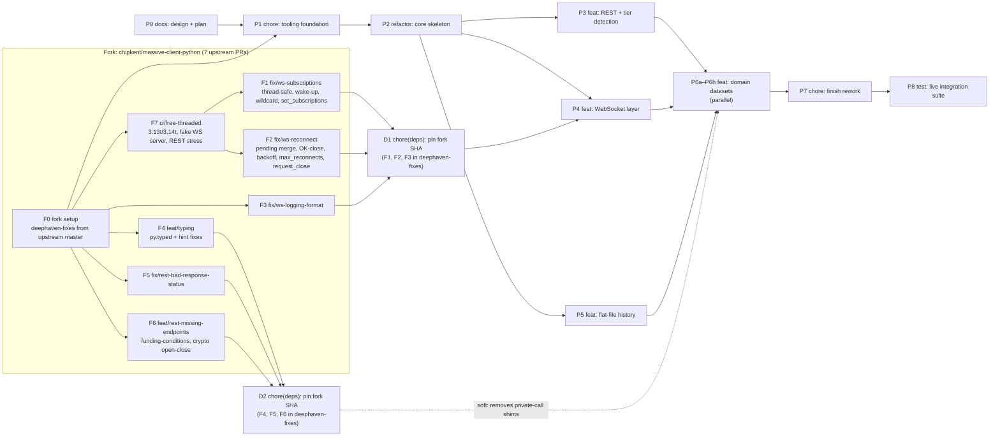

# deephaven-massive rework — execution plan

**Status:** approved plan, awaiting P0 merge. **Companion:** [`DESIGN.md`](DESIGN.md) is the
specification; this file is the schedule. When they disagree, `DESIGN.md` wins and this file
gets a `docs:` fix.

## Purpose and lifetime of this file

This file turns the approved rework into work packages that a fresh-context agent can execute
with nothing but `DESIGN.md`, this file, `AGENTS.md`, and the code. It is **temporary by
design**: P7 moves the durable parts (standards, invariants, workflow) into `README.md` and
`AGENTS.md`, then deletes `plans/rework/`. Nothing in this file is a long-term reference, so do
not link to it from docstrings or from `README.md`.

Citations of the form "Appendix B" through "Appendix I" refer to
[`RESEARCH.md`](RESEARCH.md), the reference material gathered during planning: the data
catalog, endpoint status, tooling research, and the bug lists for the current code.

## How progress is tracked

- One GitHub issue per work package, all children of one parent tracking issue. Each issue
  carries the package's live checklist; the checklists below are the *initial* copy.
- Each package links its issue; the parent tracking issue is #37. Live progress is tracked in
  the issues' checklists, not by ticking boxes in this file.
- A package is **done** when its PR is merged by the owner and the issue is closed with a link to
  the merged PR. Agents never merge and never close issues on their own authority.
- Packages are referred to by ID (`P3`, `F6`) in commit bodies and PR descriptions
  (`Refs #<issue>`), never by title, so renames do not break traceability.

## Table of contents

1. [Dependency graph](#dependency-graph)
2. [Global rules for every package](#global-rules-for-every-package)
3. [Parallelism guide](#parallelism-guide)
4. [Legacy code transition](#legacy-code-transition)
5. [Package template](#package-template)
6. Library packages
   - [P0 docs: rework design and plan](#p0)
   - [P1 chore: tooling foundation](#p1)
   - [P2 refactor: core skeleton](#p2)
   - [P3 feat: REST transport and tier detection](#p3)
   - [P4 feat: WebSocket layer](#p4)
   - [P5 feat: flat-file history](#p5)
   - [P6a–P6h feat: domain datasets](#p6)
   - [P7 chore: finish rework](#p7)
   - [P8 test: live integration suite](#p8)
   - [D1–Dn chore(deps): fork rev bumps](#d-bumps)
7. Fork packages (`chipkent/massive-client-python`)
   - [Fork workflow](#fork-workflow)
   - [F0 fork setup](#f0)
   - [F1–F7 fork fixes](#f1-f7)
8. [End-to-end verification](#end-to-end-verification)
9. [Decisions recorded during planning](#decisions-recorded-during-planning)

---

## Dependency graph



Hard edges are solid. The dotted edge is soft: P6f and P6g ship with the documented private-call
shim if D2 has not landed, and the shim is deleted in a follow-up `refactor:` PR when it does.
F1 and F2 are stacked on F7 because their tests use F7's fake WebSocket server.

Critical path: `F0 → P1 → P2 → (F7 → F1, F2 → D1) → P4 → P6 → P7`. F7, F1, F2, F3 can proceed
while P1–P3 are in flight, so D1 should be ready by the time P2 merges.

---

## Global rules for every package

These rules apply to every package in both repositories. Package sections only add to them.

1. **Branching.** One PR per package on a branch named `<type>/<topic>` off `main` in this
   repository. In the fork, fix branches are cut from upstream `master` (stacked on F7 where noted)
   and are the source of the upstream PRs; `deephaven-fixes` is an integration branch, not a PR
   target (see [Fork workflow](#fork-workflow)). Never commit directly on `main` or `master` in
   either repository. Never force-push a branch another agent may have checked out.
2. **Conventional commits.** Commit subjects and PR titles follow Conventional Commits v1.0.0
   (`feat:`, `fix:`, `docs:`, `test:`, `refactor:`, `ci:`, `chore:`), with the PR title given in
   each package below. Commit bodies end with the attribution lines the harness supplies.
3. **Check gate.** `./scripts/check.sh` (full tier) must be green before every push, and every CI
   job must be green on the PR, including the free-threaded jobs (`3.13t`, `3.14t`,
   `PYTHON_GIL=0`), which are required checks. Until P1 lands, the gate is the legacy
   `scripts/pre-commit.sh`; from P1 on, hooks enforce it automatically.
4. **Fresh-context implementers.** Each package is executed by a subagent whose only inputs are
   `DESIGN.md`, this file, `AGENTS.md`, and the code. If a package cannot be completed from those
   inputs, the fix is to improve those files (a `docs:` PR), not to pass tribal knowledge along.
5. **No merging in this repository.** Agents never run `gh pr merge`, `git merge` into `main`,
   or `git push` to `main`. Only the owner merges, always via PR. The single exception is the
   fork's `deephaven-fixes` integration branch: agents may merge fix branches into it and push
   it, only when its CI is green (owner decision; see [Fork workflow](#fork-workflow)).
6. **Owner approvals.** The following are outward-facing and require explicit owner approval
   each time: opening a PR or issue in this repository, opening an upstream PR to
   `massive-com/client-python`, creating the PyPI tracking issue, and any change to branch
   protection. Agents prepare the text and stop at the gate. Pushing a `fix/*`/`feat/*`/`ci/*`
   branch to the fork and merging it into `deephaven-fixes` needs no per-event approval.
7. **Test layout** ([DESIGN § 4.2 Test layout](DESIGN.md#42-test-layout)). `tests/` mirrors
   `src/deephaven_massive/`: the module `<path>/<name>.py` is tested by
   `tests/<path>/test_<name>.py`, where `<name>` has its leading underscore removed and `<path>`
   is copied as is. So `_config.py` is tested by `tests/test_config.py`, `_domains/stocks.py` by
   `tests/_domains/test_stocks.py`, and `_catalog.py` by `tests/test_catalog.py` (which also
   holds the coverage assertions). A package `__init__.py` is mirrored by
   `tests/<path>/test_init.py`; `tests/test_init.py` holds the public-surface tests
   (`dm.__all__`, `__version__`). Live tests end in `_integration.py`. The approved exceptions
   to the mirror rule are exactly `tests/conftest.py`, `tests/test_layout.py`,
   `tests/test_catalog.py` (for its coverage assertions), `tests/test_readme.py` (the
   DESIGN § 21 examples; it mirrors `README.md`), and the `tests/_fakes/` package
   (DESIGN § 4.2; see [Decisions recorded during planning](#decisions-recorded-during-planning)).
   `tests/_fakes/` is imported only by `tests/conftest.py`, whose thin fixtures hand the fakes
   to test modules; a test module imports it directly only when no fixture can provide what it
   needs, with a comment saying why. `tests/test_layout.py` enforces the rule; a new exception
   needs owner approval and a change to DESIGN § 4.2.
8. **Linter-ignore policy.** The global `ignore` list, every `per-file-ignores` entry, and every
   inline `# noqa` or `# type: ignore[...]` needs a reason comment. Adding a *new* rule to any
   ignore list, or a new `noqa` category, requires owner approval recorded in the PR. Fix the
   code first.
9. **Coverage.** 100% statement and branch coverage over `src/deephaven_massive`. `pragma: no
   cover` is allowed only with a written reason on the same line and owner approval in the PR;
   `exclude_also` holds exactly the approved patterns from `pyproject.toml`. Never write dead
   defensive branches to satisfy the gate; delete the branch instead.
10. **Deephaven invariants.** `AGENTS.md` lists them (execution context on every library thread,
    no blocking inside listeners, the registry lock is a leaf lock, no refreshing tables outside
    an explicit liveness scope). A package that touches `src/deephaven_massive/_*.py` restates
    the invariants it relies on in its PR description.
11. **No live testing as design input** ([DESIGN § 22](DESIGN.md#22-decisions), item 19). Unit tests use fake REST/WS/S3 servers and
    fixtures shaped from SDK `from_dict` and documentation samples. Live tests are P8 only.
12. **Docstrings and docs sync.** Google-style docstrings on every public and private module,
    class, and function (`D` rules, `DOC201/501/502`). A change to a public signature, default, or
    table semantics updates `DESIGN.md` (owner decision required) and, after P7, `README.md`.
13. **One package, one concern.** If a package needs a change to a file another package owns,
    land that change first in a small separate PR (`refactor:` or `chore:`), rebase, and continue.
14. **Answer every review comment.** Reply to each review thread on a package's PR, from people
    or bots: name the commit that addresses it and summarize the fix, or explain why no change
    is made. No thread is left unanswered, and none is resolved without a reply.

---

## Parallelism guide

### Which packages can run concurrently

| Wave | Packages | Notes |
|---|---|---|
| 0 | P0, F0 | F0 needs the fork to exist (owner step). P1 pins the fork, so F0 precedes P1. |
| 1 | P1; F7, F3, F4, F5, F6 | Fork branches are independent of each other and of P1–P3. |
| 2 | P2; F1, F2 (after F7); D1 (when F1–F3 are in `deephaven-fixes`) | P2 is the only writer of the new package skeleton. |
| 3 | P3, P4, P5 | Disjoint files (see below). P4 waits for D1. |
| 4 | P6a–P6h; D2 | Eight domain packages, disjoint files by construction. |
| 5 | P7 | Serial: deletes legacy code, rewrites docs, adds the catalog coverage assertions. |
| 6 | P8 | After P7; needs a key; owner runs it. |

### How file conflicts are avoided

The module names are fixed by [DESIGN § 4.1 Source modules](DESIGN.md#41-source-modules). The
skeleton created in P2 is designed so that later packages own disjoint files:

- **Transport packages own distinct modules.** P3 owns `_rest.py`, `_hosts.py`, `_poll.py`,
  the generated `SDK_PARAMS` block of `_catalog.py`, and `scripts/refresh_massive_catalog.py`.
  P4 owns `_ws.py`, `_stream.py`, and `_watchlist.py`. P5 owns `_flatfiles.py`. Each owns its
  mirrored test file(s) and a fixture directory `tests/data/<module>/`. The fake servers
  follow the same split: P1 creates the empty `tests/_fakes/__init__.py`, and P3 owns
  `tests/_fakes/rest.py`, P4 `tests/_fakes/ws.py`, and P5 `tests/_fakes/s3.py`. Each also adds
  its own thin fixture to `tests/conftest.py` as a separate, self-contained block (one
  fixture function and its import), so the three edits are disjoint hunks. `_session.py` exposes
  one factory hook per transport that P2 stubs (`NotImplementedError`) and each transport
  package fills; the hooks are separate functions, so three PRs can edit `_session.py` without
  overlapping hunks. If overlap is unavoidable, P3 lands first, then P5, then P4.
- **Domain packages own one module each.** P6x edits only `_domains/<domain>.py`,
  `tests/_domains/test_<domain>.py`, and `tests/data/<domain>/`. P6h owns
  `_domains/partners.py`, which holds the four vendor classes. P6g owns
  `_domains/reference.py`, `_domains/indicators.py`, and `_domains/economy.py`, and is the one
  domain package that also edits `_session.py` and `_catalog.py`: it fills
  `MassiveSession.snapshots()` and adds that dataset's record, because DESIGN places the
  unified snapshot on the session rather than in a namespace module.
- **No shared registry file is edited by domain packages** (P6g's two edits above excepted).
  Every cross-cutting table is composed from per-domain declarations rather than written
  centrally:
  - Each `_domains/<domain>.py` exports `DATASETS: tuple[DatasetSpec, ...]`. A `DatasetSpec`
    (defined in P2's `_catalog.py`) carries the dataset name, query class, REST endpoint(s) and
    SDK method name(s), WebSocket channel(s), flat-file prefix(es), schema overrides, timestamp
    units per transport and field, `start`/`end` axis pair, default `PollMode`, and the page
    size.
  - `_catalog.py` aggregates `DATASETS` from a **fixed module list written in P2** (every domain
    module exists from P2 as a stub exporting `DATASETS = ()`), so P6 packages never touch
    `_timeunits.py` or `_schema.py`.
  - The namespace classes (`_Stocks`, `_Options`, …) live in their domain modules; `_session.py`
    instantiates them from P2 on, so P6 packages never touch `__init__.py`.
  - Catalog exclusions with `# reason:` live only in `tests/test_catalog.py` (P7).
- **Generated content is regenerated in one place.** The `SDK_PARAMS` block of `_catalog.py`
  and `tests/data/massive_docs_index.txt` are regenerated only by P3, P7, and D-bump PRs, never
  inside a domain PR. A domain package that needs a parameter the generated table lacks (the
  two SDK-gap endpoints) declares it in its own `DatasetSpec.extra_params`.
- **`uv.lock` and `pyproject.toml` dependency changes** happen only in P1, D-bump PRs, and P7.
  Feature PRs do not add dependencies; if one is needed, open a `chore(deps):` PR first.
- **Fixture data is per package.** Never add a shared fixture file; put payloads in
  `tests/data/<owner>/` and load them through the `load_fixture` fixture from `conftest.py`.

---

## Legacy code transition

The current implementation (`src/deephaven_massive/engine/`, `domains/`, `schemas/`, and the
legacy `config.py`, `session.py`, `__init__.py`) stays in the tree until P7 as a reference for
implementers (the appendices cite its line numbers), but it is **not** part of the new gate.

- **P1** adds temporary exclusions, each tagged with the grep-able marker `LEGACY-EXCLUSION`:
  - `[tool.ruff] extend-exclude`, `[tool.mypy] exclude`, and `[tool.coverage.run] omit` for
    `src/deephaven_massive/{engine,domains,schemas}/**` and the three legacy top-level files;
  - legacy tests move unchanged to `tests/legacy/` and are excluded from collection
    (`collect_ignore_glob` in `tests/conftest.py`) and from ruff/mypy;
  - `tests/test_layout.py` skips the same paths via one `LEGACY_PATHS` constant.
- **P2** rewrites `__init__.py`, replaces the legacy `config.py` and `session.py` with
  `_config.py` and `_session.py`, and removes those three files from every exclusion list. From
  P2 on, the legacy set is exactly the three subpackages.
- **P6x** packages may read legacy normalizers for field provenance but must not import them.
- **P7** deletes the three subpackages, `tests/legacy/`, and every `LEGACY-EXCLUSION` line.
  `grep -rn LEGACY-EXCLUSION .` must return nothing after P7.

---

## Package template

Every package below has the same sections, in this order: header (PR title, branch, issue),
goal, DESIGN sections, dependencies and parallelism, files, tasks, acceptance criteria,
verification, pitfalls, out of scope, approval gates. "DESIGN §" references use the section
numbers and titles of `DESIGN.md` and link to its headings; the "DESIGN sections implemented"
line of each package is the authoritative list, and prose elsewhere may cite a section by number
alone.

---

<a id="p0"></a>
## P0 — `docs: rework design and plan`

| | |
|---|---|
| **Branch** | `docs/rework-design-plan` |
| **Issue** | Parent tracking issue #37 (P0 itself merged in #11) |

**Goal.** Commit the approved specification and this execution plan so every later package has
a stable source of truth, and open the tracking issues that hold the live checklists.

**DESIGN sections implemented.** All of `DESIGN.md` is the deliverable (Appendix A v3 with the
"Required v3 edits" applied, rewritten in O'Reilly style), including
[§ 1 Purpose and scope](DESIGN.md#1-purpose-and-scope) and
[§ 22 Decisions](DESIGN.md#22-decisions), which no code package implements; no code.

**Depends on.** Nothing. **Parallel with.** F0.

**Files.**
- Create: `plans/rework/DESIGN.md`, `plans/rework/PLAN.md` (this file).
- Modify: none. Delete: none.

**Tasks.**
- [ ] Write `plans/rework/DESIGN.md` from Appendix A plus every "Required v3 edit" (lifecycle
      once-only flag; stream lifetime bound to `on_shutdown_callback`; `HeldResults` column;
      explicit-verdict rule narrowed; stream key `(dataset, channel, symbol key)`; lock order
      sentence; `last_by` keeps every symbol ever seen; `venue` on futures factories and six query
      classes; `/v3/snapshot/options/{u}/{o}` "covered by"; Python `>=3.11`; enums only with the
      runtime `TypeError`; base Business TICK host rule with WARNING; diagnostics scope; fork list
      minus #9/#10 plus the handshake `max_connections` item (F2.6); owner answers to §20).
- [ ] Write this file.
- [ ] Draft the parent tracking issue and one issue per package (P0–P8, D-bumps, F0–F7) using
      each package's goal, checklist, and acceptance criteria. **Stop for owner approval before
      creating any issue.**
- [ ] After approval: create the issues, replace every `Issue: TBD` in this file, commit.
- [ ] Open the PR (title above) with the owner's approval. PR body links the parent issue.

**Acceptance criteria.**
- [ ] `DESIGN.md` contains every required edit; a reviewer can tick each of the 13 edit items.
- [ ] Every package in this file has all template sections filled.
- [ ] Every `Issue: TBD` is replaced (or the PR description says issue creation was deferred by
      the owner).
- [ ] The legacy gate (`./scripts/pre-commit.sh`) still passes; no code changed.

**Verification.**
```bash
./scripts/pre-commit.sh                       # legacy gate; must be unchanged and green
git diff --stat main -- . ':!plans/'          # must be empty: P0 touches only plans/
grep -n "Issue: TBD" plans/rework/PLAN.md     # empty after issues are created
```

**Pitfalls.** Appendix G §6 lists statements in the current `README.md`/`AGENTS.md` that are
false (not strict mypy, wrong test counts, "Zero-Copy", "lock-free"); do not copy prose from
them into `DESIGN.md`.

**Out of scope.** Any code or tooling change; `AGENTS.md`/`README.md` edits (P1 and P7).

**Approval gates.** Creating issues; opening the PR. Merge by owner only.

---

<a id="p1"></a>
## P1 — `chore: tooling foundation`

| | |
|---|---|
| **Branch** | `chore/tooling-foundation` |
| **Issue** | #12 |

**Goal.** Replace the permissive, four-way-duplicated gate with one strict, agent-friendly
toolchain: pinned ruff `ALL`, strict mypy, pytest 9 native config, a single `scripts/check.sh`
entry point, git and Claude Code hooks, a CI matrix that includes free-threaded CPython, and a
committed lockfile that pins the SDK fork. Legacy code is excluded from the gate until P7.

**DESIGN sections implemented.** [§ 20 Quality gates](DESIGN.md#20-quality-gates) (the whole
section); [§ 4.2 Test layout](DESIGN.md#42-test-layout) (`tests/conftest.py` and
`tests/test_layout.py`); [§ 11 Enums and types](DESIGN.md#11-enums-and-types) (the `>=3.11`
floor and the CI matrix); [§ 18.4 Free-threaded specifics](DESIGN.md#184-free-threaded-specifics)
(free-threaded CI is gating); [§ 19 SDK fork: fix list and responsibility split](DESIGN.md#19-sdk-fork-fix-list-and-responsibility-split)
(the `[tool.uv.sources]` pin). The exact configuration is [§ 20.1 Tooling configuration](DESIGN.md#201-tooling-configuration).

**Depends on.** P0 (merged), F0 (the `deephaven-fixes` branch must exist to be pinned).
**Parallel with.** F1–F7.

**Files.**
- Create: `scripts/check.sh`, `.claude/settings.json`, `.claude/hooks/post-edit-ruff.sh`,
  `.claude/hooks/stop-check.sh`, `.claude/hooks/pre-bash-uv-only.sh`, `tests/test_layout.py`,
  `tests/test_init.py`, `tests/_fakes/__init__.py` (empty; P3, P4, and P5 each add one module),
  `uv.lock` (un-ignored and committed), `tests/legacy/` (moved files).
- Modify: `pyproject.toml` (rewrite), `.pre-commit-config.yaml` (rewrite), `.gitignore` (trim to
  ~20 lines), `.github/workflows/ci.yml` (rewrite), `.github/workflows/conventional-pr-check.yml`
  (runner `ubuntu-latest`), `.github/dependabot.yml` (keep; now effective because `uv.lock` is
  committed), `AGENTS.md` (rewrite), `tests/conftest.py` (rewrite), `src/deephaven_massive/__init__.py`
  (minimal: `__version__` from `importlib.metadata` only).
- Delete: `scripts/pre-commit.sh`, `scripts/install-hooks.sh`, `tests/__init__.py`.
- Move: `tests/test_*.py` (eight legacy files) → `tests/legacy/`.

**Tasks.**
- [ ] **`pyproject.toml`** per Appendix D §5 with these overrides from the settled decisions
      (decisions override the appendix where they differ):
  - `requires-python = ">=3.11"`, `target-version = "py311"`, mypy `python_version = "3.11"`,
    classifiers 3.11–3.14; PEP 639 `license = "Apache-2.0"`, `license-files = ["LICENSE"]`;
    `authors = [{name = "Chip Kent", email = "chipkent@illumon.com"}]`; `[project.urls]` to
    `github.com/chipkent/deephaven-massive`; `Typing :: Typed`.
  - `dependencies`: `massive>=2.9.0`, `deephaven-core>=42.0`, `pyarrow>=14`, `boto3>=1.28`,
    `websockets>=14`. `[tool.uv.sources] massive = { git = "https://github.com/chipkent/massive-client-python", rev = "<sha of deephaven-fixes>" }`.
    `orjson` as an optional extra (`[project.optional-dependencies] orjson = ["orjson>=3.9"]`).
  - `[dependency-groups] dev`: `ruff==<exact>`, `mypy`, `types-boto3[s3]`, `pytest>=9`,
    `pytest-cov`, `pytest-timeout`, `pyright`, `pre-commit`, `deephaven-server>=42.0`. No
    `pytest-asyncio` ([DESIGN § 20.1](DESIGN.md#201-tooling-configuration)).
  - Ruff: `select = ["ALL", "DOC201", "DOC501", "DOC502"]`, `preview = true`,
    `explicit-preview-rules = true`, `required-version`, global ignores exactly: `COM812`,
    `COM819`, `W191`, `E111`, `E114`, `E117`, `D206`, `D300`, `Q000`–`Q003`, `TRY003`, `EM101`,
    `EM102`, `PLR0913`, `FBT003`, `CPY001`, each with a reason comment. **Keep enforced**: `E501`
    at 100, `ANN401`, `TC*`, `SLF001` in src, `C901` (`max-complexity = 12`), `PLR091x`,
    `PLR0917` with `max-positional-args = 3`. Tests-only ignores: `S101`, `PLR2004`, `INP001`,
    `SLF001`, `ARG001`, `ARG002`, `ARG005`, `FBT001`, `FBT002`, `D100`–`D107`. Google
    convention; `docstring-code-format = true`. **Do not** add Appendix D's `banned-module-level-imports`
    for `deephaven` ([DESIGN § 20.1](DESIGN.md#201-tooling-configuration): module-level imports; the JVM starts in `pytest_configure`).
  - Mypy: `strict`, `warn_unreachable`, `warn_unused_configs`, the eight `enable_error_code`
    entries from [DESIGN § 20.1](DESIGN.md#201-tooling-configuration). Overrides: `ignore_missing_imports` for `pyarrow.*` and, until a
    D-bump lands F4 (`py.typed`), `massive.*` (tag the latter with the marker `FORK-PY-TYPED` so
    that bump removes it).
  - Pytest 9 `[tool.pytest]`: `minversion = "9.0"`, `strict = true`, `filterwarnings = ["error"]`,
    `addopts = ["-ra", "--import-mode=importlib"]`, `timeout = 60`,
    `faulthandler_timeout = 120`, `faulthandler_exit_on_timeout = true`, `testpaths = ["tests"]`.
    No coverage flags in `addopts`.
  - Coverage: `source = ["deephaven_massive"]`, `branch = true`, `fail_under = 100`,
    `show_missing`, `exclude_also = ["if TYPE_CHECKING:", "@(typing\\.)?overload"]` only.
  - Pyright `[tool.pyright]` standard mode over `src` (non-gating).
  - `LEGACY-EXCLUSION` entries (see [Legacy code transition](#legacy-code-transition)).
- [ ] `uv lock`; remove `uv.lock` from `.gitignore`; commit it. Trim `.gitignore` to the ~20
      lines in Appendix G finding 13.
- [ ] **`scripts/check.sh [fast|full] [--no-fix]`**: fast = `ruff check --fix` + `ruff format` +
      `mypy src tests`; full = fast + `pytest --cov --cov-report=term-missing:skip-covered`;
      `--no-fix` = `ruff check` + `ruff format --check` (CI and hooks). `CI=true` adds
      `--output-format github`. Exit non-zero on first failure; print each step's name.
- [ ] **`.pre-commit-config.yaml`**: local hooks calling `uv run` for the fast tier at
      `pre-commit`; the full tier at `pre-push`; `pre-commit-hooks` `no-commit-to-branch`
      (`main`), `check-yaml`, `end-of-file-fixer`, `trailing-whitespace`; `uv-pre-commit`
      `uv-lock`. Pin `rev`s.
- [ ] **`.claude/settings.json`** hooks: `PostToolUse` on `Edit|Write` of `*.py` → ruff fix +
      format on that file, remaining diagnostics to stderr with exit 2; `Stop` → `check.sh fast
      --no-fix` (respect `stop_hook_active`); `PreToolUse` on `Bash` → block bare
      `python|pytest|ruff|mypy|pip` not prefixed by `uv run`. Scripts live in `.claude/hooks/`.
- [ ] **CI** (`ci.yml`): jobs `lock` (`uv lock --check`), `lint` (`check.sh fast --no-fix` with
      GitHub output format, plus `pyright src` with `continue-on-error: true`), `test` matrix
      `["3.11", "3.12", "3.13", "3.13t", "3.14", "3.14t"]` with JDK 17, `uv sync --locked`,
      `PYTHON_GIL=0` on the `t` entries, `pytest --cov --cov-report=xml`; `build` (`uv build`
      then `uv run --isolated --with dist/*.whl python -c "import deephaven_massive"`). Pin
      action SHAs as today.
- [ ] **`tests/conftest.py`** rewrite: start the embedded `deephaven_server.Server` in
      `pytest_configure` (before collection), `-DPeriodicUpdateGraph.defaultRefreshIntervalMillis=25`,
      keep the documented `_final_jvm_exit`/`os._exit` shutdown workaround in an isolated,
      commented block; fixtures (not importable helpers): `dh_exec_ctx`, `dh_to_pylist`,
      `load_fixture(owner, name)`, `make_csv_gz`; `collect_ignore_glob = ["legacy/*"]`.
      Port: an implementer's technical choice, not an owner decision. Try
      `deephaven_server.Server(port=0)` (an ephemeral port lets two test runs share a machine);
      if the server does not support it, use the fixed port `10099` with a comment saying why.
      Make `tests/_fakes/` importable from `conftest.py` under `--import-mode=importlib` (for
      example `pythonpath = ["tests"]` in `[tool.pytest]`, with a reason comment, so the
      fixtures can `from _fakes.ws import …`).
- [ ] **`tests/test_layout.py`**: walk `src/deephaven_massive/**/*.py`, assert the mirrored test
      file exists per DESIGN § 4.2 (leading underscore stripped from the module name; the
      directory path copied as is; `__init__.py` ↔ `test_init.py`), assert no test file
      lacks a source module unless it is one of the approved exceptions (`tests/conftest.py`,
      `tests/test_layout.py`, `tests/test_catalog.py`, `tests/test_readme.py`), ignore the
      `tests/_fakes/` package entirely, skip `LEGACY_PATHS`.
- [ ] **`tests/test_init.py`** + minimal `__init__.py`: `__version__` equals
      `importlib.metadata.version("deephaven-massive")`.
- [ ] Move the eight legacy test files to `tests/legacy/`; delete `tests/__init__.py`.
- [ ] Delete `scripts/pre-commit.sh` and `scripts/install-hooks.sh`. (`IMPLEMENTATION_PLAN.md`
      was already deleted in P0; DESIGN.md supersedes it.)
- [ ] **`AGENTS.md`** rewrite (≤ 150 lines): commands (`uv sync`, `./scripts/check.sh`,
      `uv run pre-commit install --hook-type pre-commit --hook-type pre-push`); the hard rules
      (merges via PR, only the owner merges, answer every review comment, branch naming,
      conventional commits, test layout,
      linter-ignore policy, coverage pragma policy, free-threaded CI is gating, no live testing
      in unit tests); the Deephaven invariants from DESIGN § 18 and § 6.1 rewritten as rules;
      JVM test gotchas; a "where to look" table pointing at `DESIGN.md` until P7. Drop every
      count and every claim a tool now enforces.
- [ ] PR description documents the manual owner step: GitHub ruleset on `main` requiring a PR,
      the six required status checks (incl. `3.13t`, `3.14t`), no direct pushes.

**Acceptance criteria.**
- [ ] `./scripts/check.sh` (full) is green locally on 3.11; CI is green on all six Python jobs.
- [ ] `uv sync --locked` succeeds from a clean checkout; `uv lock --check` passes.
- [ ] `uv run pre-commit run --all-files` passes; `pre-push` stage runs the full tier.
- [ ] Claude Code hooks fire: editing a `.py` file with a lint error surfaces it (exit 2); a
      bare `pytest` command is blocked.
- [ ] `tests/test_layout.py` and `tests/test_init.py` pass; coverage of the measured set is 100%.
- [ ] `grep -rn LEGACY-EXCLUSION` lists every temporary exclusion and nothing else is excluded.
- [ ] `AGENTS.md` contains the merges-via-PR rule, the layout rule, and the ignore policy.

**Verification.**
```bash
uv sync --locked
./scripts/check.sh                       # full tier
./scripts/check.sh fast --no-fix
uv run pre-commit run --all-files
uv run pre-commit run --hook-stage pre-push --all-files
uv run pytest tests/test_layout.py tests/test_init.py -q
uv build && uv run --isolated --with dist/*.whl python -c "import deephaven_massive"
grep -rn LEGACY-EXCLUSION pyproject.toml tests/conftest.py tests/test_layout.py
```

**Pitfalls (Appendix G).** `uv.lock` git-ignored makes dependabot a no-op (G#1); unused
`massive` dependency (G#2); blanket `ignore_missing_imports` discarding real types for
`deephaven`/`websockets` (G#3); `pytest-asyncio` with zero async tests (G#4); four gate
definitions (G#6); tests importing helpers from `conftest.py` plus `pythonpath=["."]` (G#7);
`exclude_lines` re-adding `pragma: no cover` (G#8); duplicated version (G#9); placeholder author
and deprecated license form (G#10); dev deps as a PyPI extra (G#11); `websockets>=11` with the
legacy `connect` (G#12); 220-line `.gitignore` (G#13); `conftest.py` importing the private
`_ensure_deephaven_server` and hard-coding port 10099 (G P2). Appendix D's draft config has
`py310`, `pytest-asyncio`, a `TC003` ignore, an `ANN401` ignore, `PLR0917` ignored, and a
`deephaven` module-level import ban; the settled decisions override all six.

**Out of scope.** Any change to legacy code behaviour; new library modules (P2); README rewrite
(P7); removing the legacy exclusions (P7).

**Approval gates.** Opening the PR; the ruleset on `main` (owner); any addition to the ignore
lists beyond those enumerated above.

---

<a id="p2"></a>
## P2 — `refactor: core skeleton`

| | |
|---|---|
| **Branch** | `refactor/core-skeleton` |
| **Issue** | #13 |

**Goal.** Create the new package layout with the public surface fixed (exports, config, session
shell, query classes, enums, types, errors), the cross-cutting engines that transports and domains
build on (schema registry, time units, symbols, dates, liveness, diagnostics, dataset catalog),
and stub domain modules so P3–P6 can proceed in parallel without touching shared files. No
network code.

**DESIGN sections implemented.** [§ 2 Principles and terms](DESIGN.md#2-principles-and-terms);
[§ 3 Exports](DESIGN.md#3-exports); [§ 4 Package layout](DESIGN.md#4-package-layout) (every
module exists after P2, as a stub where its transport or domain comes later);
[§ 5 `MassiveConfig`](DESIGN.md#5-massiveconfig);
[§ 6 `MassiveSession` and lifecycle](DESIGN.md#6-massivesession-and-lifecycle) including
[§ 6.1 How a live table is kept alive and released](DESIGN.md#61-how-a-live-table-is-kept-alive-and-released);
[§ 7 Query classes and verbs](DESIGN.md#7-query-classes-and-verbs) (class shapes,
[§ 7.2 synchronous `ValueError`s](DESIGN.md#72-synchronous-valueerrors-for-parameter-values),
and [§ 7.3 the runtime enum check](DESIGN.md#73-runtime-enum-check); transport-dependent verb
bodies raise `NotImplementedError` until their transport lands);
[§ 10 Symbols and `ALL`](DESIGN.md#10-symbols-and-all);
[§ 11 Enums and types](DESIGN.md#11-enums-and-types);
[§ 12 Timestamp units and day boundaries](DESIGN.md#12-timestamp-units-and-day-boundaries);
[§ 17 Diagnostics](DESIGN.md#17-diagnostics) (table definitions and the session-owned scope);
[§ 18 Concurrency model](DESIGN.md#18-concurrency-model) (registry lock, reaper thread, lock
order).

**Depends on.** P1. **Parallel with.** F1–F7, D1.

**Files.** Module names are those of DESIGN § 4.1; every module below `deephaven_massive/`
other than `__init__.py` is private, and the public surface is `__init__.py` alone. The six
query classes and the type aliases are importable from `deephaven_massive._query` and
`deephaven_massive._types` for annotations only; there is no public `query` module.
- Create under `src/deephaven_massive/`:
  - `__init__.py` (rewrite): exactly the names of DESIGN § 3, `__all__`, and `__version__`.
  - `_config.py`: frozen `MassiveConfig`; `MassiveConfig()` reads the environment; validation
    (`reconnect_backoff < 15` → `ValueError`; `ws_hosts` hostname-only).
  - `_session.py`: `MassiveSession`, namespaces, the `snapshots()` shell (P6g fills it),
    `connections()`, `streams()`, `release()`, `close()`, context manager, `_registry_lock`,
    reaper thread, the host-decision cache, the captured `ExecutionContext` with fail-fast,
    second-session WARNING, per-transport factory hooks (stubs).
  - `_query.py`: the six query classes and their verbs.
  - `_errors.py`: `MassiveError`, `AuthenticationError`, `EntitlementError`.
  - `_enums.py`: the fourteen exported `StrEnum`s plus the internal `Recency` and
    `ChannelFamily`; the `_require_enum(value, EnumType, name)` check raising the decision-23
    `TypeError`.
  - `_types.py`: `Symbols`, `ALL`/`_All`, `DateLike`, `FilterValue`, and the `bars` overload
    aliases (`StreamSpan`, `DaySpan`, `FuturesSpan`).
  - `_schema.py`: schema registry, SDK-model flattening to PascalCase, dtype coercion, the
    override-table types, the four hand-written tick schemas with per-transport key maps.
  - `_timeunits.py`: `(dataset, transport, field) → unit` lookup composed from `DatasetSpec`s;
    refuses unregistered fields; the `[1990, 2100]` defensive check; the FMV `>= 10**17` rule.
  - `_symbols.py`: normalization across WS/REST/S3 forms for every class; `Underlying` parsing.
  - `_dates.py`: `DateLike` parsing (tz required), class day zones, half-open `[start, end)`,
    futures session rules, `flat_file_publish_cutoff` logic (pure function).
  - `_liveness.py`: result and stream scopes, `_ResultRecord`, weakref → reaper queue, once-only
    `released` flag.
  - `_diagnostics.py`: `connections`/`streams` `input_table` definitions and update helpers
    (library threads only).
  - `_catalog.py`: `DatasetSpec`, the aggregation over the fixed domain module list, and an
    empty, clearly delimited `SDK_PARAMS` block that P3 generates.
  - `_domains/__init__.py` (empty), `_domains/base.py` (the shared dataset factory), and
    stubs `_domains/{stocks,options,futures,indices,forex,crypto,reference,indicators,economy,partners}.py`,
    each with its namespace class(es) and `DATASETS: tuple[DatasetSpec, ...] = ()`.
    `partners.py` holds the four vendor classes.
- Create the mirrored test for every module above under `tests/` (`tests/test_config.py`,
  `tests/test_session.py`, `tests/test_query.py`, …, `tests/_domains/test_base.py`,
  `tests/_domains/test_stocks.py`, …), update `tests/test_init.py`, and add
  `tests/_domains/test_init.py` (the mirror of `_domains/__init__.py`).
- Modify: `pyproject.toml` (remove the three top-level files from `LEGACY-EXCLUSION` lists),
  `tests/test_layout.py` (`LEGACY_PATHS` shrinks to the three subpackages).
- Delete: the legacy `config.py` and `session.py` (replaced by `_config.py` and
  `_session.py`); the legacy subpackages remain until P7.

**Tasks.**
- [ ] Implement `_enums.py`, `_types.py`, `_errors.py`; test: every exported enum is a `StrEnum`
      whose values are Massive wire strings; the `_require_enum` message names the member.
- [ ] Implement `_config.py`; tests cover env resolution order (`MASSIVE_API_KEY` then
      `POLYGON_API_KEY`), missing key → `AuthenticationError`, every validation rule, defaults
      live in exactly one place (assert no second default table exists).
- [ ] Implement `_symbols.py` and `_dates.py` as pure functions with parametrized tests from
      DESIGN § 10 and § 12 (every input form listed there; naive datetimes rejected; futures
      session widening).
- [ ] Implement `_schema.py`: flatten an SDK `@modelclass` instance (nested models → `Parent.Child`
      → `ParentChild` PascalCase), the explicit override table type, one dtype per union column,
      `int[]` for condition lists, `LocalDate`/`Instant` mapping. Tests use real SDK models
      (`massive.rest.models`).
- [ ] Implement `_timeunits.py` + the `[1990, 2100]` guard; test the FMV rule at the boundary.
- [ ] Implement `_catalog.py` (`DatasetSpec`, aggregation, `SDK_PARAMS` loader interface that P3
      fills, `extra_params`); test that the fixed module list equals the set of modules under
      `_domains/`.
- [ ] Implement `_liveness.py` and the reaper in `_session.py` exactly per DESIGN § 6.1:
      scope per result, `manage`, weakref callback enqueues only, reaper wraps each job in
      try/except with ERROR log, once-only flag flipped under `_registry_lock`, `release()`
      verifies the weakref resolves to the same object. Tests run inside the embedded JVM with
      a `table_publisher` blink table and assert `on_shutdown_callback` fires after the last
      result is released, and does not fire while a derived table is alive.
      Also assert that two `blink()` calls on one query return distinct wrappers with distinct
      records, and that deleting one releases only its own record.
- [ ] Implement `_diagnostics.py` in a session-owned `LivenessScope` released in `close()`.
- [ ] Implement `_query.py` verbs' synchronous validation (`ALL` rules, exhausted generator,
      `ring(capacity)` bounds, `last_by` keys, `poll` interval) and the `ValueError` when called
      on the UG thread; transport-dependent bodies call session hooks that raise
      `NotImplementedError` (covered by tests asserting that exact behaviour until P3–P5 replace
      them).
- [ ] Implement `_session.py` namespaces, `close()` semantics (publishers not failed, WARNING
      once, streams `CLOSED`), `__enter__/__exit__`, fail-fast without an `ExecutionContext`.
- [ ] Add the enum-only signature test in `tests/test_enums.py` (DESIGN § 11): walk every
      public callable reachable from `deephaven_massive` and the session namespaces; assert no
      parameter annotation contains a `Literal` of `str` ([DESIGN § 11](DESIGN.md#11-enums-and-types)), and that every enum
      mirroring an SDK enum has the same value set. The `dm.__all__` test lives in
      `tests/test_init.py`.
- [ ] Remove the three top-level files from the `LEGACY-EXCLUSION` lists.

**Acceptance criteria.**
- [ ] `import deephaven_massive as dm; dm.__all__` equals the DESIGN § 3 list (test).
- [ ] `MassiveSession()` outside a Deephaven worker raises a clear error naming the requirement.
- [ ] Liveness tests prove: release via `m.release`, via GC, and via `close()`; double release is
      a no-op with no second shutdown callback.
- [ ] No `Literal[str]` in any public signature; every enum parameter rejects `str` with the
      documented `TypeError`.
- [ ] `./scripts/check.sh` green; CI green on all six jobs including `3.13t`/`3.14t`.

**Verification.**
```bash
./scripts/check.sh
uv run pytest tests/test_init.py tests/test_config.py tests/test_session.py tests/test_query.py \
  tests/test_enums.py tests/test_types.py tests/test_errors.py tests/test_liveness.py \
  tests/test_schema.py tests/test_timeunits.py tests/test_symbols.py tests/test_dates.py \
  tests/test_catalog.py tests/test_diagnostics.py tests/_domains -q
uv run mypy src tests
PYTHON_GIL=0 uv run --python 3.13t pytest tests/test_liveness.py tests/test_session.py -q
```

**Pitfalls (Appendix E).** Unbounded `_post_attach_sigs` (E C1) — no per-row Python sets in any
engine path; streams never shut down (E C3) — every publisher is created with
`on_shutdown_callback` inside a scope; zero logging and swallowed exceptions (E H2) — every
module has `logger = logging.getLogger(__name__)` and no `contextlib.suppress(Exception)`; test
hooks in the public constructor (E H6) — `MassiveSession(config)` only; `_is_deephaven_table`
duck-typing matched `pyarrow.Table` (E H7) — use `isinstance(obj, deephaven.table.Table)`;
defensive clamps `max(0, n-1)` (E H8) — raise on double release; triplicated config defaults
(E M); `exec_ctx: ... | None` deferred failures (E M) — mandatory, fail fast; `to_utc_ns`
magnitude sniffing (F M6) — units are declared per `(dataset, transport, field)`.

**Out of scope.** Any REST, WebSocket, or S3 I/O (P3–P5); dataset definitions (P6); the `bars`
overloads (P6, per domain); deleting legacy code (P7).

**Approval gates.** Opening the PR. Any deviation from DESIGN § 3 or from the module names of
DESIGN § 4.1 needs an owner decision first.

---
<a id="p3"></a>
## P3 — `feat: REST transport and tier detection`

| | |
|---|---|
| **Branch** | `feat/rest-transport` |
| **Issue** | #14 |

**Goal.** Put every REST dataset on the official SDK: `RESTClient` wiring, paginated results
streamed into bounded Arrow batches, filter validation against a generated parameter table,
403/429 mapping, host resolution from REST evidence, and the `poll()` verb with all three modes
including reactive symbol tables. After P3, `Query.fetch()`, `Query.poll()`,
`HistoryQuery.history(source=REST)`, and the `fetch()` of the latest-queries work for any
`DatasetSpec` that declares an SDK method.

**DESIGN sections implemented.** [§ 7 Query classes and verbs](DESIGN.md#7-query-classes-and-verbs)
(`fetch`, `poll`, REST `history`); [§ 9 Filters](DESIGN.md#9-filters);
[§ 13.1 Invariants](DESIGN.md#131-invariants) and [§ 13.2 Host decision](DESIGN.md#132-host-decision);
[§ 13.4 REST](DESIGN.md#134-rest);
[§ 14 Publishers, fan-out, and failure semantics](DESIGN.md#14-publishers-fan-out-and-failure-semantics)
(the `poll()` publisher and `input_table` rules); [§ 17 Diagnostics](DESIGN.md#17-diagnostics)
(REST rows in `connections()`, `RequestsPerCycle`);
[§ 18 Concurrency model](DESIGN.md#18-concurrency-model) (poller thread,
`ThreadPoolExecutor(max_concurrency)`).

**Depends on.** P2. **Parallel with.** P4, P5 (disjoint files; P3 lands first if `_session.py`
hunks overlap).

**Files.**
- Create: `src/deephaven_massive/_rest.py` (SDK client construction, `iter_rows`, `get_json`,
  Arrow batching, error mapping, rate-limit WARNING once), `_hosts.py` (host resolution and the
  `HostDecision` record; the cache lives on the session under `_registry_lock`), `_poll.py`
  (REPLACE/UPSERT/APPEND pollers, reactive symbol snapshot per cycle, fan-out executor),
  `scripts/refresh_massive_catalog.py`, `tests/test_rest.py`, `tests/test_hosts.py`,
  `tests/test_poll.py`, `tests/_fakes/rest.py` (the fake REST transport),
  `tests/data/massive_docs_index.txt` (vendored for P7),
  `tests/data/_rest/`, `tests/data/_hosts/` (snapshot fixtures per class and tier).
- Modify: `tests/conftest.py` (one thin `fake_rest` fixture that builds the
  `tests/_fakes/rest.py` transport), `_session.py` (fill the REST factory hook; `connections()`
  REST rows), `_query.py`
  (REST-backed verb bodies replace `NotImplementedError`), `_catalog.py` (the generated
  `SDK_PARAMS` block), `tests/test_catalog.py` (the `SDK_PARAMS` parity test against the
  installed SDK), `_domains/base.py` (REST dataset factory helper used by P6).
- Delete: none.

**Tasks.**
- [ ] `_rest.py`: build `massive.RESTClient(api_key, base=cfg.rest_base_url, retries=3,
      connect_timeout=10, read_timeout=30, maxsize=16, pagination=True)`; clear the SDK's stdout
      handler on logger `RESTClient` (Appendix H §1 note). Public SDK `list_*`/`get_*` methods
      are the only call path except the two documented private-call shims
      (`_paginate_iter`/`_get` for `/fed/v1/funding-conditions` and
      `/v1/open-close/crypto/{from}/{to}/{date}`, DESIGN § 8.12), each guarded by a test that
      fails once the fork method exists.
- [ ] Convert models with `dataclasses.asdict`, flatten via `_schema.py`, build Arrow batches of
      at most one SDK page; never hold more than one page of dicts (Appendix H §1 "bounded
      memory"). Never pass one `params` dict to two threads (the SDK mutates it in place).
- [ ] Error mapping: `BadResponse` → `EntitlementError` on 403 (status from the fork's
      `status` attribute when present, else parsed from the body `{"status":"NOT_AUTHORIZED"}`),
      `MassiveError("rate limited …")` after urllib3 `Retry` exhaustion on 429 with a one-time
      WARNING about Basic-plan limits; JSON decode failure raises instead of returning `[]`.
- [ ] `scripts/refresh_massive_catalog.py`: regenerate the `SDK_PARAMS` block of
      `_catalog.py` as `SDK_PARAMS[method] = {name: kind}` from
      `inspect.signature(RESTClient.<method>)`, and vendor `tests/data/massive_docs_index.txt`
      (llms.txt slugs and `Endpoint:` lines) for P7. A parity test in `tests/test_catalog.py`
      asserts that the vendored table equals the installed SDK's signatures.
- [ ] Filter validation at query construction: unknown key or wrong kind → `ValueError` naming
      the valid keys; passing the dataset's time-axis pair through `filters` → `ValueError`;
      `start`/`end` map to the pair in `DatasetSpec`.
- [ ] `_hosts.py`: `resolve(asset_class, family) -> HostDecision` exactly per DESIGN § 13.2:
      FMV fixed; `ws_hosts` pin; forex/crypto without a REST call; one evidence call
      per class via public SDK methods with raw results; ordered timeframe fields excluding
      `underlying_asset`; DELAYED wins; the no-timeframe branches incl. the base-Business
      WARNING ([DESIGN § 13.2](DESIGN.md#132-host-decision)) and futures `UNKNOWN`; HTTP 403 → `EntitlementError`; transport error
      → nothing cached. Synchronous on the calling thread, cached under `_registry_lock`
      (released before the call).
- [ ] `_poll.py`: one thread per `poll()` table; `REPLACE` and `UPSERT` on a keyed
      `input_table` with static Arrow key tables for deletes (incl. empty cycles); `APPEND` on a
      `table_publisher`; reactive symbols read with `Table.snapshot()` on the poller thread, never
      in a listener; fan-out under `max_concurrency`; `RequestsPerCycle` in `streams()`; the
      release path stops the poller (uses P2's `_liveness`); 403 inside a cycle →
      `publish_failure(EntitlementError)`.
- [ ] `fetch()` on `StreamHistoryLatestQuery` (one request per symbol via the "last" endpoints;
      `ALL` → `ValueError` naming `snapshots()`); `fetch()` on `HistoryLatestQuery` (`/prev`).
- [ ] REST `history()` paging with no `limit`; grouped-daily path for `ALL` + DAY.
- [ ] Tests use a fake `RESTClient` transport (`tests/_fakes/rest.py`, handed to tests by the
      `fake_rest` fixture) injected by monkeypatching `urllib3` at the
      `PoolManager.request` boundary (so the SDK's own pagination and `Retry` run), with fixtures
      in `tests/data/_rest/` shaped from SDK `from_dict`; assert exact path and query params for
      each code path, `next_url` pagination with page-size cap, 403, 429, bad JSON, and all three
      poll modes under the embedded JVM.
- [ ] Free-threaded test: 16 threads calling `fetch()` on one session concurrently.

**Acceptance criteria.**
- [ ] No `urllib3` import in `src/`; every REST call goes through `massive.RESTClient`.
- [ ] `grep -rn "_get(\|_paginate" src/` lists exactly the two shims, each with the pinned-rev
      test reference in a comment.
- [ ] Every host-decision branch in DESIGN § 13.2 has a fixture test naming it.
- [ ] `poll(mode=REPLACE)` evicts keys absent from the latest cycle, including on an empty cycle.
- [ ] `./scripts/check.sh` green; CI green on all six jobs.

**Verification.**
```bash
./scripts/check.sh
uv run pytest tests/test_rest.py tests/test_hosts.py tests/test_poll.py tests/test_catalog.py -q
uv run python scripts/refresh_massive_catalog.py --check    # generated block is current
PYTHON_GIL=0 uv run --python 3.13t pytest tests/test_rest.py tests/test_poll.py -q
```

**Pitfalls (Appendices E, F, H).** Hand-rolled urllib3 client with its own retry loop (session
`_request_json`); `limit` used as page size (F H1: `/v3/reference/tickers` max 1000 → HTTP 400);
envelope sniffing (`"converted" not in payload …`, F H4) — use the SDK's `result_key`;
`_paginate(raw=True)` returns only the first page (H §1); `BadResponse` loses the HTTP status
(H §1); ms epoch ints forwarded to `timestamp.gte` which expects ns (F M6);
`datetime.isoformat()` placed in the aggs path (F M6); option seeding with N per-contract
snapshot calls (F M7) — use `/v3/snapshot?ticker.any_of=` 250 per request; network I/O in a
poller `__init__` (E M); `__PollId` written but never read (E M); a second `poll()` on the same
query silently stopping the first (E M); "absence ⇒ delayed" applied to futures (v3 §19 M2).

**Out of scope.** WebSocket (P4); S3 (P5); any `DatasetSpec` beyond the two or three used as
test fixtures (P6); `HistorySource.AUTO` arbitration (P5, which owns `_flatfiles.py`; P3's
`history()` handles only `source=REST`); the catalog coverage assertions (P7).

**Approval gates.** Opening the PR. Running `scripts/refresh_massive_catalog.py` fetches docs
from massive.com (read-only; no approval needed, note it in the PR).

---

<a id="p4"></a>
## P4 — `feat: WebSocket layer`

| | |
|---|---|
| **Branch** | `feat/websocket-layer` |
| **Issue** | #15 |

**Goal.** Implement live streams on the forked `WebSocketClient(raw=True)`: one connection per
URL, a reconcile loop with one in-flight step, acknowledgement parsing and watchdogs, the
explicit-verdict re-resolve, per-stream publishers with shared-batch fan-out, the options cap
with deferral, reactive watchlists, and the live diagnostics. After P4, every `StreamQuery` verb
works for any `DatasetSpec` that declares a channel.

**DESIGN sections implemented.**
[§ 13.3 Connection and subscription protocol](DESIGN.md#133-connection-and-subscription-protocol);
[§ 14 Publishers, fan-out, and failure semantics](DESIGN.md#14-publishers-fan-out-and-failure-semantics);
[§ 15 Options contract cap](DESIGN.md#15-options-contract-cap);
[§ 17 Diagnostics](DESIGN.md#17-diagnostics) (connection and stream rows, `HeldResults`,
`Deferred`, `State`); [§ 18 Concurrency model](DESIGN.md#18-concurrency-model) (WS client
thread, flush thread, loop-confined state, lock order);
[§ 6.1 How a live table is kept alive and released](DESIGN.md#61-how-a-live-table-is-kept-alive-and-released)
(stream scope; `on_shutdown_callback` → ref-count decrement);
[§ 19 SDK fork: fix list and responsibility split](DESIGN.md#19-sdk-fork-fix-list-and-responsibility-split)
(what the library relies on versus what it owns).

**Depends on.** P2; **D1** (the pinned `deephaven-fixes` SHA contains F1, F2, F3). **Parallel
with.** P3, P5.

**Files.**
- Create: `src/deephaven_massive/_ws.py` (connection registry keyed by URL, single-flight
  creation, client thread per connection running `WebSocketClient.connect`, reconcile loop, ack
  parser, watchdogs, verdict rule, the options contract cap, idle close after 30 s grace),
  `_stream.py` (stream registry keyed by `(dataset, channel, symbol key)`, `table_publisher`
  inside the stream scope, per-channel `SimpleQueue`s, flush thread, one Arrow→Java conversion
  per channel per flush, `where_in` fan-out with cached filter tables, cap deferral),
  `_watchlist.py` (`listen(..., do_replay=True)` on the symbol table; diffs dispatched off the
  UG thread; `last_by().where_in(symbol_table, "Symbol")`), `tests/test_ws.py`,
  `tests/test_stream.py`, `tests/test_watchlist.py`, `tests/_fakes/ws.py` (the fake WebSocket
  server), `tests/data/_ws/` (status-frame fixtures per cluster: `connected`, `auth_success`,
  `auth_failed`, `success subscribed to: …`, `error not authorized`, `max_connections`,
  comma-list acks).
- Modify: `tests/conftest.py` (one thin `fake_ws_server` fixture that builds the
  `tests/_fakes/ws.py` server), `_session.py` (fill the WS factory hook;
  `connections()`/`streams()` live rows), `_query.py` (stream verb bodies), `_domains/base.py`
  (stream dataset factory helper).
- Delete: none.

**Tasks.**
- [ ] `_ws.py`: construct `WebSocketClient(api_key, feed=host, market=path, raw=True,
      max_reconnects=None, reconnect_backoff=cfg.reconnect_backoff,
      max_reconnect_backoff=cfg.max_reconnect_backoff, max_size=None)`; clear the SDK's stdout
      handler on logger `WebSocketClient`. Decode each raw frame once (stdlib `json`, or `orjson`
      when importable, logged once at INFO); route `ev == "status"` frames to the connection's
      status handler and data frames to per-channel queues.
- [ ] Reconcile loop per DESIGN § 13.3: desired set from ref-counts minus deferred
      contracts; one in-flight step; `set_subscriptions(desired, resend=…)` (F1) for sends;
      ≤ 1000 parameters per frame; per-parameter watchdog `ack_timeout` → one resend → `NO_ACK`
      + ERROR + scheduled reconnect; `status error` naming a parameter fails exactly that
      parameter's streams; unattributed `error` applies to the in-flight step; explicit-verdict
      re-resolve only when `Recency=UNKNOWN`, every parameter of the step was refused, and the
      host is not pinned, at most once per (class, family).
- [ ] `auth_failed` → fail every stream on the path with `AuthenticationError`;
      `max_connections` → `State=WAITING_SLOT`, streams alive, whether it arrives as a raw frame
      after the handshake or is surfaced by the fork during the handshake (F2.6, in D1);
      reconnect states.
- [ ] `_stream.py`: stream dedup by key; `table_publisher(name=f"massive.{dataset}#{n}",
      col_defs=<schema>, on_shutdown_callback=…)` created in the stream's `LivenessScope` under
      the captured `ExecutionContext`; shutdown callback does only registry update under
      `_registry_lock` and `loop.call_soon_threadsafe`; flush thread: drain → one Arrow batch →
      `to_table` once → per stream `add(batch)` or `add(batch.where_in(filter_table, "Symbol"))`;
      `on_flush_callback` unused; schema mismatch → `publish_failure` + ERROR.
- [ ] Options cap: count parameters per `/options` connection; static over-cap → `ValueError`
      at verb time; reactive input → sorted subscribe up to the cap, the rest `Deferred`,
      `State=RUNNING`, WARNING on each transition, promote on freed capacity.
- [ ] `_watchlist.py`: listener computes adds/removes only; dispatches to a session worker;
      subscribe order: insert, enable, subscribe; unsubscribe order: disable, unsubscribe,
      delete; symbol table held strongly by the stream in its scope.
- [ ] Library threads never take the UG lock while holding `_registry_lock`; verbs on the UG
      thread raise `ValueError` (P2 helper).
- [ ] Idle connection close in the connection loop (30 s grace), not the reaper.
- [ ] Tests: the `fake_ws_server` fixture (`tests/_fakes/ws.py`) speaking the Massive protocol
      (auth, status acks, data frames, server-initiated close, `max_connections` both in the
      auth reply and after it); deterministic drives (`flush_now()`
      style test seams on private objects, allowed under tests-only `SLF001`); every row of the
      DESIGN § 13.3 protocol table has a test; the fan-out benchmark (non-gating, `-m benchmark`,
      deselected by default) records rows/second for 1, 10, 100 streams; free-threaded stress:
      16 threads × concurrent subscribe/unsubscribe/release against the fake server, run on
      `3.13t`/`3.14t`.

**Acceptance criteria.**
- [ ] A refused parameter fails only its streams; other streams on the same connection keep
      ticking (test).
- [ ] Releasing the last result of a stream unsubscribes its topics; a derived table keeps the
      stream alive (test under the embedded JVM).
- [ ] Deferred option contracts subscribe automatically when capacity frees (test).
- [ ] No Python per-row work per stream in the flush path (benchmark shows per-stream cost
      independent of row count in Python; recorded in the PR).
- [ ] `./scripts/check.sh` green; CI green on all six jobs including the stress tests.

**Verification.**
```bash
./scripts/check.sh
uv run pytest tests/test_ws.py tests/test_stream.py tests/test_watchlist.py -q
PYTHON_GIL=0 uv run --python 3.13t pytest tests/test_ws.py tests/test_stream.py tests/test_watchlist.py -q
PYTHON_GIL=0 uv run --python 3.14t pytest tests/test_ws.py tests/test_stream.py tests/test_watchlist.py -q
uv run pytest -m benchmark tests/test_stream.py -q    # non-gating
```

**Pitfalls (Appendices E, H).** `_post_attach_sigs` growth (E C1); seed cutover losing rows (E
C2; gone: `last_by` never seeds); streams never shut down (E C3); all decode/JVM work on the
asyncio thread (E H1); swallowed exceptions and unobserved `create_task` results (E H2); seed
failure leaving a half-started stream (E H3); idle connections never closed (E H4); unlocked
`_stream_registry` (E H5); `_emit_action` under a lock with a user hook (E M); tearing down the
whole URL on an entitlement error (DESIGN § 14); SDK defects the fork now fixes — do not
re-implement workarounds in the library (`scheduled_subs` races, pending-subs loss,
`ConnectionClosedOK` return, immediate reconnects) — rely on F1/F2; `custom_json=orjson` is unsafe
for WS sends (`dumps` returns bytes, H §3) — decode only; `websockets` default `max_size` 1 MiB
(H §3).

**Out of scope.** REST (P3); S3 (P5); channel definitions for datasets (P6; P4 uses `T`/`Q`
fixtures only); live tests (P8).

**Approval gates.** Opening the PR. The PR must link the D1 PR that bumped the fork SHA.

---

<a id="p5"></a>
## P5 — `feat: flat-file history`

| | |
|---|---|
| **Branch** | `feat/flat-file-history` |
| **Issue** | #16 |

**Goal.** Stream `.csv.gz` flat files from `files.massive.com` into static tables with pure-Arrow
per-batch transforms, symbol pushdown, per-venue futures prefixes, partition-date rules, the
publish-cutoff rule, and the `HistorySource.AUTO` arbitration that decides between S3 and REST.

**DESIGN sections implemented.** [§ 16 `HistorySource.AUTO`](DESIGN.md#16-historysourceauto);
[§ 12 Timestamp units and day boundaries](DESIGN.md#12-timestamp-units-and-day-boundaries)
(flat-file partition dates, futures session keys with the fail-loud check);
[§ 7 Query classes and verbs](DESIGN.md#7-query-classes-and-verbs) (`history(source=…)`); the
flat-file columns of [§ 8 Namespace tree](DESIGN.md#8-namespace-tree) (as `DatasetSpec`
fields); [§ 5 `MassiveConfig`](DESIGN.md#5-massiveconfig) (`s3_*`,
`flat_file_symbol_threshold`, `flat_file_publish_cutoff`).

**Depends on.** P2. **Parallel with.** P3, P4.

**Files.**
- Create: `src/deephaven_massive/_flatfiles.py`, `tests/test_flatfiles.py`,
  `tests/_fakes/s3.py` (the fake S3 opener), `tests/data/_flatfiles/` (CSV fixtures with the
  **documented** headers per prefix, e.g. `us_stocks_sip/trades_v1`:
  `conditions,correction,exchange,id,participant_timestamp,price,sequence_number,sip_timestamp,size,tape,ticker,trf_id,trf_timestamp`).
- Modify: `tests/conftest.py` (one thin `fake_s3` fixture that builds the `tests/_fakes/s3.py`
  opener), `_session.py` (S3 factory hook), `_query.py` (`history()` arbitration calls
  `_flatfiles.choose_source` then dispatches), `_domains/base.py` (flat-file prefix helper).
- Delete: none.

**Tasks.**
- [ ] `boto3` client from config (`s3_endpoint_url`, `s3_bucket`, credentials); typed via
      `types-boto3[s3]`. Missing credentials → S3 "not possible" in AUTO; explicit
      `source=FLAT_FILES` → `ValueError` listing the violated constraint.
- [ ] Read each key with `pyarrow.csv.open_csv` in 16 MB chunks; per batch: rename headers to
      the dataset's PascalCase columns, `pc.cast` to the registered dtypes, timestamp units from
      `_timeunits.py` (ns for ticks and `window_start`), `Symbol` pushdown with `pc.is_in` on each
      batch, list columns (`Conditions`, `Indicators`) parsed with Arrow compute on surviving
      rows only, half-open `[start, end)` filter on `Timestamp`. Hand batches to Deephaven
      incrementally (one `to_table` per batch, then `merge`), never accumulate the whole range.
- [ ] Partition selection per class day zone; missing non-trading dates skipped silently,
      missing weekday WARNING, missing last requested date →
      `MassiveError("… not yet published; flat files land ~11:00 ET next day")`; the publish
      cutoff from config.
- [ ] Futures: `us_futures_{venue}` prefixes, `venue=None` reads all four, 403 on any prefix →
      `EntitlementError` naming the venue and the `venue=` parameter; the session-date
      assumption is verified on the first file (date column vs key) and fails loudly.
- [ ] `choose_source()` implementing the AUTO predicate verbatim from DESIGN § 16; each `history()`
      logs `source=S3 files=<n> skipped=<dates>` or `source=REST requests=<n>`.
- [ ] Tests: fake S3 (`tests/_fakes/s3.py`, through the `fake_s3` fixture) via a `botocore`
      stubber or an injected opener on the private client;
      gzip and plain streams; pushdown keeps only matching symbols; a 3-day range with one
      missing weekday; the cutoff rule at 11:29 and 11:31 ET; futures venue fan-out and 403;
      every AUTO branch (none/one/both possible, threshold at 49/50/`ALL`).

**Acceptance criteria.**
- [ ] `grep -n "to_pylist\|to_pydict" src/deephaven_massive/_flatfiles.py` is empty.
- [ ] Peak memory is bounded by one chunk (test monitors `pa.total_allocated_bytes()` across a
      multi-chunk fixture).
- [ ] Every branch of DESIGN § 16 is covered by a named test; `./scripts/check.sh` green; CI
      green.

**Verification.**
```bash
./scripts/check.sh
uv run pytest tests/test_flatfiles.py tests/test_query.py -q
```

**Pitfalls (Appendix F).** `to_pylist()` per chunk and accumulating every batch (F C2);
`us_futures/` umbrella prefix and futures `day_aggs_v1` never existed (F, Appendix C);
`load()` positional overloading and seven aliases (F H5); AUTO disabled whenever
`adjusted=True` (F M4) — AUTO requires `adjusted=False` only for datasets that *have* the
parameter, and `indices.bars` has none; `ignore_missing = len(dates) > 1` dropping days silently
(F LOW); fixture headers that are not Massive's real columns (F LOW).

**Out of scope.** Dataset prefixes beyond the fixtures (P6 declares them); REST history (P3);
live S3 tests (P8).

**Approval gates.** Opening the PR.

---

<a id="p6"></a>
## P6a–P6h — `feat: <namespace> datasets`

All eight packages share this section. Each implements its namespace's rows of
[DESIGN § 8 Namespace tree](DESIGN.md#8-namespace-tree) on top of P3–P5, owns disjoint files
(see [Parallelism guide](#parallelism-guide)), and follows the same tasks and acceptance
criteria. Per-package specifics follow the shared text.

**Shared goal.** Declare every dataset of the namespace as a `DatasetSpec` in the namespace's
module, implement the namespace class's factory methods with exact DESIGN signatures (enums
only; `bars` overloads where applicable), and prove each dataset with realistic fixtures: exact
path and params, normalized column values, and timestamp units.

**DESIGN sections implemented.** The namespace's subsection of
[§ 8 Namespace tree](DESIGN.md#8-namespace-tree) (§ 8.1 to § 8.11, named per package below);
[§ 7.1 `bars()` overloads](DESIGN.md#71-bars-overloads) where the namespace has `bars`;
[§ 9 Filters](DESIGN.md#9-filters) (the dataset's `start`/`end` axis pair and `filters` keys);
[§ 12 Timestamp units and day boundaries](DESIGN.md#12-timestamp-units-and-day-boundaries)
(the namespace's rows); [§ 10 Symbols and `ALL`](DESIGN.md#10-symbols-and-all) (the
namespace's input forms); [§ 11 Enums and types](DESIGN.md#11-enums-and-types) (the
namespace's parameters).

**Depends on.** P3, P4, P5. **Parallel with.** every other P6 package and D2. **Soft
dependency.** P6f and P6g on D2 (F6) for the two SDK-gap endpoints; ship with the P3 shim
otherwise. No other P6 package depends on a fork fix.

**Shared files.** Replace the P2 stub `src/deephaven_massive/_domains/<domain>.py`, and create
or extend `tests/_domains/test_<domain>.py` and `tests/data/<domain>/*.json` (plus `*.csv` for
flat-file datasets). Nothing else, with the single exception noted for P6g. If a shared module
needs a change, land it first in a separate `refactor:` PR.

**Shared tasks (per dataset).**
- [ ] `DatasetSpec` with: name (`"<ns>.<dataset>"`), query class, SDK method name(s) and path
      template(s), WS channel(s) and family, flat-file prefix(es) and documented headers, the
      per-transport key maps for tick schemas (WS / SDK model / CSV, explicit, no fallback
      chains), schema overrides (wrong SDK hints, dtype narrowing), timestamp units per
      `(transport, field)`, `start`/`end` axis pair, default `PollMode`, page size.
- [ ] Factory method on the namespace class with the exact DESIGN § 8 signature and a Google
      docstring stating the transports, the `limit` total-row semantics, and `ALL` behaviour.
- [ ] Fixture shaped from the SDK model's `from_dict` and the docs sample (not invented keys);
      test asserts the exact request path and params, the normalized PascalCase column values
      for every column the fixture supplies, the `Instant` of each timestamp column, and
      `Symbol`/`Underlying` per DESIGN § 10.
- [ ] Synchronous `ValueError`s listed in DESIGN § 7.2 for the dataset (`ALL` where
      disallowed, `Timespan.DAY` on futures, `SESSION` outside futures, `history(source=REST)` on
      `indices.values`, …).
- [ ] For streamed datasets: a fake-server test that one data frame lands in `blink()` with the
      dataset schema; for flat-file datasets: a one-batch CSV fixture round trip.

**Shared acceptance criteria.**
- [ ] Every row of the namespace's table in DESIGN § 8 has a `DatasetSpec` and a test module
      section named after it.
- [ ] `tests/test_timeunits.py` (P2) passes with the new specs: every timestamp-like field of
      every registered SDK model and flat-file header has a unit.
- [ ] No fallback chains (`_first_present`, `row.get("a") or row.get("b")`) in the module.
- [ ] `./scripts/check.sh` green; CI green on all six jobs.

**Shared verification.**
```bash
./scripts/check.sh
uv run pytest tests/_domains/test_<domain>.py tests/test_timeunits.py tests/test_catalog.py -q
```

**Shared pitfalls (Appendices B, C, F).** Nine wrong REST paths (F C1): `/futures/vX/*`,
`/stocks/filings/13f/vX/holdings`, `insider-transactions/vX/*`, `/stocks/filings/vX/disclosures`,
`/benzinga/v1/consensus-ratings?ticker=`, `/fable/v1/eu/*`; invented wire keys in 13-F, insider,
NOI, Fable normalizers (F C3); null anchors from wrong keys — ratios `current_ratio` (real
`current`), ETF `fund_flows` (real `fund_flow`), TMX `description` (real `name`), 8-K `text`
(real `items_text`), Benzinga `buy_count` (real `buy_ratings`), `ArcaShortVolume` ←
`adf_short_volume`, IPO `SharesOffered` ← `shares_outstanding` (F M3); related companies
`Symbol` null (F M1); futures `tick_size`/`min_tick` (real `trade_tick_size`), product
`sub_asset_class` (real `asset_sub_class`) (F M2); `_normalize_bar` treating `"s"` as a start
timestamp and `_normalize_quote` falling back to `p` (F LOW); 23 aliases and ~3,500 copy-paste
lines (F H3) — one name per dataset, no aliases; Benzinga transcripts never existed (C).

**Shared out of scope.** Shared modules; README (P7); catalog exclusions (P7); live tests (P8).

**Shared approval gates.** Opening the PR.

### P6a — `feat: stocks datasets` — branch `feat/stocks-datasets` — Issue: #17
DESIGN [§ 8.1 `m.stocks`](DESIGN.md#81-mstocks). Owns `_domains/stocks.py`, including the
nested `financials` and `filings` namespaces as inner classes (DESIGN § 4.1 fixes one module
per namespace; splitting it would need an owner decision). Datasets: `trades`, `quotes`, `bars` (overloads;
`A`/`AM`; `/prev`; range; grouped daily; `minute_aggs_v1`/`day_aggs_v1` adjusted=False only),
`luld`, `imbalances` (NOI wire keys `T,t,at,a,i,x,o,p,b`), `fmv`, `snapshots(include_otc)`,
`movers(Direction)`, `daily_open_close`, `dividends`, `splits`, `ipos`, `short_interest`,
`short_volume`, `share_float`, `financials.{balance_sheets,income_statements,
cash_flow_statements,ratios}(timeframe: Timeframe)`, `filings.{index,sections_10k,text_8k,
disclosures_8k,risk_factors,institutional_holdings,insider_holdings,insider_transactions,
risk_factor_taxonomy,disclosure_taxonomy}`. Filings paths are the SDK's
`/stocks/filings/vX/{13-F,form-3,form-4}`, `/stocks/filings/8-K/vX/disclosures`,
`/stocks/taxonomies/vX/*`.

### P6b — `feat: options datasets` — branch `feat/options-datasets` — Issue: #18
DESIGN [§ 8.2 `m.options`](DESIGN.md#82-moptions). Owns `_domains/options.py`. Datasets: `trades` (latest), `quotes` (stream + history, no "last"),
`bars`, `fmv`, `chain(underlying, contract_type: ContractType)`, `snapshots` (unified
`/v3/snapshot?ticker.any_of=O:…` 250 per request; `Underlying` parsed; `ALL` allowed),
`contracts`, `daily_open_close`. OCC symbol normalization via `_symbols.py` (no hand-rolled
parser in the domain). `/v3/snapshot/options/{u}/{o}` is recorded in the spec as *covered by*
`snapshots`.

### P6c — `feat: futures datasets` — branch `feat/futures-datasets` — Issue: #19
DESIGN [§ 8.3 `m.futures`](DESIGN.md#83-mfutures). Owns `_domains/futures.py`. Datasets: `trades(symbols, *, venue=None)`, `quotes(…, venue=None)`,
`bars` (futures overloads: no `DAY`; `SESSION` allowed; `resolution = f"{multiplier}{unit}"`;
WS `A` and `AM`), `snapshots(product_code)`, `contracts`, `products`, `exchanges`,
`market_status`, `schedules`. Paths `/futures/v1/*`; `window_start` ns; session-date rules from
`_dates.py`; prefixes `us_futures_{venue}/{trades,quotes,minute_aggs,session_aggs}_v1`. Streams
always `/futures`.

### P6d — `feat: indices datasets` — branch `feat/indices-datasets` — Issue: #20
DESIGN [§ 8.4 `m.indices`](DESIGN.md#84-mindices). Owns `_domains/indices.py`. Datasets: `values` (WS `V` in the TICK family; `fetch()` projects
`/v3/snapshot/indices` to `Value`/`Timestamp=last_updated`; history flat files only, REST →
`ValueError`), `bars` (no `adjusted`), `snapshots`, `daily_open_close`. The `V` not-authorized
reply fails the stream with a message naming `ws_hosts[AssetClass.INDICES]` and
`business.massive.com` (fixture test for both replies).

### P6e — `feat: forex datasets` — branch `feat/forex-datasets` — Issue: #21
DESIGN [§ 8.5 `m.forex`](DESIGN.md#85-mforex). Owns `_domains/forex.py`. Datasets: `quotes`
(latest via `/v1/last_quote/currencies`, unit UNVERIFIED → ms with the `[1990, 2100]` guard),
`bars` (`CAS`/`CA`; grouped `…/fx/{date}`), `fmv`, `snapshots` (`ALL` = all pairs), `movers`,
`conversion(from_currency, to_currency, amount, precision)`. Pair forms `EUR/USD` ↔
`C:EURUSD`. Forex has no daily open-close dataset, so P6e has no dependency on F6 or D2.

### P6f — `feat: crypto datasets` — branch `feat/crypto-datasets` — Issue: #22
DESIGN [§ 8.6 `m.crypto`](DESIGN.md#86-mcrypto). Owns `_domains/crypto.py`. Datasets: `trades` (latest via `/v1/last/crypto`, unit UNVERIFIED),
`quotes` (stream only), `bars` (`XAS`/`XA`; grouped), `fmv`, `snapshots`, `movers`,
`daily_open_close` (`/v1/open-close/crypto/{from}/{to}/{date}` via the P3 shim until D2;
`extra_params` declared in the spec). Pair forms `BTC-USD` ↔ `X:BTCUSD`.

### P6g — `feat: reference, indicators, economy, and unified snapshots` — branch `feat/reference-datasets` — Issue: #23
DESIGN [§ 8.7 `m.reference`](DESIGN.md#87-mreference), [§ 8.8 `m.indicators`](DESIGN.md#88-mindicators),
[§ 8.9 `m.economy`](DESIGN.md#89-meconomy), and [§ 8.11 `m.snapshots`](DESIGN.md#811-msnapshots).
Owns `_domains/reference.py` (`tickers(market: Market, …)`, `ticker_details`, `ticker_types`,
`ticker_events`, `related_companies`, `news`, `exchanges`, `conditions(data_type:
ConditionDataType, sip: Sip)`, `market_status` (one row; nested maps flattened),
`market_holidays`), `_domains/indicators.py` (`sma`, `ema`, `rsi`, `macd`; `series_type:
SeriesType`; symbol prefix selects the class; axis `timestamp` ms), and `_domains/economy.py`
(`treasury_yields`, `inflation`, `inflation_expectations`, `labor_market`,
`funding_conditions` via the P3 shim until D2). It also fills `MassiveSession.snapshots()` in
`_session.py` (`m.snapshots(symbols, …F)`: `/v3/snapshot`, 250 per request, mixed classes,
per-ticker `NOT_ENTITLED` rows keep `Error`/`Message` and log once) and adds that dataset's
record to `_catalog.py`; its tests for the unified snapshot go in `tests/test_session.py`.
P6g is the only domain package that edits those two shared modules. `cusip` is typed `str` in
the library regardless of the SDK hint.

### P6h — `feat: partner datasets` — branch `feat/partner-datasets` — Issue: #24
DESIGN [§ 8.10 `m.partners`](DESIGN.md#810-mpartners). Owns `_domains/partners.py`, which
holds the four vendor classes (`m.partners.benzinga`, `.etf_global`, `.tmx`, `.fable`), with
`tests/_domains/test_partners.py` and `tests/data/partners/`. Benzinga: `analysts`,
`analyst_insights`, `ratings`, `consensus_ratings(symbols)` (path param
`/benzinga/v1/consensus-ratings/{ticker}`, one request per symbol), `bulls_bears_say`,
`guidance`, `earnings`, `firms`, `news` (`/benzinga/v2/news`, axis `published`, default
`APPEND`). ETF Global: `analytics`, `constituents`, `fund_flows`, `profiles`, `taxonomies`
(`Dict[str, float]` exposures flattened per the schema rules). TMX: `corporate_events`. Fable:
`merchant_aggregates`, `merchant_hierarchy` (`/consumer-spending/eu/v1/*`; real keys
`merchant_ticker`, `total_transactions`, `transaction_currency`).

---

<a id="p7"></a>
## P7 — `chore: finish rework`

| | |
|---|---|
| **Branch** | `chore/finish-rework` |
| **Issue** | #25 |

**Goal.** Close the rework: prove 100% Massive coverage against the SDK and the docs with
reviewed exclusions, delete the legacy code and every temporary exclusion, run the README
examples end to end against fake servers, rewrite `README.md`, move the durable content of
`plans/rework/` into `README.md` and `AGENTS.md`, and delete `plans/rework/`.

**DESIGN sections implemented.** [§ 8.12 Excluded endpoints](DESIGN.md#812-excluded-endpoints)
(as the catalog test's exclusion lists); [§ 21 Examples](DESIGN.md#21-examples) (as
executable tests); [§ 20 Quality gates](DESIGN.md#20-quality-gates) (the layout and catalog
gates run with no legacy exclusions); the whole document becomes `README.md` reference
material.

**Depends on.** P6a–P6h (all merged). **Parallel with.** nothing (serial).

**Files.**
- Create: `tests/test_readme.py` (the README example tests; an approved non-mirrored file
  that mirrors `README.md`, DESIGN § 4.2).
- Modify: `tests/test_catalog.py` (add the coverage assertions and exclusion lists to the P2/P3
  unit tests), `tests/data/massive_docs_index.txt` (refreshed), `README.md` (rewrite, ≈250–350
  lines, O'Reilly style), `AGENTS.md` (absorb the durable rules from this file:
  parallelism/ownership conventions, fork workflow, legacy-free statement), `pyproject.toml`,
  `tests/conftest.py`, `tests/test_layout.py` (remove every `LEGACY-EXCLUSION`),
  `.github/workflows/ci.yml` only if a job name changed.
- Delete: `src/deephaven_massive/engine/`, `domains/`, `schemas/`, `tests/legacy/`,
  `plans/rework/` (both files).

**Tasks.**
- [ ] Coverage assertions in `tests/test_catalog.py` per Appendix B §3: (A) every public
      `RESTClient` method's path ∈ catalog ∪ `SDK_EXCLUSIONS`; (B) every documented `GET` path
      in the vendored docs index ∈ catalog ∪ `DOCS_EXCLUSIONS`, and every catalog path ∈ docs ∪
      SDK; (C) every `EventType × Market` ∈ catalog ∪ `WS_EXCLUSIONS`; (D) flat-file prefixes ==
      documented set and schema columns ⊆ documented headers. Exclusion lists carry `# reason:`
      per entry, exactly the DESIGN § 8.12 list (deprecated: `/v3/reference/{dividends,splits}`,
      `/benzinga/v1/news`, `/vX/reference/financials`; undocumented: `/v1/summaries`, crypto
      `/book`, `XL2`, `LV`, Launchpad, WS `/futures/{venue}`, spec-only paths; superseded:
      `/v3/snapshot/options/{u}/{o}`; legacy `/v1/historic/*`, `/v2/ticks/*`).
- [ ] Run `scripts/refresh_massive_catalog.py` and commit the refreshed index and params.
- [ ] Delete the legacy subpackages and `tests/legacy/`; remove every `LEGACY-EXCLUSION`;
      `grep -rn LEGACY-EXCLUSION .` is empty; `tests/test_layout.py` runs with no skip list.
- [ ] `tests/test_readme.py`: each DESIGN § 21 snippet runs in the embedded JVM against the
      `fake_rest` and `fake_ws_server` fixtures (examples 1–6); assertions on table columns and the
      `connections()` rows the comments claim.
- [ ] `README.md` rewrite: install (git source until PyPI), configuration table, quickstart,
      verbs and table shapes, symbols and `ALL`, host resolution summary, namespace index (one
      row per dataset: transports, query class), lifecycle (`release`, `close`, the console
      caveats), diagnostics, development (`check.sh`, hooks, layout rule), with no marketing
      prose and no counts.
- [ ] `AGENTS.md`: fold in the durable parts of this file; point "where to look" at modules.
- [ ] Draft the "move to PyPI once fork fixes are upstream" issue (lists the seven upstream PRs
      and the `[tool.uv.sources]` removal). **Owner approval before creating.**
- [ ] Delete `plans/rework/`.

**Acceptance criteria.**
- [ ] `tests/test_catalog.py` passes; adding a fake SDK method without a catalog entry fails it
      (negative test included).
- [ ] `git grep -n "engine/\|domains/\|schemas/\|LEGACY-EXCLUSION\|plans/rework"` returns only
      `_domains/` references.
- [ ] All six README examples execute as tests in `tests/test_readme.py`.
- [ ] `./scripts/check.sh` green; CI green on all six jobs; `uv build` wheel imports.

**Verification.**
```bash
./scripts/check.sh
uv run pytest tests/test_catalog.py tests/test_layout.py tests/test_readme.py -q
uv run python scripts/refresh_massive_catalog.py --check
git grep -n "LEGACY-EXCLUSION\|plans/rework" ; test $? -eq 1
uv build && uv run --isolated --with dist/*.whl python -c "import deephaven_massive as dm; print(dm.__version__)"
```

**Pitfalls (Appendix G §6).** README claims that were false ("Zero-Copy", "lock-free", bounded
memory for S3, `pip install` of an unpublished package); reversed alias documentation; AGENTS.md
counts and the "commit messages are enforced" claim (the action lints PR titles only).

**Out of scope.** Live tests (P8); PyPI publication; any new dataset.

**Approval gates.** Opening the PR; creating the PyPI tracking issue.

---

<a id="p8"></a>
## P8 — `test: live integration suite`

| | |
|---|---|
| **Branch** | `test/live-integration` |
| **Issue** | #26 |

**Goal.** Add `*_integration.py` tests that run only with `MASSIVE_API_KEY` (and S3 keys) set,
so the owner can retire every UNVERIFIED note in `DESIGN.md`/`README.md` with evidence: the base
Business TICK host ([DESIGN § 13.2](DESIGN.md#132-host-decision)), the indices `V` host, forex/crypto "last" timestamp units,
futures flat-file session keys, ack message text per cluster, and the options cap counting rule.

**DESIGN sections implemented.** [§ 23 Open verification items](DESIGN.md#23-open-verification-items)
(the live-test column), which retires the UNVERIFIED markers in
[§ 13 Host resolution and connection protocol](DESIGN.md#13-host-resolution-and-connection-protocol),
[§ 12 Timestamp units and day boundaries](DESIGN.md#12-timestamp-units-and-day-boundaries),
[§ 15 Options contract cap](DESIGN.md#15-options-contract-cap), and
[§ 18.4 Free-threaded specifics](DESIGN.md#184-free-threaded-specifics).

**Depends on.** P7. **Parallel with.** nothing.

**Files.**
- Create the files DESIGN § 23 names: `tests/test_hosts_integration.py`,
  `tests/test_ws_integration.py`, `tests/test_timeunits_integration.py`,
  `tests/test_flatfiles_integration.py`, `tests/_domains/test_stocks_integration.py` (each
  mirrors a source module per the layout rule; `skipif` without the key; marker `integration`).
- Modify: `pyproject.toml` (`markers = ["integration: …"]`; CI deselects `-m "not integration"`),
  `tests/conftest.py` (key fixture), `README.md` (how to run), `.github/workflows/ci.yml`.

**Tasks.**
- [ ] One test per row of DESIGN § 23, each printing the evidence it observed.
- [ ] Tests subscribe to at most one symbol per class and release immediately; they never
      exceed one connection slot per cluster.
- [ ] Document that the owner runs the suite locally; CI never has a key.

**Acceptance criteria.**
- [ ] `uv run pytest -m integration` is skipped entirely without a key and passes with one.
- [ ] A follow-up `docs:` PR removes each retired UNVERIFIED note, citing the test.

**Verification.**
```bash
./scripts/check.sh                                   # integration tests skipped
MASSIVE_API_KEY=… uv run pytest -m integration -q    # owner only
```

**Pitfalls.** Per [DESIGN § 22](DESIGN.md#22-decisions), item 19: these tests are evidence for retiring notes, never design input;
never add a probe for an unsupported endpoint (`/v1/summaries`, `/futures/{venue}`).

**Out of scope.** Changing any behaviour (file a `fix:` package if a note turns out wrong).

**Approval gates.** Opening the PR; the owner runs the suite.

---

<a id="d-bumps"></a>
## D1, D2, … — `chore(deps): pin massive fork to <sha>`

| | |
|---|---|
| **Branch** | `chore/bump-massive-fork-<short-sha>` |
| **Issue** | D1 #27, D2 #28 (one issue per bump) |

**Goal.** Move this repository's `[tool.uv.sources] massive.rev` to a `deephaven-fixes` commit
whose CI is green, regenerate `uv.lock`, and remove any temporary accommodation that the newly
included fork fixes make unnecessary.

**DESIGN sections implemented.**
[§ 19 SDK fork: fix list and responsibility split](DESIGN.md#19-sdk-fork-fix-list-and-responsibility-split)
(the commit pin).

**Depends on.** The named fork branches merged into `deephaven-fixes`. **Parallel with.**
anything that does not touch `pyproject.toml`/`uv.lock`.

**Files.** Modify `pyproject.toml`, `uv.lock`; D1 may touch nothing else; D2 removes the
`massive.*` mypy override (`FORK-PY-TYPED`), regenerates the `SDK_PARAMS` block of
`_catalog.py` (`scripts/refresh_massive_catalog.py`), and converts the two P3 shims' guard
tests from "shim present" to "fork method used" if P6f/P6g have landed (else leaves a TODO in
the issue).

**Tasks.**
- [ ] Confirm the target `deephaven-fixes` SHA has green CI in the fork (all jobs incl. `3.13t`,
      `3.14t`).
- [ ] Set `rev`, run `uv lock`, `uv sync --locked`, `./scripts/check.sh`.
- [ ] D1 must contain F1, F2 (through F2.6), F3 (P4's hard dependency). D2 must contain F4, F5, F6.

**Acceptance criteria.**
- [ ] `uv lock --check` passes; CI green; the PR body lists the fork commits included.

**Verification.**
```bash
uv lock && uv sync --locked && ./scripts/check.sh
uv run python -c "import massive, importlib.metadata as m; print(m.version('massive'))"
```

**Pitfalls.** Never bump the rev inside a feature PR (lockfile conflicts across parallel
packages). Never pin a SHA whose fork CI is red.

**Approval gates.** Opening the PR.

---
<a id="fork-workflow"></a>
## Fork workflow (`github.com/chipkent/massive-client-python`)

The fork exists to fix the SDK rather than work around it ([DESIGN § 19](DESIGN.md#19-sdk-fork-fix-list-and-responsibility-split)). Its rules differ from
this repository's in one respect: the integration branch is assembled by direct merges.

- **Branches.** `master` (the upstream default branch) tracks upstream `massive-com/client-python` `master` and is never edited.
  Each topic gets one `fix/<topic>`, `feat/<topic>`, or `ci/<topic>` branch cut from upstream
  `main`. F1 and F2 are cut from the F7 branch instead, because their tests use F7's fake
  server; their upstream PRs are opened as stacked PRs that note the dependency.
- **`deephaven-fixes`** is the integration branch this repository pins by commit SHA. It only
  moves forward: topic branches are merged into it, and when upstream moves, the new upstream
  `master` is merged into it. It is **never reset, rebased, or force-pushed**, because a rewritten
  history could make a pinned SHA unreachable and break `uv sync` here. A ruleset on the fork
  blocks deletion and force pushes on `master` and `deephaven-fixes`. Agents may merge into
  `deephaven-fixes` and push it, **only when the fork's CI is green on the result**. Nothing is
  ever committed directly on it; every change arrives by a merge.
- **Upstream PRs.** Each topic branch is the source of exactly one PR to
  `massive-com/client-python` (seven in total, F1–F7; F0 has none). Opening an upstream PR
  requires owner approval each time. Upstream PR bodies state the defect, the evidence
  (file:line in v2.9.0), the change, and the test; they never mention Deephaven.
- **Upstream merges.** When upstream merges a PR, merge the new upstream `master` into
  `deephaven-fixes` (resolving any conflict in favour of upstream's version of the fix) and
  delete the corresponding topic branch. A D-bump PR here moves the pin.
- **Never in the fork:** connection sharing, ref-counting, publishers, failure semantics,
  reactive watchlists, tier detection, the options cap, schema mapping, S3 (DESIGN § 19,
  "stays in this library").
- **Gate in the fork.** The upstream project's own test suite plus the F7 jobs on `3.13t` and
  `3.14t` with `PYTHON_GIL=0`. Topic branches run CI on push.

Evidence paths below are relative to `.venv/lib/python3.11/site-packages/massive` (v2.9.0) and
were re-verified while writing this plan.

---

<a id="f0"></a>
## F0 — fork setup

| | |
|---|---|
| **Branch** | none (repository setup) |
| **Issue** | #29 |

**Goal.** Make the fork ready to receive topic branches: `deephaven-fixes` exists at upstream
`main`, CI runs on push to every branch, and `main`/`deephaven-fixes` are protected against
direct commits.

**DESIGN sections implemented.**
[§ 19 SDK fork: fix list and responsibility split](DESIGN.md#19-sdk-fork-fix-list-and-responsibility-split)
(the branch model).

**Depends on.** The fork exists (owner creates it). **Parallel with.** P0.

**Files (fork).** Possibly `.github/workflows/*.yml` trigger edits so CI runs on `push` to all
branches (no behaviour change otherwise).

**Tasks.**
- [ ] Owner: fork `massive-com/client-python` to `chipkent/massive-client-python` (if not done).
- [ ] Create `deephaven-fixes` from upstream `master` (`git switch -c deephaven-fixes
      upstream/master && git push origin deephaven-fixes`) — pushing this branch is allowed by the
      fork rules.
- [ ] If the upstream workflow runs only on `pull_request` or on `master`, add a topic branch
      `ci/run-on-push` enabling `on: push` for all branches; merge it into `deephaven-fixes`
      (no upstream PR needed for a trigger change; note it in the F7 upstream PR instead).
- [ ] Owner: ruleset on `master` and `deephaven-fixes` — no direct commits except merges of topic
      branches by the fork workflow above; document the ruleset in the F0 issue.
- [ ] Record the `deephaven-fixes` SHA in the F0 issue; P1 pins it.

**Acceptance criteria.**
- [ ] `deephaven-fixes` exists, equals upstream `master` (plus the CI trigger if needed), CI green.
- [ ] A test commit on a throwaway branch triggers CI on push.

**Verification.**
```bash
git -C <fork> fetch origin && git -C <fork> log --oneline -1 origin/deephaven-fixes
gh run list -R chipkent/massive-client-python -b deephaven-fixes --limit 3
```

**Pitfalls.** Upstream's default branch may be `master`; confirm before scripting. The SDK uses
`poetry` metadata (`Requires-Python >=3.10,<4.0`); keep its packaging untouched.

**Out of scope.** Any code fix. **Approval gates.** Fork creation and rulesets are owner steps.

---

<a id="f1-f7"></a>
## F1–F7 — fork fixes

Shared rules for every fork fix package:

- **DESIGN sections implemented.** The package's table in
  [§ 19 SDK fork: fix list and responsibility split](DESIGN.md#19-sdk-fork-fix-list-and-responsibility-split)
  (F1 to F7). The item numbers below (F1.1, F2.6, …) are that section's.
- **Branch and PRs.** One topic branch as named; merged into `deephaven-fixes` by an agent when
  the fork CI is green; one upstream PR with owner approval.
- **Tests.** Every fix ships with a test in the fork's own suite (pytest, under its `tests/`
  layout). WebSocket tests run against the fake server from F7 (`tests/helpers`-style module or
  fixture, following the upstream suite's conventions).
- **Backwards compatibility.** Upstream users must see no behaviour change unless the old
  behaviour was a defect; new parameters have defaults that reproduce prior behaviour where it
  was not a defect (F2's backoff is a deliberate exception: the knowledge base requires ≥ 15 s).
- **Verification (all).**
  ```bash
  cd <fork> && poetry install && poetry run pytest -q          # or the suite's documented command
  PYTHON_GIL=0 python3.13t -m pytest tests/ -q                  # after F7
  ```
- **Approval gates (all).** Opening the upstream PR. Merging into `deephaven-fixes` needs green CI
  only.

### F7 — `ci: free-threaded CPython jobs and concurrency stress tests` — branch `ci/free-threaded` — Issue: #30

Listed first because F1 and F2 stack on it.

**Goal.** Add CI jobs on `3.13t` and `3.14t` (`PYTHON_GIL=0`), a reusable fake Massive WebSocket
server for tests, and a concurrent `RESTClient` stress test. (`massive` and `urllib3` are
pure-Python; `websockets` ships cp313t/cp314t wheels.)

**Evidence.** `.github/workflows` has no free-threaded job; `websocket/__init__.py` has no test
double for the server.

**Change.** Matrix entries `3.13t`, `3.14t` with `PYTHON_GIL=0`; `tests/helpers/fake_ws_server.py`
(asyncio `websockets` server speaking the Massive protocol: `connected`, `auth_success`/
`auth_failed`, `success subscribed to: X`, `error`, `max_connections`, data frames, scripted
close codes); `tests/test_rest_concurrency.py` (16 threads × 200 `_get` calls against a local
HTTP stub; assert no shared-state corruption).

**Tasks.**
- [ ] Workflow matrix + `PYTHON_GIL=0` env on the `t` entries; install via `uv python install
      3.13t` or `actions/setup-python` with `freethreaded: true`.
- [ ] Fake server helper with a scriptable frame queue and a recorded inbox of client frames.
- [ ] REST concurrency test.
- [ ] Upstream PR text: motivation (free-threaded users), no runtime change.

**Acceptance.** Fork CI green on both `t` jobs; helper is used by F1 and F2 tests.

### F1 — `fix: thread-safe, prompt, and declarative WebSocket subscriptions` — branch `fix/ws-subscriptions` — Issue: #31

**Goal.** Make `subscribe`/`unsubscribe` safe to call from any thread, apply them without waiting
for the 1 s `recv` timeout, stop wildcard calls from discarding unrelated topics, and add a
declarative `set_subscriptions(desired, *, resend=())`.

**Evidence (v2.9.0 `websocket/__init__.py`).**
- Thread safety: `subscribe` (`:273-291`) and `unsubscribe` (`:293-312`) mutate `scheduled_subs`
  and `schedule_resub` on the caller's thread while the loop reads them at `:136-146`; no lock.
- Wake-up: pending subscriptions are applied only when the loop passes `:136` again, i.e. after
  a frame or the `wait_for(..., timeout=1)` at `:148-154`.
- Wildcard: `:285-289` and `:306-310` iterate `self.subs` and `discard` from `scheduled_subs`
  every topic where `t.startswith(topic)`, so `subscribe("A.*")` removes `AM.AAPL` and
  `unsubscribe("T.*")` removes `T.AAPL`.
- No resend: `:140-143` computes `scheduled_subs.difference(subs)`, which is empty for a topic
  already in `subs`; there is no way to re-send a frame for an unacknowledged parameter.

**Change.** A `threading.Lock` around `scheduled_subs`/`schedule_resub`; the loop copies the set
under the lock. An `asyncio.Event` set via `loop.call_soon_threadsafe` from `subscribe`/
`unsubscribe`/`set_subscriptions`; the loop awaits `recv()` or the event. Wildcard matching on
the exact channel (`t.split(".", 1)[0] == topic`); wildcard adds no longer remove explicit topics
(the server treats `T.*` as a superset); the collapse becomes opt-in `collapse=True`.
`set_subscriptions(desired: Iterable[str], *, resend: Iterable[str] = ())` atomically replaces the
scheduled set, emits one unsubscribe frame for removals and one subscribe frame for additions
plus `resend`.

**Tests.** 16 threads × 10 000 `subscribe`/`unsubscribe` against the fake server; final server
set equals the desired set (runs on `3.13t`). Subscribe latency < 50 ms. `subscribe("A.X");
subscribe("AM.*")` keeps `A.X`; `unsubscribe("T.*")` keeps `T.AAPL`. `resend` of an acked topic
emits a frame (captured by the fake server).

**Tasks.**
- [ ] Lock + event + wildcard fix + `set_subscriptions`, each a separate commit.
- [ ] Tests above; docstrings; CHANGELOG entry if upstream keeps one.

**Acceptance.** All four tests pass on 3.11–3.14 and `3.13t`/`3.14t`; existing suite unchanged.

### F2 — `fix: reconnect semantics (pending subscriptions, clean close, backoff, max_reconnects, thread-safe close, handshake max_connections)` — branch `fix/ws-reconnect` — Issue: #32

**Goal.** Make the client survive the outages Massive actually produces: keep subscriptions
scheduled during an outage, reconnect after a server-initiated clean close unless the user asked
to close, wait ≥ 15 s with doubling backoff and jitter, count only consecutive failures toward
`max_reconnects`, provide a thread-safe `request_close()`, and surface a `max_connections`
status received during the handshake.

**Evidence (v2.9.0 `websocket/__init__.py`).**
- Pending loss: `:178` `self.scheduled_subs = set(self.subs)` on `ConnectionClosedError` drops
  subscriptions scheduled but not yet applied.
- Clean close: `:168-172` `except ConnectionClosedOK: … return` ends the client permanently
  after a server-side clean close (sent after `max_connections`/slow consumer).
- Backoff: `:111-117` `connect(..., process_exception=lambda exc: None)` reconnects via the
  iterator's own schedule, which resets after each success; `:183` `continue` re-enters
  immediately. The knowledge base requires ≥ 15 s.
- `max_reconnects`: `:106` counter is a lifetime total; `:177-182` raises once exceeded even
  with successes in between.
- Close: `:321-332` `close()` is a coroutine touching `self.websocket` from any thread; during
  backoff it logs "no websocket open to close" and the loop keeps reconnecting.
- Handshake `max_connections` (F2.6): `:132-134` logs a `max_connections` status received
  with the auth reply and then the server closes; the caller only sees a disconnect.

**Change.** On reconnect, leave `scheduled_subs` (the authoritative desired set) untouched and
reset only `subs = set()` with `schedule_resub = True`; a union with `subs` would resurrect
unsubscribes that were pending when the connection dropped. Reconnect after
`ConnectionClosedOK` unless `request_close()` was called; `request_close()` is synchronous and
thread-safe (`call_soon_threadsafe` sets a flag and closes the socket); `close()` kept.
`reconnect_backoff: float = 15.0`, `max_reconnect_backoff: float = 120.0`, doubling, with
upward-only jitter clamped to `[reconnect_backoff, max_reconnect_backoff]` (DESIGN § 19, F2.3),
applied before re-entering the iterator. `max_reconnects` counts consecutive failed
attempts, reset on `auth_success`; `None` = unlimited; docstring updated. F2.6:
surface a `max_connections` status received during the handshake to the caller, as a distinct
exception or a flag, so a caller can distinguish it from a network drop. F2.6 is in scope and
lands as the last commit of F2, kept minimal and separable so the upstream PR can drop it
without touching the rest of F2; `deephaven-fixes` always carries it, because P4 relies on it.

**Tests.** During an outage, schedule one subscribe and one unsubscribe; after reconnect the
server holds the new topic and not the removed one. Fake server
closes with 1000; client reconnects; after `request_close()` it stops. Timestamps between
reconnect attempts ≥ backoff and ≤ cap. Six outages with successes between do not raise.
`request_close()` from another thread exits the loop within the close timeout. F2.6: the fake
server sends `max_connections` in the auth reply and then closes; the caller observes it.

**Tasks.**
- [ ] One commit per sub-fix in the order above; F2.6 last and cleanly separable.
- [ ] Tests above using the F7 fake server; docstrings.

**Acceptance.** Tests pass on all matrix entries; default behaviour change (≥ 15 s backoff) is
called out in the upstream PR with the knowledge-base citation.

### F3 — `fix: malformed logging call in _parse_subscription` — branch `fix/ws-logging-format` — Issue: #33

**Evidence.** `websocket/__init__.py:268` `logger.warning("invalid subscription:", s)` passes `s`
as a format argument with no placeholder (logs "--- Logging error ---").

**Change.** `logger.warning("invalid subscription: %s", s)`.

**Test.** `caplog` shows the message with the topic text.

**Tasks.** - [ ] One-line fix, test, upstream PR.

### F4 — `feat: ship py.typed and correct model and parameter type hints` — branch `feat/typing` — Issue: #34

**Goal.** Let strict mypy consumers use the SDK without `ignore_missing_imports`.

**Evidence.** `massive/` has no `py.typed`. Wrong hints: `websocket/models/models.py:220-224`
`CryptoQuote.bid_price: Optional[int]`, `ask_price: Optional[int]`, `ask_size: Optional[int]`,
`timestamp: Optional[float]`; `:331` `IndexValue.timestamp: Optional[str]`;
`rest/models/aggs.py:107` `PreviousCloseAgg.timestamp: Optional[float]`;
`rest/models/trades.py:34` `LastTrade.sequence_number: Optional[float]`; `rest/reference.py:95`
`list_tickers(cusip: Optional[int])` (CUSIPs are alphanumeric).

**Change.** Add `massive/py.typed` and include it in the wheel; hints → `float`, `float`, `float`,
`int`; `int`; `int`; `int`; `str`. Fix any further errors `mypy --strict` reports on the package
only where the fix is a pure annotation.

**Tests.** Round-trip fixtures for each corrected model; a sample strict-mypy consumer in CI
(`mypy --strict tests/typing_consumer.py`).

**Tasks.** - [ ] `py.typed` + packaging include; - [ ] hint fixes; - [ ] mypy consumer check in CI.

### F5 — `fix: BadResponse carries the HTTP status and body` — branch `fix/rest-bad-response-status` — Issue: #35

**Evidence.** `rest/base.py:154-155` `raise BadResponse(resp.data.decode("utf-8"))`; the status
code is lost, so 403 vs 429 vs 500 must be inferred from the body.

**Change.** `BadResponse(message, *, status: int, body: str)` with `__str__` unchanged; populate
at `:155`. Also raise on JSON decode failure instead of returning `[]` (`:160-164`, `:249-253`)
if upstream accepts it; otherwise split into a second commit the owner can drop.

**Tests.** 403 and 429 fixtures through a stubbed `PoolManager.request`; `exc.status == 403`.

**Tasks.** - [ ] Exception change; - [ ] decode-failure commit (separable); - [ ] tests.

### F6 — `feat: add funding-conditions and crypto daily open-close endpoints` — branch `feat/rest-missing-endpoints` — Issue: #36

**Evidence.** `rest/economy.py` has exactly four `/fed/v1/*` URLs (`:56`, `:84`, `:123`,
`:164`); `/fed/v1/funding-conditions` is documented. `rest/aggs.py:154` has only
`/v1/open-close/{ticker}/{date}`; `/v1/open-close/crypto/{from}/{to}/{date}` is documented.

**Change.** `list_funding_conditions(...)` mirroring `list_treasury_yields` (params per the docs
page; model in `rest/models/economy.py`); `get_daily_open_close_crypto(from_, to, date, *,
adjusted=None, params=None, raw=False)` with a model mirroring the documented response.

**Tests.** Signature parity with the docs page (parameter names); fixture round trips through
`from_dict`.

**Tasks.** - [ ] Two commits (one per endpoint); - [ ] models; - [ ] tests; - [ ] README list of
endpoints if upstream maintains one.

---

## End-to-end verification

The rework is complete when all of the following hold on `main`:

- [ ] `./scripts/check.sh` is green locally; every CI job is green, including `3.13t` and
      `3.14t` with `PYTHON_GIL=0`.
- [ ] `tests/test_layout.py`, `tests/test_catalog.py`, and the 100% branch-coverage gate pass
      with no `LEGACY-EXCLUSION` and no unapproved `pragma: no cover`.
- [ ] The README examples (DESIGN § 21) run in the embedded test JVM against the fake REST
      and WS servers.
- [ ] `grep -rn "Literal\[\"" src/deephaven_massive/*.py src/deephaven_massive/_domains` finds no
      public string categorical.
- [ ] `plans/rework/` no longer exists; `AGENTS.md` and `README.md` carry the durable content.
- [ ] After merge, the owner runs P8 with a key and the UNVERIFIED notes are retired by a
      `docs:` PR.

---

<a id="decisions-recorded-during-planning"></a>
## Decisions recorded during planning

The owner settled the last open questions before P1. They are already applied throughout this
file and `DESIGN.md`; this list records them in one place.

1. **`__init__.py` mirroring:** a package `__init__.py` is mirrored by
   `tests/<path>/test_init.py`; `tests/test_init.py` holds the `dm.__all__` and `__version__`
   tests (DESIGN § 4.2).
2. **README example tests:** they live in `tests/test_readme.py` (lowercase per PEP 8 and ruff
   `N999`; it mirrors `README.md`), an approved non-mirrored file created in P7.
3. **Shared fakes:** `tests/_fakes/` is an approved package exempt from the mirror rule; P1
   creates `__init__.py`, P3 `rest.py`, P4 `ws.py`, P5 `s3.py`; only `tests/conftest.py` imports
   it, through thin fixtures.
4. **Embedded test server port:** an implementer's technical choice in P1, not an owner
   decision: `deephaven_server.Server(port=0)` if supported, else fixed port `10099` with a
   comment.
5. **F2.6:** in scope; it lands as the last, separable commit of F2, and P4 relies on it
   through D1.
