# deephaven-massive rework — execution plan

**Status:** approved plan. Merged: rework-design-and-plan (#11), tooling-foundation (#42),
core-skeleton (#46), final-design (#52), wire-client-dependencies (#53), legacy-deletion (#54),
final-names (#56), wire-package-scaffold (#60), flat-file-history (#63, restructured from #51),
rest-client (#66), and rest-wire-schema (#67). In review: websocket-client (#64).
**Companion:** [`DESIGN.md`](DESIGN.md) is the specification; this file is the schedule. When
they disagree, `DESIGN.md` wins and this file gets a `docs:` fix.

## Purpose and lifetime of this file

This file turns the approved rework into planned PRs that a fresh-context agent can execute
with nothing but `DESIGN.md`, this file, `AGENTS.md`, and the code. It is **temporary by
design**: finish-rework moves the durable parts (standards, invariants, workflow) into
`README.md` and `AGENTS.md`, and plan-retirement deletes `plans/rework/`. Nothing in this file
is a long-term reference, so do not link to it from docstrings or from `README.md`.

Citations of the form "Appendix B" through "Appendix I" refer to
[`RESEARCH.md`](RESEARCH.md), the reference material gathered during planning: the data
catalog, endpoint status, tooling research, and the bug lists for the legacy code.
Appendix H (the SDK evaluation) predates the decision to drop the SDK; the SDK defects it
records are now requirements of the library's own clients (DESIGN § 19).

## How progress is tracked

- One GitHub issue per planned PR, all children of one parent tracking issue. Each issue
  carries the planned PR's live checklist; the checklists below are the *initial* copy.
- Each planned PR links its issue; the parent tracking issue is #37. Live progress is tracked in
  the issues' checklists, not by ticking boxes in this file.
- A planned PR is **done** when its PR is merged by the owner and the issue is closed with a link
  to the merged PR. Agents never merge and never close issues on their own authority.
- Each planned PR has a short kebab-case name that says what it delivers (`rest-transport`,
  `rest-client`). Commit bodies and PR descriptions refer to a planned PR by that name and its
  issue (`Refs #<issue>`), never by PR title, so a retitled PR does not break traceability.

## Table of contents

1. [Dependency graph](#dependency-graph)
2. [Global rules for every planned PR](#global-rules-for-every-planned-pr)
3. [Parallelism guide](#parallelism-guide)
4. [Planned PR template](#planned-pr-template)
5. Planned PRs
   - [rework-design-and-plan](#rework-design-and-plan) (merged)
   - [tooling-foundation](#tooling-foundation) (merged)
   - [core-skeleton](#core-skeleton) (merged)
   - [The remaining planned PRs](#pkgs): final-design, wire-client-dependencies, legacy-deletion,
     final-names, wire-package-scaffold, flat-file-history, rest-client, websocket-client,
     rest-wire-schema, field-descriptions, websocket-and-flat-file-wire-schemas,
     runtime-drift-reporting, flat-file-s3-shared-rules, generated-catalog-and-schemas,
     api-drift-check, massive-sdk-removal, rest-transport, websocket-layer,
     result-column-descriptions, column-reference-pages, the eight dataset planned PRs,
     finish-rework, live-integration-suite, plan-retirement, release-workflow, release-0.1.0,
     release-tag, upstream-sdk-issues
6. [End-to-end verification](#end-to-end-verification)
7. [Decisions recorded during planning](#decisions-recorded-during-planning)

---

## Dependency graph

```mermaid
flowchart LR
    final_design["final-design (#52)"] --> legacy_deletion["legacy-deletion"]
    final_design & legacy_deletion --> final_names["final-names"]
    wire_client_dependencies["wire-client-dependencies"] --> wire_package_scaffold
    final_names --> wire_package_scaffold["wire-package-scaffold"]
    wire_package_scaffold --> flat_file_history["flat-file-history (#63)"]
    wire_package_scaffold --> rest_client["rest-client"]
    wire_package_scaffold --> websocket_client["websocket-client"]
    wire_package_scaffold & rest_client --> rest_wire_schema["rest-wire-schema"]
    rest_wire_schema --> field_descriptions["field-descriptions"]
    field_descriptions --> ws_ff_schemas["websocket-and-flat-file-wire-schemas"]
    flat_file_history --> runtime_drift_reporting["runtime-drift-reporting"]
    flat_file_history & rest_client --> flat_file_s3_shared_rules["flat-file-s3-shared-rules"]
    ws_ff_schemas & flat_file_history & runtime_drift_reporting --> generated_catalog["generated-catalog-and-schemas"]
    ws_ff_schemas & flat_file_history & flat_file_s3_shared_rules --> api_drift_check["api-drift-check"]
    generated_catalog --> massive_sdk_removal["massive-sdk-removal"]
    rest_client & generated_catalog --> rest_transport["rest-transport"]
    websocket_client & generated_catalog --> websocket_layer["websocket-layer"]
    rest_transport & websocket_layer --> result_column_descriptions["result-column-descriptions"]
    result_column_descriptions --> column_reference_pages["column-reference-pages"]
    column_reference_pages --> asset_class_datasets["stocks-, options-, futures-, indices-,<br/>forex-, and crypto-datasets"]
    column_reference_pages --> other_datasets["reference-indicator-economy-datasets,<br/>partner-datasets"]
    asset_class_datasets & other_datasets & api_drift_check & massive_sdk_removal --> finish_rework["finish-rework"]
    asset_class_datasets & other_datasets --> live_integration_suite["live-integration-suite"]
    finish_rework & live_integration_suite --> plan_retirement["plan-retirement"]
    finish_rework -.-> release_workflow["release-workflow<br/>(owner go-ahead only)"]
    plan_retirement & release_workflow -.-> release_0_1_0["release-0.1.0<br/>(owner go-ahead only)"]
    release_0_1_0 -.-> release_tag["release-tag<br/>(owner pushes v0.1.0)"]
```



The release planned PRs (dashed) start only on the owner's go-ahead; nothing else depends on
them.

**Critical path:** final-design → legacy-deletion → final-names → wire-package-scaffold →
rest-client → rest-wire-schema → field-descriptions → websocket-and-flat-file-wire-schemas →
generated-catalog-and-schemas → websocket-layer → result-column-descriptions →
column-reference-pages → the asset-class dataset planned PRs → finish-rework → plan-retirement.
The release (release-workflow, release-0.1.0, release-tag) follows only on the owner's
go-ahead. **Chains alongside it:** wire-package-scaffold → flat-file-history →
runtime-drift-reporting → generated-catalog-and-schemas; wire-package-scaffold →
websocket-client → websocket-layer; flat-file-history → flat-file-s3-shared-rules →
api-drift-check. wire-client-dependencies may merge at any time.

---

## Global rules for every planned PR

These rules apply to every planned PR. Planned-PR sections only add to them.

1. **Branching.** Each planned PR is one pull request on a branch named `<type>/<topic>`, cut from
   `origin/main` after `git fetch`, never from a local `main`. Never commit directly on `main`.
   Never force-push a branch another agent may have checked out.
2. **Conventional commits.** Commit subjects and PR titles follow Conventional Commits v1.0.0
   (`feat:`, `fix:`, `docs:`, `test:`, `refactor:`, `ci:`, `chore:`), with the PR title given in
   each planned PR below. Commit bodies end with the attribution lines the harness supplies.
3. **Check gate.** `./scripts/check.sh` (full tier) must be green before every push, and every
   CI job must be green on the PR, including the free-threaded `3.14t` job (`PYTHON_GIL=0`),
   which is a required check. 3.14t is the only free-threaded target: pyarrow, numpy, and pandas
   no longer publish cp313t wheels.
4. **Fresh-context implementers.** Each planned PR is executed by a subagent whose only inputs are
   `DESIGN.md`, this file, `AGENTS.md`, and the code. If a planned PR cannot be completed from
   those inputs, the fix is to improve those files (a `docs:` PR), not to pass tribal knowledge
   along.
5. **No merging.** Agents never run `gh pr merge`, `git merge` into `main`, or `git push` to
   `main`. Only the owner merges, always via PR.
6. **Owner approvals.** The following are outward-facing and require explicit owner approval
   each time: opening a PR or issue in this repository (the tracking issues of final-design,
   wire-client-dependencies, legacy-deletion, final-names, wire-package-scaffold, rest-client,
   websocket-client, rest-wire-schema, field-descriptions, websocket-and-flat-file-wire-schemas,
   runtime-drift-reporting, flat-file-s3-shared-rules, generated-catalog-and-schemas,
   api-drift-check, massive-sdk-removal, result-column-descriptions, column-reference-pages,
   plan-retirement, release-workflow, and release-0.1.0 included), filing an issue on
   `massive-com/client-python` ([upstream-sdk-issues](#upstream-sdk-issues); pull requests there
   are never opened), force-pushing #51 (flat-file-history), PyPI configuration, and any change to
   branch protection. Agents prepare the text and stop at the gate.
7. **Test layout** ([DESIGN § 4.2](DESIGN.md#42-test-layout)). `tests/` mirrors
   `src/deephaven_massive/`: every path component drops one leading underscore
   (`_namespaces/stocks.py` → `tests/namespaces/test_stocks.py`, `_massive/rest/client.py` →
   `tests/massive/rest/test_client.py`); `__init__.py` maps to `test_init.py` and `__main__.py`
   to `test_main.py`; `test_catalog.py` is the plain mirror of `_catalog.py`. A `_` directory
   under `tests/` is a helper package outside the rule (`tests/_fakes/`). The only other
   exceptions are `tests/conftest.py`, `tests/test_layout.py`, and `tests/test_readme.py`.
   Fixtures live in `tests/data/<test owner path>/`. Import roots: `pythonpath = ["."]` and
   `mypy_path = ["src"]`, with fakes imported as `tests._fakes…`. `tests/test_layout.py`
   enforces the rule; a new exception needs owner approval and a change to DESIGN § 4.2.
8. **Linter-ignore policy.** The global `ignore` list, every `per-file-ignores` entry, and every
   inline `# noqa` or `# type: ignore[...]` needs a reason comment. Adding a *new* rule to any
   ignore list, or a new `noqa` category, requires owner approval recorded in the PR. Fix the
   code first.
9. **Coverage.** 100% statement and branch coverage over `src/deephaven_massive`. `pragma: no
   cover` is allowed only with a written reason on the same line and owner approval in the PR.
   Never write dead defensive branches to satisfy the gate; delete the branch instead.
10. **Deephaven invariants.** `AGENTS.md` lists them. A planned PR that touches
    `src/deephaven_massive/_*.py` restates the invariants it relies on in its PR description.
11. **No live testing as design input** ([DESIGN § 22](DESIGN.md#22-decisions)). Unit
    tests use the fakes in `tests/_fakes/` and fixtures shaped from the vendor's spec examples
    and documentation samples. Live tests belong to live-integration-suite alone.
12. **Docstrings and docs sync.** Every module, class, and function, public or private, has a
    Google-style docstring that meets `AGENTS.md`'s documentation standard. A change to a public
    signature, default, or table semantics updates `DESIGN.md` (owner decision required) and,
    after finish-rework, `README.md`.
13. **One planned PR, one concern.** If a planned PR needs a change to a file another planned PR
    owns, land that change first in a small separate PR (`refactor:` or `chore:`), rebase, and
    continue.
14. **Answer every review comment.** Reply to each review thread on a planned PR, from people
    or bots: name the commit that addresses it and summarize the fix, or explain why no change
    is made. No thread is left unanswered, and none is resolved without a reply.
15. **Every gate has a negative test that fails when the gate is deleted.**

---

## Parallelism guide

The module names are fixed by [DESIGN § 4.1](DESIGN.md#41-source-modules), so planned PRs own
disjoint files:

- **The wire package** is split by owner. wire-package-scaffold owns `_massive/__init__.py`, `net/`
  (except `retry.py`), `spec/types.py`, and the boundary tests in `tests/test_layout.py`.
  rest-client owns `rest/` and `net/retry.py`; websocket-client owns `ws/`; flat-file-history owns
  `flatfiles/`, which runtime-drift-reporting and flat-file-s3-shared-rules then edit in turn;
  rest-wire-schema and websocket-and-flat-file-wire-schemas own `refresh/` and `spec/*.json`
  (field-descriptions adds `spec/descriptions.json` and `Field.description`; api-drift-check adds
  `drift.py`). Each adds its own block to `_massive/__init__.py`, so a later merge rebases that one
  file.
- **The library modules.** rest-transport owns `_rest.py`, `_hosts.py`, `_poll.py`; websocket-layer
  owns `_ws.py`, `_stream.py`, `_watchlist.py`; flat-file-history owns `_flat_files.py` and
  `_history_source.py`; runtime-drift-reporting owns `_diagnostics.py`'s drift registry;
  generated-catalog-and-schemas owns `_catalog.py`, `_schema.py`, and `_timeunits.py`.
  `_session.py` has one factory hook per transport, so rest-transport, websocket-layer, and
  flat-file-history edit disjoint hunks. result-column-descriptions starts after all three have
  merged, adds `describe()` and the description rule to `_schema.py` and `columns()` to
  `_query.py`, and adds the `describe()` call at each verb's return in their modules (`_rest.py`,
  `_poll.py`, `_stream.py`, `_flat_files.py`): ownership passes in sequence, as `flatfiles/`
  passes from flat-file-history to runtime-drift-reporting and flat-file-s3-shared-rules, so no
  separate PR is needed. column-reference-pages owns `_reference.py`,
  `scripts/render_reference.py`, and `tests/test_reference.py`.
- **The fakes** follow the clients: rest-client `tests/_fakes/rest.py`, websocket-client `ws.py`,
  flat-file-history `s3.py`, core-skeleton `stream.py`; each adds one self-contained fixture block
  to `tests/conftest.py`.
- **The dataset planned PRs** edit only `_namespaces/<ns>.py`, its tests and fixtures, and delete
  only their own `tests/data/catalog/undeclared/<ns>.txt`. There are no lock files and no
  column maps to edit. A needed `refresh/` fix lands first in its own PR.
  reference-indicator-economy-datasets also fills `MassiveSession.snapshots()` in `_session.py`.
- **Generated content** changes only through `python -m deephaven_massive._massive.refresh`; the
  check that it is current is `uv run pytest tests/massive/refresh -q`. The column reference,
  `docs/datasets/`, changes only through `uv run python scripts/render_reference.py`; the check
  is `uv run pytest tests/test_reference.py -q`.
- **`pyproject.toml` dependency changes** happen only in `chore(deps):` PRs
  (wire-client-dependencies, massive-sdk-removal). `uv.lock` is not committed.
- **Fixture data is per test owner:** `tests/data/<test owner path>/`, loaded through the
  `load_fixture` fixture.

The legacy implementation is deleted by legacy-deletion; when a planned PR needs it for reference,
it reads it with `git show 519fad8:src/deephaven_massive/<path>`.

---

## Planned PR template

Every planned PR below has the same sections, in this order: header (PR title, branch, base,
issue), goal, DESIGN sections, dependencies and parallelism, files, tasks, acceptance criteria,
verification, pitfalls, out of scope, approval gates. "DESIGN §" references use the section numbers
and titles of `DESIGN.md` and link to its headings; the "DESIGN sections implemented" line of each
planned PR is the authoritative list.

---

<a id="rework-design-and-plan"></a>
## rework-design-and-plan — `docs: rework design and plan`

| | |
|---|---|
| **Branch** | `docs/rework-design-plan` |
| **Issue** | Parent tracking issue #37 (rework-design-and-plan itself merged in #11) |

**Goal.** Commit the approved specification and this execution plan so every later planned PR has
a stable source of truth, and open the tracking issues that hold the live checklists.

**DESIGN sections implemented.** All of `DESIGN.md` is the deliverable (Appendix A v3 with the
"Required v3 edits" applied, rewritten in O'Reilly style), including
[§ 1 Purpose and scope](DESIGN.md#1-purpose-and-scope) and
[§ 22 Decisions](DESIGN.md#22-decisions), which no planned PR implements in code; no code.

**Depends on.** Nothing. **Parallel with.** fork-setup.

**Files.**
- Create: `plans/rework/DESIGN.md`, `plans/rework/PLAN.md` (this file).
- Modify: none. Delete: none.

**Tasks.**
- [ ] Write `plans/rework/DESIGN.md` from Appendix A plus every "Required v3 edit" (lifecycle
      once-only flag; stream lifetime bound to `on_shutdown_callback`; `HeldResults` column;
      explicit-verdict rule narrowed; stream key `(dataset, channel, symbol key)`; lock order
      sentence; `last_by` keeps every symbol ever seen; `venue` on futures factories and six query
      classes; `/v3/snapshot/options/{u}/{o}` "covered by"; Python `>=3.11`; enums only with the
      runtime `TypeError`; base Business TICK host rule with WARNING; diagnostics scope; fork list
      minus #9/#10 plus the handshake `max_connections` item (item 6 of the fork's WebSocket
      reconnect PR); owner answers to §20).
- [ ] Write this file.
- [ ] Draft the parent tracking issue and one issue per planned PR (every planned PR of this file
      and every fork PR) using each planned PR's goal, checklist, and acceptance criteria. **Stop
      for owner approval before creating any issue.**
- [ ] After approval: create the issues, replace every `Issue: TBD` in this file, commit.
- [ ] Open the PR (title above) with the owner's approval. PR body links the parent issue.

**Acceptance criteria.**
- [ ] `DESIGN.md` contains every required edit; a reviewer can tick each of the 13 edit items.
- [ ] Every planned PR in this file has all template sections filled.
- [ ] Every `Issue: TBD` is replaced (or the PR description says issue creation was deferred by
      the owner).
- [ ] The legacy gate (`./scripts/pre-commit.sh`) still passes; no code changed.

**Verification.**
```bash
./scripts/pre-commit.sh                       # legacy gate; must be unchanged and green
git diff --stat main -- . ':!plans/'          # must be empty: rework-design-and-plan touches only plans/
grep -n "Issue: TBD" plans/rework/PLAN.md     # empty after issues are created
```

**Pitfalls.** Appendix G §6 lists statements in the current `README.md`/`AGENTS.md` that are
false (not strict mypy, wrong test counts, "Zero-Copy", "lock-free"); do not copy prose from
them into `DESIGN.md`.

**Out of scope.** Any code or tooling change; `AGENTS.md`/`README.md` edits (tooling-foundation and
finish-rework).

**Approval gates.** Creating issues; opening the PR. Merge by owner only.

---

<a id="tooling-foundation"></a>
## tooling-foundation — `chore: tooling foundation`

| | |
|---|---|
| **Branch** | `chore/tooling-foundation` |
| **Issue** | #12 |

**Status.** Merged (#42). Its fork source (`[tool.uv.sources]`, the `massive` dependency, and
the installed-commit steps in `check.sh` and CI) is removed by massive-sdk-removal; the text below
records what tooling-foundation did.

**Goal.** Replace the permissive, four-way-duplicated gate with one strict, agent-friendly
toolchain: ruff `ALL` on the latest release, strict mypy, pytest 9 native config, a single `scripts/check.sh`
entry point, git and Claude Code hooks, a CI matrix that includes free-threaded CPython, and a
no committed lockfile: every sync resolves the newest versions, including the latest SDK fork.
Legacy code is excluded from the gate until finish-rework.

**DESIGN sections implemented.** [§ 20 Quality gates](DESIGN.md#20-quality-gates) (the whole
section); [§ 4.2 Test layout](DESIGN.md#42-test-layout) (`tests/conftest.py` and
`tests/test_layout.py`); [§ 11 Enums and types](DESIGN.md#11-enums-and-types) (the `>=3.11`
floor and the CI matrix); [§ 18.4 Free-threaded specifics](DESIGN.md#184-free-threaded-specifics)
(free-threaded CI is gating); the `[tool.uv.sources]` branch source of the former § 19 (the
SDK fork, since replaced by [§ 19 Wire clients and the spec snapshot](DESIGN.md#19-wire-clients-and-the-spec-snapshot)). The exact configuration is [§ 20.1 Tooling configuration](DESIGN.md#201-tooling-configuration).

**Depends on.** rework-design-and-plan (merged), fork-setup (the `deephaven-fixes` branch must
exist to be tracked). **Parallel with.** the fork PRs.

**Files.**
- Create: `scripts/check.sh`, `.claude/settings.json`, `.claude/hooks/post-edit-ruff.sh`,
  `.claude/hooks/stop-check.sh`, `.claude/hooks/pre-bash-uv-only.sh`, `tests/test_layout.py`,
  `tests/test_init.py`, `tests/_fakes/__init__.py` (empty; rest-transport, websocket-layer, and
  flat-file-history each add one module), `tests/legacy/` (moved files). `uv.lock` stays
  git-ignored.
- Modify: `pyproject.toml` (rewrite), `.pre-commit-config.yaml` (rewrite), `.gitignore` (trim to
  ~20 lines), `.github/workflows/ci.yml` (rewrite), `.github/workflows/conventional-pr-check.yml`
  (runner `ubuntu-latest`), `.github/dependabot.yml` (GitHub Actions and pre-commit
  updates only), `AGENTS.md` (rewrite), `tests/conftest.py` (rewrite), `src/deephaven_massive/__init__.py`
  (minimal: `__version__` from `importlib.metadata` only).
- Delete: `scripts/pre-commit.sh`, `scripts/install-hooks.sh`, `tests/__init__.py`.
- Move: `tests/test_*.py` (eight legacy files) → `tests/legacy/`.

**Tasks.**
- [ ] **`pyproject.toml`** per Appendix D §5 with these overrides from the settled decisions
      (decisions override the appendix where they differ):
  - `requires-python = ">=3.11"`, `target-version = "py311"`, mypy `python_version = "3.11"`,
    classifiers 3.11–3.14; PEP 639 `license = "Apache-2.0"`, `license-files = ["LICENSE"]`;
    `authors = [{name = "Chip Kent", email = "chipkent@illumon.com"}]`; `[project.urls]` to
    `github.com/chipkent/deephaven-massive`; `Typing :: Typed`.
  - `dependencies`: `massive>=2.9.0`, `deephaven-core>=42.0`, `pyarrow>=14`, `boto3>=1.28`,
    `websockets>=14`. `[tool.uv.sources] massive = { git = "https://github.com/chipkent/massive-client-python", branch = "deephaven-fixes" }` (always the latest commit).
    `orjson` as an optional extra (`[project.optional-dependencies] orjson = ["orjson>=3.9"]`).
  - `[dependency-groups] dev`: `ruff>=…` (floor only; every sync installs the latest), `mypy`, `types-boto3[s3]`, `pytest>=9`,
    `pytest-cov`, `pytest-timeout`, `pyright`, `pre-commit`, `deephaven-server>=42.0`. No
    `pytest-asyncio` ([DESIGN § 20.1](DESIGN.md#201-tooling-configuration)).
  - Ruff: `select = ["ALL", "DOC201", "DOC501", "DOC502"]`, `preview = true`,
    `explicit-preview-rules = true`, global ignores exactly: `COM812`,
    `COM819`, `W191`, `E111`, `E114`, `E117`, `D206`, `D300`, `Q000`–`Q003`, `TRY003`, `EM101`,
    `EM102`, `PLR0913`, `FBT003`, `CPY001`, each with a reason comment. **Keep enforced**: `E501`
    at 100, `ANN401`, `TC*`, `SLF001` in src, `C901` (`max-complexity = 12`), `PLR091x`,
    `PLR0917` with `max-positional-args = 3`. Tests-only ignores: `S101`, `PLR2004`, `INP001`,
    `SLF001`, `ARG001`, `ARG002`, `ARG005`, `FBT001`, `FBT002`, `D100`–`D107`. Google
    convention; `docstring-code-format = true`. **Do not** add Appendix D's `banned-module-level-imports`
    for `deephaven` ([DESIGN § 20.1](DESIGN.md#201-tooling-configuration): module-level imports; the JVM starts in `pytest_configure`).
  - Mypy: `strict`, `warn_unreachable`, `warn_unused_configs`, the eight `enable_error_code`
    entries from [DESIGN § 20.1](DESIGN.md#201-tooling-configuration). Overrides: `ignore_missing_imports` for `pyarrow.*` only;
    the fork's `massive` ships `py.typed` (the fork's `py.typed` PR).
  - Pytest 9 `[tool.pytest]`: `minversion = "9.0"`, `strict = true`, `filterwarnings = ["error"]`,
    `addopts = ["-ra", "--import-mode=importlib"]`, `timeout = "60"`,
    `faulthandler_timeout = "120"` (both strings: pytest and pytest-timeout declare these
    options as strings and reject TOML numbers), `faulthandler_exit_on_timeout = true`,
    `testpaths = ["tests"]`.
    No coverage flags in `addopts`.
  - Coverage: `source = ["deephaven_massive"]`, `branch = true`, `fail_under = 100`,
    `show_missing`, `exclude_also = ["if TYPE_CHECKING:", "@(typing\\.)?overload"]` only.
  - Pyright `[tool.pyright]` standard mode over `src` (non-gating).
  - `LEGACY-EXCLUSION` entries (see [Legacy code transition](#legacy-deletion)).
- [ ] Keep `uv.lock` git-ignored. Trim `.gitignore` to the ~20 lines in Appendix G finding 13.
- [ ] **`scripts/check.sh [fast|full] [--no-fix]`**: fast = `ruff check --fix` + `ruff format` +
      `mypy src tests`; full = fast + `pytest --cov --cov-report=term-missing:skip-covered`;
      `--no-fix` = `ruff check` + `ruff format --check` (CI and hooks). `CI=true` adds
      `--output-format github`. Exit non-zero on first failure; print each step's name.
- [ ] **`.pre-commit-config.yaml`**: local hooks calling `uv run` for the fast tier at
      `pre-commit`; the full tier at `pre-push`; `pre-commit-hooks` `no-commit-to-branch`
      (`main`), `check-yaml`, `end-of-file-fixer`, `trailing-whitespace`. Pin `rev`s.
- [ ] **`.claude/settings.json`** hooks: `PostToolUse` on `Edit|Write` of `*.py` → ruff fix +
      format on that file, remaining diagnostics to stderr with exit 2; `Stop` → `check.sh fast
      --no-fix` (respect `stop_hook_active`); `PreToolUse` on `Bash` → block bare
      `python|pytest|ruff|mypy|pip` not prefixed by `uv run`. Scripts live in `.claude/hooks/`.
- [ ] **CI** (`ci.yml`): jobs `lint` (`check.sh fast --no-fix` with
      GitHub output format, plus `pyright src` with `continue-on-error: true`), `test` matrix
      `["3.11", "3.12", "3.13", "3.14", "3.14t"]` with JDK 17, `uv sync` (a fresh resolve),
      `PYTHON_GIL=0` on `3.14t` (the only free-threaded target: pyarrow, numpy, and pandas no
      longer publish cp313t wheels), `pytest --cov --cov-report=xml`; `build` (`uv build`
      then `uv run --isolated --with dist/*.whl python -c "import deephaven_massive"`). Pin
      action SHAs as today.
- [ ] **`tests/conftest.py`** rewrite: start the embedded `deephaven_server.Server` in
      `pytest_configure` (before collection), `-DPeriodicUpdateGraph.defaultRefreshIntervalMillis=25`,
      keep the documented `_final_jvm_exit`/`os._exit` shutdown workaround in an isolated,
      commented block; fixtures (not importable helpers): `dh_exec_ctx`, `dh_to_pylist`,
      `load_fixture(owner, name)`, `make_csv_gz`; `collect_ignore_glob = ["legacy/*"]`.
      Port: an implementer's technical choice, not an owner decision. Try
      `deephaven_server.Server(port=0)` (an ephemeral port lets two test runs share a machine);
      if the server does not support it, use the fixed port `10099` with a comment saying why.
      Make `tests/_fakes/` importable from `conftest.py` under `--import-mode=importlib` (for
      example `pythonpath = ["tests"]` in `[tool.pytest]`, with a reason comment, so the
      fixtures can `from _fakes.ws import …`).
- [ ] **`tests/test_layout.py`**: walk `src/deephaven_massive/**/*.py`, assert the mirrored test
      file exists per DESIGN § 4.2 (leading underscore stripped from the module name; the
      directory path copied as is; `__init__.py` ↔ `test_init.py`), assert no test file
      lacks a source module unless it is one of the approved exceptions (`tests/conftest.py`,
      `tests/test_layout.py`, `tests/test_catalog.py`, `tests/test_readme.py`), ignore the
      `tests/_fakes/` package entirely, skip `LEGACY_PATHS`.
- [ ] **`tests/test_init.py`** + minimal `__init__.py`: `__version__` equals
      `importlib.metadata.version("deephaven-massive")`.
- [ ] Move the eight legacy test files to `tests/legacy/`; delete `tests/__init__.py`.
- [ ] Delete `scripts/pre-commit.sh` and `scripts/install-hooks.sh`. (`IMPLEMENTATION_PLAN.md`
      was already deleted in rework-design-and-plan; DESIGN.md supersedes it.)
- [ ] **`AGENTS.md`** rewrite (≤ 150 lines): commands (`uv sync --upgrade`, `./scripts/check.sh`,
      `uv run pre-commit install --hook-type pre-commit --hook-type pre-push`); the hard rules
      (merges via PR, only the owner merges, answer every review comment, branch naming,
      conventional commits, test layout,
      linter-ignore policy, coverage pragma policy, free-threaded CI is gating, no live testing
      in unit tests); the Deephaven invariants from DESIGN § 18 and § 6.1 rewritten as rules;
      JVM test gotchas; a "where to look" table pointing at `DESIGN.md` until finish-rework. Drop
      every count and every claim a tool now enforces.
- [ ] PR description documents the manual owner step: GitHub ruleset on `main` requiring a PR,
      the required status checks `test (3.11)` … `test (3.14)` and `test (3.14t)`, no direct
      pushes.

**Acceptance criteria.**
- [ ] `./scripts/check.sh` (full) is green locally on 3.11; CI is green on all five Python jobs.
- [ ] `uv sync` succeeds from a clean checkout.
- [ ] `uv run pre-commit run --all-files` passes; `pre-push` stage runs the full tier.
- [ ] Claude Code hooks fire: editing a `.py` file with a lint error surfaces it (exit 2); a
      bare `pytest` command is blocked.
- [ ] `tests/test_layout.py` and `tests/test_init.py` pass; coverage of the measured set is 100%.
- [ ] `grep -rn LEGACY-EXCLUSION` lists every temporary exclusion and nothing else is excluded.
- [ ] `AGENTS.md` contains the merges-via-PR rule, the layout rule, and the ignore policy.

**Verification.**
```bash
uv sync --upgrade
./scripts/check.sh                       # full tier
./scripts/check.sh fast --no-fix
uv run pre-commit run --all-files
uv run pre-commit run --hook-stage pre-push --all-files
uv run pytest tests/test_layout.py tests/test_init.py -q
uv build && uv run --isolated --with dist/*.whl python -c "import deephaven_massive"
grep -rn LEGACY-EXCLUSION pyproject.toml tests/conftest.py tests/test_layout.py
```

**Pitfalls (Appendix G).** Unused
`massive` dependency; blanket `ignore_missing_imports` discarding real types for
`deephaven`/`websockets`; `pytest-asyncio` with zero async tests; four gate
definitions; tests importing helpers from `conftest.py` plus `pythonpath=["."]`;
`exclude_lines` re-adding `pragma: no cover`; duplicated version; placeholder author
and deprecated license form; dev deps as a PyPI extra; `websockets>=11` with the
legacy `connect`; 220-line `.gitignore`; `conftest.py` importing the private
`_ensure_deephaven_server` and hard-coding port 10099.
Appendix D's draft config has `py310`, `pytest-asyncio`, a `TC003` ignore, an `ANN401` ignore,
`PLR0917` ignored, and a `deephaven` module-level import ban; the settled decisions override all
six.

**Out of scope.** Any change to legacy code behaviour; new library modules (core-skeleton); README
rewrite (finish-rework); removing the legacy exclusions (finish-rework).

**Approval gates.** Opening the PR; the ruleset on `main` (owner); any addition to the ignore
lists beyond those enumerated above.

---

<a id="core-skeleton"></a>
## core-skeleton — `refactor: core skeleton`

| | |
|---|---|
| **Branch** | `refactor/core-skeleton` |
| **Issue** | #13 |

**Status.** Merged (#46). Its SDK-derived parts (`_schema.model_schema` and the model
flattening, the SDK fields of `DatasetSpec`, the empty `SDK_PARAMS` block, and the tests that
import `massive`) are removed by generated-catalog-and-schemas; the text below records what
core-skeleton did.

**Goal.** Create the new package layout with the public surface fixed (exports, config, session
shell, query classes, enums, types, errors), the cross-cutting engines that transports and domains
build on (schema registry, time units, symbols, dates, liveness, diagnostics, dataset catalog),
and stub domain modules so the transport and dataset planned PRs can proceed in parallel without
touching shared files. No network code.

**DESIGN sections implemented.** [§ 2 Principles and terms](DESIGN.md#2-principles-and-terms);
[§ 3 Exports](DESIGN.md#3-exports); [§ 4 Package layout](DESIGN.md#4-package-layout) (every
§ 4.1 module this planned PR owns exists after it, the domain modules as stubs; the
transport modules `_rest.py`, `_hosts.py`, `_poll.py`, `_ws.py`, `_stream.py`, `_watchlist.py`,
and `_flatfiles.py` are created by rest-transport, websocket-layer, and flat-file-history);
[§ 5 `MassiveConfig`](DESIGN.md#5-massiveconfig);
[§ 6 `MassiveSession` and lifecycle](DESIGN.md#6-massivesession-and-lifecycle) including
[§ 6.1 How a live table is kept alive and released](DESIGN.md#61-how-a-live-table-is-kept-alive-and-released);
[§ 7 Query classes and verbs](DESIGN.md#7-query-classes-and-verbs) (class shapes,
[§ 7.2 synchronous `ValueError`s](DESIGN.md#72-synchronous-valueerrors-for-parameter-values),
and [§ 7.3 the runtime enum check](DESIGN.md#73-runtime-enum-check); transport-dependent verb
bodies raise `NotImplementedError` until their transport lands);
[§ 10 Symbols and `ALL`](DESIGN.md#10-symbols-and-all);
[§ 11 Enums and types](DESIGN.md#11-enums-and-types);
[§ 12 Timestamp units and day boundaries](DESIGN.md#12-timestamp-units-and-day-boundaries);
[§ 17 Diagnostics](DESIGN.md#17-diagnostics) (table definitions and the session-owned scope);
[§ 18 Concurrency model](DESIGN.md#18-concurrency-model) (registry lock, reaper thread, lock
order).

**Depends on.** tooling-foundation. **Parallel with.** the fork PRs.

**Files.** Module names are those of DESIGN § 4.1; every module below `deephaven_massive/`
other than `__init__.py` is private, and the public surface is `__init__.py` alone. The six
query classes and the type aliases are importable from `deephaven_massive._query` and
`deephaven_massive._types` for annotations only; there is no public `query` module.
- Create under `src/deephaven_massive/`:
  - `__init__.py` (rewrite): exactly the names of DESIGN § 3, `__all__`, and `__version__`.
  - `_config.py`: frozen `MassiveConfig`; `MassiveConfig()` reads the environment; validation
    (`reconnect_backoff` positive and `max_reconnect_backoff >= reconnect_backoff`, else
    `ValueError`; `ws_hosts` hostname-only).
  - `_session.py`: `MassiveSession`, namespaces, the `snapshots()` shell
    (reference-indicator-economy-datasets fills it), `connections()`, `streams()`, `release()`,
    `close()`, context manager, `registry_lock`, reaper thread, the captured `ExecutionContext`
    with fail-fast, second-session WARNING, per-transport factory hooks (stubs).
  - `_query.py`: the six query classes and their verbs.
  - `_errors.py`: `MassiveError`, `AuthenticationError`, `EntitlementError`.
  - `_enums.py`: the fourteen exported `StrEnum`s plus the internal `Recency` and
    `ChannelFamily`; the `_require_enum(value, EnumType, name)` check raising the decision-23
    `TypeError`.
  - `_types.py`: `Symbols`, `ALL`/`_All`, `DateLike`, `FilterValue`, and the `bars` overload
    aliases (`StreamSpan`, `DaySpan`, `FuturesSpan`).
  - `_schema.py`: schema registry, SDK-model flattening to PascalCase, dtype coercion, the
    override-table types, the four hand-written tick schemas with per-transport key maps.
  - `_timeunits.py`: `(dataset, transport, field) → unit` lookup composed from `DatasetSpec`s;
    refuses unregistered fields; the `[1990, 2100]` defensive check; the FMV `>= 10**17` rule.
  - `_symbols.py`: normalization across WS/REST/S3 forms for every class; `Underlying` parsing.
  - `_dates.py`: `DateLike` parsing (tz required), class day zones, half-open `[start, end)`,
    futures session rules, `flat_file_publish_cutoff` logic (pure function).
  - `_liveness.py`: result and stream scopes, `ResultRecord`, weakref → reaper queue, once-only
    `released` flag.
  - `_diagnostics.py`: `connections`/`streams` `input_table` definitions and update helpers
    (library threads only).
  - `_catalog.py`: `DatasetSpec`, the aggregation over the fixed domain module list, and an
    empty, clearly delimited `SDK_PARAMS` block that rest-transport generates.
  - `_domains/__init__.py` (empty), `_domains/base.py` (the shared dataset factory), and
    stubs `_domains/{stocks,options,futures,indices,forex,crypto,reference,indicators,economy,partners}.py`,
    each with its namespace class(es) and `DATASETS: tuple[DatasetSpec, ...] = ()`.
    `partners.py` holds the four vendor classes.
- Create the mirrored test for every module above under `tests/` (`tests/test_config.py`,
  `tests/test_session.py`, `tests/test_query.py`, …, `tests/_domains/test_base.py`,
  `tests/_domains/test_stocks.py`, …), update `tests/test_init.py`, and add
  `tests/_domains/test_init.py` (the mirror of `_domains/__init__.py`).
- Modify: `pyproject.toml` (remove the three top-level files from `LEGACY-EXCLUSION` lists),
  `tests/test_layout.py` (`LEGACY_PATHS` shrinks to the three subpackages).
- Delete: the legacy `config.py` and `session.py` (replaced by `_config.py` and
  `_session.py`); the legacy subpackages remain until finish-rework.

**Tasks.**
- [ ] Implement `_enums.py`, `_types.py`, `_errors.py`; test: every exported enum is a `StrEnum`
      whose values are Massive wire strings; the `_require_enum` message names the member.
- [ ] Implement `_config.py`; tests cover env resolution order (`MASSIVE_API_KEY` then
      `POLYGON_API_KEY`), missing key → `AuthenticationError`, every validation rule, defaults
      live in exactly one place (assert no second default table exists).
- [ ] Implement `_symbols.py` and `_dates.py` as pure functions with parametrized tests from
      DESIGN § 10 and § 12 (every input form listed there; naive datetimes rejected; futures
      session widening).
- [ ] Implement `_schema.py`: flatten an SDK `@modelclass` instance (nested models → `Parent.Child`
      → `ParentChild` PascalCase), the explicit override table type, one dtype per union column,
      `int[]` for condition lists, `LocalDate`/`Instant` mapping. Tests use real SDK models
      (`massive.rest.models`).
- [ ] Implement `_timeunits.py` + the `[1990, 2100]` guard; test the FMV rule at the boundary.
- [ ] Implement `_catalog.py` (`DatasetSpec`, aggregation, `SDK_PARAMS` loader interface that
      rest-transport fills, `extra_params`); test that the fixed module list equals the set of
      modules under `_domains/`.
- [ ] Implement `_liveness.py` and the reaper in `_session.py` exactly per DESIGN § 6.1:
      scope per result, `manage`, weakref callback enqueues only, reaper wraps each job in
      try/except with ERROR log, once-only flag flipped under `registry_lock`, `release()`
      verifies the weakref resolves to the same object. Tests run inside the embedded JVM with
      a `table_publisher` blink table and assert `on_shutdown_callback` fires after the last
      result is released, and does not fire while a derived table is alive.
      Also assert that two `blink()` calls on one query return distinct wrappers with distinct
      records, and that deleting one releases only its own record.
- [ ] Implement `_diagnostics.py` in a session-owned `LivenessScope` released in `close()`.
- [ ] Implement `_query.py` verbs' synchronous validation (`ALL` rules, exhausted generator,
      `ring(capacity)` bounds, `last_by` keys, `poll` interval) and the `ValueError` when called
      on the UG thread; transport-dependent bodies call session hooks that raise
      `NotImplementedError` (covered by tests asserting that exact behaviour until rest-transport,
      websocket-layer, and flat-file-history replace them).
- [ ] Implement `_session.py` namespaces, `close()` semantics (publishers not failed, WARNING
      once, streams `CLOSED`), `__enter__/__exit__`, fail-fast without an `ExecutionContext`.
- [ ] Add the enum-only signature test in `tests/test_enums.py` (DESIGN § 11): walk every
      public callable reachable from `deephaven_massive` and the session namespaces; assert no
      parameter annotation contains a `Literal` of `str` ([DESIGN § 11](DESIGN.md#11-enums-and-types)), and that every enum
      mirroring an SDK enum has the same value set. The `dm.__all__` test lives in
      `tests/test_init.py`.
- [ ] Remove the three top-level files from the `LEGACY-EXCLUSION` lists.

**Acceptance criteria.**
- [ ] `import deephaven_massive as dm; dm.__all__` equals the DESIGN § 3 list (test).
- [ ] `MassiveSession()` outside a Deephaven worker raises a clear error naming the requirement.
- [ ] Liveness tests prove: release via `m.release`, via GC, and via `close()`; double release is
      a no-op with no second shutdown callback.
- [ ] No `Literal[str]` in any public signature; every enum parameter rejects `str` with the
      documented `TypeError`.
- [ ] `./scripts/check.sh` green; CI green on all five test jobs including `3.14t`.

**Verification.**
```bash
./scripts/check.sh
uv run pytest tests/test_init.py tests/test_config.py tests/test_session.py tests/test_query.py \
  tests/test_enums.py tests/test_types.py tests/test_errors.py tests/test_liveness.py \
  tests/test_schema.py tests/test_timeunits.py tests/test_symbols.py tests/test_dates.py \
  tests/test_catalog.py tests/test_diagnostics.py tests/_domains -q
uv run mypy src tests
PYTHON_GIL=0 uv run --python 3.14t pytest tests/test_liveness.py tests/test_session.py -q
```

**Pitfalls (Appendix E).** Unbounded `_post_attach_sigs` — no per-row Python sets in any
engine path; streams never shut down — every publisher is created with
`on_shutdown_callback` inside a scope; zero logging and swallowed exceptions — every
module has `logger = logging.getLogger(__name__)` and no `contextlib.suppress(Exception)`; test
hooks in the public constructor — `MassiveSession(config)` only; `_is_deephaven_table`
duck-typing matched `pyarrow.Table` — use `isinstance(obj, deephaven.table.Table)`;
defensive clamps `max(0, n-1)` — raise on double release; triplicated config defaults;
`exec_ctx: ... | None` deferred failures — mandatory, fail fast; `to_utc_ns` magnitude sniffing —
units are declared per `(dataset, transport, field)`.

**Out of scope.** Any REST, WebSocket, or S3 I/O (rest-transport, websocket-layer, and
flat-file-history); dataset definitions (the dataset planned PRs); the `bars` overloads (the
dataset planned PRs, per domain); deleting legacy code (finish-rework).

**Approval gates.** Opening the PR. Any deviation from DESIGN § 3 or from the module names of
DESIGN § 4.1 needs an owner decision first.

---
<a id="pkgs"></a>
## Remaining planned PRs

**Common gate.** Every planned PR below also meets these, which its own acceptance criteria do
not repeat:

- `./scripts/check.sh` green;
- every CI job green, including 3.14t with `PYTHON_GIL=0`;
- 100% statement and branch coverage;
- a negative test per new gate (global rule 15);
- a Fable adversarial review to CONVERGED;
- every review thread answered;
- a tracking issue under #37, created with owner approval;
- a branch cut from `origin/main` after `git fetch` (global rule 1).

| Name | Title | Depends on |
|---|---|---|
| [final-design](#final-design) | `docs: final design: one wire package, generated schemas, final layout` | none |
| [wire-client-dependencies](#wire-client-dependencies) | `chore(deps): declare urllib3, certifi, and botocore; raise the websockets floor` | none |
| [legacy-deletion](#legacy-deletion) | `chore: delete the legacy implementation` | final-design |
| [final-names](#final-names) | `refactor: final module and test names` | final-design, legacy-deletion |
| [wire-package-scaffold](#wire-package-scaffold) | `feat: wire package scaffold` | wire-client-dependencies, final-names |
| [flat-file-history](#flat-file-history) | `feat: flat-file history` (#63) | wire-package-scaffold |
| [rest-client](#rest-client) | `feat: REST client` | wire-package-scaffold |
| [websocket-client](#websocket-client) | `feat: WebSocket client` | wire-package-scaffold |
| [rest-wire-schema](#rest-wire-schema) | `feat: generate the REST wire schema from the OpenAPI snapshot` | wire-package-scaffold, rest-client |
| [field-descriptions](#field-descriptions) | `feat: generated schemas carry vendor field descriptions` | rest-wire-schema |
| [websocket-and-flat-file-wire-schemas](#websocket-and-flat-file-wire-schemas) | `feat: generate the WebSocket and flat-file wire schemas` | rest-wire-schema, field-descriptions |
| [runtime-drift-reporting](#runtime-drift-reporting) | `feat: runtime schema drift reporting` | flat-file-history |
| [flat-file-s3-shared-rules](#flat-file-s3-shared-rules) | `fix: flat-file S3 client follows the shared TLS, proxy, and retry rules` | flat-file-history, rest-client |
| [generated-catalog-and-schemas](#generated-catalog-and-schemas) | `refactor: catalog and schemas from the generated tables` | websocket-and-flat-file-wire-schemas, flat-file-history, runtime-drift-reporting |
| [api-drift-check](#api-drift-check) | `feat: Massive API drift check` | websocket-and-flat-file-wire-schemas, flat-file-history, flat-file-s3-shared-rules |
| [massive-sdk-removal](#massive-sdk-removal) | `chore(deps): remove massive and its fork source` | generated-catalog-and-schemas |
| [rest-transport](#rest-transport) | `feat: REST transport and tier detection` | rest-client, generated-catalog-and-schemas |
| [websocket-layer](#websocket-layer) | `feat: WebSocket layer` | websocket-client, generated-catalog-and-schemas |
| [result-column-descriptions](#result-column-descriptions) | `feat: result tables carry column descriptions` | rest-transport, websocket-layer |
| [column-reference-pages](#column-reference-pages) | `feat: generated dataset column reference` | result-column-descriptions |
| [stocks-datasets, options-datasets, futures-datasets, indices-datasets, forex-datasets, crypto-datasets](#dataset-planned-prs) | `feat: <stocks / options / futures / indices / forex / crypto> datasets` | rest-transport, websocket-layer, column-reference-pages |
| [reference-indicator-economy-datasets](#dataset-planned-prs) | `feat: reference, indicators, economy, and unified snapshots datasets` | rest-transport, column-reference-pages |
| [partner-datasets](#dataset-planned-prs) | `feat: partner datasets` | rest-transport, column-reference-pages |
| [finish-rework](#finish-rework) | `chore: finish rework` | every dataset planned PR, api-drift-check, massive-sdk-removal |
| [live-integration-suite](#live-integration-suite) | `test: live integration suite` | every dataset planned PR |
| [plan-retirement](#plan-retirement) | `docs: retire verified notes and the rework plan` | finish-rework, live-integration-suite |
| [release-workflow](#release-workflow) | `ci: publish to PyPI from a version tag` (on the owner's go-ahead only) | finish-rework |
| [release-0.1.0](#release-0.1.0) | `chore: release 0.1.0` (on the owner's go-ahead only) | plan-retirement, release-workflow |
| [release-tag](#release-tag) | Owner: push the tag `v0.1.0` (on the owner's go-ahead only) | release-0.1.0 |
| [upstream-sdk-issues](#upstream-sdk-issues) | Upstream SDK issues (owner-gated, issues only, off the path) | none |

---

<a id="final-design"></a>
## final-design — `docs: final design: one wire package, generated schemas, final layout`

| | |
|---|---|
| **Branch** | `docs/own-clients` (PR #52) |
| **Base** | `origin/main` after `git fetch` |
| **Issue** | Parent tracking issue #37 |

**Goal.** Rewrite `DESIGN.md`, this file, and `AGENTS.md` to the final design: one wire package
holding REST, WebSocket, and S3 access; every schema generated from the vendor's specs; the final
module and test layout; and every remaining planned PR in the template.

**DESIGN sections implemented.** All of `DESIGN.md`, including the flat-file text settled in
#51 ([process decision](#process-decisions) “The flat-file DESIGN and PLAN text of #51”).

**Depends on.** Nothing. **Parallel with.** wire-client-dependencies.

**Files.** Modify `plans/rework/DESIGN.md`, `plans/rework/PLAN.md`, `AGENTS.md`. Nothing else.

**Tasks.**
- [ ] Apply the design to DESIGN, PLAN, and AGENTS.
- [ ] Carry every DESIGN and PLAN hunk of #51 (`git diff origin/main...945d060 -- plans/`, eleven
      hunks) under the final names; the PR body maps each hunk to where it landed.
- [ ] A full review round.

**Acceptance criteria.**
- [ ] `git grep -nE 'refresh_massive_spec|restspec|names/|_datasets|DatasetWire|unused_allowlisted|ColumnOverride|allowlist|AccumulatedDollar' plans AGENTS.md`
      returns only history notes.
- [ ] Every decision maps to a DESIGN section.

**Verification.**
```bash
./scripts/check.sh
git diff --stat origin/main -- . ':!plans' ':!AGENTS.md'      # empty
```

**Pitfalls.** DESIGN states the design, not its history.

**Out of scope.** Any code.

**Approval gates.** Opening the PR; merge by the owner.

---

<a id="wire-client-dependencies"></a>
## wire-client-dependencies — `chore(deps): declare urllib3, certifi, and botocore; raise the websockets floor`

| | |
|---|---|
| **Branch** | `chore/deps-wire-clients` |
| **Base** | `origin/main` after `git fetch` |
| **Issue** | #70 |

**Goal.** Declare the libraries the wire clients import, so nothing relies on a dependency that
only `massive` brings in.

**DESIGN sections implemented.** [§ 20.1 Tooling configuration](DESIGN.md#201-tooling-configuration)
(the runtime dependencies).

**Depends on.** Nothing; it may merge at any time. **Parallel with.** everything.

**Files.** Modify `pyproject.toml` only: floors for `urllib3`, `certifi`, and `botocore`; the
`websockets` floor raised to the first release whose `websockets.asyncio.client.connect` reads
proxies from the environment. `massive` stays until massive-sdk-removal.

**Tasks.**
- [ ] The declarations, each floor checked against the API it uses (`urllib3.ProxyManager`,
      `websockets.asyncio.client.connect` proxy support,
      `botocore.config.Config(proxies=…, retries={"total_max_attempts": …})`, and
      `verify=` on `boto3` `Session.client`).

**Acceptance criteria.**
- [ ] `rm -rf .venv && uv sync --upgrade` resolves.

**Verification.**
```bash
rm -rf .venv && uv sync --upgrade
./scripts/check.sh
```

**Pitfalls.** Declarations only; nothing else rides along.

**Out of scope.** Removing `massive` (massive-sdk-removal).

**Approval gates.** Opening the PR.

---

<a id="legacy-deletion"></a>
## legacy-deletion — `chore: delete the legacy implementation`

| | |
|---|---|
| **Branch** | `chore/delete-legacy` |
| **Base** | `origin/main` after `git fetch` |
| **Issue** | #71 |

**Goal.** Delete the legacy implementation and every temporary exclusion now, so no shadow of
the old layout remains. References to it read `git show 519fad8:<path>`.

**DESIGN sections implemented.** None; [process decision](#process-decisions) “The legacy
implementation is deleted”.

**Depends on.** final-design. **Parallel with.** wire-client-dependencies.

**Files.**
- Delete: `src/deephaven_massive/engine/`, `domains/`, `schemas/`, `tests/legacy/`.
- Modify: `pyproject.toml`, `tests/conftest.py`, `tests/test_layout.py` (every
  `LEGACY-EXCLUSION`, `LEGACY_PATHS`, `collect_ignore_glob`), `plans/rework/RESEARCH.md`
  (citations repointed to `519fad8`), `AGENTS.md` (the legacy row).

**Tasks.**
- [ ] Delete the legacy code and tests, every `LEGACY-EXCLUSION` line, `LEGACY_PATHS`, and
      `collect_ignore_glob`.
- [ ] Repoint RESEARCH.md's line citations and the AGENTS row to `git show 519fad8:<path>`.

**Acceptance criteria.**
- [ ] `git grep -n LEGACY-EXCLUSION` is empty.
- [ ] The built wheel holds no legacy module.

**Verification.**
```bash
./scripts/check.sh
git grep -n LEGACY-EXCLUSION ; test $? -eq 1
uv build && unzip -l dist/*.whl | grep -E 'engine/|/domains/|schemas/' ; test $? -eq 1
```

**Pitfalls.** The legacy `domains/` must go before final-names renames `_domains/`.

**Out of scope.** Any new code.

**Approval gates.** Opening the PR.

---

<a id="final-names"></a>
## final-names — `refactor: final module and test names`

| | |
|---|---|
| **Branch** | `refactor/final-names` |
| **Base** | `origin/main` after `git fetch` |
| **Issue** | #72 |

**Goal.** Rename to the final layout before new code lands: `_domains/` to `_namespaces/`, the
test paths to the rule of DESIGN § 4.2, and the import roots.

**DESIGN sections implemented.** [§ 4.1 Source modules](DESIGN.md#41-source-modules) (the
`_namespaces/` name); [§ 4.2 Test layout](DESIGN.md#42-test-layout) (the naming rule, the
dunder rule, the import roots); [§ 20.1](DESIGN.md#201-tooling-configuration) (`pythonpath`,
`mypy_path`).

**Depends on.** final-design, legacy-deletion. **Parallel with.** wire-client-dependencies.

**Files.**
- Move: `src/deephaven_massive/_domains/` → `_namespaces/`; `tests/_domains/` →
  `tests/namespaces/`; test fixtures to `tests/data/<test owner path>/`.
- Modify: `pyproject.toml` (`pythonpath = ["."]`, `mypy_path = ["src"]`), `tests/conftest.py`
  (fakes imported as `tests._fakes…`), `tests/test_layout.py` (the naming rules), every import
  of `_domains`, `tests/test_session.py` (its four `_fakes.stream` imports), `AGENTS.md`
  (rule 7 states the new layout, rule 10's fixture path, the
  `_namespaces/` row).

**Tasks.**
- [ ] The renames, with no logic change.
- [ ] `tests/test_layout.py`: each path component drops one leading underscore; `__init__.py`
      maps to `test_init.py` and `__main__.py` to `test_main.py`; `_` directories under `tests/`
      are helpers; `test_catalog.py` is a plain mirror; the exceptions are `conftest.py`,
      `test_layout.py`, `test_readme.py`, and `_` helper directories. A negative test per rule.

**Acceptance criteria.**
- [ ] `uv run mypy src tests` and pytest pass with a `tests/massive/` stub while `massive` is
      installed, and `import massive` in pytest resolves to the SDK.

**Verification.**
```bash
./scripts/check.sh
uv run pytest tests/test_layout.py -q
```

**Pitfalls.** `tests/massive/` must never shadow a top-level `massive`; that is why the roots
change.

**Out of scope.** `_flat_files.py` and `_history_source.py` (they arrive with flat-file-history).

**Approval gates.** Opening the PR.

---

<a id="wire-package-scaffold"></a>
## wire-package-scaffold — `feat: wire package scaffold`

| | |
|---|---|
| **Branch** | `feat/wire-package-scaffold` |
| **Base** | `origin/main` after `git fetch` |
| **Issue** | #73 |

**Goal.** Create the wire package's skeleton and everything the later wire planned PRs share, so
rest-client, websocket-client, flat-file-history, and rest-wire-schema import nothing from each
other.

**DESIGN sections implemented.** [§ 3 Exports](DESIGN.md#3-exports) (`MassiveError.status`
and `request_id`, the lazy `__init__`); [§ 19](DESIGN.md#19-wire-clients-and-the-spec-snapshot)
(the package, its interface skeleton, the wire errors, the boundary and layers).

**Depends on.** wire-client-dependencies, final-names. **Parallel with.** nothing on the critical
path.

**Files.**
- Create: `src/deephaven_massive/_massive/__init__.py` (lazy; this planned PR's block of
  `__all__`), `_massive/net/__init__.py`, `net/errors.py`, `net/http.py`, `net/codec.py`,
  `_massive/spec/__init__.py`, `spec/types.py` (no loaders), empty `rest/`, `ws/`, `flatfiles/`,
  and `refresh/` package markers; their mirrors under `tests/massive/`.
- Modify: `src/deephaven_massive/__init__.py` (lazy, PEP 562), `_errors.py` (`from_wire`,
  `status`, `request_id`), `tests/test_init.py`, `tests/test_errors.py`, `tests/test_layout.py`
  (the boundary and layer tests).

**Tasks.**
- [ ] `net/errors.py`: `WireError`, `WireAuthError`, `WireEntitlementError`, each with `status`,
      `host`, `path`, `request_id`, and `message`.
- [ ] `net/http.py` (CA bundle, proxy selection) and `net/codec.py` (orjson when installed,
      logged once).
- [ ] `spec/types.py`: `Transport`, `Source` (with `memberships`), `Membership(kind, group,
      position, projection: Mapping[wire_key, column] | None)`, `RestPath`, `Field`,
      `Param`, `ParamKind`, `WireType`, `WireUnit`, `DriftReport`, frozen, standard library
      only.
- [ ] The lazy package `__init__.py` files.
- [ ] `_errors.from_wire`; `MassiveError.status` and `.request_id`, read-only.
- [ ] The boundary and layer tests of DESIGN § 19 (boto3 and botocore forbidden outside
      `_massive` and `tests/_fakes/`; `tests/massive/` may import any `_massive` module, the
      rest of `tests/` only the interface), with a negative test per rule.

**Acceptance criteria.**
- [ ] A subprocess import of `deephaven_massive._massive` leaves `deephaven` out of
      `sys.modules`.
- [ ] A negative test per boundary and layer rule.
- [ ] A `from_wire` test per wire-error class.

**Verification.**
```bash
./scripts/check.sh
uv run pytest tests/massive tests/test_layout.py tests/test_errors.py tests/test_init.py -q
```

**Pitfalls.** Keep it to types and skeletons: anything else belongs to rest-client,
websocket-client, rest-wire-schema, or flat-file-history.

**Out of scope.** The clients, the generator.

**Approval gates.** Opening the PR.

---

<a id="flat-file-history"></a>
## flat-file-history — `feat: flat-file history`

| | |
|---|---|
| **Branch** | `feat/flat-file-history` (#51) |
| **Base** | `origin/main` after `git fetch` |
| **Issue** | #16 |

**Goal.** Stream `.csv.gz` flat files into static tables with pure-Arrow per-block transforms,
symbol pushdown, per-venue futures prefixes, partition-date rules, the publish-cutoff rule, and
the `HistorySource.AUTO` choice between S3 and REST, with the S3 wire access in
`_massive/flatfiles/` and the policy in `_flat_files.py` and `_history_source.py`.

**DESIGN sections implemented.** [§ 16 `HistorySource.AUTO`](DESIGN.md#16-historysourceauto);
[§ 19.3 The flat-file client](DESIGN.md#193-the-flat-file-client);
[§ 12 Timestamp units and day boundaries](DESIGN.md#12-timestamp-units-and-day-boundaries)
(flat-file partition dates, futures sessions, epoch 0); [§ 7](DESIGN.md#7-query-classes-and-verbs)
(`history(source=…)`, the reactive table read once); [§ 5](DESIGN.md#5-massiveconfig) (`s3_*`,
`flat_file_symbol_threshold`, `flat_file_publish_cutoff`); [§ 18](DESIGN.md#18-concurrency-model)
(the reader pool, `FlatFileClient`'s lock).

**Depends on.** wire-package-scaffold. **Parallel with.** rest-client, websocket-client,
rest-wire-schema.

**How it is restructured.** #51 at 945d060 is restructured as a move with unchanged logic,
built on a new local branch, `restructure/flat-file-history`, cut from `origin/main` after
`git fetch` once wire-package-scaffold has merged, in two commits: (1) 945d060 rebased without its
`plans/` changes, which final-design already carries, and with renames only (`_flatfiles.py` →
`_flat_files.py`, `_sources.py` → `_history_source.py`); (2) the move of the S3 wire code into
`_massive/flatfiles/` (`client.py`, `layout.py`, `reader.py`). It replaces
#51's branch with
`git push --force-with-lease=feat/flat-file-history:945d060 origin HEAD:feat/flat-file-history`,
so the push fails if #51 moved; the implementer stops before the push for the owner.

**Files.**
- Create: `src/deephaven_massive/_flat_files.py`, `_history_source.py`,
  `_massive/flatfiles/client.py`, `layout.py`, `reader.py`; their mirrors; `tests/_fakes/s3.py`
  (`fake_s3` attaches through it, and failures are injected by name);
  `tests/data/flat_files/` and `tests/data/massive/flatfiles/` (CSV fixtures with the
  **documented** headers per prefix, e.g. `us_stocks_sip/trades_v1`:
  `conditions,correction,exchange,id,participant_timestamp,price,sequence_number,sip_timestamp,size,tape,ticker,trf_id,trf_timestamp`).
- Modify: `tests/conftest.py` (one thin `fake_s3` fixture), `_session.py` (S3 factory hook),
  `_query.py`, `_dates.py`, `_catalog.py`, `_massive/__init__.py` and `flatfiles/__init__.py`
  (the flat-file block of `__all__`).
  - *As implemented (#51):* `_namespaces/base.py` has no flat-file prefix helper (it gained only
    `build_query(adjusted=)`); prefix resolution is three lines in `_history_source.py`, which
    also holds `partition_dates`, `rest_history_problem`, and `choose_source`.
    `HistoryQuery.history()` reads a reactive symbol table once, makes the source choice, logs
    it, and calls one transport; `FlatFileTransport.history` takes the partition dates
    (`dates=`) instead of `source=`, and `_flat_files.py` does flat-file I/O through
    `_massive`. `Request` gained a typed `adjusted` field (`build_query(adjusted=)`), and
    `DatasetSpec` gained `has_rest_history` and `has_grouped_daily`. `_dates.py` gained
    `futures_session`; `_catalog.py` checks the flat-file key maps at import (`Symbol`,
    `Timestamp`, and `SessionEndDate` for futures). Dataset planned PRs pass `adjusted` to
    `build_query(adjusted=...)`, not in `params`.

**Tasks.**
- [ ] `FlatFileClient` from config (`s3_endpoint_url`, `s3_bucket`, credentials); typed via
      `types-boto3[s3]`. Missing credentials → S3 "not possible" in AUTO; explicit
      `source=FLAT_FILES` → `ValueError` listing the violated constraint.
- [ ] Read each key with `pyarrow.csv.open_csv` in 1 MiB blocks (Arrow reads about 32 blocks
      ahead, so 16 MB blocks held ~0.5 GB per reader); per block: the session check, `Symbol`
      pushdown with `pc.is_in`, the half-open `[start, end)` filter, then on the survivors the
      rename and list parsing (`Conditions`, `Indicators`). Hand batches to Deephaven
      incrementally (one `to_table` per 16 blocks of surviving rows of a file, then `merge`),
      never accumulate the whole range.
- [ ] Partition selection per class day zone; missing non-trading dates skipped silently,
      missing weekday WARNING, the missing-last-date rule of DESIGN § 16; the publish cutoff
      from config.
- [ ] Futures: `us_futures_{venue}` prefixes, `venue=None` reads all four, the 403 and
      credential rules of DESIGN § 16; every block of every futures file is checked against
      its session key.
- [ ] `choose_source()` implementing the AUTO predicate verbatim from DESIGN § 16, and its log
      lines.
- [ ] The move maps S3 errors to the wire-error family (`WireAuthError`,
      `WireEntitlementError`, `WireError`) with `request_id` from `x-amz-request-id`
      (DESIGN § 19.3), turned into public exceptions by `from_wire` with #51's texts. #51 does
      neither, so this is a named, justified change to the affected test bodies.
- [ ] Tests: fake S3 (`tests/_fakes/s3.py`); gzip streams (gzip only, since every documented
      key is `.csv.gz`; a non-gzip body is a tested error); pushdown keeps only matching
      symbols; a 3-day range with one missing weekday; the cutoff rule at 11:29 and 11:31 ET;
      futures venue fan-out and 403; every AUTO branch (none/one/both possible, threshold at
      49/50/`ALL`).

**Acceptance criteria.**
- [ ] `git show --color-moved=dimmed-zebra --color-moved-ws=allow-indentation-change <commit 2>`
      shows no logic change.
- [ ] All 88 tests of 945d060 (59 + 21 + 8) are mapped by name to their new homes, and the PR
      body names every test body that changed and why.
- [ ] #51's error texts are unchanged.
- [ ] `grep -rn "to_pylist\|to_pydict" src/deephaven_massive/_flat_files.py src/deephaven_massive/_massive/flatfiles`
      is empty.
- [ ] Peak memory is bounded per concurrent reader, independent of the file's length (about 32
      blocks of read-ahead plus 16 blocks of gathered rows); the test measures Python-owned
      buffers with `tracemalloc` and Arrow's pool across a fixture of more than 1000 blocks.
- [ ] A session that used this transport and was dropped without `close()` is collected when
      unreferenced (`gc.collect()`), the `garbage-collected without close()` WARNING is logged,
      and the transport's closer ran.
- [ ] Every branch of DESIGN § 16 is covered by a named test.
- [ ] The owner's thread at `tests/test_catalog.py:1` is answered. A full review round.

**Verification.**
```bash
./scripts/check.sh
uv run pytest tests/test_flat_files.py tests/test_history_source.py tests/massive/flatfiles tests/test_query.py -q
```

**Pitfalls (Appendix F).** `to_pylist()` per chunk and accumulating every batch;
`us_futures/` umbrella prefix and futures `day_aggs_v1` never existed (F, Appendix C);
`load()` positional overloading and seven aliases; AUTO disabled whenever
`adjusted=True` — AUTO requires `adjusted=False` only for datasets that *have* the
parameter, and `indices.bars` has none; `ignore_missing = len(dates) > 1` dropping days silently
(F LOW); fixture headers that are not Massive's real columns (F LOW).

**Out of scope.** The header peek and drift (runtime-drift-reporting); the shared TLS, proxy, and
retry rules (flat-file-s3-shared-rules); dataset prefixes beyond the fixtures (the dataset
planned PRs); REST history (rest-transport); live S3 tests (live-integration-suite).

**Approval gates.** The force-push to #51; merge by the owner.

---

<a id="rest-client"></a>
## rest-client — `feat: REST client`

| | |
|---|---|
| **Branch** | `feat/rest-client` |
| **Base** | `origin/main` after `git fetch` |
| **Issue** | #74 |

**Goal.** A REST client that speaks Massive's documented REST protocol exactly, shared safely by
every thread of a session, that turns pages into Arrow batches of the generated fields and
reports drift.

**DESIGN sections implemented.** [§ 19.1 The REST client](DESIGN.md#191-the-rest-client); the
REST column of [§ 19.5 Runtime drift](DESIGN.md#195-runtime-drift); the shared retry schedule.

**Depends on.** wire-package-scaffold. **Parallel with.** websocket-client, rest-wire-schema,
flat-file-history.

**Files.**
- Create: `_massive/rest/client.py`, `query.py`, `response.py`, `batch.py`; `_massive/net/retry.py`;
  their mirrors; `tests/_fakes/rest.py` (a real `ThreadingHTTPServer` on `127.0.0.1` speaking
  Massive's envelope); `tests/data/massive/rest/`.
- Modify: `_massive/__init__.py` and `rest/__init__.py` (the REST block), `tests/conftest.py`
  (`fake_rest`).

**Tasks.**
- [ ] Every rule of DESIGN § 19.1, each with a named test: transport, bearer authentication and
      no key in any URL, proxy and CA from `net.http`, query encoding by `ParamKind`, `next_url`
      paging with the foreign-host refusal and the row cap, `net/retry.py` (5xx and connection
      errors 0.5/1/2 s; 429 by `Retry-After`, else 15/30/60 s; above 60 s fails at once; TLS
      never retried), the mid-paging resume, the not-before instant, the error mapping (a 429
      is `WireError(status=429)`), strict decoding, logging.
- [ ] `to_batch` with every REST case of DESIGN § 19.5.
- [ ] Sleeping goes through an injectable clock.

**Acceptance criteria.**
- [ ] Every § 19.1 rule has a named test, and every § 19.5 REST case is asserted.
- [ ] The not-before instant is tested under 16 threads on 3.14t.
- [ ] No key appears in any log record (`caplog`).

**Verification.**
```bash
./scripts/check.sh
uv run pytest tests/massive/rest tests/massive/net -q
PYTHON_GIL=0 uv run --python 3.14t pytest tests/massive/rest -q
```

**Pitfalls.** The SDK defects this client must not reproduce: a `datetime` converted through a
float; invalid JSON or a missing `results` key returned as an empty list; an error without its
HTTP status; urllib3's `MaxRetryError` leaking out. urllib3's `PoolManager` does not read
`HTTPS_PROXY`; build a `ProxyManager`. Construct the pool with `retries=False`, or urllib3
retries underneath the client.

**Out of scope.** Datasets and Deephaven (rest-transport).

**Approval gates.** Opening the PR.

---

<a id="websocket-client"></a>
## websocket-client — `feat: WebSocket client`

| | |
|---|---|
| **Branch** | `feat/websocket-client` |
| **Base** | `origin/main` after `git fetch` |
| **Issue** | #75 |

**Goal.** A WebSocket client for one `wss://host/path`, confined to its own loop thread, that
decodes every frame against injected generated sources into status events, rows, rejects, and
drift.

**DESIGN sections implemented.** [§ 19.2 The WebSocket client](DESIGN.md#192-the-websocket-client);
the client's side of [§ 13.3](DESIGN.md#133-connection-and-subscription-protocol); the WebSocket
column of [§ 19.5](DESIGN.md#195-runtime-drift); [§ 5](DESIGN.md#5-massiveconfig) (the 15 s
`reconnect_backoff` floor).

**Depends on.** wire-package-scaffold. **Parallel with.** rest-client, rest-wire-schema,
flat-file-history.

**Files.**
- Create: `_massive/ws/client.py`, `protocol.py`, `backoff.py`; their mirrors;
  `tests/_fakes/ws.py` (a fake Massive server on `websockets.asyncio.server`);
  `tests/data/massive/ws/`.
- Modify: `_massive/__init__.py` and `ws/__init__.py` (the WebSocket block), `tests/conftest.py`
  (`fake_ws_server`), `_config.py` and `tests/test_config.py` (`reconnect_backoff` below 15 s
  raises `ValueError`; the docstring describes the client's one backoff).

**Tasks.**
- [ ] Every rule of DESIGN § 19.2, each with a named test. Decoding takes injected `Source`s, so
      websocket-client needs no generated file.
- [ ] `set_required(channel, keys)` on the loop thread, kept across generations and passed to
      the decoder; `tests/massive/ws/test_protocol.py` shows a missing required key becomes a
      `Reject` while a missing optional field becomes null, and `test_client.py` shows the set
      survives a reconnect.
- [ ] Every WebSocket case of DESIGN § 19.5: a bad row rejects only its topic, and its siblings
      are delivered.
- [ ] Time goes through an injectable clock and sleep.

**Acceptance criteria.**
- [ ] `close()` during a 120 s backoff returns within 1 s.
- [ ] A clean server close (1000) reconnects; `A.*` and `AM.X` stay independent.
- [ ] Stress tests on 3.14t: `close()` from 16 threads; 16 clients at once.

**Verification.**
```bash
./scripts/check.sh
uv run pytest tests/massive/ws tests/test_config.py -q
PYTHON_GIL=0 uv run --python 3.14t pytest tests/massive/ws -q
```

**Pitfalls.** The SDK defects this client must not reproduce: a clean server close that ends
the client; a wildcard that drops topics sharing its prefix; changes made while down that are
lost; instant reconnects; a 1 s receive poll before sending; no thread-safe close. Use one
`connect()` per attempt, never websockets' reconnecting iterator. `orjson.dumps` returns bytes,
which would send binary frames.

**Out of scope.** Topics, acknowledgements, watchdogs, routing (websocket-layer); the generated
`ws.json` (websocket-and-flat-file-wire-schemas).

**Approval gates.** Opening the PR.

---

<a id="rest-wire-schema"></a>
## rest-wire-schema — `feat: generate the REST wire schema from the OpenAPI snapshot`

| | |
|---|---|
| **Branch** | `feat/rest-wire-schema` |
| **Base** | `origin/main` after `git fetch` |
| **Issue** | #76 |

**Goal.** The refresh command, the canonical snapshot, and `spec/rest.json`: every non-excluded
documented REST path named and given units. Scope: about 120 paths, with about 90
timestamp-like integers (68 of them untagged) and about 50 short keys.

**DESIGN sections implemented.** [§ 19.4 Generated schemas](DESIGN.md#194-generated-schemas)
(REST sources, representation rules, the type lattice, naming, the gates `short-key`,
`column-collision`, `timestamp-unit`, and `stale-entry`);
[§ 19.6 Refresh and drift](DESIGN.md#196-refresh-and-drift) (the command, canonical storage);
[§ 8.12](DESIGN.md#812-excluded-endpoints) (`EXCLUSIONS`, documented coverage);
[§ 12](DESIGN.md#12-timestamp-units-and-day-boundaries) (REST `UNITS`);
[§ 20.1](DESIGN.md#201-tooling-configuration) (the wheel exclusion).

**Depends on.** wire-package-scaffold, rest-client. **Parallel with.** websocket-client,
flat-file-history.

**Files.**
- Create: `_massive/refresh/__main__.py`, `generate.py` (the refresh, composing the rest),
  `snapshot.py` (the snapshot format), `fetch.py`, `docs.py` (the `llms.txt` reader only),
  `openapi.py`, `naming.py`, `rest.py` (the REST generator), `gates.py`, `render.py`,
  `hand_input.py`, `lexicon.py` (REST shapes), `overrides.py` (`NAMES`, REST `UNITS`, REST
  `TYPE_FIXES`, `RESULT_KEYS`), `exclusions.py` (the executable REST rows of DESIGN § 8.12),
  `vendor/massive/` (every source, in one snapshot, with `manifest.json`, outside the package)
  and `vendor/README.md`, `_massive/spec/rest.json`; their mirrors under
  `tests/massive/refresh/`.
- Modify: `AGENTS.md` (the refresh commands, and `uv run pytest tests/massive/refresh -q`),
  `_massive/__init__.py` (the spec block of `__all__`: `source`, `sources`, and the value
  types), `_massive/spec/__init__.py` and `tests/massive/spec/test_init.py` (the loaders, one
  load under a lock), `pyproject.toml`
  (the wheel exclusion of `_massive/refresh`), `.github/workflows/ci.yml` (the build job asserts
  the wheel holds `spec/rest.json` and no `refresh/`, and the sdist holds no `vendor/`).

**Tasks.**
- [ ] `python -m deephaven_massive._massive.refresh [--fetch]`; `fetch.py` stores every source
      canonically in one snapshot (DESIGN § 19.6).
- [ ] The REST generator with the § 19.4 rules and the gates `short-key`, `column-collision`,
      `timestamp-unit`, and `stale-entry` (its REST half), and the type lattice.
- [ ] `EXCLUSIONS` with the executable REST rows of DESIGN § 8.12 (items present in the OpenAPI
      spec or `llms.txt`), never the documentation-only rows; a REST row the snapshot shows
      absent from every vendor source moves to the documentation-only list in DESIGN § 8.12;
      the `llms.txt` reader in `docs.py`.

**Acceptance criteria.**
- [ ] The parity test passes byte for byte.
- [ ] For documented REST paths: documented − (DESIGN § 8 ∪ § 8.12) = ∅ at the pinned
      snapshot; any residue goes to the owner before merge.
- [ ] For documented REST paths: documented = generated ⊎ excluded ⊎ (deprecated ∪ draft).
      Channels and prefixes arrive in websocket-and-flat-file-wire-schemas.
- [ ] Negative tests for `short-key`, `column-collision`, `timestamp-unit`, and `stale-entry`;
      a fixture exercises each `TYPE_FIXES` entry.
- [ ] A test checks every "not documented in `llms.txt`" exclusion against the snapshot's
      `llms.txt`.
- [ ] A 16-thread first load on 3.14t.
- [ ] The wheel has `spec/rest.json` and no `refresh/`; neither distribution has `vendor/`,
      and the tests that read the snapshot skip, with a reason, where it is absent.

**Verification.**
```bash
./scripts/check.sh
uv run python -m deephaven_massive._massive.refresh
test -z "$(git status --porcelain --untracked-files=all -- src/deephaven_massive/_massive/spec)"
uv run pytest tests/massive/refresh tests/massive/spec -q
```

**Pitfalls.** `https://api.massive.com/specs/rest.json` is a stale 33-path subset; pin
`/openapi`. The `x-polygon-go-type` unit tags are wrong on indicators; they are a cross-check.
Never derive a name from a description.

**Out of scope.** WebSocket and flat-file schemas (websocket-and-flat-file-wire-schemas); `--check`
(api-drift-check).

**Approval gates.** Opening the PR. The owner reviews the lexicons, `NAMES`, `UNITS`,
`TYPE_FIXES`, and `EXCLUSIONS`. `--fetch` reads public Massive URLs.

---

<a id="field-descriptions"></a>
## field-descriptions — `feat: generated schemas carry vendor field descriptions`

| | |
|---|---|
| **Branch** | `feat/field-descriptions` |
| **Base** | `origin/main` after `git fetch` |
| **Issue** | #77 |

**Goal.** The refresh records the vendor's description of every REST field, normalized to plain
text, in a separate generated file, `spec/descriptions.json`, and the `spec` loader joins it
into `Field.description`. This is the source of every vendor-written column description users
later see; it needs no declared dataset.

**DESIGN sections implemented.** [§ 19.4](DESIGN.md#194-generated-schemas) (**Field
descriptions**: sources, normalization, no gate, the file format, the join at load);
[§ 19](DESIGN.md#19-wire-clients-and-the-spec-snapshot) (the interface's `provenance` and
`Provenance`); [§ 2.1](DESIGN.md#21-principles) principle 12 (its source half);
[§ 22](DESIGN.md#22-decisions) “Vendor descriptions in a separate generated file”.

**Depends on.** rest-wire-schema. **Parallel with.** websocket-client. **Before.**
websocket-and-flat-file-wire-schemas, which writes the WebSocket and flat-file entries with the
same rules.

**Files.**
- Create: `_massive/spec/descriptions.json` (generated).
- Modify: the `refresh/` generator module that writes `spec/*.json` (the description record,
  the normalization, the new file), `_massive/spec/types.py` (`Field.description: str = ""`,
  `Provenance`), `_massive/spec/__init__.py` (the join under the existing once-only lock,
  `provenance()`), `_massive/__init__.py` (`provenance`, `Provenance` in the spec block of
  `__all__`), `.github/workflows/ci.yml` (the build job asserts the wheel holds
  `spec/descriptions.json`), and their tests under `tests/massive/refresh/`,
  `tests/massive/spec/`, and `tests/massive/test_init.py`.

**Tasks.**
- [ ] Record each REST response field's OpenAPI `description` after `$ref` and `allOf`
      resolution, keyed by `(source, wire key)`.
- [ ] Normalize by exactly the three rules of DESIGN § 19.4: Markdown links and `<a href>`
      links become `text (url)`, whitespace collapses to one space and the ends are trimmed.
- [ ] Write `spec/descriptions.json` with `generated_by`, `fetched` (the manifest's fetch
      date), `urls` (each source's vendor URL, from the manifest), and `descriptions`, stored
      canonically like the other generated files; a field without text has no entry.
- [ ] Join the file into `Field.description` at load; an entry naming a source or wire key
      the schema files lack raises; `provenance()` returns the fetch date and the URLs.

**Acceptance criteria.**
- [ ] The parity test covers `spec/descriptions.json` byte for byte.
- [ ] On a synthetic snapshot whose only change is a description, the refresh changes
      `descriptions.json` and leaves `rest.json` byte for byte unchanged.
- [ ] Normalization tests: a Markdown link, an `<a href>` link with extra attributes, newlines
      and runs of spaces, text with no link (unchanged), and an empty description (no entry).
- [ ] A field with no description generates, loads as `""`, and stops nothing (the absence of
      a gate is tested).
- [ ] The negative load test: a description entry for an unknown source or wire key raises.
- [ ] A 16-thread first load on 3.14t loads each file once.
- [ ] The PR records the description coverage of the pinned snapshot (DESIGN § 19.4 gives
      1,392 of 1,394 leaf fields).
- [ ] The wheel holds `spec/descriptions.json`.

**Verification.**
```bash
./scripts/check.sh
uv run python -m deephaven_massive._massive.refresh
test -z "$(git status --porcelain --untracked-files=all -- src/deephaven_massive/_massive/spec)"
uv run pytest tests/massive/refresh tests/massive/spec tests/massive/test_init.py -q
```

**Pitfalls.** A `description` key inside `rest.json` would make a description edit look like a
schema change in review; keep the files apart. Normalization changes nothing but the three
rules (no HTML unescaping, no truncation). Descriptions never feed column names or gates; the
quoted descriptions of `NAMES` entries are a separate, existing mechanism.

**Out of scope.** WebSocket and flat-file descriptions (websocket-and-flat-file-wire-schemas); the
per-dataset description rule and every user-facing outlet (result-column-descriptions,
column-reference-pages).

**Approval gates.** Opening the PR.

---

<a id="websocket-and-flat-file-wire-schemas"></a>
## websocket-and-flat-file-wire-schemas — `feat: generate the WebSocket and flat-file wire schemas`

| | |
|---|---|
| **Branch** | `feat/ws-flat-file-wire-schemas` |
| **Base** | `origin/main` after `git fetch` |
| **Issue** | #78 |

**Goal.** `spec/ws.json` and `spec/flatfiles.json`, the dataset kinds, and the gates that make
names, types, and transports agree.

**DESIGN sections implemented.** [§ 19.4](DESIGN.md#194-generated-schemas) (WebSocket and
flat-file sources, `KINDS`, `PROJECTIONS`, `TRANSPORT_ONLY`, `VENUES`, the channel and
prefix half of `stale-entry`, and `type-agreement`, `transport-agreement`, and
`venue-agreement`).

**Depends on.** rest-wire-schema, field-descriptions. **Parallel with.** flat-file-history,
websocket-client.

**Files.**
- Create: `_massive/spec/ws.json`, `flatfiles.json`.
- Create: `refresh/ws.py` and `refresh/flatfiles.py` (the WebSocket and flat-file generators)
  and their mirrors.
- Modify: `refresh/generate.py` (runs the new generators), `render.py` (`ws.json` and
  `flatfiles.json`), `gates.py` (the new gates), `docs.py` (the "Columns"
  and overview parsers), `lexicon.py` (their `SHAPES`), `overrides.py` (`NAMES` including `dv`
  and `dav`, `UNITS`, `TYPE_FIXES`, `KINDS`, `PROJECTIONS`, `TRANSPORT_ONLY`, `VENUES`),
  `exclusions.py` (the executable WebSocket and flat-file rows of DESIGN § 8.12; a row absent
  from `websocket.json` and the flat-file pages moves to the documentation-only list),
  `spec/descriptions.json` (the WebSocket and flat-file entries, recorded and normalized as
  field-descriptions does for REST; the PR records their coverage),
  `_massive/__init__.py` and `_massive/spec/__init__.py` (the loaders for `ws.json` and `flatfiles.json`;
  `Source.memberships`), `tests/massive/spec/test_init.py`.

**Tasks.**
- [ ] The WebSocket and flat-file generators, and the gates `type-agreement`,
      `transport-agreement`, and `venue-agreement`.
- [ ] Write each source's memberships (`kind`, `group`, `position`, `projection`) from `KINDS`
      and `PROJECTIONS` into its entry in all three `spec/*.json` files, and load them onto
      `Source.memberships`; a test loads `spec/` with `refresh/` absent.
- [ ] A library test checks `VENUES` against `FuturesVenue`.
- [ ] Column order (an owner decision; DESIGN § 19.4 naming policy rule 6): the sources of each
      kind take their field order from the kind's flat-file "Columns" table or WebSocket
      message, recorded explicitly in all three `spec/*.json`; REST-only sources keep the
      documented (alphabetical) REST order. A test checks one kind's order end to end (the
      stocks aggregate order `ticker, volume, open, close, high, low, window_start,
      transactions`), and a source whose order cannot be taken from its kind fails the refresh.
- [ ] Check that the wire-derived names DESIGN § 21 uses (`BidPrice`, `AskPrice`) are generated
      names. `Symbol`, `Timestamp`, and `Underlying` come from the dataset key rename and are
      checked in generated-catalog-and-schemas.

**Acceptance criteria.**
- [ ] Parity for all three files.
- [ ] For every documented path, channel, and prefix: documented − (DESIGN § 8 ∪ § 8.12) = ∅,
      and documented = generated ⊎ excluded ⊎ (deprecated ∪ draft).
- [ ] Negative tests for `type-agreement` (a type disagreement, including stocks `dv` against
      futures `dv`) and `transport-agreement` (`s` → `Shares`).
- [ ] All 37 channels and every documented prefix are accounted for.
- [ ] A test checks that the four futures venue pages are identical.

**Verification.**
```bash
./scripts/check.sh
uv run pytest tests/massive/refresh -q
```

**Pitfalls.** A short key means different things by shape (`c` is close or conditions, `z` is
tape or average trade size); a flat key table cannot work.

**Out of scope.** The run-time merge (generated-catalog-and-schemas).

**Approval gates.** Opening the PR; the owner reviews the hand input.

---

<a id="runtime-drift-reporting"></a>
## runtime-drift-reporting — `feat: runtime schema drift reporting`

| | |
|---|---|
| **Branch** | `feat/runtime-drift` |
| **Base** | `origin/main` after `git fetch` |
| **Issue** | #79 |

**Goal.** Report drift and fail loudly on bad data for flat files, and add the diagnostics
column and registry every transport uses.

**DESIGN sections implemented.** [§ 19.5 Runtime drift](DESIGN.md#195-runtime-drift) (the
registry, `SchemaDrift`, the flat-file column); [§ 16](DESIGN.md#16-historysourceauto) (the
header peek); [§ 12](DESIGN.md#12-timestamp-units-and-day-boundaries) (the timestamp routine
for flat files); [§ 17](DESIGN.md#17-diagnostics).

**Depends on.** flat-file-history. **Parallel with.** rest-wire-schema,
websocket-and-flat-file-wire-schemas.

**Files.** Modify `_diagnostics.py` (`DriftRegistry`, `SchemaDrift`), `_massive/flatfiles/reader.py`
(the header peek and the missing key header), `_flat_files.py` (routing), `_timeunits.py` (the
routine; epoch 0 → null moves here from `_flat_files.py`), `tests/_fakes/s3.py`, and their tests.

**Tasks.**
- [ ] The header peek and by-name reading of DESIGN § 16.
- [ ] `DriftRegistry` and `SchemaDrift`; the flat-file routing.
- [ ] The timestamp routine for flat files.

**Acceptance criteria.**
- [ ] Fake S3 with extra, missing, missing-key, and reordered headers; reordered headers give
      identical results.
- [ ] One WARNING per (dataset, transport, field), counted with `caplog`.
- [ ] A static verb raises `MassiveError`.
- [ ] The bound and the overflow check fail ms data declared as ns.

**Verification.**
```bash
./scripts/check.sh
uv run pytest tests/test_flat_files.py tests/massive/flatfiles tests/test_diagnostics.py tests/test_timeunits.py -q
```

**Pitfalls.** At 945d060 a missing header fails with Arrow's `include_columns` error and an
extra one is ignored silently; read by name.

**Out of scope.** REST and WebSocket routing (rest-transport, websocket-layer).

**Approval gates.** Opening the PR.

---

<a id="flat-file-s3-shared-rules"></a>
## flat-file-s3-shared-rules — `fix: flat-file S3 client follows the shared TLS, proxy, and retry rules`

| | |
|---|---|
| **Branch** | `fix/flat-file-s3-net` |
| **Base** | `origin/main` after `git fetch` |
| **Issue** | #80 |

**Goal.** S3 follows the same TLS, proxy, and retry rules as REST.

**DESIGN sections implemented.** [§ 19.3 The flat-file client](DESIGN.md#193-the-flat-file-client)
(TLS, proxies, retries).

**Depends on.** flat-file-history, rest-client. **Parallel with.**
websocket-and-flat-file-wire-schemas, runtime-drift-reporting.

**Files.** Modify `_massive/flatfiles/client.py` and its tests. Failures are injected only
through the fake's existing `fail(key, …)` and `put_dropped`, so flat-file-s3-shared-rules never
edits `tests/_fakes/s3.py`, which runtime-drift-reporting edits in parallel.

**Tasks.**
- [ ] `session.client("s3", verify=<net.http CA bundle>, config=Config(proxies=<net.http>,
      retries={"total_max_attempts": 1}))`, and the
      `net/retry.py` schedule for HTTP 500, 503 `SlowDown`, `RequestTimeout`, and connection
      errors before the first byte.

**Acceptance criteria.**
- [ ] A connection error before the first byte is retried.
- [ ] The client is constructed with `verify=` on `Session.client` and the proxies and
      `retries={"total_max_attempts": 1}` inside `Config` (a test constructs it).
- [ ] A drop after the first block fails loudly, with no duplicate rows.
- [ ] TLS is never retried.
- [ ] No credential appears in any log record.

**Verification.**
```bash
./scripts/check.sh
uv run pytest tests/massive/flatfiles -q
```

**Pitfalls.** `SSL_CERT_DIR` does not apply to S3.

**Out of scope.** The reader.

**Approval gates.** Opening the PR.

---

<a id="generated-catalog-and-schemas"></a>
## generated-catalog-and-schemas — `refactor: catalog and schemas from the generated tables`

| | |
|---|---|
| **Branch** | `refactor/generated-schemas` |
| **Base** | `origin/main` after `git fetch` |
| **Issue** | #81 |

**Goal.** Derive every dataset schema from the generated tables and delete every hand-written
schema.

**DESIGN sections implemented.** [§ 19.4](DESIGN.md#194-generated-schemas) (the run-time merge,
the catalog gates); [§ 4.1](DESIGN.md#41-source-modules) (`_catalog.py`, `_schema.py`);
[§ 8.12](DESIGN.md#812-excluded-endpoints) (used coverage);
[§ 11](DESIGN.md#11-enums-and-types); [§ 12](DESIGN.md#12-timestamp-units-and-day-boundaries)
(the routine for every transport).

**Depends on.** websocket-and-flat-file-wire-schemas, flat-file-history, runtime-drift-reporting.
**Parallel with.** websocket-client, flat-file-s3-shared-rules.

**Files.** Modify `_catalog.py`, `_schema.py`, `_timeunits.py`, `_enums.py`, `_flat_files.py`,
`_namespaces/base.py`, and the users of `_enums.Transport` (`_query.py`, `_session.py`,
`_diagnostics.py`, `_history_source.py`), and their tests (`test_catalog`, `test_schema`,
`test_timeunits`, `test_enums`, `test_query`, `test_session`, `test_diagnostics`,
`test_history_source`, `namespaces/test_base`); create
`tests/data/catalog/undeclared/<namespace>.txt`.

**Tasks.**
- [ ] `DatasetSpec` gains `kind`, the per-source key columns (`KeySpec(column, from_request)`,
      optional per role, as DESIGN § 19.4 states), and the role paths (`fetch_path`,
      `history_path`, `grouped_daily_path`, `extra_paths`); `has_rest_history` and
      `has_grouped_daily` read the role paths.
- [ ] `_schema.rename` and `dataset_schema` (DESIGN § 19.4), reading memberships and their
      projections from `Source.memberships`, never from `refresh/`; a `from_request` key becomes a
      constant column; the cache is computed outside its lock and published under it.
- [ ] Delete the hand tick schemas, core-skeleton's key maps, `ColumnOverride`, the SDK flattening,
      `TimeUnitTable`, and `_enums.Transport`.
- [ ] `_flat_files.py` builds plans from `source(Transport.FLAT_FILES, …)`; the timestamp routine
      serves every transport.
- [ ] `tests/test_catalog.py`: the catalog gates and the undeclared files; `_enums` checked against
      `spec/rest.json`.
- [ ] Each `tests/data/catalog/undeclared/<namespace>.txt` lists the sources that namespace will
      declare; a shared source (the aggregate range path, `/prev`) is listed in every namespace
      that will use it.

**Acceptance criteria.**
- [ ] `git grep -nE "^\s*(from|import) massive" -- src tests` is empty.
- [ ] `git grep -n "_enums import.*Transport"` is empty, and `Transport`'s string values are
      unchanged in the diagnostics tables.
- [ ] A per-ticker REST path (`/v3/trades/{t}`) and a futures WebSocket channel pass the
      declared-keys gate with `from_request` and absent session keys.
- [ ] The renamed dataset schemas of the synthetic and test specs carry `Symbol`, `Timestamp`,
      and `Underlying` where the dataset declares those keys (the declared-keys gate), including
      the DESIGN § 21 names `Symbol` and `Timestamp`.
- [ ] Negative tests for every catalog gate on synthetic specs; the declared-keys gate's cases
      include a reference dataset that declares no key and passes.
- [ ] A `stocks.trades`/`crypto.trades` fixture pair shows identical column sets with a single
      `Timestamp`.

**Verification.**
```bash
./scripts/check.sh
uv run pytest tests/test_catalog.py tests/test_schema.py tests/test_timeunits.py tests/test_enums.py -q
```

**Pitfalls.** No schema is inferred from data; the merge runs from committed files only.

**Out of scope.** Declaring datasets (the dataset planned PRs).

**Approval gates.** Opening the PR.

---

<a id="api-drift-check"></a>
## api-drift-check — `feat: Massive API drift check`

| | |
|---|---|
| **Branch** | `feat/api-drift-check` |
| **Base** | `origin/main` after `git fetch` |
| **Issue** | #82 |

**Goal.** `--check` and the weekly drift job.

**DESIGN sections implemented.** [§ 19.6 Refresh and drift](DESIGN.md#196-refresh-and-drift)
(`--check`, the drift job); [§ 20](DESIGN.md#20-quality-gates) (spec drift is advisory).

**Depends on.** websocket-and-flat-file-wire-schemas, flat-file-history, flat-file-s3-shared-rules.
**Parallel with.** generated-catalog-and-schemas.

**Files.** Create `_massive/refresh/drift.py` and its tests, `.github/workflows/spec-drift.yml`.
Modify `refresh/__main__.py`; `_massive/flatfiles/client.py` (`prefixes()`) and
`tests/massive/flatfiles/test_client.py`; `tests/_fakes/s3.py` (answer `ListObjectsV2`, with
common prefixes and continuation tokens).

**Tasks.**
- [ ] `--check` covers REST, `llms.txt`, channels and keys, flat-file pages and headers, overview
      rows, S3 prefixes through `FlatFileClient.prefixes()`, and newly deprecated paths still in
      `rest.json`.
- [ ] `FlatFileClient.prefixes()`: a paginated `list_objects_v2(Delimiter="/")` through the
      shared retry schedule and the closed-flag check.
- [ ] The workflow: `issues: write` only; one standing issue; creates the `spec-drift` label.

**Acceptance criteria.**
- [ ] Synthetic before-and-after snapshots for every drift kind.
- [ ] The issue logic is tested against a fake `gh`.
- [ ] `prefixes()` returns every prefix across two pages, and the drift report lists a bucket
      prefix that nothing names.

**Verification.**
```bash
./scripts/check.sh
uv run python -m deephaven_massive._massive.refresh --check    # live; prints the report
```

**Pitfalls.** The workflow runs only after it reaches `main`; the owner triggers its first run.

**Out of scope.** Applying a refresh.

**Approval gates.** Opening the PR.

---

<a id="massive-sdk-removal"></a>
## massive-sdk-removal — `chore(deps): remove massive and its fork source`

| | |
|---|---|
| **Branch** | `chore/deps-remove-massive` |
| **Base** | `origin/main` after `git fetch` |
| **Issue** | #83 |

**Goal.** Remove the `massive` dependency and its fork source.

**DESIGN sections implemented.** [§ 20.1](DESIGN.md#201-tooling-configuration).

**Depends on.** generated-catalog-and-schemas. **Parallel with.** rest-transport, websocket-layer.

**Files.** Modify `pyproject.toml` (remove `[tool.uv.sources]` and the `massive` declaration;
add a `"massive"` entry to `[tool.ruff.lint.flake8-tidy-imports.banned-api]`, now that no code
imports it), `scripts/check.sh` and `.github/workflows/ci.yml` (the `massive` steps),
`AGENTS.md` (the "until massive-sdk-removal" sentence).

**Tasks.**
- [ ] The edits above.

**Acceptance criteria.**
- [ ] `git grep -n "massive-client-python\|deephaven-fixes\|tool.uv.sources" -- ':!plans'` is
      empty.
- [ ] `import massive` fails after a clean sync, and ruff rejects an `import massive`.

**Verification.**
```bash
rm -rf .venv && uv sync --upgrade
./scripts/check.sh
```

**Pitfalls.** Nothing else rides along.

**Out of scope.** Library code.

**Approval gates.** Opening the PR.

---

<a id="rest-transport"></a>
## rest-transport — `feat: REST transport and tier detection`

| | |
|---|---|
| **Branch** | `feat/rest-transport` |
| **Base** | `origin/main` after `git fetch` |
| **Issue** | #14 |

**Goal.** Put every REST dataset on `RestClient` and the generated tables: requests built from a
`DatasetSpec`, batches renamed and converted, 403/429 handling, drift routing, single-flight
host resolution, and `poll()` with all three modes, including reactive symbol tables.

**DESIGN sections implemented.** [§ 7](DESIGN.md#7-query-classes-and-verbs) (`fetch`, `poll`,
REST `history`); [§ 9](DESIGN.md#9-filters); [§ 13.1](DESIGN.md#131-invariants),
[§ 13.2](DESIGN.md#132-host-decision); [§ 13.4](DESIGN.md#134-rest);
[§ 19.5](DESIGN.md#195-runtime-drift) (REST routing); [§ 14](DESIGN.md#14-publishers-fan-out-and-failure-semantics)
(the `poll()` publisher and `input_table` rules); [§ 17](DESIGN.md#17-diagnostics) (REST rows,
`RequestsPerCycle`, `SchemaDrift` for `poll()`); [§ 18](DESIGN.md#18-concurrency-model) (poller
threads).

**Depends on.** rest-client, generated-catalog-and-schemas. **Parallel with.** websocket-layer,
massive-sdk-removal.

**Files.**
- Create: `_rest.py`, `_hosts.py`, `_poll.py`, `tests/test_rest.py`, `tests/test_hosts.py`,
  `tests/test_poll.py`, `tests/data/rest/`, `tests/data/hosts/`.
- Modify: `_session.py` (the REST factory hook, the session's `RestClient` and its closer,
  REST rows), `_query.py` (REST verb bodies), `_namespaces/base.py`.

**Tasks.**
- [ ] One `RestClient` per session, closed through a closer that holds the core weakly.
- [ ] Requests from the `DatasetSpec`: the role path's `RestPath`, its path segments, the symbol
      parameter, the `start`/`end` wire pair, the validated `filters`, `Request.adjusted` sent as
      `adjusted` when not None, the page size; `limit` is the total-row cap.
- [ ] Batches from `to_batch`, renamed (`_schema.rename`) and converted (the timestamp routine);
      drift to the `DriftRegistry`; never more than one page of rows held.
- [ ] Errors per DESIGN § 13.4: `from_wire`; the rate-limit WARNING once per session; fan-out
      404 drops one symbol; `poll()` data failures → `publish_failure`.
- [ ] `_hosts.py` exactly per DESIGN § 13.2, including the unknown-`timeframe` failure and the
      single-flight future cache.
- [ ] `_poll.py`: `REPLACE`/`UPSERT` on a keyed `input_table` with static key tables for
      deletes; `APPEND` on a `table_publisher`; reactive symbols read with `Table.snapshot()` on
      the poller thread; fan-out under `max_concurrency`.
- [ ] `fetch()` on the latest queries; REST `history()` on `history_path` and
      `grouped_daily_path`.
- [ ] A `poll()` that races `close()` never starts a poller the session will not stop
      (register its cleanup through `SessionCore.on_close`).

**Acceptance criteria.**
- [ ] Every § 13.2 branch has a fixture test, including an unknown `timeframe`.
- [ ] A § 19.5 data failure fails only the affected `poll()` table.
- [ ] Single-flight resolution under 16 threads.
- [ ] `poll(mode=REPLACE)` evicts keys absent from the latest cycle, including on an empty
      cycle.
- [ ] A session dropped without `close()` is collected, and the transport's closer ran.

**Verification.**
```bash
./scripts/check.sh
uv run pytest tests/test_rest.py tests/test_hosts.py tests/test_poll.py -q
PYTHON_GIL=0 uv run --python 3.14t pytest tests/test_rest.py tests/test_poll.py -q
```

**Pitfalls (Appendices E, F).** A second HTTP path beside `RestClient`; `limit` used as page
size; envelope sniffing; ms epoch integers sent to a ns parameter;
per-contract snapshot calls instead of `ticker.any_of`; network I/O in a poller
`__init__`; "absence ⇒ delayed" applied to futures.

**Out of scope.** The REST client (rest-client); WebSocket (websocket-layer); datasets beyond test
fixtures (the dataset planned PRs).

**Approval gates.** Opening the PR.

---

<a id="websocket-layer"></a>
## websocket-layer — `feat: WebSocket layer`

| | |
|---|---|
| **Branch** | `feat/websocket-layer` |
| **Base** | `origin/main` after `git fetch` |
| **Issue** | #15 |

**Goal.** Live streams on `WsClient`: one connection per URL, the reconcile loop, watchdogs and
the `NO_ACK` rule, the verdict rule, publishers with shared-batch fan-out, rejects and drift
routing, the options cap, reactive watchlists, and the live diagnostics.

**DESIGN sections implemented.** [§ 13.3](DESIGN.md#133-connection-and-subscription-protocol)
(the library's side); [§ 14](DESIGN.md#14-publishers-fan-out-and-failure-semantics);
[§ 15](DESIGN.md#15-options-contract-cap); [§ 17](DESIGN.md#17-diagnostics) (live rows,
`SchemaDrift` in `connections()`); [§ 18](DESIGN.md#18-concurrency-model);
[§ 19.5](DESIGN.md#195-runtime-drift) (WebSocket routing, the bound mask);
[§ 6.1](DESIGN.md#61-how-a-live-table-is-kept-alive-and-released).

**Depends on.** websocket-client, generated-catalog-and-schemas. **Parallel with.** rest-transport,
massive-sdk-removal.

**Files.**
- Create: `_ws.py`, `_stream.py`, `_watchlist.py`, `tests/test_ws.py`, `tests/test_stream.py`,
  `tests/test_watchlist.py`, `tests/data/ws/`.
- Modify: `tests/_fakes/stream.py` (created in core-skeleton), `_session.py` (the WS factory hook,
  live rows), `_query.py` (stream verbs), `_namespaces/base.py`.

**Tasks.**
- [ ] One `WsClient` per URL with the channels' generated sources; `on_open`, `on_status`,
      `on_data`, `on_state` per DESIGN § 13.3, all on the loop thread.
- [ ] The reconcile loop with make-before-break wildcard transitions, single-topic re-send,
      and the `NO_ACK` rule (one reconnect per topic per session).
- [ ] `_ws.py` builds each channel's required-key set from the dataset's `KeySpec`s for the
      channel's source (no `from_request` keys) and calls `set_required` before the channel's
      first subscribe; `tests/test_ws.py` asserts the set and the call order against the fake.
- [ ] Rejects fail only their streams; a row with no symbol fails only the channel's `ALL`
      streams and logs at ERROR; drift goes to the `DriftRegistry`.
- [ ] The flush renames, converts, applies the bound mask, and fans out with `where_in`.
- [ ] The options cap with deferral; `_watchlist.py`; idle close after 30 s.
- [ ] The core-skeleton follow-ups: `open_stream`'s `channel` is `str`; `open_stream`
      releases its scope and references if it raises; the shutdown callback logs the `RuntimeError`
      of a closed loop; `blink()` on a failed stream and the `DHError` wrap.

**Acceptance criteria.**
- [ ] A drifting or rejected topic fails only its streams.
- [ ] The negative test: a second `NO_ACK` of a topic triggers no reconnect.
- [ ] Releasing the last result unsubscribes; a derived table keeps the stream alive.
- [ ] `m.close()` returns promptly during a backoff wait.
- [ ] No Python per-row work per stream in the flush (benchmark recorded in the PR).

**Verification.**
```bash
./scripts/check.sh
uv run pytest tests/test_ws.py tests/test_stream.py tests/test_watchlist.py -q
PYTHON_GIL=0 uv run --python 3.14t pytest tests/test_ws.py tests/test_stream.py tests/test_watchlist.py -q
```

**Pitfalls (Appendices E, H).** Streams never shut down; decode or JVM work on the
asyncio thread; swallowed exceptions; idle connections never closed;
tearing down a whole URL on one entitlement error; prefix matching between topics.

**Out of scope.** The WebSocket client (websocket-client); datasets (the dataset planned PRs).

**Approval gates.** Opening the PR.

---

<a id="result-column-descriptions"></a>
## result-column-descriptions — `feat: result tables carry column descriptions`

| | |
|---|---|
| **Branch** | `feat/column-descriptions` |
| **Base** | `origin/main` after `git fetch` |
| **Issue** | #84 |

**Goal.** Every verb returns a table whose columns carry their descriptions (the web UI's
column-header tooltip) and whose table description names the dataset; every query gains the
public, no-network `columns()`; and `dataset_schema` picks one description per column of each
dataset.

**DESIGN sections implemented.** [§ 7](DESIGN.md#7-query-classes-and-verbs) (`columns()`);
[§ 7.4](DESIGN.md#74-column-descriptions) (outlets 1 and 2, `describe()`,
`DatasetSpec.summary`); [§ 19.4](DESIGN.md#194-generated-schemas) (**Column descriptions**:
`Column`, rules 1–3); [§ 6.1](DESIGN.md#61-how-a-live-table-is-kept-alive-and-released) (the
described `blink()` copy, a stream failed during its open);
[§ 23](DESIGN.md#23-open-verification-items) (whether the described copy of a keyed
`input_table` keeps its input-table attribute, and whether the web UI shows a
`TableDescription`);
[§ 22](DESIGN.md#22-decisions) “`columns()` on every query” and “Every result carries column
descriptions”.

**Depends on.** rest-transport, websocket-layer (and through them field-descriptions,
websocket-and-flat-file-wire-schemas, and generated-catalog-and-schemas). **Parallel with.**
api-drift-check, massive-sdk-removal. **Before.** column-reference-pages and the dataset planned
PRs, so that every declared dataset is described from its first PR.

**Files.** Modify `_schema.py` (`Column` gains `description`, `supplied_by`, `wire_keys`; the
three rules; `describe()`), `_catalog.py` (`DatasetSpec.summary`, required, one sentence),
`_query.py` (`QueryBase.columns()`; every verb ends with `describe()`), and wherever a verb's
returned table is built (`_rest.py`, `_poll.py`, `_stream.py`, `_flat_files.py`), with their
tests (`test_schema`, `test_catalog`, `test_query`, `test_rest`, `test_poll`, `test_stream`,
`test_flat_files`, `namespaces/test_base`).

**Tasks.**
- [ ] `dataset_schema` fills each `Column`'s description by rules 1–3 of DESIGN § 19.4,
      `supplied_by` in the order `REST`, `FLAT_FILES`, `WS`, and `wire_keys` before any
      projection.
- [ ] `_schema.describe(table, spec)`: cast `j_table` to `GridAttributes` through `jpy`, call
      `withColumnDescriptions` with a `java.util.HashMap` of the non-empty descriptions, then
      `withDescription("<dataset>: <summary>")`, cast back to `Table`, and wrap.
- [ ] Every verb calls `describe()` on the exact table it returns, after the shape is
      derived, on the caller thread inside the result scope; never under `registry_lock`, on
      the poller, flush, or reader threads, or in a listener.
- [ ] `QueryBase.columns()` exactly per the DESIGN § 7 docstring contract.
- [ ] `DatasetSpec.summary` on every synthetic and test spec.

**Acceptance criteria.**
- [ ] Every shape carries `ColumnDescriptions` equal to the schema's non-empty descriptions and
      its `TableDescription`: `fetch()`, REST and flat-file `history()`, `blink()`,
      `append_only()`, `ring()`, `last_by()` (with and without a reactive `where_in`), and
      `poll()` in all three modes.
- [ ] Teardown: releasing a described `blink()` or `append_only()` result still runs the
      blink table's `on_shutdown_callback` and unsubscribes; a table the user derives from it
      keeps the stream alive. Two `blink()` calls give two distinct tables and records.
- [ ] `blink()` on a stream that failed during its open raises the wrapped `MassiveError`, as
      the other shapes do.
- [ ] The rule tests: REST text wins over WebSocket text, and source order breaks ties within
      a transport (rule 1); `crypto.trades` `Tape` reads "Always null for `crypto.trades`;
      supplied by `stocks.trades`." (rule 2); `Symbol` and `Timestamp` quote the renamed wire
      key, and a key filled from the request names its parameter (rule 3); a column with no
      description gets `""` and fails nothing.
- [ ] The negative test: a description naming a column the table lacks fails in `describe()`.
- [ ] `columns()`: the four columns and their types; the same rows for two queries of one
      dataset with different arguments; no request reaches the fakes; it works after
      `close()`; `m.release()` rejects it; it raises `ValueError` on a UG thread.
- [ ] The two DESIGN § 23 items on Deephaven (the keyed `input_table` attribute and the web
      UI's `TableDescription`): the fixture tests, and the web UI outcome recorded in the PR.
- [ ] 16 threads calling `columns()` and `blink()` on one session at once on 3.14t.

**Verification.**
```bash
./scripts/check.sh
uv run pytest tests/test_schema.py tests/test_query.py tests/test_poll.py tests/test_stream.py tests/test_flat_files.py -q
PYTHON_GIL=0 uv run --python 3.14t pytest tests/test_schema.py tests/test_query.py tests/test_stream.py -q
```

**Pitfalls.** `Table.with_attributes` skips the column check; use `GridAttributes`. Describing
the stream's own blink table, instead of a copy, would hand two results one table and break the
distinct-result rule. Describing before `append_only()` or `ring()` loses the descriptions,
because neither copies attributes. Reading `__doc__` at run time breaks under `python -OO`; the
summary lives on the `DatasetSpec`.

**Out of scope.** The generated pages and docstring links (column-reference-pages); describing the
diagnostics tables.

**Approval gates.** Opening the PR.

---

<a id="column-reference-pages"></a>
## column-reference-pages — `feat: generated dataset column reference`

| | |
|---|---|
| **Branch** | `feat/column-reference` |
| **Base** | `origin/main` after `git fetch` |
| **Issue** | #85 |

**Goal.** The column reference: committed `docs/datasets/<namespace>.md` pages generated from
the dataset schemas, one command that owns the whole directory so that no page is ever
orphaned, and a parity test that fails on a stale, missing, or extra file. Dataset docstrings
link to their section instead of listing columns.

**DESIGN sections implemented.** [§ 7.4](DESIGN.md#74-column-descriptions) (outlet 3: the
renderer, `sync`, the command, the parity test, the docstring rule);
[§ 4.1](DESIGN.md#41-source-modules) (`_reference.py`, the supporting files);
[§ 20](DESIGN.md#20-quality-gates) (the column-reference gate);
[§ 22](DESIGN.md#22-decisions) “A generated column reference that cannot hold an orphaned page”.

**Depends on.** result-column-descriptions. **Parallel with.** api-drift-check,
massive-sdk-removal. **Before.** Every dataset planned PR, so each namespace's planned PR renders
its own page and links its own docstrings.

**Files.** Create `src/deephaven_massive/_reference.py`, `tests/test_reference.py`, and
`scripts/render_reference.py`. Modify `AGENTS.md` (the command in **Commands**, and that
`docs/datasets/` is never edited by hand). No page exists yet: no dataset is declared, so the
rendered set is empty and `docs/datasets/` is absent until the first dataset planned PR.

**Tasks.**
- [ ] `_reference.render(provenance)`: one page per namespace module with declared datasets,
      sections in declaration order, the explicit `<a id="<dataset>"></a>` anchor (dots as
      hyphens), the heading, `DatasetSpec.summary`, the column table, and the footer from the
      `Provenance` argument; `|` escaped, no trailing whitespace, one final newline.
- [ ] `_reference.sync(directory, pages)`: delete every file and subdirectory not in `pages`,
      write each page whose bytes differ, return what it wrote and deleted, touch nothing
      outside `directory`. A missing `directory` counts as empty and is created only to
      write a page, so `sync()` with no pages on a missing directory succeeds and writes
      nothing.
- [ ] `scripts/render_reference.py`: start the embedded server, then import the library, call
      `render(_massive.provenance())` and `sync()` on `docs/datasets/`, and print the
      result. All logic stays in `_reference.py`, which coverage measures.
- [ ] `tests/test_reference.py`: the parity test, the docstring tests (the docstring starts
      with the summary and names `docs/datasets/<namespace>.md#<dataset>`), and render and
      sync tests on a synthetic catalog and `tmp_path`.

**Acceptance criteria.**
- [ ] On a clean checkout, the command writes and deletes nothing and `git status` stays
      clean.
- [ ] The negative tests: a planted `docs/datasets/stray.md`, a planted subdirectory, a
      deleted page, and an edited page each fail the parity test, whose message names the
      command; the command removes the planted files and restores the others.
- [ ] Render tests on a synthetic catalog: a nested dataset's anchor (`financials-ratios`),
      `|` escaping, a union-only column's text, a `request` wire cell, one wire-field column
      per transport used, and the footer's date and URLs.
- [ ] `sync` leaves a page with unchanged bytes untouched (its modification time stays).
- [ ] A docstring without its anchor, or not starting with its summary, fails the docstring
      test (on a synthetic namespace class).
- [ ] No module under `src/` imports `deephaven_server` (the layout test is unchanged).

**Verification.**
```bash
./scripts/check.sh
uv run python scripts/render_reference.py && git status --porcelain docs/datasets    # empty
uv run pytest tests/test_reference.py -q
```

**Pitfalls.** GitHub drops dots from heading anchors, hence the explicit `<a id>`. Generating
column lists into hand-written modules makes them go stale; docstrings link, they never list.
A script that imports the library before the server starts fails on the first Deephaven import.

**Out of scope.** The pages themselves (each dataset planned PR renders its namespace); `README.md`
links (finish-rework).

**Approval gates.** Opening the PR.

---

<a id="dataset-planned-prs"></a>
## Dataset planned PRs — `feat: <namespace> datasets`

All eight planned PRs share this section; per-PR specifics follow. The first six, from
stocks-datasets to crypto-datasets, are the *asset-class dataset planned PRs*. Each branch is cut
from `origin/main` after `git fetch`.

| Name | Title | Branch | Issue | Depends on |
|---|---|---|---|---|
| stocks-datasets | `feat: stocks datasets` | `feat/stocks-datasets` | #17 | rest-transport, websocket-layer, column-reference-pages |
| options-datasets | `feat: options datasets` | `feat/options-datasets` | #18 | rest-transport, websocket-layer, column-reference-pages |
| futures-datasets | `feat: futures datasets` | `feat/futures-datasets` | #19 | rest-transport, websocket-layer, column-reference-pages |
| indices-datasets | `feat: indices datasets` | `feat/indices-datasets` | #20 | rest-transport, websocket-layer, column-reference-pages |
| forex-datasets | `feat: forex datasets` | `feat/forex-datasets` | #21 | rest-transport, websocket-layer, column-reference-pages |
| crypto-datasets | `feat: crypto datasets` | `feat/crypto-datasets` | #22 | rest-transport, websocket-layer, column-reference-pages |
| reference-indicator-economy-datasets | `feat: reference, indicators, economy, and unified snapshots datasets` | `feat/reference-datasets` | #23 | rest-transport, column-reference-pages |
| partner-datasets | `feat: partner datasets` | `feat/partner-datasets` | #24 | rest-transport, column-reference-pages |

**Shared goal.** Declare every dataset of the namespace, implement the namespace class's factory
methods with the exact DESIGN signatures, and prove each dataset with spec-shaped fixtures.

**DESIGN sections implemented.** The namespace's subsection of
[§ 8](DESIGN.md#8-namespace-tree); [§ 7.1](DESIGN.md#71-bars-overloads) where it has `bars`;
[§ 9](DESIGN.md#9-filters); [§ 10](DESIGN.md#10-symbols-and-all); [§ 11](DESIGN.md#11-enums-and-types).

**Parallel with.** every other dataset planned PR.

**Shared files.** `_namespaces/<ns>.py` (namespace class and `DATASETS`), its tests and
fixtures, its generated column reference page `docs/datasets/<ns>.md`, and the deletion of
`tests/data/catalog/undeclared/<ns>.txt`. No `_massive` diff: a
needed `refresh/` fix lands first in its own PR.

**Shared tasks (per dataset).**
- [ ] A `DatasetSpec`: name, one-sentence summary, query class, kind, the per-source key
      columns (`KeySpec`), the role paths,
      channels, prefixes, the `start`/`end` wire pair, poll defaults, page size. No column
      overrides and no unit declarations: those are generated.
- [ ] The factory method with the exact DESIGN § 8 signature and a docstring that starts with
      the summary, states the transports, `limit`, and `ALL`, and links its column reference
      section (DESIGN § 7.4); never a column list.
- [ ] Regenerate the namespace's page with `uv run python scripts/render_reference.py` and
      review it: every column has the description the rule picks, or an empty one the PR
      names.
- [ ] A fixture shaped from the spec's example and the docs sample; the test asserts the exact
      request, the column values, each `Instant`, and `Symbol`/`Underlying`.
- [ ] The § 7.2 `ValueError`s.
- [ ] Streamed datasets: one frame lands in `blink()`; flat-file datasets: a one-block round
      trip.
- [ ] Real docstring examples on the query classes, `MassiveSession`, the enums, and
      `EntitlementError` once the namespace's datasets exist.

**Shared acceptance criteria.**
- [ ] Every DESIGN § 8 row of the namespace is declared and tested.
- [ ] The catalog gates pass for the namespace, and only its own undeclared file is deleted, so the
      dataset planned PRs land in any order.
- [ ] No `_massive` diff.

**Shared verification.**
```bash
./scripts/check.sh
uv run pytest tests/namespaces/test_<ns>.py tests/test_catalog.py tests/test_reference.py -q
uv run python scripts/render_reference.py && git status --porcelain docs/datasets    # empty
```

**Shared pitfalls (Appendices B, C, F).** Nine wrong REST paths; invented wire keys; null anchors
from wrong keys; related companies `Symbol` null; 23 aliases and ~3,500 copy-paste lines — one name
per dataset, no aliases. Read the legacy code, if needed, with
`git show 519fad8:src/deephaven_massive/<path>`.

**Shared out of scope.** Shared modules; README (finish-rework); live tests
(live-integration-suite).

**Shared approval gates.** Opening the PR.

- **stocks-datasets** ([§ 8.1](DESIGN.md#81-mstocks)): `trades`, `quotes`, `bars` (overloads;
  `A`/`AM`; `/prev`; range; grouped daily; `minute_aggs_v1`/`day_aggs_v1` adjusted=False only),
  `luld`, `imbalances`, `fmv`, `snapshots(include_otc)`, `movers(Direction)`, `daily_open_close`,
  `dividends`, `splits`, `ipos`, `short_interest`, `short_volume`, `share_float`, the
  `financials.*` and `filings.*` namespaces as inner classes.
- **options-datasets** ([§ 8.2](DESIGN.md#82-moptions)): `trades`, `quotes`, `bars`, `fmv`,
  `chain`, `snapshots` (unified `/v3/snapshot`, 250 per request; `Underlying` parsed; `ALL`
  allowed), `contracts`, `daily_open_close`. OCC normalization via `_symbols.py`.
- **futures-datasets** ([§ 8.3](DESIGN.md#83-mfutures)): `trades`, `quotes`, `bars` (no `DAY`;
  `SESSION`; `resolution = f"{multiplier}{unit}"`), `snapshots(product_code)`, `contracts`,
  `products`, `exchanges`, `market_status`, `schedules`. Streams always `/futures`.
- **indices-datasets** ([§ 8.4](DESIGN.md#84-mindices)): `values` (`fetch()` through the snapshot's
  membership of the values kind; history
  flat files only), `bars` (no `adjusted`), `snapshots`, `daily_open_close`; the `V`
  not-authorized message.
- **forex-datasets** ([§ 8.5](DESIGN.md#85-mforex)): `quotes`, `bars`, `fmv`, `snapshots`,
  `movers`, `conversion`. Pair forms `EUR/USD` ↔ `C:EURUSD`.
- **crypto-datasets** ([§ 8.6](DESIGN.md#86-mcrypto)): `trades`, `quotes`, `bars`, `fmv`,
  `snapshots`, `movers`, `daily_open_close`. Pair forms `BTC-USD` ↔ `X:BTCUSD`.
- **reference-indicator-economy-datasets**
  ([§ 8.7](DESIGN.md#87-mreference)–[§ 8.9](DESIGN.md#89-meconomy),
  [§ 8.11](DESIGN.md#811-msnapshots)): the reference, indicators, and economy namespaces, and
  `MassiveSession.snapshots()` with its record `reference.snapshots` in `_namespaces/reference.py`;
  the one dataset planned PR that edits `_session.py`.
- **partner-datasets** ([§ 8.10](DESIGN.md#810-mpartners)): the four vendor classes in
  `_namespaces/partners.py`.

---

<a id="finish-rework"></a>
## finish-rework — `chore: finish rework`

| | |
|---|---|
| **Branch** | `chore/finish-rework` |
| **Base** | `origin/main` after `git fetch` |
| **Issue** | #25 |

**Goal.** Close the rework: the README examples run, `README.md` is rewritten, the durable rules
move into `AGENTS.md`, and generated = used.

**DESIGN sections implemented.** [§ 21 Examples](DESIGN.md#21-examples);
[§ 8.12](DESIGN.md#812-excluded-endpoints) (generated = used).

**Depends on.** Every dataset planned PR, api-drift-check, massive-sdk-removal. **Parallel with.**
live-integration-suite.

**Files.** Create `tests/test_readme.py`. Modify `README.md`, `AGENTS.md`, and
`tests/test_catalog.py` (asserts that no undeclared file remains).

**Tasks.**
- [ ] `tests/test_readme.py`: each DESIGN § 21 example runs in the embedded JVM against the
      fakes.
- [ ] `README.md`: install from the repository until release-0.1.0, configuration, quickstart,
      verbs, symbols, hosts, the namespace index (linking each namespace's column reference page
      and `columns()`), lifecycle, diagnostics, development.
- [ ] Fold the durable rules into `AGENTS.md`.

A refresh of the snapshot, when Massive has changed, is its own `chore: refresh the Massive
snapshot` PR, never part of finish-rework.

**Acceptance criteria.**
- [ ] All six DESIGN § 21 examples run.
- [ ] generated = used.
- [ ] The built wheel imports inside a Deephaven server.

**Verification.**
```bash
./scripts/check.sh
uv run pytest tests/test_readme.py tests/test_catalog.py -q
```

**Pitfalls (Appendix G § 6).** README claims that are false ("Zero-Copy", "lock-free", a
`pip install` of an unpublished package).

**Out of scope.** Deleting `plans/rework/` (plan-retirement); publication (release-tag).

**Approval gates.** Opening the PR.

---

<a id="live-integration-suite"></a>
## live-integration-suite — `test: live integration suite`

| | |
|---|---|
| **Branch** | `test/live-integration` |
| **Base** | `origin/main` after `git fetch` |
| **Issue** | #26 |

**Goal.** `*_integration.py` tests that run only with `MASSIVE_API_KEY` (and S3 keys), so the
owner can retire every UNVERIFIED note with evidence.

**DESIGN sections implemented.** [§ 23](DESIGN.md#23-open-verification-items) (the live-test
column).

**Depends on.** Every dataset planned PR. **Parallel with.** finish-rework.

**Files.** Create `tests/test_hosts_integration.py`, `tests/test_ws_integration.py`,
`tests/test_timeunits_integration.py`, `tests/test_flat_files_integration.py`,
`tests/namespaces/test_stocks_integration.py`. Modify `pyproject.toml` (the `integration`
marker), `tests/conftest.py`, `.github/workflows/ci.yml`, `tests/data/symbols/crypto_tickers.csv`
(regenerated from the live reference endpoint, with its date in the PR).

**Tasks.**
- [ ] One test per DESIGN § 23 row, printing the evidence it observed; at most one symbol per
      class; never more than one connection slot per cluster.

**Acceptance criteria.**
- [ ] Skipped without a key; the owner runs it with one.

**Verification.**
```bash
./scripts/check.sh
MASSIVE_API_KEY=… uv run pytest -m integration -q    # owner only
```

**Pitfalls.** These tests are evidence, never design input; never probe an unsupported endpoint.

**Out of scope.** Changing behaviour (a `fix:` planned PR follows a refuted note).

**Approval gates.** Opening the PR; the owner runs the suite.

---

<a id="plan-retirement"></a>
## plan-retirement — `docs: retire verified notes and the rework plan`

| | |
|---|---|
| **Branch** | `docs/retire-plans` |
| **Base** | `origin/main` after `git fetch` |
| **Issue** | #86 |

**Goal.** Retire each UNVERIFIED note that live-integration-suite verified and delete
`plans/rework/`.

**DESIGN sections implemented.** [§ 23](DESIGN.md#23-open-verification-items).

**Depends on.** finish-rework, live-integration-suite. **Parallel with.** release-workflow.

**Files.** Modify `README.md`, the docstrings that carry UNVERIFIED notes, `AGENTS.md` (pointed
at the code and README). Delete `plans/rework/` (DESIGN, PLAN, RESEARCH).

**Tasks.**
- [ ] Retire each note, citing live-integration-suite's evidence; a refuted note goes to the owner.

**Acceptance criteria.**
- [ ] `git grep -n "UNVERIFIED\|plans/rework"` lists only refuted items, each with an owner
      decision.
- [ ] The PR body links the owner's live-integration-suite run output for each DESIGN § 23 row it
      retires.

**Verification.**
```bash
./scripts/check.sh
git grep -n "UNVERIFIED\|plans/rework"
```

**Pitfalls.** None beyond the common gate.

**Out of scope.** Behaviour changes.

**Approval gates.** Opening the PR.

---

<a id="release-workflow"></a>
## release-workflow — `ci: publish to PyPI from a version tag`

| | |
|---|---|
| **Branch** | `ci/release-workflow` |
| **Base** | `origin/main` after `git fetch` |
| **Issue** | #87 |

**Starts only on the owner's go-ahead.** Publishing is not turned on. Until the owner says so,
no release workflow, GitHub environment, or pending trusted publisher is created, and no other
planned PR depends on this one.

**Goal.** Publish to PyPI reproducibly, with no long-lived token.

**DESIGN sections implemented.** [§ 20.1](DESIGN.md#201-tooling-configuration) (release).

**Depends on.** finish-rework and the owner's go-ahead. **Parallel with.** live-integration-suite,
plan-retirement.

**Files.** Create `.github/workflows/release.yml`.

**Tasks.**
- [ ] On a `v*` tag: build the sdist and the wheel, check that the tag equals
      `project.version`, publish through PyPI trusted publishing (`id-token: write`). The owner
      configures the PyPI project and the trusted publisher.
- [ ] The rehearsal, in the method the owner chooses at the go-ahead.

**Acceptance criteria.**
- [ ] The chosen rehearsal succeeds without publishing `0.1.0` to PyPI.

**Verification.** The chosen rehearsal.

**Pitfalls.** No token in secrets. No rehearsal may push a tag that matches `project.version`:
the version is already `0.1.0`, the only tag that passes the check is `v0.1.0`, and pushing it
publishes to PyPI, where a version can never be re-uploaded.

**Out of scope.** The version bump (release-0.1.0).

**Approval gates.** Opening the PR; the owner's PyPI configuration.

---

<a id="release-0.1.0"></a>
## release-0.1.0 — `chore: release 0.1.0`

| | |
|---|---|
| **Branch** | `chore/release-0.1.0` |
| **Base** | `origin/main` after `git fetch` |
| **Issue** | #88 |

**Starts only on the owner's go-ahead.** Publishing is not turned on. Until the owner says so,
no release workflow, GitHub environment, or pending trusted publisher is created, and no other
planned PR depends on this one.

**Goal.** Prepare the first release.

**DESIGN sections implemented.** [§ 20.1](DESIGN.md#201-tooling-configuration).

**Depends on.** plan-retirement, release-workflow. **Parallel with.** nothing.

**Files.** Modify `README.md` (the install line becomes `pip install deephaven-massive`).
`pyproject.toml` already says `version = "0.1.0"`, so there is no version diff.

**Tasks.**
- [ ] The README edit.

**Acceptance criteria.**
- [ ] The README states no UNVERIFIED behaviour.

**Verification.**
```bash
./scripts/check.sh
```

**Pitfalls.** None.

**Out of scope.** Pushing the tag (release-tag).

**Approval gates.** Opening the PR.

---

<a id="release-tag"></a>
## release-tag — owner: push the tag `v0.1.0`

Only on the owner's go-ahead: the owner pushes `v0.1.0` after release-0.1.0 merges. Acceptance:
`pip install deephaven-massive==0.1.0` imports inside a Deephaven server.

---

<a id="upstream-sdk-issues"></a>
## upstream-sdk-issues — Upstream SDK issues (optional, off the path)

The library does not use Massive's Python SDK. Four real bugs in `massive-com/client-python`
may be filed as goodwill: a clean close ends the client, a wildcard drops sibling topics, a
datetime goes through a float, and invalid JSON yields `[]`.

- **Issues only, never pull requests.**
- Each is reproduced against the latest PyPI `massive`, passes a clarity critique, and is posted
  only after the owner approves its text.
- Nothing depends on it. What happens to the fork `chipkent/massive-client-python` is the
  owner's own action; the plan has no step for it.

---

## End-to-end verification

The rework is complete when all of the following hold on `main`:

- [ ] `./scripts/check.sh` is green locally; every CI job is green, including `3.14t` with
      `PYTHON_GIL=0`.
- [ ] `tests/test_layout.py`, `tests/test_catalog.py`, `tests/massive/refresh/test_generate.py`,
      and the 100% branch-coverage gate pass, with no unapproved `pragma: no cover`.
- [ ] `uv run python -m deephaven_massive._massive.refresh` leaves `spec/*.json` unchanged.
- [ ] `uv run python scripts/render_reference.py` leaves `docs/datasets/` unchanged, and every
      declared dataset has a section there.
- [ ] The DESIGN § 21 examples run in the embedded test JVM against the fakes.
- [ ] `grep -rn "Literal\[\"" src/deephaven_massive` finds no public string categorical.
- [ ] No dependency on `massive` and no `[tool.uv.sources]`.
- [ ] `plans/rework/` no longer exists (plan-retirement); `AGENTS.md` and `README.md` carry the
      durable content.
- [ ] Once the owner has turned publishing on, and only then: `pip install
      deephaven-massive==0.1.0` imports inside a Deephaven server (release-tag).

---

<a id="decisions-recorded-during-planning"></a>
## Decisions recorded during planning

1. **`__init__.py` mirroring:** a package `__init__.py` is mirrored by
   `tests/<path>/test_init.py`; `tests/test_init.py` holds the `dm.__all__` and `__version__`
   tests (DESIGN § 4.2).
2. **README example tests:** they live in `tests/test_readme.py`, created in finish-rework.
3. **Shared fakes:** `tests/_fakes/` is a helper package outside the mirror rule; rest-client
   creates `rest.py`, websocket-client `ws.py`, flat-file-history `s3.py`, core-skeleton
   `stream.py`; only `tests/conftest.py` imports it, through thin fixtures.
4. **Embedded test server port:** an implementer's choice in tooling-foundation.
5. **Own clients, no SDK** (DESIGN § 22 “No SDK: own clients over Massive's documented APIs”).

<a id="process-decisions"></a>
### Process decisions

These decide how the work is carried out, not what is built, so they live here rather than in
DESIGN.

1. **The flat-file implementation of #51 is restructured before merge** as a move with
   unchanged logic into the wire package, so `main` never carries another boundary
   (flat-file-history).
2. **The legacy implementation is deleted** (legacy-deletion). References to it read
   `git show 519fad8:<path>`.
3. **The flat-file DESIGN and PLAN text of #51** is carried into the final documents, under
   the final module names (final-design).
4. **The fork is left alone.** The plan has no archive, pull-request-closing, or
   branch-cleanup step for `chipkent/massive-client-python`; what happens to it is the owner's
   own action.
5. **The live integration suite runs alongside the finishing planned PR** (live-integration-suite
   alongside finish-rework), and plan-retirement retires the verified UNVERIFIED notes and deletes
   `plans/rework/`.
6. **Upstream issues** (DESIGN § 22 “No SDK pull requests; upstream issues are optional”) are each
   reproduced against the latest PyPI `massive`, pass a clarity critique, and are posted only after
   the owner approves the text (upstream-sdk-issues).
7. **Local worktree and branch cleanup** is done by the coordinator, outside the plan.

The owner decisions of the final design, each recorded in DESIGN or above:

| Decision | Where it is recorded |
|---|---|
| Names from the lexicons, `NAMES`, and the declared key columns | § 19.4; § 22 “Names come from the generated tables” |
| Coverage is derived: documented = generated ⊎ excluded ⊎ …; generated ⊆ used ∪ undeclared | § 8.12; § 19.4 (the coverage gate) |
| One wire package, REST, WebSocket, and S3 | § 19; § 22 “One wire package” |
| #51 is restructured before merge as a move with unchanged logic | flat-file-history; process decision “The flat-file implementation of #51 is restructured before merge” |
| The legacy code is deleted now (legacy-deletion) | Process decision “The legacy implementation is deleted” |
| The test layout: one underscore dropped per component, the dunder rule | § 4.2; § 22 “Test layout” |
| S3 follows the shared network rules | § 19.3; § 22 “S3 follows the shared network rules” |
| Renames: `_namespaces/`, `_flat_files.py`, `_history_source.py`, `_massive/flatfiles/` | § 4.1; § 22 “Module names” |
| `python -m deephaven_massive._massive.refresh`; `refresh/` not shipped | § 19.6; § 22 “`refresh/` is not shipped” |
| The flat-file DESIGN and PLAN text of #51 is carried into the final documents | Process decision “The flat-file DESIGN and PLAN text of #51” |
| Hand input is naming, grouping, and verification only | § 19.4; § 22 “Hand input is naming, grouping, and verification, never a column list” |
| The `SchemaDrift` column | § 17 |
| The runtime drift policy | § 19.5; § 22 “The runtime drift policy” |
| One timestamp routine; the bound on epoch integers only | § 12; § 22 “One timestamp routine” |
| Kinds are hand input in `KINDS`; each source's memberships are written into `spec/*.json` | § 19.4 |
| Dataset schemas merged at run time, after the rename | § 19.4; § 22 “Dataset schemas are merged at run time, after the rename” |
| A missing declared key column fails loudly on every transport | § 19.5 |
| An unconvertible value in `poll()` fails the table | § 13.4; § 19.5 |
| Hand input is never a column list | § 19.4 |
| `dav` → `AccumulatedDecimalVolume`; stocks `dv` → `DecimalVolume`; futures `dv` → `DollarVolume` | § 19.4; § 22 “Names come from the generated tables” |
| The snapshot is stored canonically | § 19.6 |
| live-integration-suite runs alongside finish-rework; plan-retirement retires notes and deletes `plans/rework/` | Process decision “The live integration suite runs alongside the finishing planned PR” |
| Release 0.1.0 through trusted publishing, on the owner's go-ahead only | § 20.1; § 22 “Release through trusted publishing, on the owner's go-ahead” |
| The fork is left to the owner | § 22 “No SDK pull requests; upstream issues are optional”; process decisions “The fork is left alone” and “Upstream issues” |
| The raw vendor snapshot lives at the top-level `vendor/massive/`, in neither the wheel nor the sdist | § 19 (rest-wire-schema, #67) |
| `columns()` on every query: a static, no-network table `Name`, `Type`, `Description`, `SuppliedBy` | § 7; § 22 “`columns()` on every query” |
| Generated, committed `docs/datasets/<namespace>.md`; one command owns the whole directory, and the parity test fails on a stale, missing, or extra file | § 7.4; § 22 “A generated column reference that cannot hold an orphaned page” |
| Vendor descriptions in a separate generated `spec/descriptions.json`, normalized, with no gate | § 19.4; § 22 “Vendor descriptions in a separate generated file” |
| Every result carries `ColumnDescriptions` and a `TableDescription`, applied to the exact returned table | § 7.4; § 22 “Every result carries column descriptions” |
